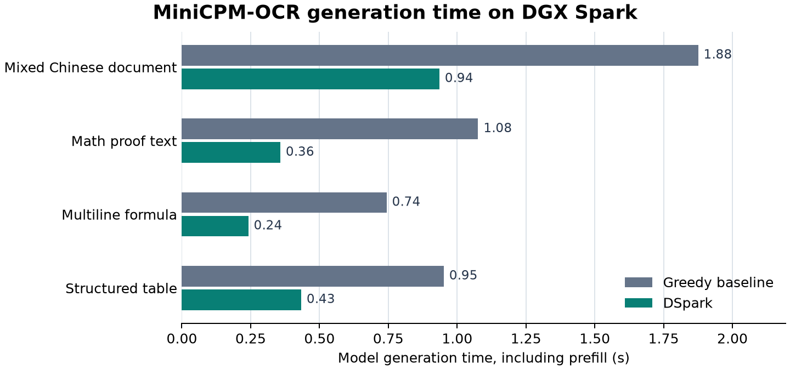

# XiaokeAILabs: AI Engineering Experiments

[中文](README.md) | [Engineering guides and experiment series](docs/en/README.md) | [Website source](index.html)

Does fine-tuning a retrieval model actually improve search? How large a model can run on one machine, and what happens when several people send requests? How much time can an inference optimization save, and does that result depend on the hardware?

XiaokeAILabs explores these questions through open engineering experiments spanning **model training and fine-tuning, inference deployment and performance, retrieval and reranking, document understanding, and multimodal systems**. Alongside experiment code and measurements, the repository contains tutorials and cost models that explain the underlying mechanisms. Use them to design experiments, understand trade-offs, and investigate the results on your own data and hardware.

The project is open source and will continue to grow. Datasets, devices, and evaluation methods differ between experiments; read each report in its own context.

**Explore the work:** retrieval and ranking · data structures and storage · inference and deployment · document understanding · visual and multimodal systems. The [experiment map](docs/en/README.md) links each area to its guides, code, and reproduction materials.

## Start with a question

| What you want to do | Where to start |
|---|---|
| Fit a model on one machine, and compare engines and slot counts | [2-bit single GPU](experiments/moe-2bit-fit/README.en.md) · [Engines and slots](experiments/engine-slot-concurrency/README.en.md) · [NInfer serving](experiments/ninfer-serving/README.en.md) · [Strata](experiments/strata-arm64/README.en.md) |
| See how speculative-decoding settings change throughput on three prompts | [LLM inference performance](experiments/llm-inference-perf/README.en.md) |
| Explore whether two computers can run a model together | [Two-computer inference and communication](experiments/pipeline-parallel/README.en.md) |
| Run a multimodal embedding on an Intel NPU and compare it with CPU | [Jina CLIP OpenVINO](experiments/jina-clip-openvino/README.en.md) |
| Estimate memory and bandwidth requirements and understand throughput | [Inference cost models](experiments/inference-cost-models/README.en.md) · [LLM mechanics](experiments/llm-mechanics/README.en.md) |
| Retrieve candidates with embeddings and select more relevant results with a reranker | [Embedding fine-tuning](experiments/embedding-finetuning/README.en.md) · [ColBERT fine-tuning](experiments/colbert-finetuning/README.en.md) |
| Compare vector database retrieval, indexing, and storage costs | [Vector database benchmark](experiments/vector-db-benchmark/README.en.md) |
| Explore image model fine-tuning or document recognition | [SDXL LoRA](experiments/image-finetune/README.en.md) · [MiniCPM-OCR](experiments/minicpm-ocr/README.en.md) |
| Full-lifecycle LLM engineering from scratch: tokenization, pretraining, SFT, to GRPO alignment | [LLM full-lifecycle](experiments/llm-lifecycle-fullchain/README.en.md) |

## What the measurements reveal

**Fine-tuning does not guarantee an improvement.** In the [SciFact reranking experiment](experiments/reranker-finetuning/README.en.md), a small reranker was trained on 390 queries and evaluated on 300 queries with a fixed set of BM25 candidates. BM25 achieved nDCG@10 of 0.6617 and the fine-tuned model 0.6375; the 95% confidence interval for the difference crosses zero. Under these conditions, we cannot claim that fine-tuning improved results. The report describes training, evaluation, and limitations to help readers assess small-data fine-tuning.

**Inference acceleration needs both speed and output checks.** The [MiniCPM-OCR experiment](experiments/minicpm-ocr/README.en.md) compared ordinary generation with DSpark speculative generation on GB10. Total model generation time across four samples was 2.36 times faster, with all 343 greedily generated tokens matching. Timing includes the initial input forward pass and subsequent generation, but excludes image loading and preprocessing. Four samples do not represent every document.

**Hardware and deployment settings change the result.** In the [Jina CLIP experiment](experiments/jina-clip-openvino/README.en.md), Intel NPU throughput reached 12.57 times CPU throughput on a particular text workload, while an older driver produced NaN outputs. Both the performance result and the failure depend on the tested device, driver, and inputs. The [vector database benchmark](experiments/vector-db-benchmark/README.en.md) historically compared six databases using 11,293 documents and 40 queries from 20 Newsgroups on Windows 11 x86-64; the original result files are missing, so the figures cannot be independently verified. It was not run on DGX Spark.

## Experiment index

Experiment reports provide measurements and their limits. Tutorials and calculators explain methods and should not be treated as performance benchmarks.

| Area | Experiments and contents |
|---|---|
| Single-machine deployment, engines, and concurrency | [2-bit single GPU](experiments/moe-2bit-fit/README.en.md): whether a 299B 2-bit checkpoint runs on one GB10; [Engines and slots](experiments/engine-slot-concurrency/README.en.md): two 35B engines, and 1 slot versus 8; [NInfer serving](experiments/ninfer-serving/README.en.md): portability and concurrency for the 27B package; [Strata](experiments/strata-arm64/README.en.md): this ARM64 port beside llama.cpp |
| Speculative-decoding settings | [LLM inference performance](experiments/llm-inference-perf/README.en.md): three models, three prompts, draft settings |
| Two-computer inference | [Two-computer inference and communication](experiments/pipeline-parallel/README.en.md): Gloo/NCCL communication and small-model split generation checks passed; the cause of the older weight-copy hash mismatch remains undetermined |
| On-device inference | [Jina CLIP OpenVINO](experiments/jina-clip-openvino/README.en.md): correctness, drivers, and this text workload's throughput on Intel CPU and NPU |
| Inference mechanisms | [LLM mechanics](experiments/llm-mechanics/README.en.md): quantization, sampling, and KV cache examples; [Tokenizer mechanics](experiments/tokenizer-mechanics/README.en.md): byte-level BPE and token counts; [Inference cost models](experiments/inference-cost-models/README.en.md): memory examples and unvalidated performance estimates |
| Data structures | [Data structure costs](experiments/data-structure-costs/README.en.md): index and data-format cost models and verification scripts |
| Embeddings and reranking | [Text embedding fine-tuning](experiments/embedding-finetuning/README.en.md): train on queries and relevant documents; [Reranker fine-tuning](experiments/reranker-finetuning/README.en.md): on this SciFact run the nDCG difference crosses zero; [ColBERT fine-tuning](experiments/colbert-finetuning/README.en.md); guide: [ColBERT series](docs/en/colbert/README.md) |
| Retrieval and storage | [Vector database benchmark](experiments/vector-db-benchmark/README.en.md)：indexes, recall, latency, storage, and hybrid retrieval |
| Retrieval model distillation | [Embedding distillation](experiments/embedding-distillation/README.en.md): improvement on fixed candidates missed the predefined target; [Reranker distillation](experiments/reranker-distillation/README.en.md): advantage over supervised training is uncertain; [ColBERT distillation](experiments/colbert-distillation/README.en.md): target not met and the published real-teacher scoring script has not been rerun for verification; [Multimodal embedding distillation](experiments/multimodal-embedding-distillation/README.en.md): no improvement over supervision on 100 queries, and public scripts have not been rerun end to end |
| Sparse and visual retrieval | [SPLADE fine-tuning](experiments/sparse-retrieval/README.en.md); [Multimodal reranking](experiments/multimodal-reranking/README.en.md); [Page multivector retrieval](experiments/visual-multivector-retrieval/README.en.md): Recall@1 is 0.55 on 100 pages; [Multimodal embeddings](experiments/multimodal-embedding/README.en.md) |
| Visual fine-tuning | [SDXL face identity LoRA](experiments/image-finetune/README.en.md): small-data training and comparison for one identity; [Portrait matting](experiments/portrait-matting/README.en.md): region, hair boundary, and forward time on 30 photos |
| Speech recognition | [Whisper ASR fine-tuning](experiments/asr-finetuning/README.en.md): train on LibriSpeech and compare test word error rates |
| Real-time multimodal interaction | [Full-duplex audio/video](experiments/full-duplex-multimodal/README.en.md): MiniCPM-o 4.5 verified with recorded audio/video streaming and concurrent speech output on GB10; one interruption probe received listen events but missed the pre-set stop threshold; live microphone/speaker use and human interruption remain unverified |
| Preference alignment | [DPO preference optimization](experiments/dpo-preference-alignment/README.en.md): Qwen3-0.6B fine-tuned on UltraFeedback pairs on GPU; preference direction did not change on this 128-pair test |
| Document understanding | [Guide](docs/zh/document-understanding/README.md); [Rule parsers](experiments/pdf-rule-parsers/README.en.md); [Text detection and recognition](experiments/paddle-ocr-detection-recognition/README.en.md); [Table structure](experiments/table-structure-recognition/README.en.md); [MiniCPM-OCR](experiments/minicpm-ocr/README.en.md): aarch64 deployment, quality checks, and generation speed |
| Discriminative decision | [Decision model benchmarks](experiments/decision-model-benchmark/README.en.md) and [Fine-tuning](experiments/decision-model-finetuning/README.en.md)：measurements of Laya, Nimble, metask-jev, and Jev-Omni with RLCD soft-label calibration |
| Model training | [LLM full-lifecycle](experiments/llm-lifecycle-fullchain/README.en.md): BPE, Muon pretraining, midtraining, SFT, GRPO and generation |

## How to use this repository

Open an experiment that fits your question and read its documentation for the problem, data, device, metrics, and results before following its instructions. Experiments use different software environments and model weights; some require a particular GPU, NPU, or dataset, so there is no single installation command for all of them. Performance results apply to the conditions in their reports; measure again on your own workload before using them in production.

The code is available under the [Apache License 2.0](LICENSE). Issues and pull requests are welcome; see the [contributing guide](CONTRIBUTING.en.md).

Author: Li Xiuqi (Xiaoke) · WeChat public account: 筱可AI · Email: lixiuqixiaoke@qq.com
