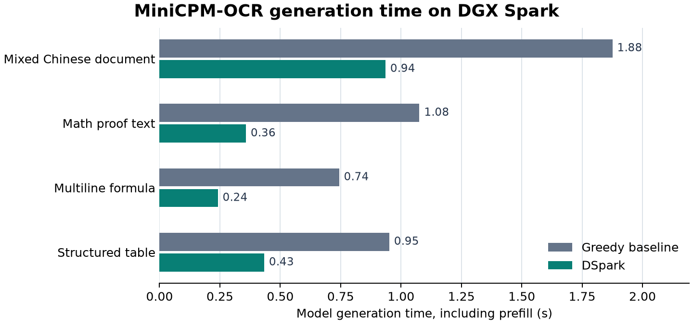

# XiaokeAILabs：AI 工程实验

[English](README.en.md) | [工程原理与实验系列](docs/zh/README.md) | [网站源码](index.html)

训练一个检索模型到底有没有改善搜索？单台设备能部署多大的模型，处理多人请求时又会怎样？一项推理优化能节省多少时间，其结果是否依赖特定硬件？

XiaokeAILabs 围绕这些工程问题开展开放实验，覆盖**模型训练与微调、推理部署与性能、检索与重排序、文档解析和多模态**。这里既有实验代码和实测结果，也有帮助理解原理的教程与成本模型。希望它能帮助你选择实验方案、理解关键取舍，并在自己的数据和硬件上继续验证。

项目开源并会持续更新。每项工作使用的数据、设备和评测方式各不相同，请结合对应报告理解结论。

**实验全景：**检索与排序 · 推理与部署 · 文档理解与信息抽取 · 视觉与多模态 · 数据结构与存储成本 · 模型训练。查看[实验地图](docs/zh/README.md)，了解各方向及其讲解、代码与复现入口。

## 从你的问题出发

| 你想解决的问题 | 可以从这里开始 |
|---|---|
| 单机上模型能不能装下、两套引擎和槽位差多少 | [2-bit 单卡](experiments/moe-2bit-fit) · [引擎与槽位](experiments/engine-slot-concurrency) · [NInfer 服务](experiments/ninfer-serving) · [Strata](experiments/strata-arm64) |
| 投机解码换草稿配置之后，三个提示词的吞吐差多少 | [LLM 推理性能](experiments/llm-inference-perf) |
| 两台电脑能否协同运行大模型 | [两台电脑一起运行大模型：跨机通信探索](experiments/pipeline-parallel) |
| Intel NPU 上的图文嵌入能不能正确跑、吞吐差多少 | [Jina CLIP OpenVINO](experiments/jina-clip-openvino) |
| 估算模型推理需要的内存与带宽，理解吞吐变化的原因 | [推理成本模型](experiments/inference-cost-models) · [LLM 机制](experiments/llm-mechanics) |
| 用嵌入模型找候选，再用重排序模型挑出更相关的结果 | [嵌入与重排序](experiments/reranker-finetuning) · [ColBERT 微调](experiments/colbert-finetuning) |
| 比较向量数据库的检索、索引和存储开销 | [六种向量检索方案：索引、召回与存储对比](experiments/vector-db-benchmark) |
| 探索图像模型微调或文档识别 | [SDXL LoRA](experiments/image-finetune) · [MiniCPM-OCR](experiments/minicpm-ocr) |
| 从零走通语言模型的训练全链路：分词、预训练、指令微调到强化学习 | [LLM 全链路](experiments/llm-lifecycle-fullchain) |

## 从实测中能看到什么

**微调不是效果提升的保证。** 在 [SciFact 重排序实验](experiments/reranker-finetuning)中，我们用 390 条查询训练小型重排序模型，并在固定 BM25 候选集的 300 条查询上评估。BM25 的 nDCG@10 为 0.6617，微调模型为 0.6375；差异的 95% 置信区间跨过零。这个结果说明，在这组数据与评估条件下，不能声称微调带来了改善。报告提供训练、评测与局限，帮助理解小样本微调应如何验证。

**推理加速需要同时看速度与输出。** [MiniCPM-OCR 实验](experiments/minicpm-ocr)在 GB10 上比较普通生成和 DSpark 投机生成。四个样本的模型生成总耗时加速 2.36 倍，贪婪生成的 343 个 token 一致。计时包含输入的首次前向和后续生成，不包含图像读取与预处理；四个样本不足以代表所有文档。

**硬件和部署配置会改变结论。** [Jina CLIP 实验](experiments/jina-clip-openvino)中，特定文本工作负载的 Intel NPU 吞吐达到 CPU 的 12.57 倍，旧驱动却出现 NaN。性能数字和故障都与测试设备、驱动及输入有关。[六种向量检索方案：索引、召回与存储对比](experiments/vector-db-benchmark)则在 Windows 11 x86-64 环境下，历史记录使用 20 Newsgroups 的 11,293 篇文档和 40 条查询比较六种方案；原始结果文件缺失，数字无法独立复核，它也不是 DGX Spark 上的测试。

## 实验索引

实验报告提供具体测量与边界；教程和计算模型用于解释方法，不应当作性能基准。

| 方向 | 实验与内容 |
|---|---|
| 单机部署、引擎与并发 | [2-bit 单卡](experiments/moe-2bit-fit)：299B 2-bit 能否在一台 GB10 上跑通；[引擎与槽位](experiments/engine-slot-concurrency)：35B 的两套引擎，以及 1 槽和 8 槽；[NInfer 服务](experiments/ninfer-serving)：27B 模型包的移植与并发；[Strata](experiments/strata-arm64)：ARM64 移植和 llama.cpp 的这次对照 |
| 投机解码配置 | [LLM 推理性能](experiments/llm-inference-perf)：三个模型、三个提示词的草稿配置对照 |
| 双机推理探索 | [两台电脑一起运行大模型：跨机通信探索](experiments/pipeline-parallel)：Gloo/NCCL 通信与小模型分层生成检查均通过；旧权重副本哈希差异的具体来源仍未查明 |
| 端侧推理 | [Jina CLIP OpenVINO](experiments/jina-clip-openvino)：Intel CPU 与 NPU 上图文嵌入的正确性、驱动，以及这次文本负载的吞吐 |
| 推理原理 | [LLM 机制](experiments/llm-mechanics)：量化、采样、KV Cache 示例；[Tokenizer 原理](experiments/tokenizer-mechanics)：字节级 BPE 与 token 计数；[推理成本模型](experiments/inference-cost-models)：内存算例与未验证的性能估算 |
| 嵌入与重排序 | [文本嵌入微调](experiments/embedding-finetuning)：用查询和相关文档训练；[重排序微调](experiments/reranker-finetuning)：SciFact 上这次微调的 nDCG 差异跨过零；[ColBERT 微调](experiments/colbert-finetuning)；原理见 [ColBERT 系列](docs/zh/retrieval/colbert/) |
| 对比学习训练 | [SimCSE 对比学习](experiments/contrastive-learning-simcse)：dropout 正例与 NLI 难负例两版训练脚本、STS 与 Recall@k 评测；干净 CUDA 环境的真实数据小样本流程已跑通，完整训练尚未复现 |
| 检索与存储 | [六种向量检索方案：索引、召回与存储对比](experiments/vector-db-benchmark)：索引、召回、延迟、存储与混合检索 |
| 检索模型蒸馏 | [Embedding 蒸馏](experiments/embedding-distillation)：固定候选上的提升未达到预设目标；[重排序蒸馏](experiments/reranker-distillation)：相对监督训练的优势不确定；[ColBERT 蒸馏](experiments/colbert-distillation)：未达到预设目标，公开的真实教师打分脚本尚未重跑验证；[图文 Embedding 蒸馏](experiments/multimodal-embedding-distillation)：100 条查询未优于监督组，公开脚本尚未从头重跑 |
| 稀疏与图文检索 | [SPLADE 微调](experiments/sparse-retrieval)；[图文重排](experiments/multimodal-reranking)；[页面多向量检索](experiments/visual-multivector-retrieval)：100 页上 Recall@1 为 0.55；[图文嵌入](experiments/multimodal-embedding) |
| 视觉微调 | [SDXL 人脸身份 LoRA](experiments/image-finetune)：单一身份的小样本训练与对照；[人物抠像](experiments/portrait-matting)：30 张照片的区域、发丝和前向耗时 |
| 语音识别 | [Whisper 语音识别微调](experiments/asr-finetuning)：使用 LibriSpeech 训练并比较测试集词错误率 |
| 实时多模态交互 | [全双工实时多模态交互](experiments/full-duplex-multimodal)：MiniCPM-o 4.5 在 GB10 上完成录制音视频推流和并发语音输出验证；单次插话探针收到倾听事件，但最后语音输出晚于预设停止门槛，未通过；真人麦克风/扬声器与真人插话仍未验证 |
| 偏好对齐 | [DPO 直接偏好优化](experiments/dpo-preference-alignment)：Qwen3-0.6B 在 UltraFeedback 回答对上完成 GPU 微调；本次 128 对测试的偏好方向未改变 |
| 文档解析 | [系列导航](docs/zh/document-understanding/README.md)；[规则解析](experiments/pdf-rule-parsers)；[文字检测与识别](experiments/paddle-ocr-detection-recognition)；[表格结构](experiments/table-structure-recognition)；[MiniCPM-OCR](experiments/minicpm-ocr)：aarch64 部署、质检与生成加速 |
| 判别式决策 | [基准评测](experiments/decision-model-benchmark) 与 [微调训练](experiments/decision-model-finetuning)：Laya、Nimble、metask-jev、Jev-Omni 实测与 RLCD/软标签微调 |
| 模型训练 | [LLM 全链路](experiments/llm-lifecycle-fullchain)：BPE 分词、Muon 预训练（附 AdamW 基线）、midtrain、SFT、GRPO 与 KV cache 生成 |

## 如何使用

进入感兴趣的实验目录，先阅读其中的说明，了解问题、数据、设备、指标与结果，再按该实验提供的步骤运行。不同实验使用不同的软件环境和模型权重；部分需要特定 GPU、NPU 或数据集，不存在适用于所有目录的统一安装命令。性能结果适用于报告列出的条件，迁移到自己的业务前应重新测量。

代码采用 [Apache License 2.0](LICENSE)。欢迎通过 Issue 或 Pull Request 参与，具体方式见[贡献指南](CONTRIBUTING.md)。

作者：李秀奇（筱可） · 公众号：筱可AI · 邮箱：lixiuqixiaoke@qq.com
