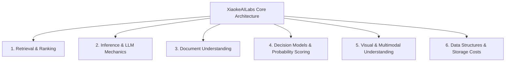

# Engineering Guides and Experiment Series

> **Reading Guide**: [中文版本](../zh/README.md) · [Project Index](../../README.md)

These guides organize empirical engineering experiments, physical cost models, and architectural derivations across modern AI systems. Each guide is anchored on four fundamental pillars: why to read, what you gain, why the experiment is necessary, and how it is implemented. Source code, configuration manifests, and raw measurement logs reside in the corresponding experiment directories.

---

## The Six Core Engineering Pillars

The knowledge architecture of XiaokeAILabs is structured into six foundational pillars:

| Area | Starting Question | English Guide | Chinese Master Guide |
|---|---|---|---|
| **Retrieval and Ranking** | How do we retrieve candidates and rank relevant results under latency constraints? | [Retrieval and Ranking](retrieval/README.md) | [检索与重排序](../zh/retrieval/README.md) |
| **Inference and LLM Mechanics** | How do models generate tokens, and how do we measure latency, KV memory, and cost? | [Inference and Deployment](inference/README.md) | [推理与大模型机理](../zh/inference/README.md) |
| **Document Understanding** | How do we accurately parse heterogeneous PDFs, OCR text, and recover tables? | [Document Understanding](document-understanding/README.md) | [文档理解与信息提取](../zh/document-understanding/README.md) |
| **Decision Models & Scoring** | How do we score discrete options under strict latency and certainty budgets? | [Decision Models](decision-models/README.md) | [决策模型与打分机制](../zh/decision-models/README.md) |
| **Visual & Multimodal** | How do we locate interface elements, separate portraits, or adapt diffusion LoRAs? | [Visual and Multimodal](multimodal/README.md) | [视觉与多模态理解](../zh/multimodal/README.md) |

---

## Detailed Experiment Index

### 1. Retrieval and Ranking

The [ColBERT Guide](colbert/README.md) details shared late-interaction mechanics; visual ColSmol and text ColBERT are distinct architectures.

| Experiment | Theoretical Guide | Code and Reproduction |
|---|---|---|
| Embedding research & benchmarks | [Read](../zh/retrieval/embedding/README.md) | [Experiment](../../experiments/embedding-finetuning/README.en.md) |
| SimCSE contrastive learning (Chinese only for now) | [Read](../zh/retrieval/embedding/SimCSE对比学习.md) | [Experiment](../../experiments/contrastive-learning-simcse/README.en.md) |
| Embedding distillation | [Read](../zh/retrieval/embedding/Embedding蒸馏.md) | [Experiment](../../experiments/embedding-distillation/README.en.md) |
| Reranker distillation | [Read](../zh/retrieval/reranking/重排序蒸馏.md) | [Experiment](../../experiments/reranker-distillation/README.en.md) |
| ColBERT supervised fine-tuning | [Read](../zh/retrieval/colbert/文本多向量检索模型微调.md) | [Experiment](../../experiments/colbert-finetuning/README.en.md) |
| ColBERT distillation | [Read](colbert/colbert-distillation.md) | [Experiment](../../experiments/colbert-distillation/README.en.md) |
| Visual multi-vector retrieval | [Read](colbert/visual-multivector-retrieval.md) | [Experiment](../../experiments/visual-multivector-retrieval/README.en.md) |
| Multimodal reranking | [Read](../zh/retrieval/reranking/多模态重排序.md) | [Experiment](../../experiments/multimodal-reranking/README.en.md) |
| Multimodal embedding distillation | [Read](retrieval/embedding/multimodal-embedding-distillation.md) | [Experiment](../../experiments/multimodal-embedding-distillation/README.en.md) |
| Six vector search solutions: index, recall and storage comparison | [Read](../zh/retrieval/vector-search/README.md) | [Experiment](../../experiments/vector-db-benchmark/README.en.md) |

### 2. Inference and LLM Mechanics

| Experiment | Theoretical Guide | Code and Reproduction |
|---|---|---|
| LLM full-lifecycle training from scratch | [Read](../zh/inference/大语言模型从零构建与训练全链路.md) | [Experiment](../../experiments/llm-lifecycle-fullchain/README.en.md) |
| Instruction tuning & LoRA mechanics | [Read](../zh/inference/大语言模型指令微调与LoRA.md) | [Experiment](../../experiments/llm-lifecycle-fullchain/README.en.md) |
| Direct preference optimization | [Read](alignment/direct-preference-optimization.md) | [Experiment](../../experiments/dpo-preference-alignment/README.en.md) |
| Tokenizer mechanics and generation costs | [Read](../zh/inference/分词机制与生成成本.md) | [Experiment](../../experiments/tokenizer-mechanics/README.en.md) |
| LLM generation mechanics and KV cache | [Read](../zh/inference/语言模型生成机制与KV缓存.md) | [Experiment](../../experiments/llm-mechanics/README.en.md) |
| Extreme inference and concurrency on GB10 | [Read](../zh/inference/DGX-Spark大模型推理与并发.md) | [2-bit](../../experiments/moe-2bit-fit/README.en.md) · [Engines and slots](../../experiments/engine-slot-concurrency/README.en.md) · [NInfer](../../experiments/ninfer-serving/README.en.md) · [Strata](../../experiments/strata-arm64/README.en.md) |
| Speculative decoding benchmarks | [Read](../zh/inference/从自回归到投机解码.md) · [Conditions](../zh/inference/投机解码收益与实测条件.md) | [Experiment](../../experiments/llm-inference-perf/README.en.md) |
| Inference memory budgets & cost models | [Read](../zh/inference/推理内存预算与成本估算.md) | [Experiment](../../experiments/inference-cost-models/README.en.md) |
| Jina CLIP and Intel NPU multimodal inference | [Read](../zh/inference/OpenVINO与NPU多模态推理.md) | [Experiment](../../experiments/jina-clip-openvino/README.en.md) |

### 3. Document Understanding and Information Extraction

| Experiment | Theoretical Guide | Code and Reproduction |
|---|---|---|
| PDF rule & vector parser benchmark | [Read](../zh/document-understanding/PDF规则解析与矢量提取.md) | [Experiment](../../experiments/pdf-rule-parsers/README.en.md) |
| PaddleOCR detection and recognition | [Read](../zh/document-understanding/PaddleOCR文字检测与识别.md) | [Experiment](../../experiments/paddle-ocr-detection-recognition/README.en.md) |
| Table structure recognition (SLANet+) | [Read](../zh/document-understanding/SLANet表格结构识别.md) | [Experiment](../../experiments/table-structure-recognition/README.en.md) |
| Table assembly: Modular vs End-to-End | [Read](../zh/document-understanding/表格还原：模块化拼接与端到端多模态.md) | [Experiment](../../experiments/table-structure-recognition/README.en.md) |
| MiniCPM document QA & audit | [Read](../zh/document-understanding/MiniCPM文档解析与质检.md) | [Experiment](../../experiments/minicpm-ocr/README.en.md) |

### 4. Decision Models and Probability Scoring

| Experiment | Theoretical Guide | Code and Reproduction |
|---|---|---|
| Decision scoring principles and heads | [Read](../zh/decision-models/决策模型原理与打分机制.md) | [Experiment](../../experiments/decision-model-benchmark/baseline-llm/README.en.md) |
| Architecture benchmark & selection | [Read](../zh/decision-models/决策模型架构评测与选型.md) | [Experiment](../../experiments/decision-model-benchmark/README.en.md) |
| Soft-label tuning & calibration (RLCD) | [Read](../zh/decision-models/决策模型微调与概率校准.md) | [Experiment](../../experiments/decision-model-finetuning/rlcd-policy/README.en.md) |
| Omnimodal decision models | [Read](../zh/decision-models/多模态决策模型.md) | [Experiment](../../experiments/decision-model-benchmark/omni-multimodal/README.en.md) |

### 5. Visual and Multimodal Understanding

| Experiment | Theoretical Guide | Code and Reproduction |
|---|---|---|
| Portrait matting quality & speed | [Read](../zh/multimodal/人物抠像质量与推理速度.md) | [Experiment](../../experiments/portrait-matting/README.en.md) |
| Face identity LoRA quantitative evaluation | [Read](../zh/multimodal/人脸身份LoRA微调与量化评估.md) | [Experiment](../../experiments/image-finetune/README.en.md) |
| Speech recognition fine-tuning | No separate guide yet | [Whisper ASR fine-tuning](../../experiments/asr-finetuning/README.en.md): small-sample GPU fine-tuning completed on GB10; no WER change was observed |
| Full-duplex realtime multimodal interaction | No separate guide yet | [MiniCPM-o 4.5 full-duplex realtime multimodal interaction](../../experiments/full-duplex-multimodal/README.en.md): realtime video and audio-only duplex links verified; empty-venv dependency, CUDA, and decode checks passed, but the Demo stack was not run end to end in that venv; live interaction remains unverified |

### 6. Data Structures and Storage Costs

| Experiment | Theoretical Guide | Code and Reproduction |
|---|---|---|

---

Each experiment defines its own physical evidence, statistical methodology, and failure boundaries. Always distinguish theoretical derivations from empirical measurements.
