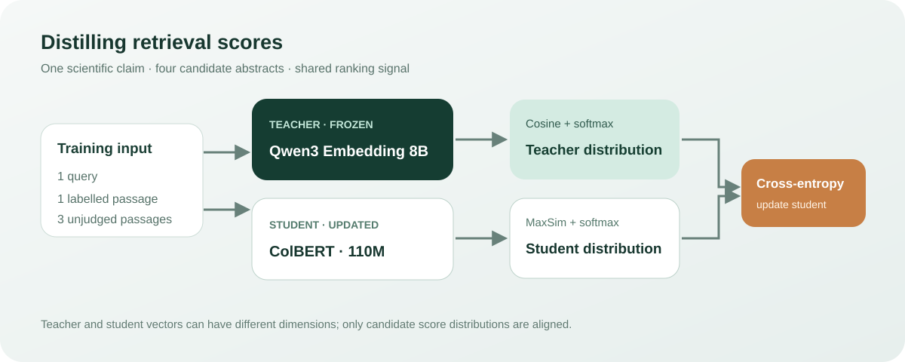

# Can teacher scores improve a ColBERT reranker?

> **Reading guide**: [Experiment code and reproduction](../../../experiments/colbert-distillation/README.en.md)

Search systems often retrieve a shortlist of documents first and then reorder it. A single-vector model represents each query and document with one vector; ColBERT keeps a vector for each token and compares the most relevant token pairs. The extra detail can help distinguish a relevant passage from a passage that shares the same general topic, at the cost of storing and comparing more vectors.

This experiment asks whether a ColBERT model can learn a useful ranking signal from an 8B-parameter embedding model, rather than relying only on a positive document label. A teacher's scores can express relative preferences across several candidates, including candidates with no human relevance judgment. Such soft supervision is a common research approach when labels are scarce; it is not ground truth and may transfer the teacher's mistakes. For background, see the [dense retrieval survey](https://doi.org/10.1145/3637870), the [ColBERT paper](https://arxiv.org/abs/2004.12832), and [ColBERTv2](https://aclanthology.org/2022.naacl-main.272/).

On this SciFact test with fixed BM25 candidates, distillation improved nDCG@10 from **0.6536 to 0.6653**, but the label-supervised model scored **0.6686**. The run did not meet its prespecified target: an increase of at least 0.02 over the original model without falling below the supervised control. It does not establish that distillation beats supervised training or that the student is faster in deployment.



## How distillation relates to supervised fine-tuning

Distillation is commonly a form of supervised training: a student produces outputs and is optimized against a target. The distinguishing feature is that the target includes a teacher model’s signal. If a teacher supplies only one hard label, student training can closely resemble ordinary label-based fine-tuning, with the label source as the main difference. Soft scores, output distributions or intermediate representations can provide different information, depending on the objective.

Here, a single-vector embedding teacher scores the same candidates as a multi-vector ColBERT student. The student learns the teacher’s distribution over those candidates; it does not copy the teacher’s embeddings. The controlled question is whether this cross-architecture signal improves the student and adds value over the available relevance labels. The teacher does not score candidates when the trained student is deployed.

## Distillation and the supervised control

Both trained models start from the same ColBERT checkpoint and use the same training queries and budget. They differ in the signal used to rank each query's four candidate documents.

Suppose the first paper is labeled relevant and the other three are unjudged. These texts and teacher scores are illustrative, not records from the experiment:

| Candidate | Existing label | Example teacher score |
| --- | --- | ---: |
| A | Relevant | 0.80 |
| B | Unjudged | 0.70 |
| C | Unjudged | 0.45 |
| D | Unjudged | 0.30 |

The **supervised control** uses the existing label and encourages the student to place A above the other candidates. Its target logits are `[50, 0, 0, 0]`, which place almost all softmax weight on A. They do not express different preferences among B, C and D. The unjudged candidates act as negatives during training, but lack of a label does not prove irrelevance.

**Distillation** asks the teacher to score the same candidates, then trains the student to follow the relative preferences in those scores. In this example, the student can learn not only to rank A highly, but also that the teacher prefers B to C and D. These are model predictions rather than human judgments, and the teacher can rank candidates incorrectly.

The supervised control tests whether teacher scores add useful information beyond the available labels. Comparing only the original student and the distilled student would show whether the model changed, but would not show whether training on labels alone could improve it as much or more. In this run, distillation scored above the original model and slightly below the supervised control. The difference is small and only one training seed was used, so the result does not establish which method is generally better.

## How the models compare documents

ColBERT keeps multiple query and document token vectors, matches each query token to its most similar document token, and combines those scores. This preserves finer-grained matches while requiring more vectors to be stored and processed. For the retrieval path, MaxSim and the trade-offs against single-vector models, see the [ColBERT and multi-vector retrieval guide](colbert-and-multivector-retrieval.md).

This experiment evaluates ColBERT as a reranker of a fixed shortlist; it does not measure full-corpus late-interaction indexing or retrieval. The implementation uses PyLate's masking for document padding and punctuation and keeps query expansion tokens.

The teacher, [Qwen3-Embedding-8B](https://huggingface.co/Qwen/Qwen3-Embedding-8B), instead assigns one cosine similarity score to each query–candidate pair. For a query and its four training candidates, we divide those scores by temperature $T=0.05$ and apply softmax. The student's MaxSim scores are converted to a distribution over the same four candidates. The student is trained to minimize the divergence between the two distributions:

$$
p_T(i\mid q)=\frac{\exp(s_T(q,d_i)/T)}{\sum_j\exp(s_T(q,d_j)/T)},\qquad
p_S(i\mid q)=\frac{\exp(s_S(q,d_i))}{\sum_j\exp(s_S(q,d_j))},
$$

$$
\mathcal{L}=D_{\mathrm{KL}}(p_T\Vert p_S)=\sum_i p_T(i\mid q)\log\frac{p_T(i\mid q)}{p_S(i\mid q)}.
$$

This transfers **candidate ranking preferences**, not the teacher's embedding vectors or internal activations. Consequently, the teacher and student can use different representation dimensions and architectures. The supervised control uses the same student, training examples and budget, but replaces teacher scores with `[50, 0, 0, 0]` before softmax, giving the labeled first candidate an almost one-hot target.

## Data: where the examples come from

The source is [SciFact](https://github.com/allenai/scifact), a scientific claim verification dataset pairing claims with research abstracts and evidence annotations. We use the [BEIR-formatted SciFact corpus and query/qrels files](https://public.ukp.informatik.tu-darmstadt.de/thakur/BEIR/datasets/scifact.zip), together with SciFact's original training claims to check evidence annotations. The BEIR inputs contain 5,183 documents, 809 labeled training queries and 300 test queries. Source-file hashes are recorded in [source-hashes.json](../../../experiments/colbert-distillation/configs/source-hashes.json); obtain and use each dataset under its own license.

The data pipeline for this run is:

1. [prepare_pools.py](../../../experiments/colbert-distillation/scripts/prepare_pools.py) builds BM25 candidate pools, uses original evidence annotations to filter training positives, and removes training queries that meet the configured near-duplicate criterion against the held-out sets. The deterministic configuration is in [pool_config.json](../../../experiments/colbert-distillation/configs/pool_config.json).
2. [prepare_teacher.py](../../../experiments/colbert-distillation/scripts/prepare_teacher.py) samples **128 training queries** using seed `20261107`. Each has one labeled positive followed by three BM25-retrieved unjudged candidates. Unjudged means no relevance label is available; it does not prove the document is irrelevant.
3. The teacher scores the same four candidates. For testing, all four models reorder the same **30 BM25 candidates for each of 300 held-out queries**. The document corpus is shared between training and test; query separation does not imply document separation.

For a single illustrative training row, the input is a claim plus four abstract candidates. Its supervision is either the four teacher scores or a target that favors the first, labeled candidate; the trained ColBERT returns a score for each candidate at inference. The exact source text and IDs are not included in the published metrics file.

For example, the following shows the shape of one model input; the text and scores are illustrative, not an actual experimental record:

```json
{
  "query": "Does a treatment affect a particular risk?",
  "candidates": ["Evidence abstract", "Candidate A", "Candidate B", "Candidate C"],
  "teacher_scores": [0.8, 0.6, 0.5, 0.3]
}
```

The actual `manifest.json` stores query IDs and ordered candidate document IDs; `teacher.json` stores the corresponding scores by query ID, and the text is loaded from SciFact. At inference, the student alone scores and sorts new query–document candidates. Its scores compare candidates for the same query; they are not relevance probabilities.

Thirty-nine of the 300 test queries have no labeled relevant document in their 30-candidate shortlist. Those cases limit what reranking can recover. The reported metrics measure ranking on the fixed shortlist, not the probability of finding relevant documents across the full corpus.

## Results

| Condition | nDCG@10 | MRR@10 |
| --- | ---: | ---: |
| Original ColBERT | 0.6536 | 0.6262 |
| Label-supervised ColBERT | 0.6686 | 0.6452 |
| Teacher-score-distilled ColBERT | 0.6653 | 0.6421 |
| 8B teacher | 0.7341 | 0.7044 |

nDCG@10 rewards placing relevant abstracts near the top, while MRR@10 measures the reciprocal rank of the first labeled relevant result. Distillation changed nDCG@10 by **+0.0117** against the original model, with a paired query-bootstrap 95% interval of **[0.0012, 0.0222]**. Against supervised training the difference was **−0.0033**, with interval **[−0.0113, 0.0041]**. These intervals resample queries; this experiment has one training seed, so they do not measure training-seed variability. The teacher's stronger score does not ensure that all of its ranking preferences are useful to the student.

The student is [lightonai/colbertv2.0](https://huggingface.co/lightonai/colbertv2.0), approximately 110 million parameters. Both trained conditions use the same initialization and seed, 128 steps, four queries per batch, AdamW at `3e-6`, and maximum query/document lengths of 32/180. The run used a DGX Spark. Distillation training took approximately 26 seconds for this small setup, excluding teacher scoring and testing; that is not end-to-end latency or throughput. No deployment speed or memory advantage over the teacher was established here.

The separate [ColBERT fine-tuning experiment](../../zh/retrieval/colbert/文本多向量检索模型微调.md) uses labels and an in-batch contrastive loss. This experiment compares teacher scores with label supervision on the same training queries. Their sample construction, loss and training settings differ, so their final scores are not a controlled single-variable comparison.

## Evidence and reproducibility limits

Prerequisites, commands and file descriptions are in the [experiment reproduction guide](../../../experiments/colbert-distillation/README.en.md).

The published pool preparation was independently rerun on CPU and produced a `pools.json` hash matching the original run. The new real-model teacher-scoring script has **not** been rerun end to end to reproduce the original scores; a complete exact reproduction is therefore not established. The PyLate 1.4.0 loss source in a related environment matches the formula above, but the exact environment used for the original distillation run remains unconfirmed. `--synthetic-encoder` in the teacher preparation script generates deterministic pseudo-vectors for a CPU interface smoke test only; it is not a model evaluation. The 50 GiB available-memory guard in `run.py` protects the original machine and is not a universal hardware minimum.

[per-query-metrics.csv](../../../experiments/colbert-distillation/evidence/per-query-metrics.csv) contains paired nDCG@10 and MRR@10 values for all four conditions. The experiment guide explains how to recompute the reported averages and bootstrap intervals.

These rows permit recomputation of aggregate statistics, but do not by themselves verify that every metric was derived from the correct ranking and labels. The three student conditions were independently checked against the original test qrels; the teacher's per-query values come from its run record. [summary.json](../../../experiments/colbert-distillation/evidence/summary.json) contains the reported numbers and timing metadata.

The student model card marks its license as MIT and the teacher model card as Apache-2.0; check the linked model cards and the dataset's original terms before reuse.

## References

- Khattab and Zaharia, [ColBERT: Efficient and Effective Passage Search via Contextualized Late Interaction over BERT](https://arxiv.org/abs/2004.12832), 2020.
- Santhanam et al., [ColBERTv2: Effective and Efficient Retrieval via Lightweight Late Interaction](https://aclanthology.org/2022.naacl-main.272/), 2022. Its denoised supervision and compression are related work, not measurements from this experiment.
- [Dense Text Retrieval Based on Pretrained Language Models: A Survey](https://doi.org/10.1145/3637870), 2024.
- The [official ColBERT implementation](https://github.com/stanford-futuredata/ColBERT) documents training, indexing and retrieval as separate steps.

