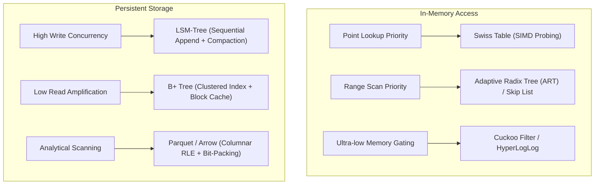

# Data Structures and Storage Costs: From Physical Overhead to Systems Architecture

> **Reading Guide**: [中文版本](../../zh/data-structure-costs/README.md) · [Documentation Index](../README.md) · [Algorithm Implementations & Verification](../../../experiments/data-structure-costs/README.en.md) · [Interactive Performance Calculator](../../../experiments/data-structure-costs/performance_calculator.html)

In AI infrastructure, large-scale search engines, vector database internals, and high-concurrency ingestion pipelines, the majority of throughput bottlenecks and out-of-memory crashes stem from a single root cause: **the mismatch between theoretical algorithmic complexity models and physical hardware layouts**.

Selecting a data structure is fundamentally an algebra of balancing five immutable physical constraints:
- Point lookup latency (CPU cache line transfers);
- Range scan efficiency (sequential memory bandwidth);
- Write amplification (storage wear and I/O bus contention);
- Memory bandwidth consumption (pointer indirection vs vectorized scanning);
- Space amplification (metadata overhead and internal fragmentation).

This series unifies the mathematical derivation, bit-level compression encoding, physical memory layout, and modern hardware characteristics (CPU cache lines, AVX-512 SIMD vectorization, and sequential disk I/O) across 36 classical data structures.

---

## Technical Articles

| Topic | Algorithms & Core Structures | Fundamental Engineering Questions | Key Findings & Physical Bounds |
|---|---|---|---|
| **[Probabilistic Data Structures & Cardinality Estimation](../../zh/data-structure-costs/概率数据结构与基数估计.md)** | Bloom Filter, Cuckoo Filter, Count-Min Sketch, HyperLogLog / HLL++ | How do we perform set membership testing, frequency tracking, and multi-billion unique visitor (UV) counting within constant memory (kilobytes to megabytes)? | Derives optimal Bloom Filter bit-width (1% false positive requires exactly 9.6 bits per item); demonstrates Cuckoo Filter fingerprint eviction and dynamic deletion; proves HyperLogLog harmonic averaging eliminates outlier distortion; explains HLL++ sparse-to-dense representation switching. |
| **[Write-Amplification & Ordered Index Selection](../../zh/data-structure-costs/读写放大与有序索引选型.md)** | B+Tree, LSM-Tree, Skip List, Adaptive Radix Tree (ART) | How do storage engines balance read and write amplification across disk page block caching, high-throughput append logs, and in-memory concurrency? | Quantifies B+Tree in-place update write amplification (10x to 50x); derives LSM-Tree tiered/leveled compaction overhead and Bloom filter pruning salvation; analyzes Skip List probabilistic height and lock-free concurrency; details ART dynamic node adaptation (Node4 to Node256) and SIMD key matching. |
| **[Hash Table Evolution & Memory Conflict Resolution](../../zh/data-structure-costs/哈希表演进与内存冲突解决.md)** | Chaining, Robin Hood, Hopscotch, Swiss Table (SIMD parallel probing), Extendible Hashing | In modern CPU architectures, why is pointer indirection significantly slower than contiguous memory comparison, and how do production hash tables surpass 90% load factors? | Explains pointer indirection and CPU cache miss overhead in linked chaining; derives Robin Hood Probe Sequence Length (PSL) variance reduction; details Swiss Table 16-byte control byte metadata and 128-bit SIMD vectorized filtering; derives local depth splits in disk extendible hashing. |
| **[Columnar Storage & Inverted Index Compression](../../zh/data-structure-costs/列式存储与倒排索引压缩编码.md)** | Varint, Delta Encoding, PFor-Delta, Simple8b, Columnar RLE, Inverted Index & WAND Algorithm | How do massive posting lists and analytical column arrays achieve 1 to 3 bits per integer compression while sustaining multi-gigabyte-per-second decoding throughput? | Explains Varint continuation-bit branch misprediction bottlenecks; derives PFor-Delta 90th percentile outlier patching and SIMD block unpacking; details Simple8b 64-bit branchless table-driven packing; derives Inverted Index skip-pointers and WAND (Weak AND) dynamic query pruning. |
| **[Data Serialization Formats: Size & Speed Benchmark](../../zh/data-structure-costs/数据格式体积与速度实测.md)** | JSON Array, JSON Lines (JSONL), Excel (XLSX), SQLite Database | For identical structured business datasets, how do these four formats differ in disk footprint, serialization throughput, append latency, and index inflation? | Compares recorded file size, read/write time, append cost, and index size. XLSX phase timing is estimated from separate measurements and does not establish the share spent parsing XML. |

---

## Architectural Taxonomy: Five-Dimensional Systems Trade-offs

---

## Interactive Tools and Code Verification

Every analytical model in this series is backed by runnable reproduction code and interactive capacity calculators:

- **[Model Scripts & Verification Suite (experiments/data-structure-costs/)](../../../experiments/data-structure-costs/README.en.md)**:
  - 36 analytical modeling scripts (`scripts/*_model.py`): provide precise theoretical memory, I/O, and CPU cycle predictions for arbitrary data volume and key lengths;
  - 37 algorithmic validation scripts (`scripts/verify_*.py`): verify probabilistic bounds, collision distributions, and compaction ratios against empirical runs;
  - Data format benchmark scripts: `benchmark_json_xlsx.py`, `benchmark_xlsx_sqlite_size.py`, and `benchmark_sqlite_pandas_queries.py`.
- **[Interactive Performance & Cost Calculator](../../../experiments/data-structure-costs/performance_calculator.html)**:
  - Zero-dependency client-side calculator running directly in modern web browsers;
  - Sliders for data volume, false positive tolerances, key-value lengths, and hardware bus bandwidths generate real-time space and latency curves for capacity planning.
