# Decision Models and Probability Scoring: Architecture, Calibration, and Benchmarks

> **Reading Guide**: [中文版本](../../zh/decision-models/README.md) · [Documentation Index](../README.md) · [Decision Benchmark Experiment](../../../experiments/decision-model-benchmark/README.en.md) · [RLCD Policy Finetuning](../../../experiments/decision-model-finetuning/rlcd-policy/README.en.md)

In autonomous agent planning, safety gating, intent routing, and real-time gaming, traditional autoregressive generation faces fundamental latency and reliability bottlenecks. Generating free-form reasoning tokens before extracting a discrete action introduces variable latency (hundreds of milliseconds to seconds) and runs the risk of format drift or hallucinated action IDs.

**Decision models** solve this by reformulating policy selection as single-forward probability scoring across a structured action space. Rather than generating text, the model directly projects hidden states onto discrete action candidates through calibrated decision heads, achieving bounded inference latency (under 10 ms) and mathematically grounded decision confidence.

---

## Technical Articles

| Article | Core Architecture & Topics | Fundamental Engineering Questions | Key Findings & Physical Bounds |
|---|---|---|---|
| **[Decision Scoring Principles and Mechanics](../../zh/decision-models/决策模型原理与打分机制.md)** | Dedicated decision heads, forward-only scoring, memory-bandwidth wall, multi-query packing | Why does autoregressive token decoding hit memory-bandwidth bottlenecks in discrete decision making, and how does forward-only scoring compress latency? | Forward-only scoring eliminates auto-regressive KV cache updates; batching 20 options amortizes compute to 2.83 ms per decision on modern unified memory; Softmax over constrained logits guarantees 100% syntactically valid action probabilities. |
| **[Decision Model Architecture Benchmark & Selection](../../zh/decision-models/决策模型架构评测与选型.md)** | Laya (400M), metask-jev (4B), Nimble (1.5B), Qwen3-VL (2B), unified memory benchmarks | How do lightweight dedicated decision models compare against multi-billion parameter autoregressive models in accuracy, latency, and throughput? | GB10 real-world benchmark demonstrates 4B dedicated decision models match 7B+ LLMs in policy selection accuracy while reducing latency by 85%; serial single-option forward passes in Nimble cause latency to scale linearly with option count ($O(K)$); Laya exhibits overconfidence risk (confidence 0.906 on misclassified edge cases). |
| **[Decision Model Finetuning and Probability Calibration](../../zh/decision-models/决策模型微调与概率校准.md)** | Soft-CE distillation, RLCD policy gradients, Expected Calibration Error (ECE), temperature scaling | Why does hard-label Cross-Entropy cause overconfidence on ambiguous boundary decisions, and how does soft-label calibration fix uncertainty? | Soft-CE distillation with RLCD policy rewards flattens overconfident probability spikes; ECE on 400 test cases with 2,000 queries drops from 0.184 to 0.042; temperature scaling ($T \in [1.2, 1.5]$) provides robust post-hoc probability smoothing. |
| **[Omnimodal Decision Models](../../zh/decision-models/多模态决策模型.md)** | Jev-Omni 4-modality architecture, video frame sampling, audio spectrogram fusion, benchmark leak isolation | How do multimodal fusion architectures maintain bounded latency when conditioning policy choices on synchronous text, vision, and audio streams? | Jev-Omni uses late-interaction cross-attention to score multimodal states in 45 ms; video frame downsampling preserves temporal context while avoiding linear KV memory explosion; audit reveals historical ScienceQA benchmarks suffered from ground-truth leakage in the input state, establishing strict evaluation isolation criteria. |

---

## Architectural Comparison: Autoregressive LLM vs Dedicated Decision Heads

```mermaid
flowchart TD
    subgraph Autoregressive Generation
        A1["Input Context & Options"] --> B1["Prefill Phase (Compute Bound)"]
        B1 --> C1["Sequential Decode Tokens (Bandwidth Bound)"]
        C1 --> D1["JSON / Regex Parser Extraction"]
        D1 --> E1["Action Execution (High Latency: 200~800 ms)"]
    end

    subgraph Dedicated Decision Head
        A2["Input Context & Structured Options"] --> B2["Single Forward Pass (Compute Bound)"]
        B2 --> C2["Constrained Decision Logits"]
        C2 --> D2["Calibrated Softmax Probability Distribution"]
        D2 --> E2["Deterministic Action Dispatch (Ultra-low Latency: 2~10 ms)"]
    end
```

---

## Engineering Selection Framework

| Evaluation Dimension | Autoregressive LLM (e.g. Qwen / Llama) | Constrained Logit Extraction (e.g. Outlines) | Dedicated Decision Model (e.g. metask-jev) |
|---|---|---|---|
| **Latency SLA** | 150 ms to 1,500 ms (depends on output token count) | 80 ms to 300 ms (prefix tree grammar overhead) | 2 ms to 15 ms (single forward pass, fixed cost) |
| **Format Guarantee** | Probabilistic (prone to syntax failures or extra tokens) | Strict (guaranteed by FSM logit masking) | Strict (native candidate logits projection) |
| **Confidence Calibration** | Poor (verbalized confidence correlates poorly with accuracy) | Moderate (token logits reflect token frequencies, not semantic policy) | High (calibrated via Soft-CE and ECE minimization) |
| **Hardware Footprint** | Large (requires 8B+ parameters and large KV cache) | Medium to Large (requires full LLM backbone) | Compact (400M to 4B parameters, zero decode KV cache) |
| **Recommended Deployment** | High-level goal planning and long-horizon reflection | Semi-structured data extraction and database querying | Low-latency policy gating, safety checking, and game loop action selection |
