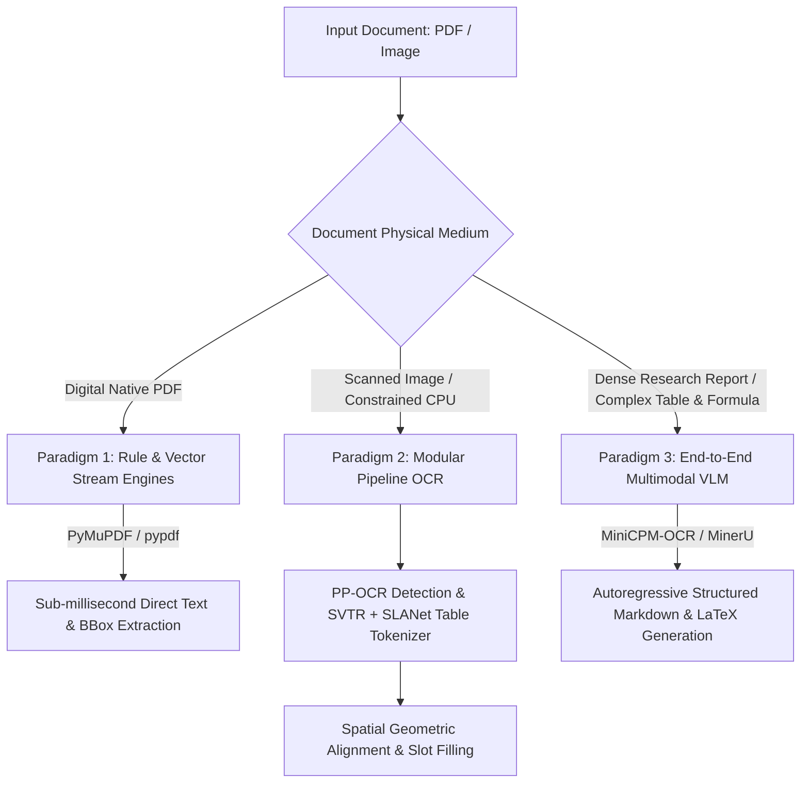

# Document Understanding and Information Extraction: From Rules to End-to-End Multimodal Models

> **Reading Guide**: [中文版本](../../zh/document-understanding/README.md) · [Documentation Index](../README.md) · [PDF Rule Parsers Experiment](../../../experiments/pdf-rule-parsers/README.en.md) · [Table Structure Recognition](../../../experiments/table-structure-recognition/README.en.md)

Scanned documents, financial reports, technical manuals, and contracts contain not just plain text, but also dense visual layouts, multi-column flows, embedded tables, and mathematical formulas. Transforming these heterogeneous artifacts into clean, structured Markdown or JSON at enterprise scale requires balancing accuracy, latency, and operational cost.

In production engineering, document understanding has evolved across **three distinct paradigms**:
1. **Rule and Bytecode Parsing**: Direct inspection of PDF binary operator streams and vector fonts, extracting native text in milliseconds;
2. **Modular Pipeline OCR**: Decomposing pages into layout analysis, text line detection, character recognition, table cell classification, and geometric slot re-assembly;
3. **End-to-End Multimodal Vision-Language Models (VLMs)**: Processing entire page images through visual encoders and causal language backbones, directly outputting styled Markdown and LaTeX.

---

## Technical Articles

| Paradigm | Fundamental Engineering Question | Main Guide | Code & Experiments |
|---|---|---|---|
| **Rule-based Extraction** | How do digital PDFs achieve 3 ms parsing, and why do scanned pages fail silently? | [PDF Rule Parsing & Vector Extraction](../../zh/document-understanding/PDF规则解析与矢量提取.md) | [pdf-rule-parsers](../../../experiments/pdf-rule-parsers/README.en.md) |
| **Modular Pipeline** | How are text lines accurately localized and transcribed from noisy page scans? | [PP-OCRv5 Text Detection & Recognition](../../zh/document-understanding/PaddleOCR文字检测与识别.md) | [paddle-ocr-detection-recognition](../../../experiments/paddle-ocr-detection-recognition/README.en.md) |
| **Modular Pipeline** | How are complex nested table grids and merged cells recovered without cascade errors? | [SLANet+ Table Structure Recognition](../../zh/document-understanding/SLANet表格结构识别.md) | [table-structure-recognition](../../../experiments/table-structure-recognition/README.en.md) |
| **Paradigm Trade-offs** | Modular geometric slot assembly vs end-to-end VLM: where do cascade errors compound? | [Two Paradigms of Table Recovery](../../zh/document-understanding/表格还原：模块化拼接与端到端多模态.md) | [assemble_table.py](../../../experiments/table-structure-recognition/scripts/assemble_table.py) · [Benchmark Results](../../../experiments/table-structure-recognition/results/) |
| **End-to-End Multimodal** | How do vision-language models parse full-page images directly and handle quality audits? | [MiniCPM Document Parsing & Audit](../../zh/document-understanding/MiniCPM文档解析与质检.md) | [minicpm-ocr](../../../experiments/minicpm-ocr/README.en.md) [Speculative decoding benchmark](minicpm-ocr-speculative-decoding-benchmark.md) |

---

## Three-Paradigm Architectural Comparison

| Evaluation Metric | Paradigm 1: Rule & Vector Stream Engines | Paradigm 2: Modular Pipeline OCR | Paradigm 3: End-to-End Multimodal VLM |
|---|---|---|---|
| **Representative Stacks** | PyMuPDF (fitz), pypdf, pdfplumber | PP-Structure (DBNet + SVTR + SLANet) | MiniCPM-OCR, MinerU, Qwen2-VL |
| **Per-Page Latency** | **3 to 30 ms** | 100 to 500 ms | 1.0 to 3.0 s (0.5 s with speculative decoding) |
| **Hardware Requirements** | Standard CPU, RAM < 30 MB | Standard CPU or lightweight edge GPU, RAM < 500 MB | Modern GPU / NPU, VRAM 4 GB to 16 GB |
| **Scanned Image Processing** | **0% (Cannot process pixel arrays)** | Excellent (purpose-built optical feature extraction) | Excellent (joint semantic and visual alignment) |
| **Complex Table & Formulas** | Loses spatial adjacency; split formula symbols | Relies on geometric coordinate matching; vulnerable to off-by-one errors | Native autoregressive generation of valid Markdown & LaTeX |
| **Maintenance Complexity** | Complex regex rules; breaks on multi-column layouts | Requires cascading 3 to 4 distinct models and heuristics | Unified single-model deployment; high finetuning threshold |

---

## Production Deployment Principles

1. **Adaptive Router Pattern**:
   In document ingestion pipelines, avoid feeding every document indiscriminately into expensive multimodal models. Use a rule-based probe first:
   - If extracted character count > 50 and bounding boxes indicate standard single-column text, route directly to the vector stream parser (cost is virtually zero, latency under 5 ms);
   - If extracted character count is zero or text stream contains corrupted font glyphs, classify as scanned bitmap and dispatch to the OCR pipeline or end-to-end VLM.
2. **BBox Tight Crop for Table Structure**:
   SLANet table recognition models are sensitive to excess page margin padding. Leaving uncropped whitespace around table boundaries causes the model to predict spurious top-level empty spanning rows with high confidence (up to 0.9784). Applying tight bounding-box crops after layout analysis eliminates these hallucinations and boosts throughput by 45%.
3. **Automated Structural Sanity Check**:
   For end-to-end VLM outputs, implement deterministic post-generation validation: verify that table column counts remain invariant across rows, that numerical totals match row summations, and that formula LaTeX strings balance brackets. Flag discrepancies for human review rather than silently storing corrupt markdown.
