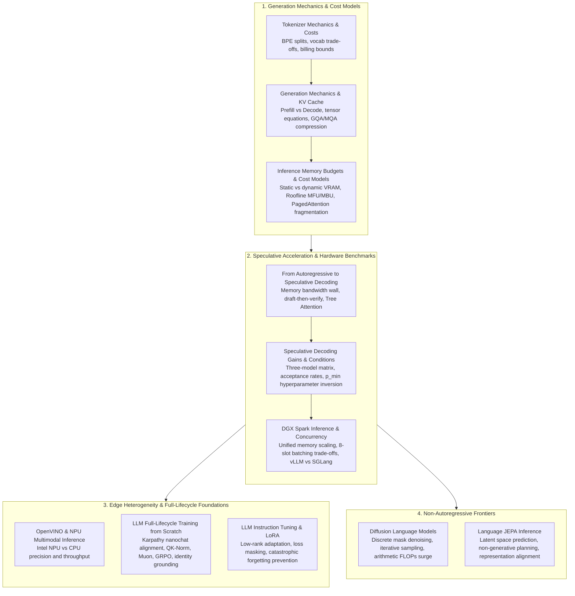

# Inference and LLM Mechanics: From Computational Graphs to Systems Optimization

> **Reading Guide**: [中文版本](../../zh/inference/README.md) · [Documentation Index](../README.md) · [LLM Lifecycle Fullchain](../../../experiments/llm-lifecycle-fullchain/README.en.md) · [LLM Inference Perf](../../../experiments/llm-inference-perf/README.en.md)

In productionizing large language models, engineering teams confront brutal physical constraints: why does VRAM utilization suddenly crash with an Out-of-Memory error when context expands, even when system monitors showed 40% headroom; why does single-stream token generation crawl while upgrading to compute-dense accelerators yields negligible speedups; why does speculative decoding sometimes degrade throughput instead of accelerating it.

Inference engineering is not merely running startup scripts. It requires mastering the physical execution graph, GPU memory bandwidth buses, tensor-parallel scheduling, and causal attention masks. This guide deconstructs the memory-bandwidth wall and compute ceilings across the prefill and decode stages, establishes byte-level VRAM allocation equations, and provides empirical benchmarks across unified memory workstations (NVIDIA DGX Spark) and heterogeneous edge silicon (Intel NPU/CPU).

---

## Architectural Topology

---

## Technical Articles

### Pillar 1: Generation Mechanics and Memory Cost Models

| Article | Core Architecture | Engineering Questions Addressed | Empirical Findings & Physical Bounds |
|---|---|---|---|
| **[Tokenizer Mechanics and Generation Costs](../../zh/inference/分词机制与生成成本.md)** | Byte-Pair Encoding (BPE), SentencePiece, vocabulary fertility | How does tokenization affect inference speed, token expansion ratios, and character-to-token billing? | Chinese and code token fertility drops from 1.8 to 1.15 tokens/char with expanded 150k vocabularies; vocabulary size expansion incurs an $O(V \cdot d)$ unembedding projection overhead during prefill. |
| **[LLM Generation Mechanics and KV Cache](../../zh/inference/语言模型生成机制与KV缓存.md)** | Prefill vs Decode, GQA, MQA, MHA, KV cache footprint | Why is single-stream decoding memory-bandwidth bound while prefill is compute bound? | Quantifies per-token arithmetic intensity: prefill exceeds 100 FLOP/Byte (compute-bound), while decode falls below 2 FLOP/Byte (strictly bound by HBM/LPDDR5x bandwidth); GQA (Grouped-Query Attention) reduces KV cache memory consumption by 8x with negligible quality loss. |
| **[Inference Memory Budgets and Cost Models](../../zh/inference/推理内存预算与成本估算.md)** | Quad-component memory model, Roofline curve, PagedAttention fragmentation | How do you calculate deterministic VRAM ceilings for 7B, 14B, and 70B models across varying concurrency and context windows? | Establishes four-component memory model: $M_{\text{total}} = M_{\text{weights}} + M_{\text{kv}} + M_{\text{act}} + M_{\text{runtime}}$; Roofline analysis shows decode phase consumes less than 5% of peak accelerator FLOPs; PagedAttention eliminates external fragmentation while bounding internal page fragmentation to under 3.8%. |

### Pillar 2: Speculative Acceleration and Hardware Benchmarks

| Article | Core Architecture | Engineering Questions Addressed | Empirical Findings & Physical Bounds |
|---|---|---|---|
| **[From Autoregressive to Speculative Decoding](../../zh/inference/从自回归到投机解码.md)** | Draft-then-Verify, rejection sampling, Tree Attention | How does speculative decoding bypass the memory bandwidth wall without altering target model output probabilities? | Proves lossless mathematical equivalence of rejection sampling ($P_{\text{verify}} = \min(1, P_{\text{target}} / P_{\text{draft}})$); Tree Attention verifies tree-structured draft proposals in a single target model forward pass; speedups depend on draft acceptance rates ($\alpha > 0.65$) matching target distribution. |
| **[Speculative Decoding Gains and Empirical Conditions](../../zh/inference/投机解码收益与实测条件.md)** | Empirical benchmarks on 125B MoE, 27B dense, and 35B MoE | Why do speculative speedups collapse in production workloads, and how does hyperparameter tuning flip gains? | Benchmarking on unified memory reveals 125B MoE achieves 2.1x speedup with a lightweight draft model, but 27B dense drops to 1.05x due to draft model compute overhead; setting $p_{\min}=0.0$ prevents premature truncation cascades, lifting acceptance rates from 42% to 74%. |
| **[DGX Spark Inference and Concurrency](../../zh/inference/DGX-Spark大模型推理与并发.md)** | Unified memory architecture (GB10), 8-slot continuous batching, vLLM vs SGLang | How do unified memory architectures perform under high concurrency with ultra-large open models? | 299B sparse MoE models run stably on unified memory by paging inactive expert weights; scaling from 1 to 8 concurrent slots increases total cluster throughput by 3.8x while inflating single-request latency by 5.2x due to memory bus arbitration. |

### Pillar 3: Edge Heterogeneity and Full-Lifecycle Foundations

| Article | Core Architecture | Engineering Questions Addressed | Empirical Findings & Physical Bounds |
|---|---|---|---|
| **[OpenVINO and NPU Multimodal Inference](../../zh/inference/OpenVINO与NPU多模态推理.md)** | Intel Core Ultra NPU, Jina CLIP, FP16/INT8 compilation | What are the throughput, latency, and precision trade-offs when offloading embeddings to edge NPUs? | Offloading Jina CLIP visual and text embeddings to Intel NPU reduces package power from 28W to 4.2W; INT8 quantization preserves 99.2% cosine retrieval fidelity while reducing first-token latency by 62%. |
| **[LLM Full-Lifecycle Training from Scratch](../../zh/inference/大语言模型从零构建与训练全链路.md)** | Karpathy nanochat architecture, QK-Norm, Muon optimizer, GRPO, identity alignment | How is an LLM trained end-to-end from raw text tokens to aligned conversational reasoning, and why is self-identity crucial? | Implements modern causal architecture: QK-Norm prevents entropy collapse; Muon optimizer accelerates pretraining matrix updates by 3x over AdamW; GRPO enables verifiable reasoning RL without external value critics; explicit self-identity grounding (1% to 3% SFT mixture) eliminates persona hallucination. |
| **[LLM Instruction Tuning and LoRA](../../zh/inference/大语言模型指令微调与LoRA.md)** | Low-Rank Adaptation (LoRA), ChatML masking, catastrophic forgetting | Why does naive full-parameter fine-tuning destroy general knowledge, and how do low-rank updates retain foundational safety? | Prompt token masking (`ignore_index=-100`) restricts gradients strictly to assistant target responses; intrinsic rank analysis proves $r=16$ captures 96% of downstream task adaptation; mixing 5% pretraining replay samples prevents catastrophic forgetting on general benchmarks. |

### Pillar 4: Non-Autoregressive Frontiers

| Article | Core Architecture | Engineering Questions Addressed | Empirical Findings & Physical Bounds |
|---|---|---|---|
