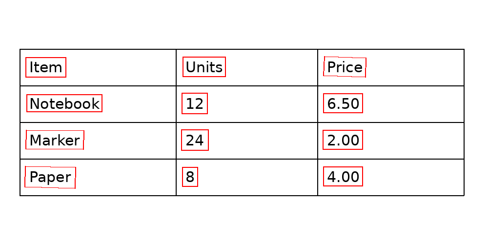

# Document OCR: from page recognition to table reconstruction

Making a scanned table usable means more than reading its text: the text must also be placed in the correct cells, and the result needs to be checked. This series explores text detection and recognition, table-structure prediction, and consistency scoring for parsed documents.

## Choose an experiment

| Question | Experiment | Observation and scope |
| --- | --- | --- |
| Where is the text, and what does it say? | [PP-OCRv5 detection and recognition](../../../zh/document-understanding/PaddleOCR文字检测与识别.md) | On one self-drawn table, 12 regions were detected and their recognized text matched the known text. This is not a general accuracy estimate. |
| How many rows and columns does the table have? | [SLANet+ table structure](../../../zh/document-understanding/SLANet表格结构识别.md) | A manually cropped version of the same table produced the expected 4-by-3 structure; the uncropped image produced an extra row. One example does not prove cropping always helps. |
| How can a parsed document be checked? | [MiniCPM-OCR and Jev](../../../zh/document-understanding/MiniCPM文档解析与质检.md) | A parser and a candidate-consistency scorer were run on DGX Spark. The score is neither accuracy nor a calibrated probability of correctness. |

The linked experiment pages are currently in Chinese.

The first two experiments used the same source image SHA-256, but ran independently: one produced text and locations, the other produced table structure. **They have not been automatically assembled into a populated table, and no unified end-to-end evaluation has been completed.** See [the shared input, outputs, and missing step](docs/table-recognition-path-and-evidence.md).

## Two paths that can be combined

A modular path can detect text regions, recognize the cropped text, predict table structure separately, and match text to cells. This makes errors in recognition and structure easier to inspect; region detection, coordinate conversion, and matching still need implementation and evaluation.

A generative parser uses a vision-language model to produce text or Markdown. It can also work on regions supplied by a separate layout model. MiniCPM-OCR's Jev compares an original region, candidate content, and its rendering to produce a consistency score for candidate ranking or review.

These approaches can be combined. The examples here do not establish which is more accurate or faster. A meaningful comparison requires the same documents and evaluation of text, structure, reading order, latency, and resource use. Scripts, configuration, and original records remain with each experiment, whose page contains its reproduction instructions.

[中文](../../../zh/document-understanding/README.md)
