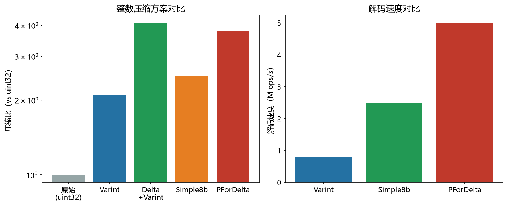
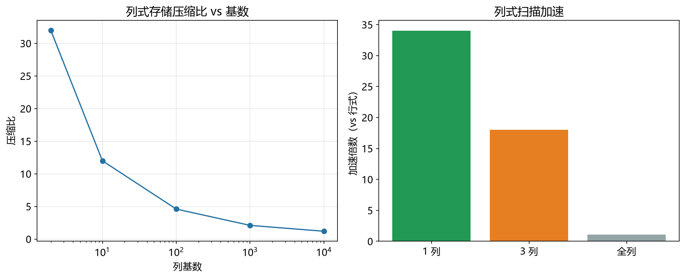
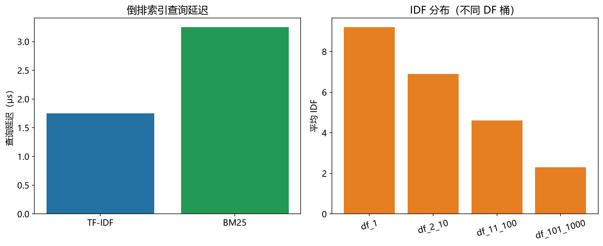

# 列式存储与倒排索引压缩编码：Varint、PFor-Delta、Simple8b与WAND剪枝

> **阅读导航**：[数据结构与存储成本](README.md) · [数据结构算法实测与复现](../../../experiments/data-structure-costs/README.md) · [检索系统全景与评估](../retrieval/检索系统全景与评估.md)

在大数据分析（OLAP 数据库，如 ClickHouse、Parquet）与大规模全文检索引擎（如 Lucene、Elasticsearch）中，系统每天需要处理数十亿行记录与数百亿个文档标识。

如果按常规 32 位或 64 位无压缩整型存储文档 ID 与词频，不仅会大幅增加磁盘与内存占用，还会拖慢 CPU 内存总线的传输吞吐。

**现代存储引擎结合“差分排序 + 紧凑整型压缩 + SIMD 向量化解压”三项技术**，将整型数组的平均存储开销从 32 比特压缩至 **1 到 4 比特**。

本篇系统推导 Varint、Delta 差分、PFor-Delta 与 Simple8b 压缩算法，解析列式存储布局，并阐明倒排索引中利用跳表指针与 WAND（Weak AND）算法实现毫秒级快速求交的底层机制。

---

## 一、 经典整型压缩算法概览

在检索引擎的倒排链表（Posting List）中，文档 ID 天然是有序递增的：

$$\text{原始序列：} [10002, 10005, 10012, 10014, 10030, ...]$$

先进行一次 **Delta 差分编码（相邻值相减）**，大整数序列立即转变为一系列极小的差值（$d_i = x_i - x_{i-1}$）：

$$\text{Delta 序列：} [10002, 3, 7, 2, 16, ...]$$

绝大多数差值都小于 128，为后续位压缩创造了有利条件。



主流整型压缩算法根据数据特性与解码效率分为四种典型流派：
- **逐字节变长编码**：以 Varint（LEB128）为代表，兼容性好，但字节级分支判断导致解码难以并行；
- **块级定长位打包**：以 Frame-of-Reference（FoR）为代表，按 128 或 256 个数一组统一计算最大位宽，规整打包；
- **异常值补丁解耦**：以 PFor-Delta 为代表，按 90%~95% 分位数截断基准位宽，异常值抽离补丁区，主体部分适合用 SIMD 向量化解压；
- **64位槽位自适应**：以 Simple8b 为代表，单机器字内部密集打包多个整数，通过查表跳转消除分支。

### 1. Varint（LEB128，如 Protocol Buffers / SQLite）
每个字节的最高位（第 7 位）作为**延续标志位（Continuation Bit）**：
- `1` 表示后续字节仍属于当前整型；
- `0` 表示这是当前整型的最后一个字节；
- 低 7 位用于拼接实际数值有效位。
- **优缺点**：实现非常简单，小于 128 的整数仅占 1 字节；但解码时每个字节都需要判断最高位标志，存在大量 CPU 分支预测失败，难以利用 SIMD 并行加速。

### 2. PFor-Delta（Patched Frame-of-Reference，工业级搜索标配）
PFor-Delta 是 Lucene 与主流检索引擎倒排链表的核心编码方式：
- 设定固定大小的块（通常 128 或 256 个整数）；
- 选择一个位宽 $b$（如 4 位），确保该块中 **90% 到 95%** 的差值都能在 $b$ 位内放下；
- **异常值抽离（Patched）**：少数超过 $2^b-1$ 的异常大值（Exceptions），槽位中仅保存其低 $b$ 位，并将其高位与在块中的偏移量统一抽离存放在块末尾的“异常区”；
- **SIMD 向量化加速**：在解包主体数据时，由于全部数据均为固定 $b$ 位紧凑对齐排布，CPU 可以直接通过 AVX2 / NEON 向量化指令一条指令同时解压 32 个整数，最后遍历极短的异常区回填，解码速度达到数 GB/s。

### 3. Simple8b（64位自适应装箱）
Simple8b 用一个 64 位的机器字（Word）打包尽可能多的整数：
- **高 4 位（Selector 选择器）**：表示当前字内部采用的打包模式（共有 16 种不同组合，从“240 个 0 位整数”到“1 个 60 位整数”）；
- **低 60 位（Payload 载荷）**：根据选择器模式，密集切割为 $k$ 个 $b$ 位的整数（满足 $k \times b \le 60$）。
- **解码优势**：解码器仅需读取高 4 位，通过一个 16 项的跳转表（Jump Table）直接调用硬编码的移位展开逻辑，完全消除了循环和内部条件分支。

---

## 二、 列式存储（Columnar Storage）布局与分析加速

与传统 OLTP 数据库（如 MySQL）采用的**行式存储（Row-oriented）**不同，数据仓库（OLAP，如 ClickHouse、Parquet）按列组织存储：



两者在物理内存与磁盘页上的核心组织差异如下：
- **行式存储（Row-oriented）**：单行内各个字段在物理空间连续存放。单条记录的点查与整行写入效率高；但在统计分析（如 `SUM(OrderAmt)`）时必须扫描并读取整行所有字段，造成大量无关磁盘 I/O 与内存带宽浪费。
- **列式存储（Columnar-oriented）**：同一字段的所有记录在连续物理空间内排布。分析查询只读取涉及的字段列，无关列完全零 I/O；且由于同列数据类型完全相同、取值范围集中，非常利于 RLE（游程编码）与字典压缩。

### 1. 高效压缩：字典编码与游程编码（RLE）
- **字典编码（Dictionary Encoding）**：对于国家、城市、状态等低基数字段，建立一个全局字符串字典映射，数据页内仅保存 1 字节的短字典 ID；
- **游程编码（Run-Length Encoding, RLE）**：在排序列上，相同数值连续出现多次（如连续 10,000 个 `"US"`），RLE 仅需记录 `("US", 10000)`，数据压缩比可达 **50:1 至 100:1**。

### 2. 计算加速：向量化执行（Vectorized Execution）
分析查询执行 `WHERE Country = 'US' AND OrderAmt > 100` 时：
- CPU 仅需从磁盘读取 `Country` 和 `OrderAmt` 这两列连续字节，完全不触碰其他几十个无关字段；
- 列数据在内存中是同构连续数组，CPU 可以直接用 SIMD 寄存器一次性完成 8 个数值的大于号比对，产生紧凑的位掩码，运算效率是传统逐行解释器的数十倍。

---

## 三、 倒排索引的高效求交与 WAND 剪枝

在包含数百万文档的语料库中，检索同时包含词项 A 和词项 B 的文档（AND 查询），本质上是**两个有序整型倒排链表求交集**。



```text
Posting List A: [ 3, 5, 12, 19, 45, 88, 102, 120, ... ]
Posting List B: [ 12, 45, 67, 88, 102, 350, ... ]
```

### 1. 跳表指针（Skip Pointers）的块跳跃
如果线性双指针求交，长倒排链表与短倒排链表比对时需要遍历所有元素。
现代倒排链表将文档 ID 分块（例如每 128 个文档为一个块），并在块头记录最大文档 ID。当链表 A 当前指针在 5，而链表 B 已经推进到 12 时，链表 A 可以直接比较块头最大值跳过整个 128 个文档的块，大幅减少解压缩开销。

### 2. 弱与剪枝：WAND（Weak AND）算法
当用户查询包含多个词项（如“自然语言处理 深度学习 模型”），但仅需返回 **Top-K（如前 10 名）最高分结果**时，没有必要完整计算所有包含任意词项的低分文档。

**WAND（Weak AND）动态剪枝算法**：
1. **预存词项上界**：为每个词项 $t$ 预先计算其在任意文档中的最大 BM25 得分贡献上界 $U_t$；
2. **动态门限（Threshold）**：维护当前已找到的第 $K$ 名文档得分 $\theta$；
3. **前缀上界求和**：将当前各个词项当前指向的文档按 ID 从小到大排序。累加其上限 $U_t$，直到累加和首次超过阈值 $\theta$（此时对应的文档 ID 为 $d_{\text{pivot}}$）；
4. **大步跳跃**：所有小于 $d_{\text{pivot}}$ 的文档，即使所有当前词项全部命中，其最高理论得分也绝不可能超过 $\theta$。检索引擎直接将所有词项指针跳跃推进至 $d_{\text{pivot}}$，直接跳过大量低分文档，端到端检索延迟可降低一个数量级。

---

## 四、 核心压缩编码选型对比

| 编码方案 | 空间压缩比 | 解压计算开销 | SIMD 并行支持 | 典型工业界落地 |
|---|---|---|---|---|
| **Varint (LEB128)** | 中等（1~5 字节） | 较慢（分支预测多） | 较难 | Protocol Buffers、gRPC、SQLite 变长列 |
| **Delta + PFor-Delta** | **极高（平均 1~3 比特/键）** | **极快（批次连续）** | **支持极好（AVX2/NEON）** | **Lucene 倒排链表、搜索引擎全文索引** |
| **Simple8b** | 极高（自适应密集） | 快（查表跳转无循环） | 良好 | ClickHouse、InfluxDB 时序时间戳 |
| **Dictionary + RLE** | 低基数下极高（几十倍） | 极快（直接复制解压） | 原生支持 | Parquet、ORC、ClickHouse 列存引擎 |

---

## 五、 实验复现与代码模型

在 `experiments/data-structure-costs/` 中包含上述压缩算法的数学模型与纯 Python 算法验证：
- **模型实现**：`scripts/varint_model.py`、`scripts/delta_model.py`、`scripts/pfor_delta_model.py`、`scripts/simple8b_model.py`、`scripts/columnar_model.py`、`scripts/inverted_index_model.py`、`scripts/bm25_model.py`；
- **纯 Python 实测验证**：`scripts/verify_varint.py`、`scripts/verify_delta.py`、`scripts/verify_pfor_delta.py`、`scripts/verify_simple8b.py`、`scripts/verify_columnar.py`、`scripts/verify_inverted_index.py`、`scripts/verify_bm25.py`；
- **机制图解**：`figures/fig-compression.png`、`figures/fig-columnar.png`、`figures/fig-inverted-index.png`。
