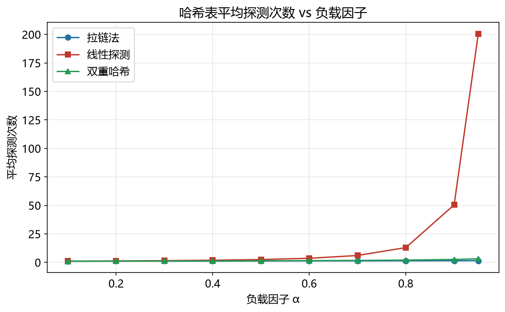
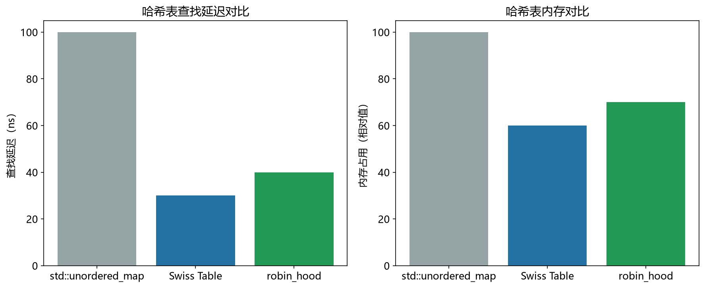
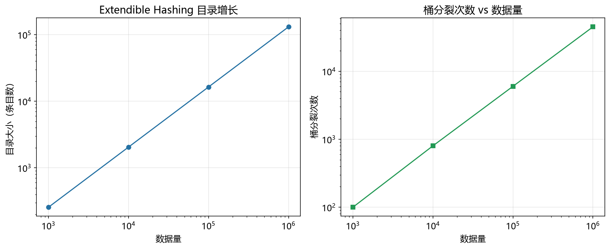

# 哈希表演进与内存冲突解决：从拉链法到 Swiss Table

> **阅读导航**：[数据结构与存储成本](README.md) · [数据结构算法实测与复现](../../../experiments/data-structure-costs/README.md)

哈希表是计算机科学中使用频率最高的基础容器。在理想假设下，哈希表的增删改查复杂度均为 $O(1)$。

然而在现代计算机体系结构中，**内存访问的物理延迟（约 50~100 ns）远高于 CPU 寄存器和 L1/L2 缓存访问（约 0.5~4 ns）**。一个理论上平均探测 1.5 次的链表节点跳转，由于指针引发的 CPU 缓存行缺失（Cache Line Miss），其真实耗时可能远慢于在连续内存块中进行 10 次 SIMD 向量化比对。

本篇系统梳理哈希表在内存与磁盘架构下的技术演进，推导拉链法、罗宾汉哈希（Robin Hood）、啤酒花哈希（Hopscotch）以及现代工业级标配 Swiss Table 的底层冲突解决拓扑与工程选型。

---

## 一、 拉链法的现代困境：指针开销与缓存缺失

早期哈希表（如 Java `HashMap`、C++ `std::unordered_map` 早期版本）普遍采用**拉链法（Separate Chaining）**：每个桶维护一个单向链表，发生哈希碰撞时将节点挂在链表末尾或头部。

### 主要缺陷：
1. **内存碎片与指针膨胀**：每个链表节点都需要额外存储一个 64 位指针（8 字节）。对于存储 `int32 -> int32` 这样小键值的场景，指针与内存对齐开销甚至超过了有效数据本身（空间利用率不足 30%）。
2. **严重的 CPU 缓存失效**：链表节点是在不同时间通过堆内存动态分配的，在物理内存中离散分布。遍历链表时，每一次 `node->next` 指针解引用几乎都必然触发一次 L3 缓存甚至主存访问，严重阻碍现代 CPU 流水线。

---

## 二、 开放寻址法的演化与优化

**开放寻址法（Open Addressing）**将所有键值紧凑保存在一个连续的数组中，发生碰撞时通过特定探查序列（Probe Sequence）在数组内寻找下一个空槽。

### 1. 传统线性探查的初级聚簇（Primary Clustering）
最简单的探查序列是 $h(k, i) = (h(k) + i) \bmod M$。其主要缺点在于：一旦某处形成连续被占用的块，后续落在该区域的键都会加剧这一块的膨胀，导致探查步数（Probe Sequence Length, PSL）急剧恶化。

### 2. 罗宾汉哈希（Robin Hood Hashing）：均化探测距离
为了打破“少数倒霉键探测距离极长”的长尾效应，罗宾汉哈希引入了**劫富济贫（Take from the rich, give to the poor）**原则：
- 每个槽位额外记录当前键从初始理想桶到当前位置的**探测距离（PSL）**；
- 插入新键时，沿途比较新键当前的 PSL 与槽位中已有键的 PSL；
- **如果新键的 PSL 大于已有键的 PSL**，说明新键“比已有键更倒霉”，已有键被直接踢出，新键抢占该槽位；被踢出的已有键带着自身 PSL 继续向下寻找空位。
- **收益**：将探查步数的方差压缩到极小，点查在未命中时只要遇到一个 PSL 小于当前探查步数的槽位即可提前终止（Early Exit）。

### 3. 啤酒花哈希（Hopscotch Hashing）：固定邻域位图
啤酒花哈希规定：每个键必须存放在其初始理想哈希桶后面的 $H$ 个连续槽位之内（称为该桶的**邻域（Neighborhood）**，通常 $H = 32$ 或 $64$）。
- 每个桶维护一个 $H$ 位的位图，记录邻域内哪些槽位的键属于当前桶；
- 插入时若邻域已满，向前线性探查找到一个空槽，并通过一系列“位图向前腾挪跳跃”将空槽逐步置换进目标邻域；
- **收益**：单键查找的探测上限被绝对锁定在 $H$ 步以内，最坏时间复杂度严格受控。

---

## 三、 现代工业标配：Swiss Table（SIMD 并行探查）

由 Google Abseil 开源、并在 Rust `hashbrown` 与 ClickHouse 中全面采用的 **Swiss Table**，是目前内存哈希表中性能领先的设计。

### 1. 核心架构：控制字节与分段哈希
将 64 位哈希值拆分为两个部分：
- **H1（高 57 位）**：用于定位控制数组中的起始组（Group）下标；
- **H2（低 7 位）**：作为 7 比特的短指纹，存入对应的**控制字节（Control Byte）**中。
- 控制字节设计：`0b10000000 (0x80)` 表示空槽，`0b11111110 (0xFE)` 表示删除墓碑，`0b0xxxxxxx` 保存 7 位 H2 指纹。

### 2. SIMD 并行向量化过滤
每 16 个槽位组成一个组（Group，占用 16 字节控制元数据）。查询一个键时：
1. 读取该组的 16 字节元数据载入 **128 位 SIMD 寄存器（x86 SSE2 / ARM NEON）**；
2. 用待查键的 H2 指纹广播复制为 16 字节向量，执行单条指令 `_mm_cmpeq_epi8` 并行比较 16 个槽位；
3. 执行 `_mm_movemask_epi8` 将 16 位匹配结果转为位掩码整数；
4. 仅对位掩码中命中的极少数候选槽位去访问真正的键值数据进行全键精确校验。

### 3. 性能收益：
- **99% 的未命中不触碰键值内存**：绝大多数不存在的键，在仅 16 字节的控制数组里就已经被 SIMD 指令判定为无匹配，根本不需要发生对真正键值的大内存访问；
- **超高装载因子**：在装载因子（Load Factor）达到 **87.5%（7/8）** 的极高状态下，仍能保持极快的点查速度，相比传统哈希表节约 30%~50% 的堆内存。

---

## 四、 磁盘动态分页：可扩展哈希（Extendible Hashing）

当哈希表规模超出单机内存、需要落盘到由固定页面（如 4 KB）组成的存储系统时，动态分裂不能简单地将全表重哈希搬迁。

**可扩展哈希（Extendible Hashing）**通过双层结构解决磁盘动态扩容：
- **全局目录（Directory）**：一个指针数组，大小为 $2^D$（$D$ 为全局深度 Global Depth）；
- **数据桶页（Bucket）**：磁盘物理页，每个桶记录自己的局部深度 $d$（Local Depth, $d \le D$）。

### 分裂机制：
当桶 C 写满时，因为其局部深度 $d=1 < D=2$，目录不需要翻倍扩张：仅需将桶 C 分裂为两个局部深度为 2 的新桶，并将目录中的指针分别指向新桶；只有当局部深度等于全局深度的桶发生溢出时，全局目录才翻倍递增（$D \to D+1$）。这种机制将全表扩容的物理 I/O 局限在单页内部。

---

## 五、 哈希表核心架构选型对照

| 架构形态 | 内存排布特点 | CPU 缓存命中率 | 典型装载因子 | 适用场景与工业代表 |
|---|---|---|---|---|
| **拉链法（Separate Chaining）** | 数组 + 链表节点堆分配 | 极差（指针引发 Cache Miss） | 75% | 早期语言标准库、键值对象极大的场景 |
| **罗宾汉哈希（Robin Hood）** | 连续数组，记录 PSL 并踢出 | 良好（局部连续探测） | 80% ~ 90% | Rust 部分嵌入式容器、只读静态哈希表 |
| **Swiss Table** | 16 字节控制数组 + 槽位分离 | **极佳（SIMD 并行过滤 16 槽）** | **87.5%** | **Google Abseil、Rust hashbrown、ClickHouse** |
| **可扩展哈希（Extendible）** | 目录数组 + 磁盘物理页 | 面向磁盘块设计 | 70% ~ 80% | 数据库主键散列存储、文件系统索引 |

---

## 六、 实验模型与验证代码

在 `experiments/data-structure-costs/` 中包含上述结构的完整数学模型与验证代码：
- **模型实现**：`scripts/hash_model.py`、`scripts/robin_hood_model.py`、`scripts/hopscotch_model.py`、`scripts/swiss_table_model.py`、`scripts/extendible_hashing_model.py`；
- **纯 Python 实测验证**：`scripts/verify_hash.py`、`scripts/verify_robin_hood.py`、`scripts/verify_hopscotch.py`、`scripts/verify_swiss_table.py`、`scripts/verify_extendible_hashing.py`；
- **机制曲线对比**：`figures/fig-swiss-table.png`、`figures/fig-robin-hood.png`、`figures/fig-cuckoo-hashing.png`。
