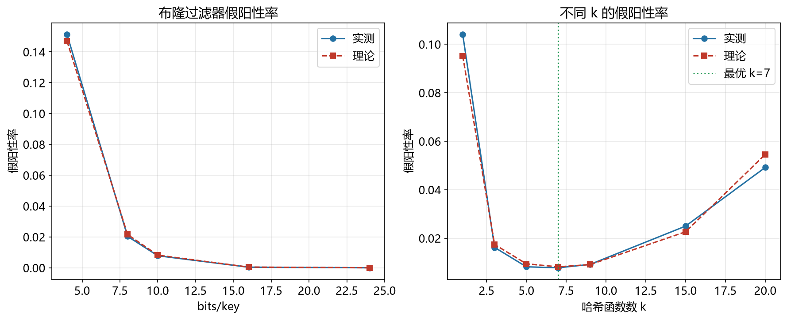
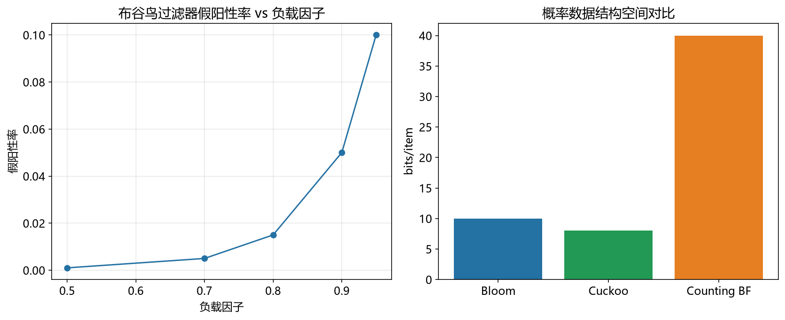

# 概率数据结构与基数估计：原理、空间下限与选型权衡

> **阅读导航**：[数据结构与存储成本](README.md) · [数据结构算法实测与复现](../../../experiments/data-structure-costs/README.md)

在海量数据流处理、实时风控、高并发缓存穿透防护以及大规模爬虫去重中，精确保存全量键值集合往往需要消耗数十 GB 乃至 TB 级的物理内存。

**概率数据结构（Probabilistic Data Structures）**的核心思想是：**在允许极小概率可控误差的前提下，将空间复杂度从 $O(N)$ 压缩到 $O(1)$ 或对数级别**。

本篇系统推导布隆过滤器（Bloom Filter）、布谷鸟过滤器（Cuckoo Filter）、Count-Min Sketch 以及 HyperLogLog（HLL/HLL++）的数学原理、最优位宽推导与工程选型边界。

---

## 一、 集合成员判定：Bloom Filter vs Cuckoo Filter

判断一个键“是否可能在集合中”，最经典的两大结构是布隆过滤器与布谷鸟过滤器。

### 1. 布隆过滤器（Bloom Filter）：最优位宽与误判率推导
布隆过滤器由长度为 $m$ 的位数组（Bitset）与 $k$ 个独立哈希函数组成。
向其中插入 $n$ 个元素后，某个特定位依然为 0 的概率为：

$$p_0 = \left(1 - \frac{1}{m}\right)^{kn} \approx e^{-kn/m}$$

查询一个不存在的元素时，所有 $k$ 个哈希位恰好全为 1 的误判率（False Positive Rate, FPR）为：

$$p \approx (1 - p_0)^k \approx \left(1 - e^{-kn/m}\right)^k$$

对 $k$ 求导求极值，得到**最优哈希函数个数**：

$$k^* = \frac{m}{n} \ln 2 \approx 0.693 \times \frac{m}{n}$$

将 $k^*$ 代回原式，解出给定预期误判率 $p$ 下所需的**理论最小比特数**：

$$m = -\frac{n \ln p}{(\ln 2)^2} \approx -1.44 \cdot n \log_2 p$$

**工程口径**：若期望误判率控制在 **1%（$p=0.01$）**，平均每个元素仅需约 **9.6 比特（约 1.2 字节）**，且最优哈希函数个数 $k \approx 7$。相比于哈希表保存原始 64 位整型或字符串，内存直接压缩 10 至 50 倍。

### 2. 布谷鸟过滤器（Cuckoo Filter）：指纹踢出与动态删除

布隆过滤器最大的短板是**无法直接删除元素**（直接置零会导致其他共享该位的键产生假阴性）。布谷鸟过滤器解决了这一问题：
- **指纹存储**：每个元素仅哈希为一个短指纹 $f$（通常 8~16 位），并根据元素哈希定位两个候选桶 $i_1$ 和 $i_2$：

$$i_1 = \operatorname{hash}(x), \qquad i_2 = i_1 \oplus \operatorname{hash}(f)$$

- **部分键剔除（Partial-key Cuckoo Hashing）**：由于异或的可逆性，只要持有指纹 $f$ 和当前桶下标 $i_1$，即可直接算出备用桶下标 $i_2$。当两桶均满时，触发随机踢出（Kickout）并递归寻找空位。
- **选型优势**：每个条目保留固定位指纹，支持直接删除；在低误判率要求（$p < 3\%$）下，空间利用率通常超越经过优化的分块布隆过滤器。

---

## 二、 频次估计：Count-Min Sketch 与保守更新

在实时数据流中统计某个键出现的频次（例如“过去 1 小时访问频次前 100 的 IP”），直接使用哈希计数器会消耗过多内存。

**Count-Min Sketch（CMS）**通过二维数组 $d \times w$ 解决频次估计问题：
- 具有 $d$ 行、$w$ 列的整型计数器矩阵，每行配备一个独立的哈希函数 $h_i(x) \in [0, w-1]$；
- 插入时，将每行对应单元格的值累加 1；
- 点查频次时，返回 $d$ 个对应位置计数的**最小值**（Min）：

$$\hat{c}(x) = \min_{1 \le i \le d} C[i, h_i(x)]$$

### 误差界与保守更新优化（Conservative Update）：
给定容忍误差 $\varepsilon$ 与失败概率 $\delta$，矩阵维度设计公式为：

$$w = \left\lceil \frac{e}{\varepsilon} \right\rceil, \qquad d = \left\lceil \ln \frac{1}{\delta} \right\rceil$$

**保守更新技巧**：在增加计数时，先查出当前所有对应位置的当前值，只对等于当前最小值的那个槽位递增，避免对已有较大计数的槽位盲目累加。实测可使点查高估误差降低 2 至 5 倍。

---

## 三、 基数估计：HyperLogLog 与 HyperLogLog++

估计海量去重独立访客（UV）或大规模分布式表中的去重基数，使用全量 Hash Set 的内存消耗为 $O(N)$。

**HyperLogLog（HLL）**将基数估计压缩到了很小的固定空间（通常仅 **12 KB 内存即可统计数亿级基数，标准误差约 1.04%**）：

### 1. 伯努利过程与分桶平滑
将元素哈希为 64 位无偏二进制串。如果一个序列开头连续出现了 $k$ 个 0，其发生概率为 $2^{-(k+1)}$，从而可以反推定独立基数约为 $2^{k+1}$。

单个估计方差显著。HLL 引入**分桶平均**：
- 取哈希值的前 $p$ 位作为分桶编号（共 $m = 2^p$ 个桶，如 $p=14$ 时 $m=16384$）；
- 剩余位统计前导零的最大长度 $R_j$；
- 使用**调和平均数（Harmonic Mean）**汇总各桶估计，有效消除极端离群值对整体均值的破坏：

$$\hat{N} = \alpha_m m^2 \left( \sum_{j=1}^m 2^{-R_j} \right)^{-1}$$

其中 $\alpha_m$ 为偏置修正系数，标准误差理论值为：

$$\operatorname{SE} = \frac{1.04}{\sqrt{m}} = \frac{1.04}{\sqrt{16384}} \approx 0.81\%$$

### 2. Google HyperLogLog++ 关键工程优化
标准 HLL 在小基数阶段偏差较大，HLL++ 做出了两大核心改进：
- **稀疏表示（Sparse Representation）**：在基数极小时，不分配全部 16384 个桶，而是将非零桶编码为压缩数组，内存仅消耗几十字节；直到数据量增长超过阈值才自动转换为稠密数组；
- **小基数线性计数器（Linear Counting）保真**：在基数小于 $2.5 m$ 时，切换为基于未命中空桶比例的泊松推导，消除小样本阶段的统计漂移。

---

## 四、 选型矩阵与内存预算对照

| 算法结构 | 核心解决问题 | 理论复杂度 | 典型空间开销 | 误差性质 | 典型工业界应用 |
|---|---|---|---|---|---|
| **Bloom Filter** | 集合成员判定 | $O(k)$ 查/写 | $1\%$ 误判率下约 1.2 Byte/键 | 假阳性（可能报虚警，绝不漏报） | 数据库防缓存穿透、LSM 读放大剪枝 |
| **Cuckoo Filter** | 成员判定 + 动态删除 | $O(1)$ 查/踢出 | 约 1.0~1.5 Byte/键 | 假阳性（支持删除，高载荷下可能踢出循环） | 网络路由器路由表、动态黑名单 |
| **Count-Min Sketch** | 流式高频/点查频次 | $O(d)$ 查/写 | 固定数组（通常几 KB 至几 MB） | 频次只高估、不高估过界 | 实时 Top-K（Heavy Hitters）、流量风控 |
| **HyperLogLog** | 超大海量去重基数（UV） | $O(1)$ 查/写 | 固定 **12 KB** 内存 | 标准误差 $\pm 1.04\%$（连续平滑分布） | Redis `PFADD`/`PFCOUNT`、OLAP 数据库聚合 |

---

## 五、 实验复现与代码对照

在 `experiments/data-structure-costs/` 中包含上述结构的完整数学模型与验证脚本：
- **模型实现**：`scripts/bloom_filter_model.py`、`scripts/cuckoo_filter_model.py`、`scripts/hyperloglog_model.py`；
- **纯 Python 实测对照**：`scripts/verify_bloom_filter.py`、`scripts/verify_cuckoo_filter.py`、`scripts/verify_hyperloglog.py`；
- **交互式理论估算**：浏览器直接打开 `performance_calculator.html`，动态拖拽误判率滑块查看空间曲线。
