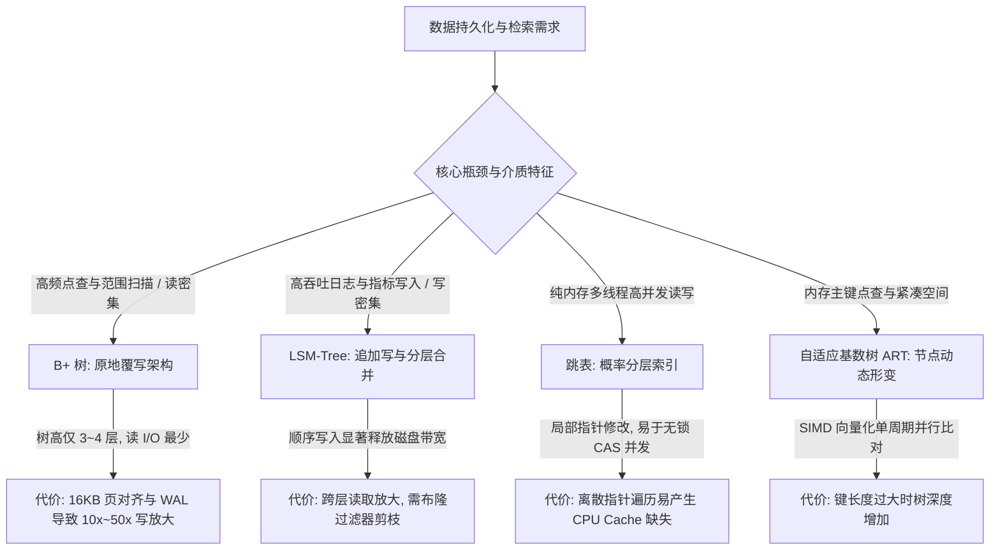
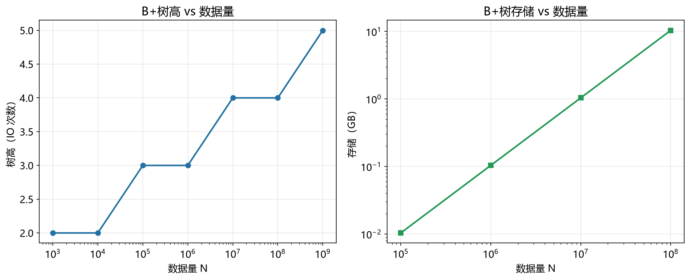
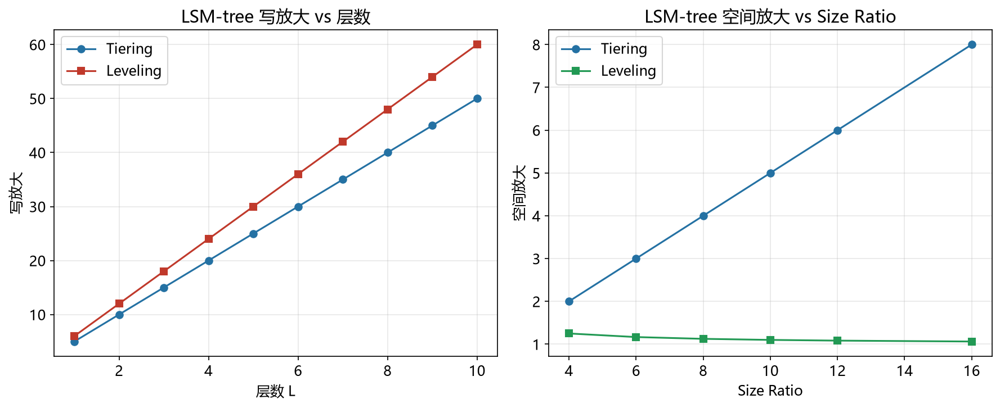
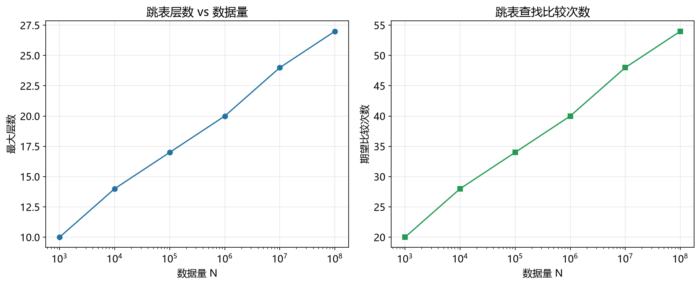
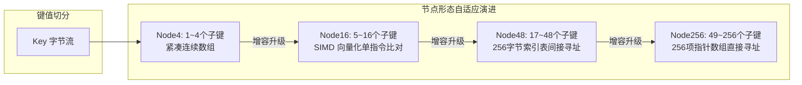

# 读写放大与有序索引选型：B+树、LSM-Tree 与跳表的物理机制

> **阅读导航**：[数据结构与存储成本](README.md) · [项目首页](../../../README.md) · [算法模型与实测复现](../../../experiments/data-structure-costs/)

在存储系统与数据库引擎中，一次微小的记录修改，往往会在底层磁盘上引发数十倍的物理数据写入。这一现象被称为**写放大（Write Amplification）**。在固态硬盘（SSD）主导现代服务器的背景下，写放大不仅制约了系统写入吞吐上限，还会持续消耗闪存介质的擦写寿命（P/E Cycles）。

存储架构在过去数十年间的演进，核心是在**读放大、写放大与并发锁开销**之间做权衡：
- 关系型数据库（如 MySQL InnoDB、SQLite）依赖 **B+ 树**换取极低的读放大与高效范围查询，但必须承受原地覆写带来的高倍写放大；
- 键值系统（如 RocksDB、LevelDB、TiKV）通过 **LSM-Tree** 将随机写入转化为顺序追加，大幅压缩写放大，却引入了读放大与后台合并开销；
- 内存存储（如 Redis ZSet、RocksDB MemTable）则采用**跳表（Skip List）**替代平衡树，通过概率分层避免全局树旋转，降低多核并发下的锁争用；
- 现代分析引擎（如 DuckDB、Hyper）进一步演进至**自适应基数树（ART）**，利用 SIMD 向量化指令提升缓存命中率与探查效率。

本文从底层硬件访问特征出发，推导四类有序索引的内部拓扑、放大因子数学关系与工程选型边界。

---

## 一、 B+ 树：面向磁盘块的读优化机制

B+ 树是传统关系型数据库最经典的磁盘索引结构，其设计核心在于：**以页为单位组织数据，最大化节点扇出，最小化磁盘寻道次数**。

### 1. 高扇出与树高度压制
B+ 树将非叶子节点与叶子节点解耦：非叶子节点仅存储键和子节点物理页号，不包含实际记录数据。
若磁盘页大小为 16 KB，主键与页指针各占 8 字节，则单页扇出（Fanout）可达到：
$$B \approx \frac{16 \times 1024}{8 + 8} = 1024$$

高扇出使得整棵树的几何高度增长非常缓慢：
- 树高 $h = 3$ 时，理论可索引约 $1024^3 \approx 10^9$（十亿）条记录；
- 在生产系统中，根节点与中间层节点通常常驻于操作系统页缓存（Page Cache）中，**单次点查真正需要发起的物理磁盘 I/O 通常仅为 1 次**。
- 叶子节点之间通过双向链表横向连接，执行范围扫描（如 `BETWEEN A AND B`）时，只需定位起始叶子页，随后沿链表顺序遍历，无需反复回溯上层节点。

### 2. 物理代价：原地覆写与写放大成因
B+ 树采用**原地更新（In-place Update）**机制，这一设计带来了不可避免的写放大：
1. **块级写入放大（Page Granularity）**：底层文件系统与磁盘控制器以页（如 4 KB 或 16 KB）为最小物理读写单元。修改单个记录中的数值，也必须将整页 16 KB 数据同步刷盘；
2. **安全双写机制（WAL 与 Doublewrite Buffer）**：
   - 为保证事务持久性，需先写入重做日志（Redo Log）；
   - 为防止写盘过程中因系统宕机导致页部分损坏（Torn Page），需先将页写入连续的双写缓冲（Doublewrite Buffer），再写回数据文件。
   实际物理写入量往往是逻辑修改量的 10 至 50 倍；
3. **无序插入与页分裂（Page Split）**：
   若主键为无序分布（如 UUID），新记录随机插入已满的叶子页，将触发页分裂与跨页数据重分配，导致磁盘块产生物理碎片并降低空间利用率。

---

## 二、 LSM-Tree：追加写入与分层合并架构

针对随机写入对机械磁盘寻道和固态硬盘垃圾回收的负担，LSM-Tree（Log-Structured Merge-tree）将随机写全部转化为**顺序追加写（Append-only Sequential Write）**。

### 1. 写入通路与不可变分层
1. **日志先行（WAL）**：写入请求先顺序追加写入磁盘 WAL，确保故障可恢复；
2. **内存缓冲（MemTable）**：同时写入内存中的有序结构（通常为跳表）。当 MemTable 达到阈值（如 64 MB）后，转为不可变的 Immutable MemTable；
3. **异步刷盘（Flush）**：后台线程将内存数据按序持久化为磁盘上的不可变文件：**SSTable（Sorted String Table）**。

整个前端写入流程不涉及任何随机覆写与页分裂，单次写入耗时处于微秒级。

### 2. 读放大与后台合并约束
LSM-Tree 提升写入效率的同时，增加了读取与后台调度的复杂性：
1. **读放大（Read Amplification）**：
   记录在磁盘上可能存在多个历史版本或墓碑标记（Tombstone）。单键点查若未命中内存，需逐层检索各级 SSTable；
2. **布隆过滤器（Bloom Filter）剪枝**：
   LSM 引擎在每个 SSTable 块头部配置布隆过滤器。通过约 10 bit/键 的内存开销，以约 1% 的假阳性概率快速判断目标键是否不存在于该文件，将大部分点查的磁盘 I/O 限制在 1 至 2 次；
3. **后台合并开销（Compaction）**：
   为了消除过期版本与回收磁盘空间，后台需持续执行 SSTable 的归并排序。如果写入流量过大导致合并速度落后于生成速度，系统将触发**写停顿（Write Stall）**，限制前端写入速率直至合并跟进。

---

## 三、 跳表（Skip List）：内存并发的无锁结构

在纯内存场景中，磁盘 I/O 约束不复存在，并发控制成为核心瓶颈。红黑树等严格平衡树结构在多线程环境下容易产生锁争用：
- 平衡树插入新节点时，若触发树平衡调整，需执行左旋、右旋与变色操作；
- 旋转操作往往涉及多层祖先节点与兄弟节点，需要锁定整条路径上的关键节点，降低了多线程并发吞吐。

**跳表（Skip List）**通过**概率性分层索引**规避了确定性树平衡：

### 1. 局部修改与无锁设计
- **概率高度分配**：新节点插入时，通过独立的随机数决定其高度（以概率 $p = 1/2$ 或 $1/4$ 向上累加索引层）；
- **局部指针调整**：插入或删除节点仅需更新受影响层的前驱与后继指针，影响范围局限于相邻节点；
- **并发控制友好**：局部修改能够通过 CPU 原子指令（Compare-And-Swap, CAS）实现无锁并发控制，因此被广泛用于 Redis ZSet 与 RocksDB MemTable。

### 2. 物理局限
跳表的每个节点在堆内存中独立分配，节点间通过指针关联。大规模数据遍历时，离散的指针寻址容易引起 CPU 缓存未命中（Cache Miss）。

---

## 四、 自适应基数树（ART）：内存分析的高效索引

对于只读或分析密集型的内存索引场景，**自适应基数树（Adaptive Radix Tree, ART）**进一步针对现代 CPU 缓存行（Cache Line）与向量化指令进行优化。

传统前缀字典树若采用固定分支因子（如每个节点固定 256 指针），稀疏键值下会产生大量空指针内存浪费；若分支因子过小，树高度增加会拉长遍历开销。

ART 实现了四种节点类型的动态自适应升级与降级：
- **Node4**：存储 1 至 4 个子键，内部采用紧凑顺序数组；
- **Node16**：存储 5 至 16 个子键，子键连续排布在 16 字节内存中。查找时**利用 SIMD 向量化指令（如 SSE/AVX）实现单指令并行比对 16 个键**，消除分支预测错误开销；
- **Node48**：存储 17 至 48 个子键，使用 256 字节的索引映射表间接寻址，兼顾快速路由与空间紧凑；
- **Node256**：存储 49 至 256 个子键，直接使用 256 元素指针数组实现 $O(1)$ 下标跳转。

ART 节点随数据规模在四种形态间自动伸缩，既消除了平衡树的键比较开销，又将空间占用维持在与跳表相当的水准，成为 DuckDB 等现代内存数据库主键索引的核心选型。

---

## 五、 四类有序索引综合选型对照

| 评估维度 | B+ 树（B+ Tree） | LSM-Tree | 跳表（Skip List） | 自适应基数树（ART） |
|---|---|---|---|---|
| **第一优化目标** | 极低读放大与范围扫描 | 极高磁盘顺序写入吞吐 | 内存无锁并发读写 | 内存紧凑点查与向量化加速 |
| **写放大（WA）** | 较高（10x ~ 50x，原地覆写） | 较低（仅顺序追加，后台合并） | 内存指针修改，无物理 I/O 放大 | 内存局部更新，无 I/O 放大 |
| **读放大（RA）** | 极低（树高仅 3~4 次 I/O） | 较高（需检索多层 SSTable） | 逐层跳跃，数学期望 $O(\log N)$ | 极低（取决于键长度，SIMD 向量化） |
| **并发控制特性** | 锁开销较大（存在页分裂与锁耦合） | 友好（写入追加无锁，合并异步） | 极佳（适合实现 CAS 无锁算法） | 良好（结合乐观读锁机制） |
| **主要工程限制** | 随机写入碎片率高，消耗闪存寿命 | 后台 Compaction 抢占 I/O 易触发写停顿 | 指针离散，CPU 缓存命中率较低 | 键长度过大时深度增加 |
| **工业落地基准** | MySQL InnoDB、PostgreSQL、SQLite | RocksDB、LevelDB、TiKV、ClickHouse | Redis ZSet、RocksDB MemTable | DuckDB 主键索引、Hyper 分析引擎 |

### 选型原则
1. **读多写少、重度依赖范围扫描与事务一致性**：优先选用 **B+ 树**；
2. **写密集型日志、时间序列监控与海量键值持久化**：优先选用 **LSM-Tree**；
3. **多核多线程环境下的纯内存并发读写**：优先选用 **跳表**；
4. **内存分析型数据库的主键点查与前缀过滤**：优先选用 **自适应基数树（ART）**。
