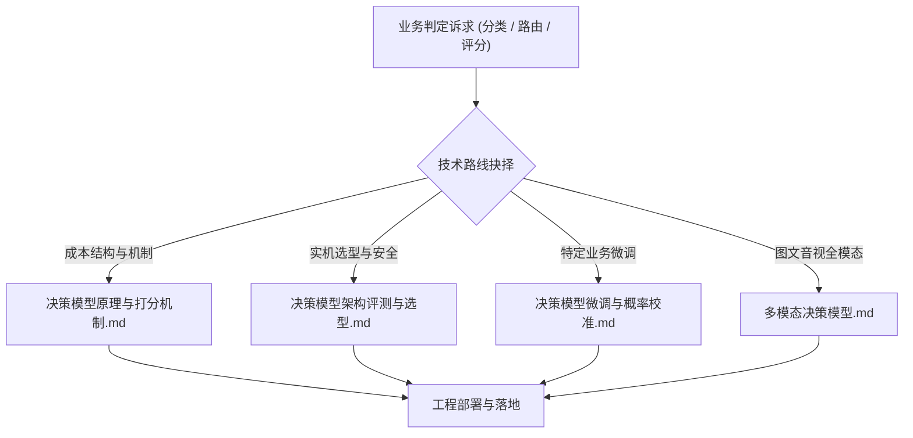

# 决策模型与判别式打分系列

> **阅读导航**：[实验入口](../../../experiments/decision-model-benchmark/) · [微调实验](../../../experiments/decision-model-finetuning/) · [检索与多向量系列](../retrieval/colbert/README.md) · [系统评估](../retrieval/检索系统全景与评估.md)

在智能体工作流、内容安全审核和企业工单分流中，大量任务本质上是分类、路由或状态判定。如果让自回归大语言模型逐字生成回复或解析 JSON，计算开销将跟着输出长度线性增长，还可能出现格式损坏与幻觉。决策模型面向预设候选项，在单次前向传播中直接输出归一化概率分布。本系列从判别式打分机制出发，系统梳理架构原理、实机基准评测、微调与概率校准，以及全模态决策模型的工程实践。

## 为什么关注决策模型

在实际业务工程中，两类场景常常遇到成本与性能瓶颈：

1. **高吞吐量与低延迟网关**：智能体在每一步规划时需要选择工具或分支，工单中心每秒需要分派数百封客户请求。要求响应时间控制在几十毫秒以内，而通用大模型即便生成一个简短的单词，端到端耗时也常在几百毫秒以上。
2. **确定性输出与下游置信度控制**：下游规则引擎往往需要明确的概率分数进行灰度分流或人工复核。自回归模型生成的自然语言或代码块需要二次正则解析，格式一旦损坏就会中断流程，且生成的文本无法直接提供校准良好的置信度。

决策模型将生成任务转化为分类与排序打分任务，为系统提供了确定性更高的判定路径。

## 看了本系列有什么收获

本系列专文覆盖以下核心内容与工程结论：

- **深入理解打分机制与成本结构**：掌握单步前向与自回归生成的计算复杂度差异，理解词表 Logits 约束打分与独立决策头的数学实现，掌握多题合并计算摊薄机制。
- **获取第一手实机选型证据**：参考同一台 aarch64 GB10 硬件平台上对 Laya、metask-jev、Nimble 及生成式基线的多项实测数据，看清各自的延迟表现、显存开销与吞吐表现。
- **掌握微调与概率校准方法**：掌握在合成决策数据（typed-decisions）上使用软交叉熵（Soft-CE）与对比蒸馏强化学习（RLCD）拟合教师软标签的数学推导，理解期望校准误差（ECE）与 Brier 分数的度量逻辑与工程陷阱。
- **看清多模态决策落地与数据安全边界**：理解四模态决策模型 Jev-Omni 的推理延迟特征与运行内存峰值，掌握视觉决策模型在训练数据构建中防范答案泄漏的严格隔离原则。

## 阅读路线与专文矩阵

根据不同研发阶段的需求，可按以下路线阅读对应专文：

| 研发阶段与关注重点 | 推荐阅读路线 | 关联实验与代码 |
|---|---|---|
| 理解决策模型原理，厘清成本结构差异 | [决策模型原理与打分机制](决策模型原理与打分机制.md) | [baseline-llm](../../../experiments/decision-model-benchmark/baseline-llm/README.md) |
| 为私有化部署选型，评估延迟、显存与风险 | [决策模型架构评测与选型](决策模型架构评测与选型.md) | [decision-model-benchmark](../../../experiments/decision-model-benchmark/README.md) |
| 训练业务决策模型，拟合软标签并校准概率 | [决策模型微调与概率校准](决策模型微调与概率校准.md) | [rlcd-policy](../../../experiments/decision-model-finetuning/rlcd-policy/README.md) · [agent-jev-text](../../../experiments/decision-model-finetuning/agent-jev-text/README.md) |
| 扩展至图文音视场景，构建多模态判定网关 | [多模态决策模型](多模态决策模型.md) | [omni-multimodal](../../../experiments/decision-model-benchmark/omni-multimodal/README.md) · [vision-decision](../../../experiments/decision-model-finetuning/vision-decision/README.md) |

配套报告：[判别式决策模型基准实测](判别式决策模型基准实测.md) · [RLCD 微调报告](RLCD微调报告.md)。

## 各专文核心议题与边界

### 1. [决策模型原理与打分机制](决策模型原理与打分机制.md)

剖析决策模型与自回归生成式模型的底层机制区别。从单步前向传播、KV 缓存消除、词表 Logits 约束打分与独立评分头的结构差异展开，推导多题合并前向计算的批处理摊薄原理。指出决策模型受限于预设选项空间，不具备开放式语义创作能力。

### 2. [决策模型架构评测与选型](决策模型架构评测与选型.md)

基于 GB10 算力盒硬件环境（20 核 CPU，121 GB 统一内存，单卡 CUDA），横向对比 ModernBERT 双分支架构（Laya 1.1B）、Qwen3.5 单 Token 约束架构（metask-jev 4B）、LoRA 适配器架构（Nimble 9B）与生成式基线（Qwen3-VL 4B）。分析延迟中位数、常驻显存、批处理收益与高置信度错误案例，给出工业落地时的置信度设闸与回退方案。

### 3. [决策模型微调与概率校准](决策模型微调与概率校准.md)

深入讲解判别式决策模型的学习目标。推导软交叉熵（Soft-CE）损失函数与 RLCD 对比蒸馏强化学习机制，解析对多采样教师模型软标签分布的拟合过程。给出 top-1 一致率、概率向量平方距离（Brier 分数）和期望校准误差（ECE）的数学公式与评测口径。明确指出软标签拟合反映的是与教师输出的一致性，不能直接等同于现实物理事件的真实发生概率。

### 4. [多模态决策模型](多模态决策模型.md)

探讨面向文本、图像、音频、视频四类输入的全模态决策模型 Jev-Omni 的工程实现。公布四模态真实推理延迟数据，剖析统一内存架构下的显存峰值与环境依赖。结合视觉自建微调实验，深入复盘 ScienceQA 数据集中参考推理泄漏这一典型工程事故，确立多模态训练数据清洗与切分的防泄漏准则。

## 评估与使用边界

阅读本系列专文与复现数据时，应注意以下工程边界：

1. **硬件与系统平台局限**：系列中所有实测性能数据均在特定 aarch64 GB10 统一内存平台测得，并未覆盖 x86_64 服务器集群或分布式多卡流水线。显存带宽与跨芯片传输开销会对不同规模模型产生非对称影响。
2. **任务与候选空间假设**：决策模型要求问题在调用前具有显式的候选选项集合（二元判断、多项分类、有序评分）。面对开放域生成、复杂逻辑推演或未定义分支的场景，仍须配合自回归大模型或检索增强流程。
3. **样本量与泛化性限制**：基准评测中的准确率与一致率指标建立在公开合成数据集或几十条特定业务短样本上。评测数据能揭示模型的内在机制和极端失误，但不能作为任何垂直业务投产的最终准确率承诺。接入实际业务前必须在自有未标注与标注数据上重新评测。
