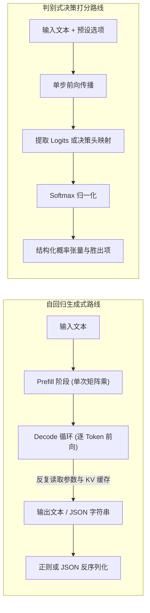
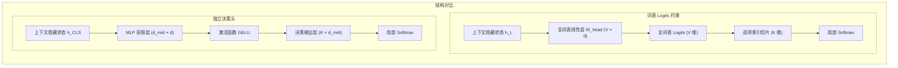
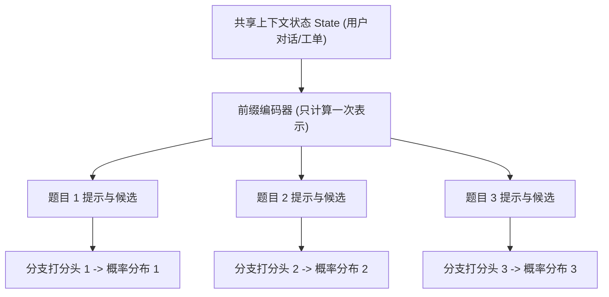

# 决策模型原理与打分机制：从自回归生成到判别式单步前向

> **阅读导航**：[决策模型系列导览](README.md) · [架构评测与选型](决策模型架构评测与选型.md) · [微调与概率校准](决策模型微调与概率校准.md)

在自动化工单分派、智能体工具调用路由或安全合规检测中，系统每秒可能需要处理成百上千个决策请求。传统做法是将提示词输入给生成式大语言模型，要求模型生成形如 `{"category": "billing"}` 的 JSON 字符串。这种方式在生产环境中暴露出延迟不可控、显存带宽浪费严重和解析容易失败等问题。决策模型（Decision Model）采用判别式打分方式，在单次前向计算中直接为所有预设选项输出概率分布。

本文深入剖析决策模型的底层打分机制，对比判别式打分与自回归生成的成本结构差异，并推导多题合并前向计算的批处理摊薄原理。

## 为什么关注打分机制

生产级系统在构建路由与判定网关时，通常面临三项工程难题：

1. **响应延迟严苛**：在人机对话流程或实时风控流中，上游判定必须在 10 至 50 毫秒内完成，而 4B 以上生成式模型单次生成即使只生成两三个词元，耗时也常常达到数百毫秒。
2. **输出格式的可靠性**：下游规则引擎依赖严格的离散选项和浮点数概率。大语言模型自回归生成时可能在输出中混入多余文字、格式标记或非法键名，导致后置正则解析异常中断。
3. **高并发下的计算成本**：若每一个决策步骤都需要逐词元解码，GPU 显存带宽将被反复搬运的参数和注意力缓存占满，无法充分发挥张量核心的算力利用率。

理解决策模型的打分机制，能够帮助架构师看清计算瓶颈究竟发生在矩阵乘法还是显存带宽，从而在系统吞吐与时延之间做出合理取舍。

## 看了本文有什么收获

阅读本文将获得以下核心认知与设计依据：

- **看清两种成本结构的核心区别**：从计算图与内存访问量角度，推导为什么自回归解码受制于显存带宽（Memory-bound），而判别式单步前向能够跑满计算核心（Compute-bound）。
- **掌握主流打分机制的实现路径**：深入掌握基于预训练词表的 Logits 约束提取机制与基于独立决策头的打分机制，理解两者的网络拓扑与计算复杂度。
- **掌握多题合并摊薄技术**：学习如何通过前缀共享与批量前向，将单个决策请求的端到端耗时从十余毫秒进一步摊薄至不足 3 毫秒。

## 为什么需要专用决策打分

让通用大语言模型直接做选择题，在底层计算架构上存在天然的机制错配。

先看一个具体的业务场景。用户发送了一条投诉消息：“我上个月被重复扣了两次会员费，请尽快把多扣的款项退回。”系统的任务是将该消息分流至四个部门之一：`["账务", "技术", "销售", "其他"]`。

如果采用传统自回归模型输出 JSON：

```json
{
  "department": "账务",
  "confidence": 0.98
}
```

模型必须完成两个阶段的运算：第一阶段将整个输入序列送入模型完成 Prefill；第二阶段进入 Decode 循环，为了生成左大括号、引号、键名、冒号、空格、选项文字以及后续字段，总共需要执行 20 至 30 次自回归前向计算。每一次计算仅产生一个 Token，但整个模型的数十亿参数必须从显存重新加载至片上缓存一次。

与此相对，决策模型在输入端接收用户状态描述与问题描述，并在模型末端直接挂载分类头或读取特定 Token 位置的 Logits。模型仅执行一次前向传播，便直接输出一个长度为 4 的张量：

$$
\mathbf{p} = [0.992, 0.003, 0.001, 0.004]
$$

这一过程没有多轮生成循环，不维护随时间步增长的 KV 缓存，避免了输出语法出错的可能。



## 核心打分机制实现路径

目前业界主流的决策模型打分机制主要分为两类：词表 Logits 约束打分与独立决策头打分。

### 1. 词表 Logits 约束打分机制

词表 Logits 约束机制常见于基于因果语言模型微调而来的决策方案（例如 metask-jev 4B）。

该方案将选项严格映射为词表中的单个词元（例如预设选项对应字母 `A`、`B`、`C`、`D`）。模型输入经过标准因果注意力掩码处理后，取序列最后一个位置隐藏状态 $\mathbf{h}_L \in \mathbb{R}^d$，与语言模型的输出投影矩阵 $\mathbf{W}_{\text{head}} \in \mathbb{R}^{V \times d}$ 相乘，得到全词表 Logits 向量 $\mathbf{z} \in \mathbb{R}^V$。

随后，系统不对整个词表执行贪心采样，而是显式切片出对应候选选项的词元索引集合 $\mathcal{I} = \{idx_1, idx_2, \dots, idx_K\}$：

$$
\mathbf{s} = [z_{idx_1}, z_{idx_2}, \dots, z_{idx_K}]
$$

最后，利用温度系数 $\tau$ 实施局部归一化：

$$
p_k = \frac{\exp(s_k / \tau)}{\sum_{j=1}^K \exp(s_j / \tau)}
$$

这种做法的优势在于能够尽量保留基础因果大模型在预训练阶段学到的语义表达能力，并且网络结构与标准语言模型完全兼容，可以直接使用通用的推理优化框架运行。其限制在于候选数量受限于设计映射规则，当候选选项包含复合短语且难以单 Token 化时，必须设计伪词元或使用特殊占位符。

### 2. 独立决策头打分机制

独立决策头机制常见于编码器架构或专门改造的解码器架构（例如基于 ModernBERT 的 Laya，以及 AgentJev）。

在该架构中，模型并不依赖原有的词表投影层，而是在骨干网络池化层之后，或者在序列特定位置（例如 `[CLS]` 词元或自定义决策标记）挂载轻量级的多层感知机（MLP）作为决策头。

设骨干网络输出的上下文隐向量为 $\mathbf{h} \in \mathbb{R}^d$，决策头包含线性投影与非线性激活层：

$$
\mathbf{s} = \mathbf{W}_2 \cdot \operatorname{GELU}(\mathbf{W}_1 \mathbf{h} + \mathbf{b}_1) + \mathbf{b}_2
$$

其中 $\mathbf{W}_1 \in \mathbb{R}^{d_{mid} \times d}$，$\mathbf{W}_2 \in \mathbb{R}^{K \times d_{mid}}$，$K$ 为该任务对应的预设类别数。

在处理候选描述本身具有动态长文本特征的任务时（例如复杂的动作选择），模型可采用前缀共享方案：状态与问题作为共享前缀完成一次注意力编码，各候选选项分别拼接在后缀位置。系统在各候选分支末端输出一个标量评分，再对本道题目的所有候选标量进行 Softmax 归一化。



## 成本结构对比：单步前向 vs 逐 Token 生成

理解两类模型的运行效率差异，必须分析每次推理过程中的显存数据搬运量与算力瓶颈。

### 计算复杂度与数据搬运量推导

设模型参数量为 $P$，隐藏层维度为 $d$，注意力头数为 $h$，序列长度为 $L$。

在自回归生成模型中，假设输入提示词长度为 $L_{in}$，模型生成结构化 JSON 产生 $L_{out}$ 个词元：

1. **Prefill 阶段**：处理 $L_{in}$ 个词元，计算量约为 $2 P L_{in}$ 次浮点运算。所有参数从显存加载一次（数据量为 $2 P$ 字节，采用 16 位浮点数）。这一阶段属于典型的计算密集型（Compute-bound），能够充分占满 GPU 计算单元。
2. **Decode 阶段**：进入生成循环，每一步生成单个词元（步数共 $L_{out}$ 次）。在每一步中，为了计算单个词元的自注意力与前向网络，整个模型的参数 $2 P$ 字节必须重新从显存加载至片上 SRAM 一次。同时，历史所有词元的 Key 和 Value 缓存必须被读取一次。第 $t$ 步的显存读取量为：

$$
\text{MemRead}(t) \approx 2 P + 2 \times 2 \times n_{layer} \times d \times (L_{in} + t)
$$

完成整个生成过程的总显存搬运量约为：

$$
\text{TotalMemRead}_{\text{autoregressive}} \approx 2 P \cdot (1 + L_{out}) + \mathcal{O}(L_{out} \cdot L_{in} + L_{out}^2)
$$

若生成一段包含 30 个词元的 JSON 字符串，$L_{out}=30$，参数在显存与计算单元之间被完整搬运了 31 次。在当前硬件体系中，显存带宽通常在 1 TB/s 至 3 TB/s 之间，计算吞吐能力远快于显存传输速度，导致计算单元在大部分时间处于等待显存数据的停顿状态（Memory-bound）。

对于判别式决策模型，无论分类选项有多少个，整个推理过程仅包含一次单步前向传播：

$$
\text{TotalMemRead}_{\text{discriminative}} \approx 2 P + \mathcal{O}(L_{in})
$$

参数仅在显存中流转一次，所有的注意力计算与矩阵相乘在一次前向中一次性完成，时间复杂度严格等同于单个 Prefill 过程。

| 指标维度 | 自回归生成式打分 | 判别式决策打分 |
|---|---|---|
| 推理步数 | $1 + L_{out}$ 步 | 严格 1 步 |
| 显存参数加载次数 | $1 + L_{out}$ 次 | 严格 1 次 |
| KV 缓存维护开销 | 随步数递增动态分配与读取 | 无需多步缓存维护 |
| 算力瓶颈性质 | Decode 阶段受制于显存带宽 | 主要是计算密集型 |
| 输出稳定性 | 可能出现格式或语法错误 | 严格符合预设张量维度 |

## 多题合并摊薄机制

在实际自动化流中，系统处理同一段上下文（例如一封长邮件或一段复杂用户会话）时，往往需要并行判断多个问题。例如：
- 问题 1：这条消息的紧急程度是高、中还是低？
- 问题 2：消息属于技术支持还是退费诉求？
- 问题 3：是否需要触发人工外呼复核？

传统串行处理需要分别调用三次模型，或者将三道题拼入一个超长提示词让大模型逐字生成完整的复杂分析。

决策模型提供了多题合并批处理机制。由于多道题目的判定完全基于同一段上下文状态（State），模型可以在批次维度或序列拼接维度，共享对状态文本的编码矩阵。



在基于 ModernBERT 架构的 Laya 模型实测中，多题合并的计算摊薄效应极为显著。在 GB10 统一内存硬件环境下，处理相同上下文下的不同题目数量时，实测端到端耗时与单题摊销如下表所示：

| 单请求包含题数 | 请求总耗时 (ms) | 单题摊销耗时 (ms) | 相对单题耗时降幅 |
|---|---:|---:|---:|
| 1 题 | 16.87 | 16.87 | 基准 |
| 2 题 | 18.44 | 9.22 | 45.3% |
| 4 题 | 22.44 | 5.61 | 66.7% |
| 8 题 | 29.36 | 3.67 | 78.2% |
| 16 题 | 45.32 | 2.83 | 83.2% |

当合并题数从 1 题增加到 16 题时，请求总耗时仅从 16.87 毫秒上升至 45.32 毫秒，平均每道题目的决策开销被压缩至 2.83 毫秒。

这背后的底层原因是：序列注意力中的长前缀仅被编码了一次，增量计算主要来自于极短的题目头线性映射。矩阵规模的适度增加恰好填补了 GPU 张量核心的空闲计算资源，使得整体计算效率逼近硬件饱和区。

## 四要素总结与工程边界

- **前提**：任务必须能够抽象为具备明确状态上下文与有限离散候选项的分类、路由或打分问题。
- **路径**：放弃自回归逐字生成机制，采用基于词表 Logits 约束提取或独立轻量级决策头架构，在单次前向中完成状态编码与候选打分，并利用多题合并机制提高算力利用率。
- **结论**：判别式决策模型将推理开销从显存带宽瓶颈转化为计算核心密集型，单次判定延迟可压减至 8 至 17 毫秒区间，多题批处理下单题开销可降至 2.83 毫秒，且从根本上避免了格式损坏和多步解码开销。
- **边界**：判别式机制无法直接用于开放式长文本创作、复杂因果推导链（CoT）生成或候选未知的自由问答场景；候选集合必须在推理前确定，如果候选分支动态变化极大，需要维护灵活的动态扩展头。
