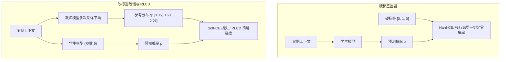
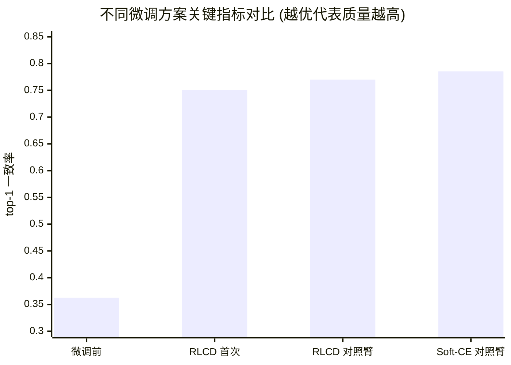
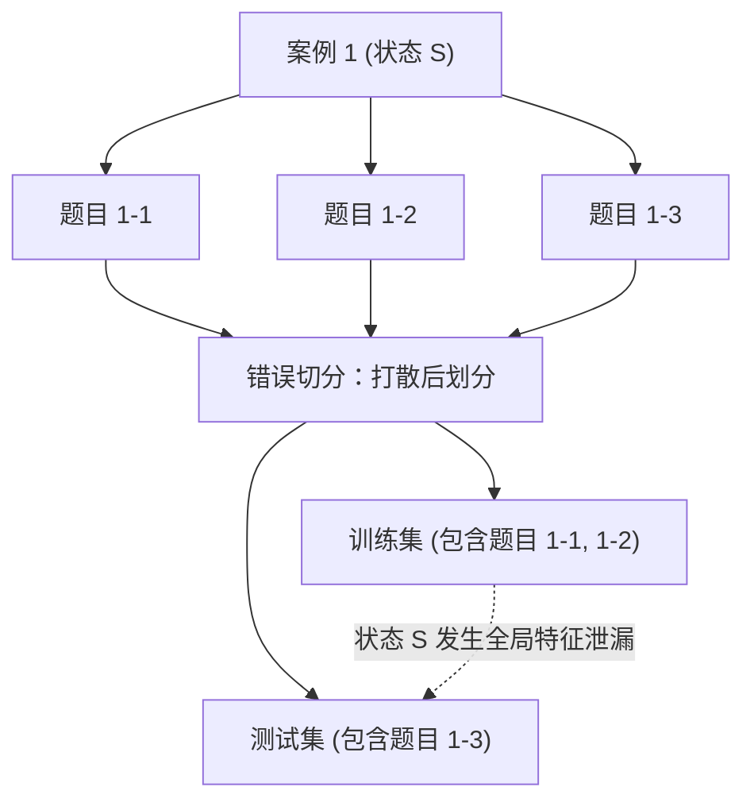

# 决策模型微调与概率校准：RLCD、软标签蒸馏与不确定性度量

> **阅读导航**：[决策模型系列导览](README.md) · [架构评测与选型](决策模型架构评测与选型.md) · [RLCD 实验复现指南](../../../experiments/decision-model-finetuning/rlcd-policy/README.md) · [RLCD 微调报告](RLCD微调报告.md)

通用基础模型在面对专业领域的判定题时，直接推理往往无法获得理想的准确率与置信度。若简单使用传统的单点硬标签（One-Hot）配合交叉熵损失进行微调，容易诱发严重的模型过度自信：预测结果几乎全部偏向 0.99 或 0.01 两个极端。一旦失去概率的相对平滑性，下游系统的置信度设闸与风险防控就会失效。

本文深入推导判别式决策模型的微调损失函数，详细对比软交叉熵（Soft-CE）与对比蒸馏强化学习（RLCD，Reinforcement Learning from Contrastive Distillation）的机制差异，并结合 typed-decisions 数据集上的实测数据，解析期望校准误差（ECE）与 Brier 分数的度量逻辑与工程边界。

## 为什么关注概率校准与微调

在工业自动化决策流中，模型的预测概率不仅仅代表排序依据，还承载着重要的业务含义：

1. **预测概率与真实命中率脱节**：如果模型对 100 个样本给出了 0.80 的预测概率，理想情况下其中应当恰好有 80 个样本预测正确。未经校准的模型往往给出 0.95 的置信度，而真实准确率仅有 70%，这种过度自信直接导致高危操作失控。
2. **硬标签抹杀不确定性信息**：在诸如复杂工单、法律合规或医疗初筛等任务中，很多案例本身具有客观模糊性。硬标签强制将某一类标为 1 其余标为 0，逼迫模型去拟合人为噪声；而由大模型多轮采样或专家群体打分形成的软标签分布（Soft labels），能够保留类别间的语义重叠信息。
3. **策略梯度与分布匹配的权衡**：如何通过对比学习让模型在拟合概率分布的同时，保持决策边界的鲁棒性，是算法工程师必须权衡的数学命题。

## 看了本文有什么收获

阅读本文将获得以下理论认知与实操指南：

- **掌握两套核心损失函数的数学推导**：理解软交叉熵对参考软分布的拟合机制，推导 RLCD 如何通过 Logits 高斯扰动和规则评分奖励构建策略梯度更新项。
- **掌握精确的概率质量评价指标**：掌握 top-1 一致率、概率向量平方距离（Brier 分数变体）与期望校准误差（ECE）的标准数学定义与分桶计算方式。
- **获取真实微调对照组实测数据**：参考在 Laya 1.1B 模型上进行 RLCD 与 Soft-CE 对照实验的真实指标，看清两者的效果差异与复现方差。
- **规避训练集泄漏与协议陷阱**：掌握案例级（Case-level）隔离与展开题目级（Question-level）划分的核心区别，防止虚假高分。

## 为什么需要软标签与专用损失

先看一个具体的决策案例。

系统需要判断某条金融操作是否存在合规风险，候选为 `["严重违规", "轻微瑕疵", "正常业务"]`。
如果采用传统硬标签监督，该样本的标签是：

$$
\mathbf{y}_{\text{hard}} = [0.0, 1.0, 0.0]
$$

损失函数会强行要求模型将对“严重违规”和“正常业务”的预测概率全部压缩到 0。但事实上，该操作虽然被判定为轻微瑕疵，其特征距离严重违规远比距离正常业务更近。强行拟合硬标签会破坏模型在潜空间中的相似度几何结构。

如果引入一个高能力教师模型，在不同温度或提示词下进行 20 次采样打分，得到的平均参考概率分布为：

$$
\mathbf{q} = [0.35, 0.60, 0.05]
$$

这个软标签分布明确表达了该案例处于“轻微瑕疵与严重违规之间，几乎不可能是正常业务”的连续语义。学生模型学习这个分布，不仅能够学习最高项的判断，还能学习不同候选之间的相对距离。

## 损失函数数学推导

### 1. 软交叉熵损失（Soft-CE）

设题目包含 $K$ 个候选项，教师模型提供的参考概率分布为 $\mathbf{q} = [q_1, q_2, \dots, q_K]$，且满足 $\sum_{i=1}^K q_i = 1$，$q_i \ge 0$。

学生模型输出的无约束 Logits 向量为 $\mathbf{z} = [z_1, z_2, \dots, z_K]$，经 Softmax 函数计算预测概率：

$$
p_i = \frac{\exp(z_i)}{\sum_{j=1}^K \exp(z_j)}
$$

软交叉熵损失定义为参考分布与预测分布之间的交叉熵：

$$
\mathcal{L}_{\text{Soft-CE}} = -\sum_{i=1}^K q_i \log p_i
$$

从信息论角度看，该损失等价于最小化教师分布与学生分布之间的 Kullback-Leibler 散度（因教师分布的香农熵 $H(q)$ 对学生模型参数而言是常数）：

$$
D_{\text{KL}}(\mathbf{q} \parallel \mathbf{p}) = \sum_{i=1}^K q_i \log \frac{q_i}{p_i} = \mathcal{L}_{\text{Soft-CE}} - H(\mathbf{q})
$$

计算损失对未归一化 Logits $z_k$ 的梯度：

$$
\frac{\partial \mathcal{L}_{\text{Soft-CE}}}{\partial z_k} = p_k - q_k
$$

这个梯度形式非常简洁：它表明反向传播信号的驱动力，就是预测概率与参考软概率之间的直接残差向量。当 $p_k = q_k$ 时，梯度处处为 0，网络达到平稳点。

### 2. 对比蒸馏强化学习（RLCD）

RLCD 在软交叉熵的基础上，引入了策略梯度与对比扰动机制，以增强模型在面临边界扰动时的决策稳健性。

其核心计算步骤如下：

1. **Logits 扰动探索**：学生模型前向输出确定性 Logits $\mathbf{z}$。为了模拟决策的不确定性，在 Logits 上叠加独立同分布的高斯噪声：

$$
\tilde{\mathbf{z}} = \mathbf{z} + \boldsymbol{\epsilon}, \quad \boldsymbol{\epsilon} \sim \mathcal{N}(\mathbf{0}, \sigma^2 \mathbf{I})
$$

2. **扰动策略分布**：基于加噪后的 Logits 计算探索策略 $\tilde{\mathbf{p}} = \operatorname{Softmax}(\tilde{\mathbf{z}})$。
3. **评分规则奖励计算**：使用严格真值评分规则（Proper Scoring Rule），根据探索分布与参考分布 $\mathbf{q}$ 的匹配程度计算标量奖励 $R$。常用的是负 Brier 距离奖励：

$$
R(\tilde{\mathbf{p}}, \mathbf{q}) = 1.0 - \sum_{i=1}^K (\tilde{p}_i - q_i)^2
$$

4. **策略梯度目标构造**：将奖励作为优势函数的基准，与基线软交叉熵加权组合：

$$
\mathcal{L}_{\text{RLCD}} = \alpha \mathcal{L}_{\text{Soft-CE}} + (1 - \alpha) \mathcal{L}_{\text{PG}}
$$

其中策略梯度损失项推动高奖励方向的概率质量提升：

$$
\mathcal{L}_{\text{PG}} = -\mathbb{E}_{\tilde{\mathbf{p}}} \left[ (R - b) \sum_{i=1}^K q_i \log p_i \right]
$$

$b$ 为批次内的移动基线，用于降低梯度的方差。通过在输出层施加可控扰动并借助评分奖励实施反馈，RLCD 促使模型在平坦的损失曲面中寻找鲁棒性更好的参数区域。

## 评价指标的标准数学定义

在评测决策模型对软概率分布的拟合与校准质量时，必须严格区分四项统计指标：

### 1. top-1 一致率（top-1 Agreement）

衡量学生模型预测概率最高的选项，是否与参考分布中最高概率的选项相吻合：

$$
\text{Agreement} = \frac{1}{M} \sum_{m=1}^M \mathbb{I}\left( \arg\max_{k} p_k^{(m)} = \arg\max_{k} q_k^{(m)} \right)
$$

其中 $M$ 为测试总题数，$\mathbb{I}$ 为指示函数。注意：在合成数据集上，该指标度量的是与教师选择的一致性，不能直接等同于现实物理事件的真实命中率。

### 2. 概率向量平方距离（Brier 分数变体）

衡量预测分布向量与参考分布向量之间的均方误差：

$$
\text{Dist}_{\text{sq}} = \frac{1}{M} \sum_{m=1}^M \sum_{k=1}^K \left( p_k^{(m)} - q_k^{(m)} \right)^2
$$

该指标越低，说明学生输出的完整概率曲线与教师分布贴合得越紧密。

### 3. 期望校准误差（Expected Calibration Error, ECE）

ECE 度量预测置信度与实际准确率之间的统计对齐程度。

计算过程如下：
1. 取每道题预测概率的最大值作为置信度：$\hat{p}^{(m)} = \max_k p_k^{(m)}$。
2. 将置信度区间 $[0, 1]$ 划分为 $B$ 个等宽区间（桶）$I_1, I_2, \dots, I_B$。
3. 统计落入第 $b$ 个桶的样本子集 $\mathcal{B}_b$。
4. 计算该桶内的平均置信度与平均真实一致率：

$$
\operatorname{conf}(\mathcal{B}_b) = \frac{1}{|\mathcal{B}_b|} \sum_{m \in \mathcal{B}_b} \hat{p}^{(m)}
$$

$$
\operatorname{acc}(\mathcal{B}_b) = \frac{1}{|\mathcal{B}_b|} \sum_{m \in \mathcal{B}_b} \mathbb{I}\left( \arg\max_k p_k^{(m)} = \arg\max_k q_k^{(m)} \right)
$$

5. 对所有非空桶按样本权重求绝对差值的加权平均：

$$
\text{ECE} = \sum_{b=1}^B \frac{|\mathcal{B}_b|}{M} \left| \operatorname{acc}(\mathcal{B}_b) - \operatorname{conf}(\mathcal{B}_b) \right|
$$

ECE 越低，表明给出的置信度越可信。

## 真实微调实验对比数据

在统一硬件 GB10、基于相同 Laya 1.1B English checkpoint、固定随机种子 seed 0、4 个 epoch（单卡 micro-batch 8，梯度累积 8）的设置下，在 typed-decisions 测试集（400 案例，共 2000 题）上执行严格对比实验，结果如下表所示：

| 实验配置臂 | top-1 一致率 ↑ | 概率向量平方距离 ↓ | ECE ↓ | 平均最大置信度 | 机制特征与收敛表现 |
|---|---:|---:|---:|---:|---|
| 微调前基础模型 | 0.3625 | 0.3155 | 0.1737 | 0.5362 | 初始权重未适应任务，一致率低且平方误差很大 |
| RLCD 首次运行 | 0.7510 | 0.0576 | 0.1321 | 0.6195 | 拟合显著提升，校准误差压降明显 |
| RLCD 对照臂 | 0.7700 | 0.0512 | 0.1387 | 0.6332 | 相同种子下因算子并行时序差异产生的正常方差 |
| soft-ce 对照臂 | **0.7855** | **0.0498** | 0.1523 | 0.6344 | top-1 一致率最高，平方距离最优，但 ECE 略高于 RLCD |

### 深入实测结论分析

1. **Soft-CE 在拟合精度上的优势**：soft-ce 对照臂取得了最高的 top-1 一致率（0.7855）与最低的平方距离（0.0498），相比 RLCD 对照臂高出 1.55 个百分点。其原因在于 soft-ce 的优化目标纯粹对准参考分布，损失曲面更平滑，梯度方向确定性更高。
2. **RLCD 在校准误差上的微弱优势**：RLCD 在两次运行中分别取得了 0.1321 与 0.1387 的 ECE，均低于 soft-ce 的 0.1523。高斯扰动与评分奖励机制起到了类似正则化的作用，遏制了最高概率项的过度膨胀，使得输出分布更加谨慎。
3. **随机性与复现方差**：在相同配置与相同 seed 0 下，两次独立运行的 RLCD 之间存在 1.9 个百分点的一致率波动（0.7510 vs 0.7700）。这表明强化学习采样项引入了更显著的结果方差，在小样本场景下需要多次实验取均值。

## 关键工程陷阱与防范规范

在决策模型的数据构建与微调过程中，存在三个容易忽略的常见问题：

### 1. 案例级划分与展开题目级划分的泄漏陷阱

在 typed-decisions 这类基准中，每个案例包含一段状态（State，如一段长会话）以及基于该状态提出的 5 道决策题。

若数据处理脚本在切分训练集与测试集之前，先将案例展开为独立的 5 道题目，然后执行随机打散（Shuffle）切分：

此时，题目 1-1 进入训练集，题目 1-3 进入测试集。虽然题目文本不同，但两者共享了完全相同的状态长文本 $S$。模型在训练阶段已经对状态文本形成了深度过拟合，导致在测试集上的指标产生虚高假象。

**规范准则**：必须坚持**先按案例（Case ID）做哈希切分，切分锁定后再展开题目**。训练集、验证集、校准集与测试集之间，必须做到状态文本层面的绝对物理隔离。

### 2. 模式定义不一致警告（Schema Conflict）

训练日志中曾出现同名问题定义发生冲突的警告。在某些多轮数据集中，同一标识符的问题在后续案例中被赋予了不同的候选项列表。若模型缓存了静态的题目编码，会导致张量对齐错位。工程实现必须确保题目元数据是动态构建并严格校验的。

### 3. 温度校准的搜索网格设计

在完成模型微调后，通常利用独立的校准集（Calibration Set）拟合全局标量温度 $\tau$。训练代码若将温度搜索上限固定为 2.0，实测中最优温度往往会触碰 2.0 上限，说明网格区间过窄。建议将网格扩展为 0.5 至 4.5 范围内的等间距网格，确保能够捕获真实的极值点。

## 四要素总结与工程边界

- **前提**：基础模型需要适应垂直领域离散决策任务，且下游业务对概率的真实性和平滑度有严格要求。
- **路径**：采用教师模型多采样生成的软标签分布作为目标，推导并应用软交叉熵或 RLCD 损失进行优化，在独立的校准集上拟合温度参数，并以 ECE 与 Brier 分数度量拟合质量。
- **结论**：微调后模型在合成数据上的 top-1 一致率可从 36.25% 提升至 78.55%，平方距离压降 84%；Soft-CE 在拟合精度上略占优势，而 RLCD 在校准误差上表现更为稳健。
- **边界**：软标签来自教师模型采样而非现实世界的客观事实，拟合指标仅代表与教师的一致性，不能外推为真实业务决策的绝对正确率；训练必须按案例级别严格隔离，杜绝跨划分状态泄漏。
