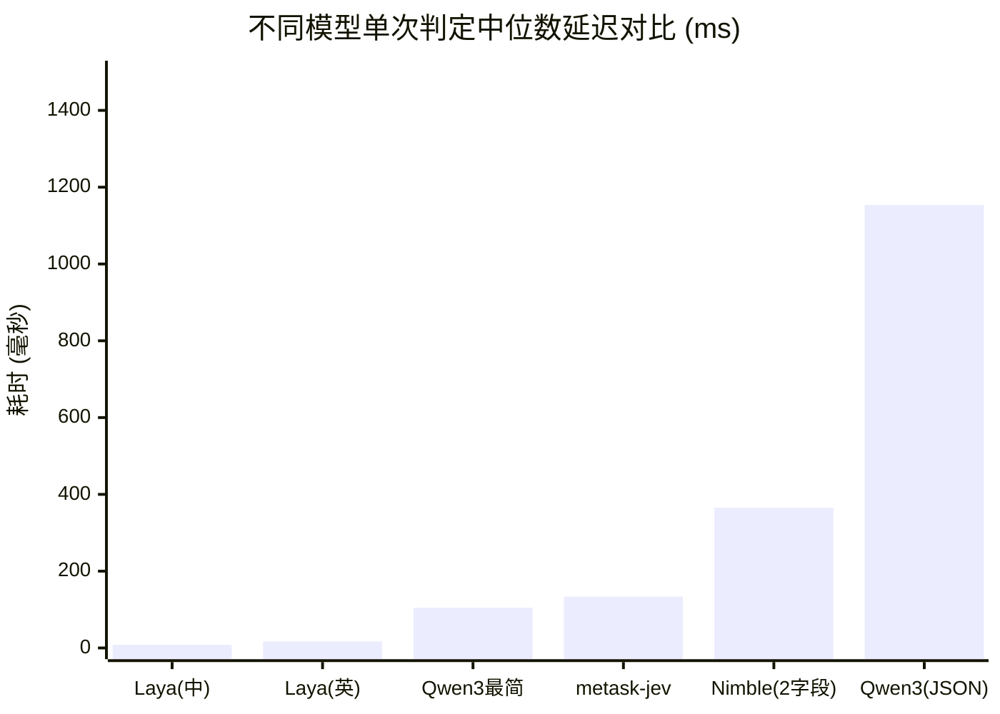
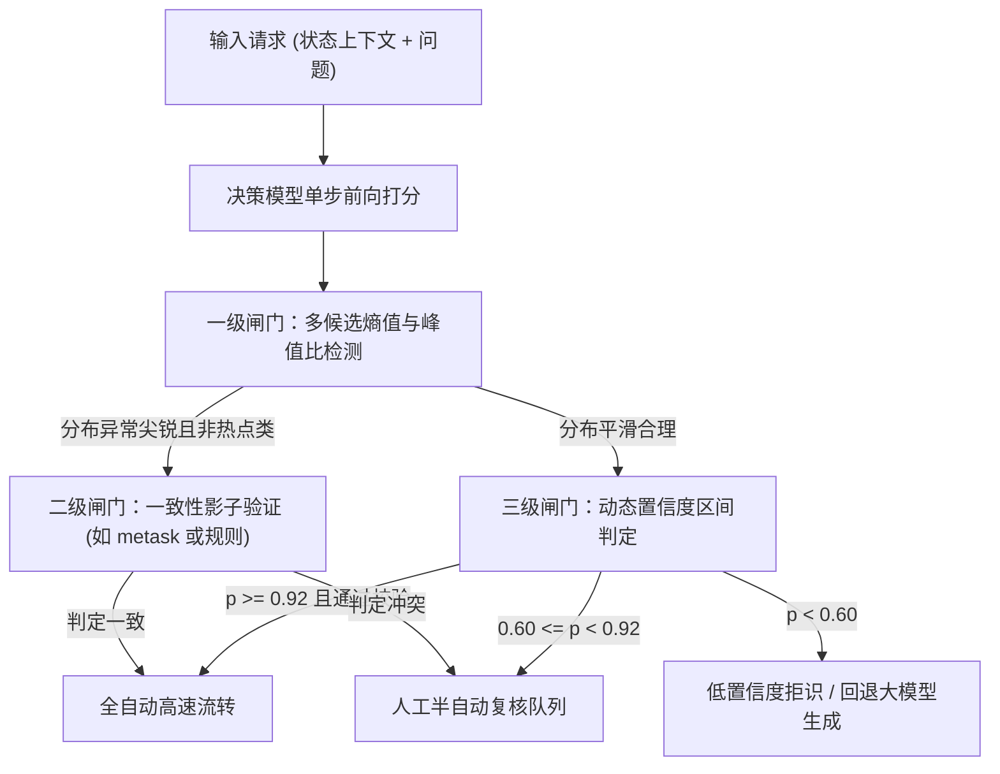

# 决策模型架构评测与选型：基于 GB10 算力盒的实机基准与设闸机制

> **阅读导航**：[决策模型系列导览](README.md) · [原理与打分机制](决策模型原理与打分机制.md) · [微调与概率校准](决策模型微调与概率校准.md) · [基准评测实验源码](../../../experiments/decision-model-benchmark/README.md)

在决策模型落地选型时，工程师经常面临来自开源社区的不同技术路线：有的基于现代双向编码器定制判别头，有的基于主流生成式模型限制输出单词元 Logits，还有的挂载 LoRA 适配器。各项目在论文和宣传文档中声称的高吞吐与极低校准误差，往往建立在特定硬件插值或理论估算之上，直接接入生产环境容易遇到显存溢出、CUDA 前向未共享导致的延迟骤增，以及高置信度误判漏过等隐患。

本文基于 aarch64 架构 GB10 算力盒（20 核 CPU，121 GB 统一内存，单卡 CUDA），对 Laya、metask-jev、Nimble 以及生成式大模型基线 Qwen3-VL 展开严格的同硬件实测，给出延迟、显存、准确率对比与系统设闸方案。

## 为什么关注架构选型

在构建轻量级本地判定服务时，技术团队面临以下决策矛盾：

1. **宣传指标与真实落地的落差**：部分开源方案在上游自述中展示了极低的理论校准误差和极高吞吐，但在实际私有化算力设备上部署时，因底层算子未针对 CUDA 优化或运行时未共享前向，实际性能大打折扣。
2. **硬件资源的承载上限**：边缘算力盒或单卡 GPU 的显存与内存资源有限。若仅仅为了执行工单三级分类，常驻模型就占用接近 20 GB 显存，将挤占主干智能体或检索服务的资源空间。
3. **静默误判的高危影响**：低置信度错误容易通过阈值截获并交由人工处理；一旦模型在错误分类上给出超过 0.90 的极高置信度，自动化系统将直接误分发，产生业务事故。

## 看了本文有什么收获

阅读本文将获得以下实证数据与设计方案：

- **获取 GB10 平台的端到端实机数据**：获取在相同硬件与输入口径下测得的毫秒级中位数延迟、冷启动开销、常驻显存以及 20 题分类真实准确率。
- **理解不同架构在 CUDA 上的底层瓶颈**：弄清为什么基于 LoRA 适配器的 Nimble 在 CUDA 平台需要 365 毫秒且显存高达 17.57 GB，看清自回归模型为何因输出长度变化产生 10 倍以上的延迟波动。
- **掌握高置信度错误与安全设闸机制**：通过真实错题剖析，建立由置信度区间划分、熵值监测与双重验证构成的三级防护体系。

## 为什么要做统一实机评测

为了直观理解评测的必要性，先看一个具体的工程案例。

某团队需要在工单中心上线自动派单网关。上游文档宣称某个 9B 的 LoRA 适配方案在 Mac 统一内存架构上能够并行给多字段打分，单次调用开销很小。但当工程团队将其部署到 NVIDIA CUDA 显卡上时，处理一条包含「工单类别」和「紧急程度」两个字段的请求，单次推理耗时竟高达 365 毫秒，显存常驻 17.57 GB。深入阅读上游底层源码才发现：该模型在 CUDA 路径并未实现前向计算共享，每增加一个判断字段，就必须执行一次完整的 9B 模型前向传播。

同时，metask 项目在上游文档中宣称通过特定对齐将校准误差降低至 0.040、理论每千次决策仅需微量成本。但在真实业务样本测试中，该数字为自测插值，且未经第三方复核。

因此，摆脱理论宣传，在同一台基准硬件、相同的输入样本和相同的度量规则下执行端到端实测，是避免架构选型失误的可靠路径。

## 评测环境与被测架构

评测统一在 GB10 算力盒上进行，环境参数如下表：

| 评估项 | 运行环境与参数配置 |
|---|---|
| 计算硬件 | aarch64 架构 GB10 算力盒（20 核 CPU，121 GB 统一内存，单卡 CUDA） |
| 软件环境 | Python 3.12，PyTorch 2.14.0+cu130，CUDA 13.0 |
| 输入短样本 | 英文样本 86 字符（重复扣费投诉），中文样本对应翻译约 25 字 |
| 提示词规模 | metask 分词后输入长度为 239 至 244 个 Token |
| 评估题量 | 20 条分类测试题与 5 条命题判断题（Nimble 因题目体系不同仅参与延迟测试） |

被测模型覆盖四种截然不同的工程路线：

1. **Laya 1.1B**：基于双向 ModernBERT 编码器构建，通过内置轻量路由器在英文分支与多语言分支之间自动分流，输出端直接映射至任务打分头，直接支持单请求多题合并。
2. **metask-jev 4B**：基于 Qwen3.5-4B 因果语言模型全参微调，将预设答案约束为单个 Token，直接读取输出层对应词元的 Logits 并做温度归一化。
3. **Nimble 9B**：基于 Qwen3.5-9B 基础模型挂载 LoRA 适配器，在 CUDA 运行时按字段依次调用打分器。
4. **Qwen3-VL 4B 基线**：主流视觉语言生成式大模型，作为自回归对比参照，分为最简文本输出与完整结构化 JSON 输出两种模式。

## 核心基准评测数据

### 1. 延迟与显存开销对比

下表记录了各模型在执行单次完整判定时的中位数耗时与常驻显存开销（数据取自评测日志）：

| 模型对象与测试条件 | 输入语言与题型 | 单次判定延迟中位数 (ms) | 常驻显存占用 | 架构特性与运行瓶颈 |
|---|---|---:|---:|---|
| Laya 多语言分支 | 中文 1 题 | 8.25 | 5.96 GB | ModernBERT 编码器，单步前向完成 |
| Laya 英文分支 | 英文 1 题 | 16.98 | 5.96 GB | 两个分支落入不同参数权重，路由开销 0.02~0.19 ms |
| Qwen3-VL 4B 最简模式 | 中文单字输出 | 104.85 | 8.30 GB | 仅生成单个词元，免去长文本解码开销 |
| Qwen3-VL 4B 最简模式 | 英文单词输出 | 103.48 | 8.30 GB | 作为生成式调优的极限参考 |
| metask-jev 4B | 英文 1 题 | 133.50 | 8.58 GB | Qwen3.5 因果单步提取 Logits |
| metask-jev 4B | 中文 1 题 | 133.70 | 8.58 GB | 中英延迟表现高度对称且稳定 |
| Nimble 9B | 英文 2 字段 | 365.33 | 17.57 GB | CUDA 路径逐字段执行完整前向，显存与耗时最高 |
| Nimble 9B | 中文 2 字段 | 366.66 | 17.57 GB | 字段数增加时耗时线性递增 |
| Qwen3-VL 4B JSON 模式 | 中文结构化 | 1153.54 | 8.30 GB | 额外生成 23 至 29 个格式词元，耗时激增 11 倍 |
| Qwen3-VL 4B JSON 模式 | 英文结构化 | 1448.17 | 8.30 GB | 自回归解码受显存带宽拖累的典型表现 |

### 2. 准确率实测与高置信度错误剖析

在 20 条分类测试样本中，Laya 与 metask-jev 4B 的表现如下：

| 模型对象 | 英文分类准确率 (20 题) | 中文分类准确率 (20 题) | 典型失误现象 |
|---|---:|---:|---|
| Laya 1.1B | 95.0% (19/20) | 95.0% (19/20) | 中文出现置信度 0.906 的严重误判；中文命题判断出现敏感性失效 |
| metask-jev 4B | 95.0% (19/20) | 100.0% (20/20) | 英文错 1 题但各题置信度平滑，模型自带题型温度系数 |
| Nimble 9B | 未在同题目下测 | 未在同题目下测 | 采用专有测试集，准确率未纳入同表比对 |
| Qwen3-VL 4B | 未在同题目下测 | 未在同题目下测 | 仅作为成本与延迟参照 |

#### 深度案例剖析：Laya 的高置信度误判漏过事故

在中文分类测试中，测试样本包含一条属于「其他」类别的模糊咨询。Laya 多语言模型将其分类判定为「账务问题」，并给出了高达 **0.906** 的预测概率。

这是生产自动化系统中最危险的一类故障。在通常的架构设计中，工程师习惯设置 0.85 或 0.90 作为直接自动流转的置信度门限。该样本由于置信度高达 0.906，会直接绕过人工审核队列进入工单账务库，导致错误的扣费流转。

深入分析其原因：Laya 在特定小样本多语言任务微调时，判别头在少量密集类别上出现了过拟合，且缺乏平滑惩罚，导致输出分布过于陡峭（Sharp distribution）。这证明了**未经概率校准的置信度不能直接等同于真实可靠度**。

#### 深度案例剖析：Laya 中文命题判断的语义脆弱性

在 5 条中文命题判断测试中，面对三个语义表达完全明确的退订威胁句子，Laya 给出的「命题为真」概率分别仅有 0.025、0.051 和 0.028，全部判定为假。而对应意思相同的英文样本，英文 checkpoint 全部给出了正确的真值判定。

这表明：Laya 的英文双向表征基础能力扎实，但其多语言分支在中文长尾命题与复杂语法结构上的语义泛化存在缺口。若在业务中直接引入其处理中文命题判断，必须先用目标场景的领域语料重新微调。

## 三条选型建议矩阵

综合延迟、显存占用、任务类型与跨语言能力，给出以下工程选型建议矩阵：

| 业务场景特征 | 推荐架构路线 | 选型核心理由与收益 | 潜在风险与防范措施 |
|---|---|---|---|
| 超高并发、极低时延（<20ms）、显存敏感、英文为主或简单多语言分类 | **Laya 1.1B** | 端到端 8 至 17 毫秒，显存仅 5.96 GB，支持多题合并将单题成本压至 2.83 毫秒 | 中文长尾命题易判错，存在高置信度过拟合；必须设置温度重校准 |
| 严肃中文业务流转、需要丰富通识理解、允许 100~150ms 时延 | **metask-jev 4B** | 中文 20 题全对，时延稳定在 133 毫秒，基于 Qwen3.5 预训练语义模型，语言理解较好 | 显存需 8.58 GB，时延高出 Laya 一个数量级；单次请求不支持复杂多题特征复用 |
| 多字段联合判断、已有特定 LoRA 资产、纯 Mac 统一内存环境 | **Nimble 9B** | 在支持并行共享前向的特定平台上支持灵活多字段定义 | 严禁直接部署于生产级 CUDA 平台（逐字段串行推理导致耗时突破 360 毫秒，显存高达 17.57 GB） |
| 复杂因果分析、自由长文本归纳、缺乏预设选项的开放场景 | **自回归大模型 (如 Qwen3)** | 能够自由组织生成语言，处理开放世界复杂逻辑 | 耗时突破 1000 毫秒，每步解码占用显存带宽；严禁用于简单二元判断与固定类别路由 |

## 安全设闸机制：如何拦截高置信度误判

为防范类似 Laya 的高置信度误判漏过，生产系统不能单纯依赖 `max(probabilities) > threshold` 进行单一条件设闸。必须在系统层建立三级设闸架构：

1. **一级闸门：分布熵与峰值差异检测**：除了最高项概率，同时计算概率向量的信息熵 $H(p) = -\sum p_i \log p_i$。若某个输入命中了训练集较少覆盖的类别，但最高概率异常高达 0.90 以上且次高项接近 0，系统触发警报。
2. **二级闸门：双模型影子分流验证**：在核心资产分发或退款结算等敏感环节，将轻量级 Laya（处理前置过滤）与高语义能力的 metask-jev 4B 并行运行。当两者给出不同预测时，无论个别模型的置信度多高，一律降级拦截。
3. **三级闸门：置信度分层流转**：
   - **自动化区间（$p \ge 0.92$）**：直接接入下游自动化 API。
   - **人工复核区间（$0.60 \le p < 0.92$）**：工单自动打标并推入坐席待办台，给出概率参考。
   - **拒识回退区间（$p < 0.60$）**：判别式模型判定条件不足，回退至带 CoT 的自回归大模型进行多轮追问，或触发未识别默认处理。

## 四要素总结与工程边界

- **前提**：在单卡或边缘计算平台部署判别式决策服务，且业务需要兼顾延迟、显存与判定可靠性。
- **路径**：在相同硬件与数据口径下评测专用编码器、因果 Logits 约束和 LoRA 架构，分析性能瓶颈，并构建三级防护闸门。
- **结论**：Laya 具备极致的延迟（8 至 17 毫秒）与多题合并收益，但中文语义存在边界缺口；metask-jev 4B 语言通识表现优秀且延迟可控（133 毫秒）；Nimble 在 CUDA 平台存在严重的非共享前向缺陷；生成式方案随输出长度增加会产生 11 倍以上的成本膨胀。
- **边界**：小样本基准评测旨在揭示底层机制与极端缺陷，不代表垂直业务真实落地的最终召回率；各方案上线前必须使用生产真实验收集进行二次校准与测试。
