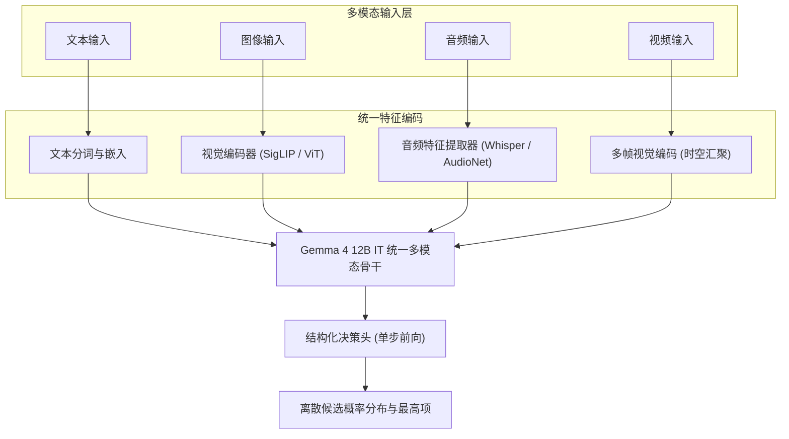
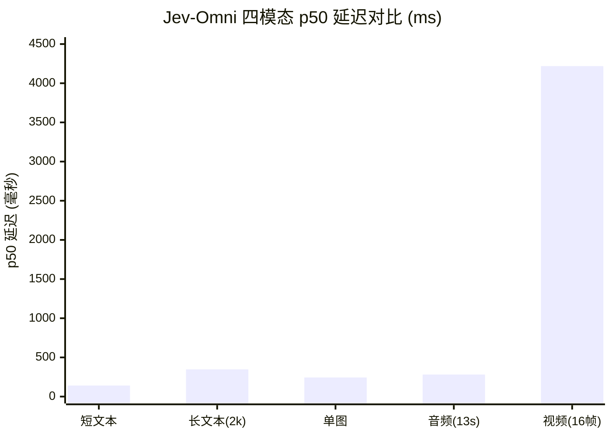

# 多模态决策模型：Jev-Omni 四模态实测与防泄漏训练边界

> **阅读导航**：[决策模型系列导览](README.md) · [架构评测与选型](决策模型架构评测与选型.md) · [Jev-Omni 实验目录](../../../experiments/decision-model-benchmark/omni-multimodal/README.md) · [视觉微调实验目录](../../../experiments/decision-model-finetuning/vision-decision/README.md)

随着智能体交互形态的丰富，自动化决策系统面临的输入已经从纯文本扩展至单据截图、商品破损照片、客服对话音频以及监控视频片段。若直接部署基于生成式视觉语言大模型（VLM）的多模态流程，不仅单次推理耗时常常高达数秒甚至数十秒，还可能因为视觉幻觉产生格式错误。多模态决策模型将文本、图像、音频、视频四类多模态特征直接投影至选项概率空间，实现端到端的快速判定。

本文以全模态决策模型 Jev-Omni（基于 Gemma 4 12B IT 基础模型）与自建视觉决策模型（基于 Qwen3.5-2B 架构）为核心对象，系统剖析多模态概率打分机制、四模态实机延迟数据、工程部署问题，并复盘多模态决策微调中极具破坏性的数据泄漏事故。

## 为什么关注多模态决策

在涉及物理世界交互与富媒体流转的业务中，存在大量高度时效性的离散判定场景：

1. **图文音视混合输入的统一路由**：电商客服系统既接收用户的维权文字，又接收退货商品外观照片；车载与安防设备需要实时根据麦克风声音和摄像头画面判断当前是否存在安全事件。构建四套独立系统维护成本很高，需要统一的多模态决策基础模型。
2. **多模态自回归生成的延迟与算力瓶颈**：传统多模态模型为了输出一个分类结果，必须先将图像拆为数百个视觉词元，再结合上下文执行多步自回归生成。以视频分析为例，单次生成耗时常常突破 10 秒，无法满足工业流水线的节奏。
3. **多模态数据训练中的隐蔽泄漏**：多模态多源数据集通常结构繁杂，包含上下文、问答、多模态特征以及解析步骤。若清洗脚本处理不当，容易将参考答案推理误当成上下文输入给模型，导致看似准确率很高、实则没有独立判定能力的严重事故。

## 看了本文有什么收获

阅读本文将获得以下多模态决策工程经验与实测依据：

- **理解全模态决策架构的输入与映射**：了解 Jev-Omni 如何在单模型内部接纳文本、图像、音频与视频，并直接计算候选概率分布。
- **获取真实环境四模态延迟指标**：掌握同一台 GB10 算力盒上实测的文本短输入、长输入、单图、13 秒音频与 16 帧视频的毫秒级中位数延迟。
- **掌握关键部署与运行注意事项**：包括 transformers 5.17.0 强依赖、FP32 权重转换加载时主机内存峰值升至 60 GB、音频 ffmpeg 覆写问题及其运行时补丁方案。
- **牢记 ScienceQA 参考推理泄漏教训**：彻底弄清视觉微调实验中将 `solution` 误入 state 的事故机制，掌握按图像 SHA-256 去重与严格字段白名单的防泄漏规约。

## 为什么需要专用多模态打分

先看一个具体的电商售后定责案例。

用户上传了一张包裹外包装破损的照片，并附带文字“箱子收到时已经被压扁了，里面的零件有划痕”。系统预设的责任方选项为：`["物流责任", "商家包装缺陷", "用户人为损坏", "正常无损"]`。

如果调用通用多模态大模型输出 JSON：
1. 模型首先将图片切分为 $24 \times 24 = 576$ 个图像 Patch 向量。
2. 文本与图像向量拼接后经过注意力矩阵，产生大量的跨模态交互。
3. 进入自回归解码，逐字生成 `{"fault": "物流责任", "reason": "..."}`。这通常需要生成 40 至 80 个 Token，整体耗时在 2 到 5 秒之间，且容易受到长文本 CoT 诱导出现偏见。

多模态决策模型在接收图文输入后，前向网络直接在输出位置计算预设 4 个选项的匹配能量，单步输出概率向量：

$$
\mathbf{p} = [0.932, 0.051, 0.012, 0.005]
$$

这一过程将图像编码开销与决策头直接挂钩，单次前向完成判定，耗时大幅压减至几百毫秒。

## Jev-Omni 全模态实机评测与延迟特征

Jev-Omni 是社区首款开源的全模态类型化决策模型，采用 Gemma 4 12B IT 作为跨模态基础模型，全参决策骨干为 12B。

在 aarch64 GB10 算力盒（20 核 CPU，121 GB 统一内存，单卡 CUDA）上，基于官方推荐的环境配置，实测性能与延迟数据如下。

### 1. 四模态延迟基准测试（30 次采样统计）

| 模态与输入规格 | 测试样本详情 | 中位数延迟 p50 (ms) | p90 延迟 (ms) | p99 延迟 (ms) | 耗时主要构件与瓶颈 |
|---|---|---:|---:|---:|---|
| 短文本 | 常见中英文咨询单句 | 140.98 | 142.30 | 152.48 | 基础模型单步前向耗时 |
| 长文本 | 包含历史背景约 2000 Tokens | 347.15 | 349.63 | 351.51 | 注意力计算随长度呈二次方增长 |
| 单张图像 | 常见分辨率特写照片 (如猫、商品) | 244.09 | 250.91 | 253.97 | 视觉编码器切片与投影开销约 100 ms |
| 音频 | 约 13 秒英文对话音频 (MP3 转码) | 280.92 | 290.66 | 293.61 | 前置 ffmpeg 转码 + 音频特征切片 |
| 视频 | 约 19 秒视频，按协议均匀抽取 16 帧 | 4218.80 | 4296.97 | 4366.44 | 16 张完整帧分别经过视觉编码器编码 |

### 2. 深入延迟瓶颈剖析：视频为何需要 4.2 秒

在纯文本或单图输入下，Jev-Omni 的端到端时延仅在 140 至 250 毫秒之间，表现出色。但一旦切换至视频模态，延迟急剧上升至 4218 毫秒。

深入剖析底层的执行时序与算子瓶颈：
- 按照官方设定的视频评估协议，模型从视频流中均匀截取 16 个代表帧。
- 这 16 张高分辨率图像在当前实现中是依次串行通过视觉编码器完成 Patch 切分与特征投影的，仅图像编码阶段就消耗了近 3.5 秒的张量计算时间。
- 随后，16 帧对应的数千个视觉 Token 与问题提示词共同组成超长序列，送入 12B 骨干网络执行全注意力交互。

若在实际业务中需要压缩视频决策延迟，工程上必须对帧采样率进行剪枝（例如从 16 帧降至 4 帧），或者前置设置轻量级时序变化检测器，仅对发生场景突变的关键帧进行多模态编码。

## 关键工程部署要点与运行时常见问题

在 GB10 与 Linux/CUDA 环境中部署 Jev-Omni 时，必须严格遵循以下五项工程纪律：

### 1. transformers 库版本的硬性边界

Jev-Omni 的底层架构命名为 `Gemma4UnifiedForConditionalGeneration`。该模型类定义首次正式合入是在 transformers 5.17.0。若运行环境安装的是 5.16.x 或更早版本，模型加载脚本会在导入阶段直接抛出 `Could not import module` 致命异常。必须在依赖管理中硬锁定 `transformers==5.17.0`。

### 2. FP32 权重分发与加载时主机内存峰值升至 60 GB

Jev-Omni 的官方决策骨干以 FP32 格式分发，分为 13 个权重分片，总容量高达约 48 GB。基础模型 Gemma 4 则以约 24 GB 的 BF16 格式分发。

加载流程在设备上表现为两段式：
1. 首先将 48 GB 的 FP32 骨干权重逐片读入主机内存；
2. 在内存中将全部线性层显式转为 BF16；
3. 将基础模型的文本骨干与决策骨干进行拼接并送入显存。

虽然最终稳定运行时常驻显存仅需约 27 GB，但在第一阶段读取 FP32 权重时，系统的**瞬时内存峰值会逼近 60 GB**。在统一内存架构的算力盒上，可用内存一旦低于 60 GB 就会直接触发系统的 OOM Killer。同时，由于需要从磁盘连续读取 48 GB 散列分片，模型首次冷启动加载时间实测长达约 8 分钟（431 至 449 秒）。在生产集群中，严禁频繁重启服务，必须保持进程常驻。

### 3. 音频推理中的 ffmpeg 覆写阻塞缺陷与运行时补丁

在 Jev-Omni 处理音频输入时，官方加载器调用系统 ffmpeg 将用户传入的音频转换为临时 WAV 文件。然而官方脚本构建命令行时，遗漏了 `-y`（自动覆盖现有文件）参数。

当同一服务进程处理第二次音频请求时，由于临时文件路径固定且已存在，后台 ffmpeg 会打印交互提示：`already exists. Overwrite? [y/N]`。在非交互式的 HTTP 服务或微服务网关中，该子进程会无限期挂起等待标准输入，最终导致整个决策服务请求超时死锁。

**工程解决方案**：无须直接修改上游第三方源码，可在运行时包装 `subprocess.run`，动态检测包含 `ffmpeg` 的调用指令，自动追加 `-y` 标志，从而保证在连续高并发调用下的完全幂等与健壮性。

### 4. 跨运行轮次判定波动的安全防范

在固定测试素材（CC0 猫图、英文音频、阅读视频）的测试中，保持模型权重与输入文件完全一致，连续多次启动服务运行综合测试套件，观察到图像与视频模态存在小幅的判定波动。例如：视频用例在不同轮次间在「基本静止」与「沿墙移动」之间产生微小翻转，置信度出现浮动。

这一现象提示我们：单次高置信度输出不等于该样本具备极强的判别绝对性。对于多模态关键业务，应当设置二次抽样机制或利用阈值设闸，避免极端样本穿透。

## 视觉决策模型微调与防泄漏警戒

除了直接采用开源全模态模型，企业通常也会针对垂直视觉场景（例如工业质检、票据分类）自建模型。我们在 `vision_jev_train` 实验中，采用 Qwen3.5-2B 作为原生多模态基础模型，通过挂载 LoRA 适配器与轻量标量打分头，探索视觉决策模型的微调路径。

然而，在这一实验的数据准备阶段，复盘出了一起典型的**数据污染与目标泄漏事故**，为多模态算法研发提供了直接教训。

### ScienceQA 的参考答案推理泄漏

旧版数据准备把 `solution` 参考答案推理放进模型上下文，训练和评估时都能接触到答案相关信息，因此历史结果不能用来证明模型能独立按图答题。仅凭这些记录，也无法判断模型是否忽略了图片或没有答案解析时的准确率。

修订后的数据准备只从题目、选项和提示构造模型输入，排除了 `solution` 和 `lecture`；重新生成数据并从基础模型训练后，才能在不提供答案解析的条件下重新评估。按图片哈希去重可以防止字节相同的图片跨划分，但不能排除近似图片、文字重复或提示本身泄漏答案，还需要进一步检查。

## 四要素总结与工程边界

- **前提**：系统面临文本、图像、音频、视频等复合模态输入，且判定任务属于离散类别选择或状态分流。
- **路径**：采用全模态统一决策模型（如 Jev-Omni）或专用多模态基础模型加决策头架构，在单步前向中融合跨模态特征并输出概率向量；严格实施输入字段白名单与图像哈希切分。
- **结论**：多模态决策模型在短文本（141 毫秒）、图像（244 毫秒）与音频（281 毫秒）上均能实现毫秒级快速收敛，显著优于传统多模态自回归解码；视频模态因 16 帧串行编码耗时高达 4.2 秒，构成主要延迟瓶颈。
- **边界**：加载阶段必须预留高达 60 GB 的内存峰值以缓冲 FP32 权重转换；多模态训练数据严禁引入答案解析等泄漏字段，上线前必须移除辅助文本并进行独立复测。
