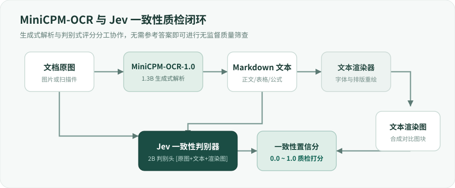
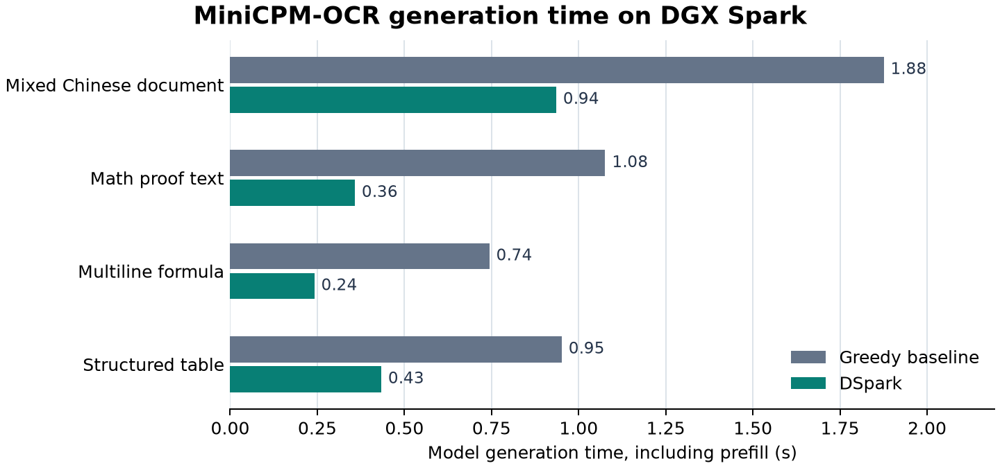

# 文档图片解析与质量检查：生成结果后如何评分

> **阅读导航**：[文档 OCR：从页面识别到表格还原](README.md) · [文档解析与质检实验与复现](../../../experiments/minicpm-ocr/)

文档识别后，如何找到值得人工复查的结果？一种方法是把识别文本重新渲染成图片，再比较它与原始文档区域是否一致。这里使用 MiniCPM-OCR-1.0 生成文本，并用 Jev 对原图、候选文本和渲染图的组合打分，探索无需参考答案的质量筛查。

在 DGX Spark 的本次环境中，我们通过 Transformers 跑通了两个模型；Jev 在三个官方样块上的分数与官方公布值相差不超过 0.0045。一个文字块的识别、渲染及三个候选打分共耗时 2.5 秒。这说明流程和样例分数可以复现，**不代表评分已经能可靠判断真实文档的识别错误**。尝试的 vLLM、SGLang 与 Paddle 安装路线在本次环境未跑通，具体条件见下文。

## 为什么值得做这个实验

OCR 的输出质量通常靠人工抽查或字符错误率（CER）衡量，前者不可扩展，后者需要人工标注的参考答案。Jev 提供的是另一条路：给定「原图 + 待判文本 + 文本渲染图」三元组，直接输出一个 0 到 1 的一致性分数，不需要参考答案。

这一分数可用于探索无标注数据的候选排序和解析质量筛查。本实验包含候选结果打分示例，但尚不足以证明其排序准确率或线上质检效果，实际应用仍需用人工标注数据评估。

本实验要回答的是三个工程问题，不是模型能力排行榜：

1. 官方文档依赖 vLLM 与 Paddle，这两项在本次 aarch64 环境下均未能安装，有没有第二条路；
2. Jev 的判别机制在没有 vLLM 的机器上能不能等价复现，分数是否和官方一致；
3. 两个模型串联运行后的真实延迟与显存代价。

## 两个模型的分工

两个模型分别负责生成与判断。Jev 接收原图、候选文本和按该文本渲染的图，输出一致与不一致的两个分数，再通过 softmax 转成一致性分数。这样可以比较同一内容的候选结果，但分数也会受字体和排版影响，不能直接当成文字正确的概率。

| 模型 | 职责 | 输入 | 输出 | 参数量 |
|---|---|---|---|---|
| MiniCPM-OCR-1.0 | 文档解析 | 图片或 PDF | Markdown（正文、表格、公式、阅读顺序） | 1.3B，SigLIP + Qwen3.5 |
| MiniCPM-OCR-Jev | 一致性判别 | 原图 + 文本 + 文本渲染图 | 两个 logits（一致 / 不一致） | 主干 2B 加 `[2,2048]` 打分头 |

两者输入输出完全不同，不能互换，也不能用一个替代另一个。Jev 权重里没有 `lm_head`，物理上生成不了文本，它只打分。

## 实验对象与环境

我们在 DGX Spark GB10 的 aarch64 环境中运行 MiniCPM-OCR-1.0、Jev 和布局检测模型，检查模型运行及 Jev 样例分数，并观察解析输出中的正文、表格、公式与阅读顺序。软件版本、权重和具体部署方式见[运行条件与部署记录](../../../experiments/minicpm-ocr/README.md#历史运行条件与部署)。

## 实测结果

### 1.0 解析

| 指标 | 数值 |
|---|---|
| A4 页端到端 | 11.2 秒 |
| WebUI 上传到出结果 | 9.75 秒 |
| 显存峰值 | 3 GiB |
| 输入形态 | 自渲染页、官方样张、PDF 均完成流程测试；识别质量见下文 |

自渲染页的[识别输出](../../../experiments/minicpm-ocr/evidence/demo-result.md)中，页眉出现方框，部分公式符号识别有误，因此这次结果只能证明流程能输出文本、表格和公式，不能称为完整准确识别。样张表格里的模型吞吐和准确率是生成测试页时写入的虚构内容，不是模型实测结果。

### Jev 打分

| 指标 | 数值 |
|---|---|
| 权重加载 | 32.5 秒 |
| 显存峰值 | 5.18 GiB |
| 单候选前向 | 0.13 到 1.16 秒 |
| 与官方公布值偏差 | ≤ 0.0045（三个官方样块） |

### 串联运行

官方文字块、三候选排序：

| 候选 | 分数 |
|---|---|
| 人工确认原文 | 0.99522 |
| 1.0 识别输出 | 0.99505 |
| 人为破坏版 | 0.00000 |

完成一次「1.0 识别一个块 → 渲染 → Jev 对三候选排序」的完整流程耗时 2.5 秒。

### 投机解码能否加快识别

通过 `scripts/benchmark_acceleration.py` 在 GB10 (`aarch64`, `PyTorch 2.14.0+cu130`, `bfloat16`) 上实测 `MiniCPM-OCR-1.0` 标准贪婪自回归解码（基线）与挂载 `MiniCPM-OCR-1.0-DSpark`（0.3B 5 层双向块草稿模型 + 低秩马尔可夫状态转移头，`block_size = 15`）后的性能表现。输入为一张自制中文测试页的裁切图，以及官方提供的正文、公式、表格样例块，共生成 343 个 Token：

计时从完整模型输入的首次前向开始，包含预填充与后续生成，不包含图片读取和处理器预处理；吞吐量为生成 Token 数除以这段耗时，并非纯解码吞吐。四个样本的贪婪输出一致只说明本次比较中的输出一致，不代表其他输入或采样方式的质量已验证。

四组样本合计耗时从 4.6461 秒降到 1.9676 秒，343 个生成 Token 与基线逐个一致。[原始记录](../../../experiments/minicpm-ocr/evidence/acceleration_benchmark.json) · [绘图脚本](../../../experiments/minicpm-ocr/scripts/plot_acceleration.py)

| 指标 | 普通贪婪解码 | DSpark 投机解码 | 本次对比 |
|---|---|---|---|
| 四个样本合计模型生成耗时 | 4.6461 秒 | 1.9676 秒 | 2.36 倍加速 |
| 生成 Token 数 / 模型生成耗时 | 73.83 tok/s | 174.32 tok/s | 吞吐提升 136.1% |
| 主模型前向次数 | 343 | 44 | 减少主模型串行前向 |
| 输出一致性 | 基线 | 343 个 Token 均一致 | 限于这四个贪婪解码样本 |

投机解码先由较小的草稿模型提出一组候选 Token，再由主模型批量核验；若连续候选通过核验，就能减少主模型逐个生成 Token 的次数。本实现还需要在候选被拒绝时回退模型状态。四个样本各测一次，加速比分别落在 2.00–3.08 倍之间；[详细结果与实现记录](../../en/document-understanding/minicpm-ocr-speculative-decoding-benchmark.md)保留各样本的数据和状态回退说明。两模型同时加载时的 PyTorch 峰值分配量为 4.33 GiB，基线未单独测量，不能据此计算草稿模型额外占用。

## 如何复现实验

实验采用 Transformers 分别运行识别和打分，再比较候选结果。依赖、模型准备、服务启动和具体运行步骤见[实验入口](../../../experiments/minicpm-ocr/README.md#怎么跑起来)。

## 边界与未验证项

**已验证**：两个模型在 GB10 aarch64 上跑通；Jev 分数与官方公布值一致；串联延迟与显存如上表。

**未验证，读下面结论时按此限定**：

| 项 | 现状 |
|---|---|
| 真实文档判别力 | 只在 3 个官方裁切样块上验过，扫描件、拍照件、中英混排均未测 |
| 性能分布 | 单次测量，未跑多轮取分布，含冷启动与否在表内已注明 |
| 跨机器复现 | 只在 GB10 上做过，x86_64 未验证 |

**已知限制**：

- **Jev 只吃块级图片，不吃整页。** 训练数据是版面块裁切（正文、公式、表格三类），整页图超出它见过的尺度，分数不可信。要判整页，得先用布局模型切块再逐块打分。
- **它的「一致」标准是训练数据的标注。** 官方样例里有一个表格块，连人工确认的原文都只拿到 0.047，因为那张表的渲染版式和原图不同，模型按学到的方式判了不一致。分数高说明「文本与它渲染出来的样子和原图相符」，不等于「OCR 在语义上完全正确」。
- **渲染质量会影响分数。** 字体缺失、公式渲染错误会让分数失真，所以页面上把原图与渲染图并排同尺度展示，让人能判断这个分该不该信。

Jev 的候选分数仅用于同组比较，不能视为准确率或直接判定识别正确；所有候选渲染失败时接口返回错误，不选出最佳项。阈值用于自动质检前，应在目标数据上以人工标注校准。
