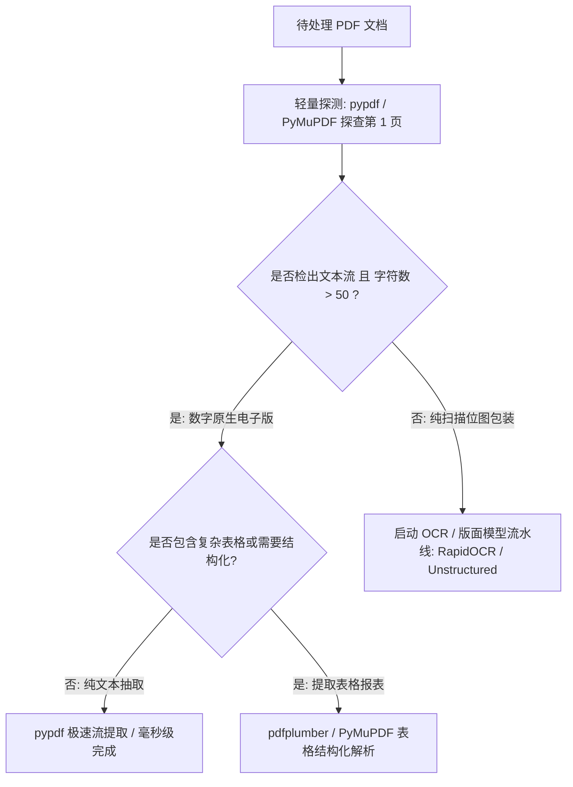

# 传统规则与矢量流解析：四大 PDF 框架的机能、表格提取与物理边界

> **阅读导航**：[文档理解与信息提取](README.md) · [项目首页](../../../README.md) · [PDF 规则解析实验](../../../experiments/pdf-rule-parsers/)

在企业知识库建设、合同检索与垂直领域 RAG 中，大量文档以 PDF 格式存在。遇到 PDF 时，是否需要直接动用重量级 OCR 流水线或视觉语言大模型？

答案取决于文档底层的物理封装形态。PDF 既不是纯图片，也不是 HTML 般的语义树，而是基于 PostScript 衍生出的**绘图与排版指令容器**。本文基于来自知名开源项目（**RapidOCR**、**pdfplumber**）的官方真实样例，深入横向评测 Python 生态中四大主流 PDF 解析框架（**PyMuPDF**、**pypdf**、**pdfplumber**、**pdfminer.six**）的性能表现、表格提取能力与物理限制。

---

## 一、 PDF 底层工作机制：矢量操作码与字符编码

当电子文档（Word、LaTeX、浏览器）导出为 PDF 时，引擎并不会将其栅格化为位图，而是直接在内容流中写入绘图与文本排版操作码：

### 1. 文本操作码（Content Stream）
PDF 的文本被包裹在 `BT`（Begin Text）与 `ET`（End Text）操作码之间，通过变换矩阵 `Tm` 和字符串操作符 `Tj` / `TJ` 绘制：

```postscript
BT
/F1 12.00 Tf          % 选用字体 F1，字号 12pt
1 0 0 1 50.00 750.00 Tm % 变换矩阵：将原点平移至绝对坐标 (x=50, y=750)
(ABCNet: Real-time Scene Text Spotting) Tj % 绘制字符串
ET
```

传统规则解析器通过直接扫描这些二进制字节序列，将编码映射为字符串输出，全程不需要神经网络推理。

### 2. 字形索引与 ToUnicode 映射字典（CMap）
PDF 内容流中存储的往往不是明文字符，而是字体字形编号（Glyph ID）。为了转译为人类可读的 Unicode 字符串，必须依赖 PDF 内部嵌入的 **ToUnicode CMap** 映射表。如果生成 PDF 时进行了子集化（Subsetting）且去除了映射字典，规则解析器将输出不可读的乱码。

---

## 二、 四大主流开源框架横向实测对比

我们在 `experiments/pdf-rule-parsers/scripts/benchmark_popular_frameworks.py` 中，选用两个知名开源项目的官方真实测试样本及扫描对照件，进行了横向基准实测（指标保存于 `evidence/popular_frameworks_comparison.json`）：
- **样本 A（`rapidocr_direct_and_image.pdf`）**：来自 RapidAI 官方测试用例，2 页，混合原生矢量文本与嵌入图片；
- **样本 B（`pdfplumber_federal_register.pdf`）**：来自 pdfplumber 官方测试用例，15 页，美国联邦公报真实三栏密集排版与表格；
- **样本 C（`testpage_cn.pdf`）**：单页纯扫描图像包装件。

### 1. 实测指标汇总

| 评测对象 | 测试框架 | 单页平均耗时 | 字符抽取总数 | 图像对象探测 | 原生表格检测能力 |
|---|---|---|---|---|---|
| **混合文档（RapidOCR 样本）** | **pypdf** | **24.58 ms** | 3,712 字 | 3 个 | 不支持（纯文本流） |
| **混合文档（RapidOCR 样本）** | **pdfminer.six** | 28.68 ms | 3,788 字 | 3 个 | 不支持（纯文本流） |
| **混合文档（RapidOCR 样本）** | **PyMuPDF** | 49.40 ms | 3,710 字 | 3 个 | 支持（find_tables 模式） |
| **混合文档（RapidOCR 样本）** | **pdfplumber** | 49.77 ms | 3,505 字 | 3 个 | 支持（extract_tables 模式） |
| **15页复杂公报（pdfplumber 样本）**| **pypdf** | **19.14 ms** | 60,087 字 | 11 个 | 不支持 |
| **15页复杂公报（pdfplumber 样本）**| **pdfminer.six** | 44.14 ms | 61,485 字 | 11 个 | 不支持 |
| **15页复杂公报（pdfplumber 样本）**| **PyMuPDF** | 110.81 ms | 60,144 字 | 11 个 | **成功检测出 2 个表格** |
| **15页复杂公报（pdfplumber 样本）**| **pdfplumber** | 117.05 ms | 58,492 字 | 11 个 | **成功提取出 2 个表格** |
| **扫描件包装（纯位图）** | **全部四大框架** | **1.4 ~ 16 ms** | **0 字** | **1 个** | **完全无法识别，提取不到文字** |

### 2. 四大框架的工程特性定性
- **`pypdf`**：
  - **优势**：极速、纯 Python 实现、零编译依赖，在 15 页密集公报上跑完仅需 287 ms（单页 19 ms）；
  - **局限**：只能输出线性文本，不具备任何原生表格识别能力。
- **`PyMuPDF (fitz)`**：
  - **优势**：基于 C/C++ MuPDF 工业引擎，速度与功能平衡极佳；提供原生的 `find_tables()` 模块，能够自动寻找矩形网格线并提取二维结构；
  - **局限**：对轻微断线的无边框表格容易漏召回。
- **`pdfplumber`**：
  - **优势**：专为高精度表格和报表抽取设计，支持通过显式的网格线求交（Linetable）提取复杂的跨行合并报表；
  - **局限**：由于内部构建了精细的字符几何空间索引，多页复杂报表的执行耗时相对较长。
- **`pdfminer.six`**：
  - **优势**：精准保留字符的字号、字体名与绝对浮点坐标；
  - **局限**：API 较为底层，缺乏高级表格抽取封装。

---

## 三、 规则解析的三大物理边界

虽然在原生数字文档上表现优异，但面对真实工业界的不确定性，规则解析存在无法逾越的物理限制：

### 1. 扫描件包装无法提取（Zero Recall）
在政企合同、历史归档或发票中，大量 PDF 实质上只是用 PDF 作为外壳包裹的单张高分辨率位图（如测试样本 C）。
实测表明，四大框架面对此类文件提取出的文本长度全部为 **0**。如果业务系统未做预检，直接将其喂入检索增强生成（RAG），会导致知识库完全丢失该文档信息。

### 2. 跨栏流排阅读顺序穿插（Reading Order Interleaving）
在学术论文和双栏报纸中，排版以两栏并列排布。
当解析器按内容流的物理写入顺序读取时，若作者在生成 PDF 时采用了交错的排版流水，解析器容易将左栏的一句话与右栏的一句话交替拼装在一起。
此时必须启用基于绝对 Bounding Box 的几何拓扑重排算法（按 X 坐标划分分栏，再按 Y 坐标自上而下阅读）。

### 3. 公式与复杂拓扑表格的语义降级
PDF 并不原生支持 LaTeX 语法。数学公式在内容流中被切碎为大量独立漂移的符号与上下标片段（如斜杠、根号折线与希腊字母）。规则解析器只能将其抽离为破碎的字符孤岛，无法重建为下游模型能理解的完整语义。

---

## 四、 工业级自适应文档前置路由策略

结合全系列实测证据，最健壮的企业级文档解析流水线应采用**自适应动态路由（Adaptive Router Pattern）**：



---

## 五、 流水线 OCR 与综合文档解析框架对比实测

当确定文档属于扫描件包装、或包含复杂图表切片时，规则解析器彻底失效。我们在 `experiments/pdf-rule-parsers/evidence/ocr_engines_and_unstructured_benchmark.json` 中，实测了组件式 OCR（**RapidOCR**，ONNXRuntime 后端）与全能文档分块框架（**Unstructured 0.27**）在真实文档样本上的物理开销与信息召回深度。

### 1. 组件式 OCR 引擎（RapidOCR ONNXRuntime）单页推理延迟

以单页复杂中文排版测试图（`testpage_cn.jpg`）与合成表格图（`synthetic-table.png`）为例，实测单张图像经历检测（Det）、方向分类（Cls）与文字识别（Rec）三段流水线的微观开销：

| 测试图像 | 图像尺寸/分辨率 | 检出文本框数 | 文本检测耗时 (Det) | 方向分类耗时 (Cls) | 字符识别耗时 (Rec) | 总推理耗时 | 平均置信度 | 检出字符总数 |
|---|---|---|---|---|---|---|---|---|
| **表格切片图 (PNG)** | 16.6 KB | 11 个 | 174.3 ms | 11.9 ms | 126.2 ms | **364.1 ms** | 0.7344 | 49 字符 |
| **A4 复杂扫描页 (JPG)** | 281.8 KB | 32 个 | 789.7 ms | 32.8 ms | 1,637.0 ms | **2,682.8 ms** | 0.7899 | 511 字符 |

实测数据显示：
- 识别阶段（Rec）是计算密度的主要消耗者，在 32 个文本切片上累计占据了 61% 的推理时间；
- 检测阶段（Det）耗时相对固定，主要受图像像素分辨率与卷积特征图尺寸决定；
- 在单核 CPU 推理下，流水线式 OCR 单页耗时约 2.6 秒，吞吐量约为规则解析器的 1/100。

### 2. Unstructured：矢量规则模式 (fast) 与模型重排模式 (hi_res)

Unstructured 是当前大模型 RAG 领域常用的文档预处理框架，支持多种解析策略（Strategy）。我们选取 RapidOCR 官方测试 PDF 与 15 页联邦公报，评测 `fast` 与 `hi_res` 模式的差异：

| 评估文档 | 解析模式 (Strategy) | 驱动引擎链路 | 解析总耗时 | 元素切块数 (Elements) | 正文段落数 (NarrativeText) | 表格切片数 (Table) | 图像切片数 (Image) | 提取总字符量 |
|---|---|---|---|---|---|---|---|---|
| **混合 PDF (2页)** | **`fast`** | pdfminer 矢量流 | 3.39 秒 | 25 个 | 9 个 | 0 个 | 0 个 | 3,724 字 |
| **混合 PDF (2页)** | **`hi_res`** | YOLOX + Tesseract | 35.03 秒 | 43 个 | 19 个 | 0 个 | 4 个 | 6,730 字 |
| **联邦公报 (15页复杂报表)** | **`fast`** | pdfminer 矢量流 | **4.72 秒** | 446 个 | 185 个 | **0 个** | **0 个** | 58,552 字 |
| **联邦公报 (15页复杂报表)** | **`hi_res`** | YOLOX + Tesseract + Table-Transformer | **113.16 秒** | 1,021 个 | 177 个 | **2 个** | **11 个** | **69,509 字** |

### 3. 工程机制透视与选型权衡

实测数据揭示了底层策略的决定性代价值：

1. **信息召回的悬殊差异**：
   在 15 页公报测试中，`fast` 模式丢失了所有的表格和插图，召回 58,552 字符；而 `hi_res` 模式不仅精准框选出 2 个核心结构化表格与 11 处插图，还通过 OCR 补全了插图与图表中的文字，总抽取字符量跃升至 69,509 字（多召回 18.7% 的关键信息）。

2. **计算耗时的 24 倍膨胀**：
   `hi_res` 模式需要将每页 PDF 逐页栅格化为位图，先经由视觉目标检测模型（YOLOX）输出边界框，再经由 Tesseract 进行局部 OCR，对表格区域调用 Table-Transformer 构建拓扑结构。在 15 页文档上，单机耗时从 4.7 秒激增到 113 秒。

3. **流水线决策准则**：
   对于要求秒级响应的实时问答场景，默认使用规则流提取或仅提取文字；对于离线知识库构建或财务报表解析，必须开启 `hi_res` 才能防止表格和图表信息的静默丢失。
    
    C -->|否: 判定为扫描位图件| G[分流至视觉模型]
    G --> H{算力与版面复杂度假定}
    H -->|固定表单 / 算力受限| I[第二代: PP-OCR + SLANet 模块化流水线]
    H -->|复杂研报 / 混合公式论文| J[第三代: MiniCPM-OCR / VLM 端到端大模型]
```

通过这套前置分流策略，不仅能让 80% 的数字原生文档以毫秒级、零 GPU 成本快速完成提取，也能把多模态大模型的算力集中在真正需要光学识别和版面理解的扫描件上。
