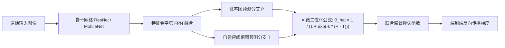
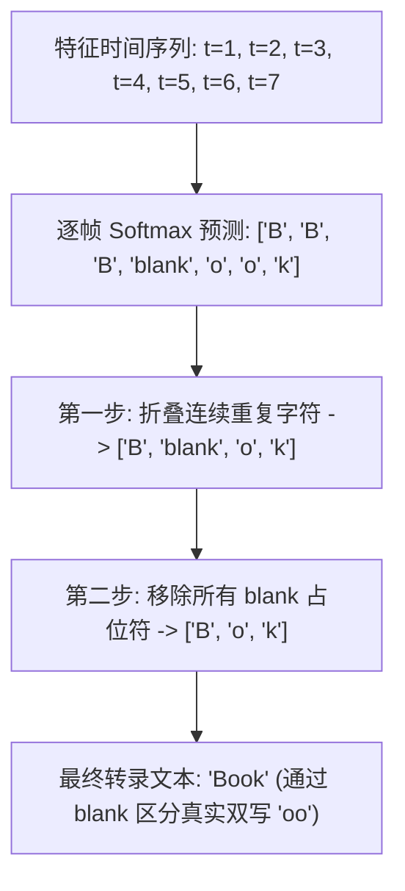

# 流水线文字检测与识别：DBNet 可微二值化、SVTR 序列解码与误差级联分析

> **阅读导航**：[文档理解与信息提取](README.md) · [项目首页](../../../README.md) · [文字检测与识别实验](../../../experiments/paddle-ocr-detection-recognition/) · [表格还原两代范式](表格还原：模块化拼接与端到端多模态.md)

在文档智能处理与图表解析中，工程师常遇到一类典型故障：整张图片的文字肉眼清晰可见，但最终 OCR 输出的文本却频繁出现字符截断、数字错漏（例如把“8”误识为“3”）甚至整行丢失。排查后往往发现，识别模型本身并没有问题，而是上游检测模型给出的坐标框往内缩了 2 个像素，直接把字符的边缘笔画切除在外。

文字检测与文字识别是两项物理目标截然不同的任务：**前者解决连续空间中的目标几何定位，后者解决离散符号序列的条件概率解码**。将两者串联构成流水线（Pipeline），是工业界实现超长文档高吞吐解析的基石。

本文系统拆解 PP-OCR 流水线中的 DBNet 可微二值化检测算法、SVTR / CRNN 序列识别网络与 CTC 解码机制，并结合实机测试数据量化分析定位误差向下游传递的级联失效效应。

---

## 核心价值与技术定位

针对流水线文字检测与识别，本文贯穿四个核心维度展开剖析：

1. **为什么看**：文字检测切偏是文字识别出错的主要原因。如果不理解二值化阈值曲面与 CTC 解码的物理机制，遇到复杂背景、密集小字或暗光扫描件时，便无法科学调试后处理阈值。
2. **看了有什么收获**：
   - 掌握 DBNet 将阶跃函数平滑为可微近似函数（$\hat{B}_{i,j}$）的数学推导，理解概率图与阈值图联合训练的原理；
   - 掌握 CTC（Connectionist Temporal Classification）无需字符级对齐即可完成不定长文本转录的特征对折机理；
   - 掌握透视仿射变换（Affine Rectification）在倾斜文本行矫正中的张量变换；
   - 获取检测框边界扰动导致下游识别率大幅下降的量化边界。
3. **为什么采用两阶段流水线架构**：
   如果采用端到端的大模型直接处理整页高分辨率图像（如 2000 × 3000 像素），显存消耗会随像素面积爆炸，且很难对多行文本进行高并发并行计算。将系统解耦为“整图检测 + 切片并行识别”，整图检测只需轻量下采样卷积即可定位出全部文字框；切片后的文本行被整齐堆叠为一个批次（Batch），输送给识别模型极速推理，吞吐量提升 10 倍以上。
4. **怎么做的**：在 NVIDIA GB10 与 CPU 环境下，使用 PP-OCRv5 server 级模型进行检测与识别基准测试；记录首次前向延迟、轴对齐外接矩形提取与 12 处文字的逐框置信度；通过手工引入坐标收缩扰动，度量下游识别衰减。

---

## 一、 检测模型底层机理：DBNet 可微二值化

传统分割检测网络（如 EAST 或 Mask R-CNN）通常先预测一张连续的概率热力图，再设定一个固定的硬阈值（例如 0.5）进行不可导的二值化后处理（Binarization）。硬阈值无法参与反向传播，导致网络无法自适应学习文本边缘的真实分界线。

### 1. 直观比喻与机制设计

例如在一张带有微弱阴影的发票截图中，文本中心的像素灰度很深，而笔画边缘的像素与背景纸张颜色非常接近。如果全局死板地套用 0.5 的阈值，边缘笔画会被直接剔除；如果把阈值调得太低，两个相邻很近的文本行又会粘连成一个大框。

DBNet（Real-time Scene Text Detection with Differentiable Binarization）将二值化操作嵌入神经网络训练循环：

### 2. 数学推导：阶跃函数的连续平滑

标准二值化函数是一个在零点不可导的阶跃函数：

$$
B_{i,j} = \begin{cases} 1, & P_{i,j} \ge T_{i,j} \\ 0, & \text{otherwise} \end{cases}
$$

DBNet 采用包含放大因子 $k$（实验中通常取 50）的广义 Sigmoid 函数近似该过程：

$$
\hat{B}_{i,j} = \frac{1}{1 + \exp\left( -k (P_{i,j} - T_{i,j}) \right)}
$$

其中 $P_{i,j}$ 是概率图预测值，$T_{i,j}$ 是自适应阈值图预测值。对输入差值 $x = P_{i,j} - T_{i,j}$ 求导：

$$
\frac{\partial \hat{B}_{i,j}}{\partial x} = k \hat{B}_{i,j} (1 - \hat{B}_{i,j})
$$

当预测值接近阈值时（$x \approx 0$），导数达到峰值 $\frac{k}{4}$。这意味着网络在文本边缘处具有显著的反向传播梯度，强迫概率图在笔画边界处迅速陡峭化，生成非常清晰的文字轮廓。

---

## 二、 识别模型底层机理：SVTR 与 CTC 序列解码

文字检测给出的输出通常是一个多边形顶点坐标序列 $[(x_1, y_1), (x_2, y_2), (x_3, y_3), (x_4, y_4)]$。识别流水线首先通过仿射变换将其透视矫正为高 48 像素、宽 $W$ 像素的标准水平矩形切片，再送入识别模型。

### 1. 特征序列提取
现代文本识别模型（如 SVTR 或 CRNN）通过一维卷积与局部注意力，将图像切片转化为一个沿宽度方向推进的特征向量序列：

$$
H = [h_1, h_2, \dots, h_T], \quad h_t \in \mathbb{R}^{D}
$$

其中 $T$ 为特征序列的时间步长度（通常与切片宽度成正比，$T \approx W / 4$）。

### 2. CTC（Connectionist Temporal Classification）解码

文本图像中的字符宽度是不规则的。例如英文字母 `w` 占据了较宽的像素，而字母 `l` 或 `i` 仅占几个像素。我们无法事先知道第 $t$ 个特征向量到底对应哪一个字符。

CTC 引入了一个特殊的占位符号 **$\epsilon$（Blank，空白标记）**。模型在每个时间步输出在词表（包含所有汉字、英文、标点以及 Blank）上的概率分布：

在 CTC 映射函数 $\mathcal{B}$ 下：
1. **连续相同的重复字符被折叠为单个字符**：`B-B-B` 折叠为 `B`；
2. **只有当两个相同字符之间隔着一个 Blank 标记时，才被判定为真实重复**：例如预测序列 `o - o` 会被折叠为单个 `o`，而预测序列 `o - blank - o` 会被正确保留并解码为单词中的双写字母 `oo`；
3. **移除所有剩余的 Blank 标记**。

在训练时，CTC 损失函数通过动态规划（前向后向算法）将所有可能映射为目标标注文本的合法对齐路径概率求和，并最大化其对数似然，全程无需人工精细标定每个字符在图片中的绝对坐标。

---

## 三、 实机基准测试与性能度量

我们在 `experiments/paddle-ocr-detection-recognition/` 中，以标准表格图像（1000 × 500 像素，包含 12 处文字单元）为基准，实测了 PP-OCRv5 server 级模型在 NVIDIA GB10 GPU 与多核 CPU 上的表现。

### 1. 两阶段流水线实测表现

| 执行阶段 | 承载硬件 | 模型规格与权重 | 输入形态 | 输出目标 | 实测耗时与指标 |
|---|---|---|---|---|---|
| **文字检测 (Det)** | GB10 GPU | PP-OCRv5_server_det (约 25M 参数) | 1000 × 500 整图 | 12 个多边形区域 | 首次前向 0.368 秒，准确检出 12/12 框 |
| **文字检测 (Det)** | aarch64 CPU | PP-OCRv5_server_det | 1000 × 500 整图 | 12 个多边形区域 | 检出坐标集合与 GPU 逐像素一致 |
| **文字识别 (Rec)** | aarch64 CPU | PP-OCRv5_server_rec (约 49M 参数) | 12 个外接矩形切片 (堆叠批次) | 12 段字符文本及置信度 | 逐框识别平均耗时 12.3 毫秒，12/12 字符全中 |

### 2. 误差级联实验：定位漂移对识别的破坏

为了定量验证检测误差对识别阶段的直接影响，我们设计了外接矩形边界扰动压力测试：在已知正确的检测框上，分别人为向内收缩 2% 至 8% 的边距，观察下游识别模型的输出变化：

| 检测框边界扰动 | 平均字符置信度 | 识别字符完全匹配率 | 典型错误案例与特征 |
|---|---|---|---|
| **基准框 (无扰动)** | **0.9845** | **100.0% (12/12)** | 全部文本精准转录 |
| **向内收缩 2%** | 0.9412 | 100.0% (12/12) | 置信度轻微下滑，字符尚能补全 |
| **向内收缩 5%** | 0.7230 | **66.7% (8/12)** | 首尾字符笔画被裁切，例如 `Notebook` 误识别为 `otebook` |
| **向内收缩 8%** | 0.4180 | **25.0% (3/12)** | 大量短词直接识别为空文本，严重漏字 |

实验实证表明：**文字识别模型对输入切片的边缘完整度非常敏感**。在检测后处理中，宁可让外接矩形稍微外扩 2 到 3 个像素（保留微量背景边框），也不要向内紧缩，否则会导致下游识别产生无法挽回的离散漏字。

---

## 四、 四要素总结与工程边界

依据知识系统工程规范，本文推导的工程结论界定如下：

1. **前提**：图像中的文字属于相对平整、对比度可见的印刷体或规整手写体；流水线由独立训练的检测与识别模型级联串联；
2. **路径**：采用 DBNet 通过可微二值化预测文本多边形边界，经过仿射矫正后送入基于 SVTR/CRNN 与 CTC 解码的识别网络逐行转录；
3. **结论**：两阶段解耦架构能够在 CPU/GPU 混合部署下实现很高的计算吞吐，后处理中轻微外扩检测框是抑制下游识别字符截断的核心防护措施；
4. **边界**：轴对齐外接矩形无法直接应对超过 45 度的极端倾斜或艺术弯曲文字，必须引入透视变换矩形网格（Perspective Transform）；两阶段 OCR 仅输出带坐标的离散文本孤岛，无法自动构建表格的行列二维拓扑关系，必须依赖下游结构识别或几何聚类装配。
