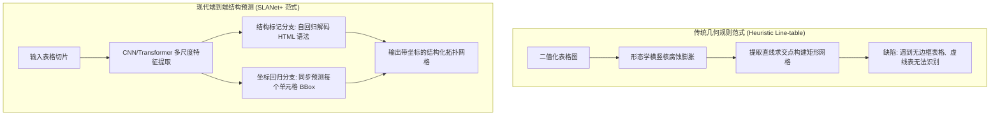
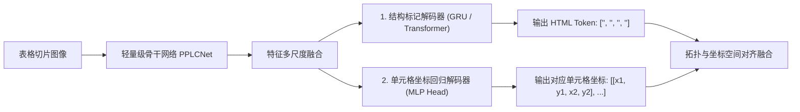

# 表格拓扑结构识别：SLANet+ 层次化解码、空白敏感性与无边框表格挑战

> **阅读导航**：[文档理解与信息提取](README.md) · [项目首页](../../../README.md) · [表格结构识别实验](../../../experiments/table-structure-recognition/) · [表格还原两代范式](表格还原：模块化拼接与端到端多模态.md)

在财务报表审计、合同数据抽取与统计年鉴数字化中，即便 OCR 能够百分之百将整页文字全部正确识别，一旦丢失了表格的行列对应与跨行跨列（Rowspan / Colspan）关系，整个系统就会输出错误结果。例如，将第 3 行第 2 列的“负债总额”错位拼接到第 4 行的“营业收入”所在单元格，会导致下游大模型或财务系统得出完全相反的业务结论。

表格结构识别（Table Structure Recognition, TSR）的核心使命，是**从被裁切的表格图片中，精准恢复出由行列拓扑、单元格边界框与合并关系构成的结构化语义树**。

本文深入推导 SLANet+（Structure-Location Alignment Network）的双分支序列坐标解码架构，通过在 NVIDIA GB10 上的实测数据剖析外围空白（Padding）对网络注意力的结构性误导，并确立无边框与复杂跨单元格场景下的工程应对策略。

---

## 核心价值与技术定位

针对表格拓扑结构识别，本文贯穿四个核心维度展开剖析：

1. **为什么看**：现实中的报表往往缺少完整的物理边框（无线表或三线表）。依靠传统的霍夫变换测线或轮廓提取会全盘失效，必须依赖深度特征学习。
2. **看了有什么收获**：
   - 掌握表格结构识别的两种技术路线（基于启发式投影聚类 vs 基于 Image-to-HTML 语法树预测）的底层优劣；
   - 掌握 SLANet+ 双分支解码网络：一个分支负责自回归预测 HTML 结构标记（`<tr>`, `<td>`, `</td>`, `</tr>`），另一个分支同步回归对应单元格的归一化包围框坐标（$[x_1, y_1, x_2, y_2]$）；
   - 深入理解为什么表格图像周围的未裁切空白会诱发模型预测出“凭空多出一整行跨列虚假单元格”的结构性幻觉；
   - 掌握上游版面分析紧凑裁剪与下游几何网格对齐的容错设计。
3. **为什么需要专用的表格结构识别模型**：
   通用 OCR 仅能输出孤立的文本包围框与文字字符串，完全不具备表格语法意识；如果直接用大语言模型去数坐标重构表格，在密集几十行的大表上不仅计算开销巨大，还极易发生 Off-by-one 错位。SLANet+ 以不足 200 万参数的极小开销，在毫秒级内完成确定性的 HTML 骨架构建。
4. **怎么做的**：在 aarch64 CPU 与 DGX Spark 平台上，对 SLANet+ 在原图（1000 × 500，带留白）与紧凑裁剪图（911 × 301，去留白）上分别进行前向推理；记录首次前向耗时（0.115s vs 0.212s）、输出 HTML 标记树与结构置信度评分，复盘空白引发结构漂移的微观机制。

---

## 一、 表格识别的两大范式演进

在工业级文档解析中，表格结构还原经历了从纯规则到深度学习的两代演进：



1. **传统规则范式（Linetable 启发式）**：
   - 依赖 OpenCV 的横向与纵向形态学结构元进行腐蚀膨胀，提取黑白水平线和垂直线，通过求线段交点组装为矩形单元格；
   - **主要缺陷**：现代互联网和学术论文中大量采用“三线表”或完全没有横竖线的“无边框表格”，规则方法因探测不到像素物理线而彻底失效。
2. **现代端到端结构预测（Image-to-Markup）**：
   - 将表格图片直接视为一种特殊形式的源代码编译任务，输入二维像素矩阵，端到端翻译为标准的 HTML 标签序列；
   - 模型不仅能理解有线表，还能依据文字在空旷背景上的行列对齐间距，自适应推理出虚拟的隐式单元格边界。

---

## 二、 SLANet+ 架构推导：双分支对齐机制

SLANet+（约 185 万参数）由特征提取骨干网络、特征融合金字塔与两个高度解耦的解码头组成：



### 1. 结构标记序列解码（Structure Token Decoder）
该分支负责将视觉特征解码为离散的 HTML 语法标记。其词表非常紧凑，主要包含基础标签：
- `<tr>` 与 `</tr>`：行的起始与结束；
- `<td>` 与 `</td>`：普通单元格；
- `<td` `colspan="2">`：跨列合并单元格；
- `<td` `rowspan="3">`：跨行合并单元格。

解码过程采用类似于语言模型的自回归循环，每推进一步输出一个结构 Token，直至生成完整的闭合表格 HTML 树。

### 2. 空间坐标同步回归（Location Alignment Decoder）
仅仅知道这一行有 3 个单元格依然不够，我们还必须知道这 3 个单元格在原始图片上的精确像素坐标，以便把 OCR 识别出的文字填入其中。

当结构解码分支吐出一个 `<td>` 标记时，坐标回归分支同步激活，利用当前时间步的隐藏状态向量，通过全连接层回归出该单元格的相对归一化边界框：

$$
\text{BBox}_t = [x_{\min}, y_{\min}, x_{\max}, y_{\max}] \in [0, 1]^4
$$

这种“结构标记与空间坐标严格一一对应”的同步对齐机制，省去了后续繁琐且脆弱的启发式网格二次匹配。

---

## 三、 实机实验：空白（Padding）对模型注意力的误导机制

在 `experiments/table-structure-recognition/` 中，我们选用了一张标准 4 行 3 列英文表格图，对比了**未裁剪原图（带大片外围空白）**与**紧凑裁剪图（去除外围空白）**在 SLANet+ 下的真实预测差异。

### 1. 真实运行指标对比（基于 DGX Spark aarch64 CPU）

| 测试样本输入 | 图像物理分辨率 | 预测 HTML 结构特征 | 预测单元格总数 | 结构置信度评分 | 首次前向耗时 |
|---|---|---|---|---|---|
| **原图 (未紧凑裁剪)** | 1000 × 500 | 异常增加顶层跨列大单元格，总计 5 行 | 13 个单元格 | **0.9784 (高置信虚假结构)** | 0.212 秒 |
| **紧凑裁剪版** | 911 × 301 | 严格契合实际版式，4 行各 3 列 | **12 个单元格** | **0.99996 (与实际一致)** | **0.115 秒 (加速 45%)** |

### 2. 物理成因复盘：为什么空白会引发结构性幻觉？

在未裁剪原图测试中，模型输出了如下异常 HTML 骨架：

```html
<html><body><table>
<tr><td colspan="3"></td></tr>  <!-- 异常凭空多出的顶层空行！-->
<tr><td></td><td></td><td></td></tr>
<tr><td></td><td></td><td></td></tr>
<tr><td></td><td></td><td></td></tr>
<tr><td></td><td></td><td></td></tr>
</table></body></html>
```

这种结构性误判具有极强的工程警示意义：
1. **空白边缘被误识别为合并表头**：
   表格上方保留的约 100 像素空白背景区域，在经过卷积下采样后形成了一条连续的长条状特征。由于训练集（如 PubTabNet）中大量科技论文表格顶部都带有一个跨全列的表格大标题（Table Caption），模型强烈的先验倾向于把顶部的空旷条状区域解释为 `colspan="3"` 的表头单元格；
2. **虚假置信度陷阱**：
   更麻烦的是，模型给出这一错误结构时，其置信度评分高达 **0.9784**。如果业务系统简单地设定 `confidence > 0.9` 作为放行门禁，这一严重的错位结构将毫无阻碍地进入下游，导致全表所有后续数据行统统下移一行，导致整张表的数据错位；
3. **输入尺寸与计算密度的减免**：
   紧凑裁剪不仅将结构置信度拉升至 0.99996 并消除了多余空行，还将纯前向计算时间从 212 毫秒缩短至 115 毫秒（由于下采样特征图宽度收缩，解码时间步显著减少）。

---

## 四、 四要素总结与工程边界

依据知识系统工程规范，本文推导的工程结论界定如下：

1. **前提**：输入图像应为已经过版面分析（Layout Analysis）定位并精确切分的单一完整表格区域；
2. **路径**：采用轻量级深度网络 SLANet+ 提取多尺度特征，利用结构标记分支与坐标回归分支同步输出 HTML 骨架与单元格包围框；
3. **结论**：紧凑去除表格边缘多余留白是消除“跨列虚假空行”结构性幻觉的必要先决条件；严禁依赖单次模型置信度分数作为结构正确性的唯一判断依据；
4. **边界**：SLANet+ 输出的仅是单元格的几何度量与空结构，不包含单元格内部文字；本实验的组装脚本按 OCR 框中心聚类、排序后顺序填入 HTML 空槽，并未实现基于 SLANet 单元格边界框的交并比匹配；复杂表格与错行场景需要另行验证。
