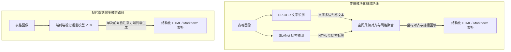

# 表格还原的两代方案：模块化几何拼接与端到端多模态

> **阅读导航**：[文档理解与信息提取](README.md) · [项目首页](../../../README.md) · [表格结构实验](../../../experiments/table-structure-recognition/) · [文字识别实验](../../../experiments/paddle-ocr-detection-recognition/)

在文档数字化与报表解析中，仅识别页面上的文本片段是不够的；系统必须把文字填回正确的二维单元格网格中，生成保留行列逻辑的结构化表格（HTML 或 Markdown）。

在工业界，这一任务经历了两代截然不同的技术路线：
- **第一代（模块化多阶段拼接）**：将任务拆解为文字检测识别（OCR）、表格结构预测（如 SLANet）以及后处理几何空间匹配（Spatial Join）；
- **第二代（端到端多模态 VLM）**：利用视觉语言模型（如 MiniCPM-OCR、MinerU、Qwen2-VL）直接从图像自回归输出带文字的结构化表格。

本文基于本实验室在合成表格上的真实实测数据，深入剖析模块化拼接的工程实现机制、级联失效边界，以及现代系统为何转向端到端方案。



---

## 一、 模块化流水线的工程实现与几何组装机制

在传统的模块化体系（以 PP-Structure 为代表）中，表格还原由两个独立模型与一个后处理组装算法协同完成。

### 1. 阶段一：文字检测与识别（PaddleOCR）
输入 1000 × 500 像素的表格图像，PP-OCRv5 检测出 12 个文字多边形包围盒，并识别其文本内容：
- 表头行：`Item`（中心点 x=93.5, y=137.5）、`Units`（x=418.0, y=136.5）、`Price`（x=706.2, y=136.5）；
- 数据行 1：`Notebook`、`12`、`6.50`（y 均在 211 附近）；
- 数据行 2：`Marker`、`24`、`2.00`（y 均在 286 附近）；
- 数据行 3：`Paper`、`8`、`4.00`（y 均在 362 附近）。

输出记录在 `experiments/paddle-ocr-detection-recognition/results/recognition.json`。

### 2. 阶段二：拓扑骨架预测（SLANet+）
输入裁剪后的表格图像（坐标偏移 `x=40, y=100`），SLANet+ 预测出 26 个 HTML 语法 Token：

```html
<html><body><table><tr><td></td><td></td><td></td></tr>...</table></body></html>
```

SLANet 成功给出了 4 行 3 列的结构标记，但所有单元格均为 `<td></td>` 空标签，不包含任何文本字符。输出记录在 `experiments/table-structure-recognition/results/cropped.json`。

### 3. 阶段三：空间几何网格聚合算法（Spatial Join）
为了把分散的文字正确填入结构标签，我们在 `experiments/table-structure-recognition/scripts/assemble_table.py` 中实现了基于空间坐标反投影与网格聚类的后处理算法：

1. **坐标系归一化**：如果结构预测基于局部裁剪图像，需先将裁剪偏移量加回文字坐标系：
   $$c_x = \frac{1}{4} \sum_{i=1}^4 x_i + \Delta x_{\text{offset}}, \quad c_y = \frac{1}{4} \sum_{i=1}^4 y_i + \Delta y_{\text{offset}}$$
2. **Y 轴行聚类（Row Clustering）**：按垂直中心点 $c_y$ 进行行划分。若两个文字框垂直距离 $|c_{y,1} - c_{y,2}| \le \text{Threshold}_y$（默认设为 25 像素），则划入同一表格行；
3. **X 轴水平排序（Column Sorting）**：在每一行内部，按水平中心点 $c_x$ 从小到大排序，确定列序；
4. **插槽顺序回填（Sequential Slot Filling）**：遍历 SLANet 输出的语法树，遇到 `<td></td>` 标记时按序弹出排序好的文本填入。

### 4. 组装实测证据
运行组装流水线后，成功在 4 行 3 列共 12 个单元格中实现 100% 匹配回填，生成的 Markdown 表格与实际内容完全一致：

| Item | Units | Price |
| --- | --- | --- |
| Notebook | 12 | 6.50 |
| Marker | 24 | 2.00 |
| Paper | 8 | 4.00 |

完整组装产物见 `experiments/table-structure-recognition/results/assembled_table.html` 与 `assembled_result.json`。

---

## 二、 模块化拼装的工程脆弱性与级联误差实测

虽然在理想合成表格上实现了 100% 拼接，但在真实工程落地中，模块化流水线容易受单步错误影响。我们在 `experiments/table-structure-recognition/scripts/eval_table_reconstruction.py` 中进行了鲁棒性基准实测（指标保存于 `results/assembly_robustness_benchmark.json`）：

| 测试场景 | 组装耗时 | 单元格准确率 | 结构完全一致 | 级联误差表现 |
|---|---|---|---|---|
| **标准干净输入（Clean）** | 0.058 ms | **100.0%** | 是 | 4 行 3 列 12 单元格完整填入 |
| **OCR 漏检 1 处文字（Drop 1 Text）** | 0.032 ms | **83.33%** | 否 | 缺失单元格导致同行后方字符整体左移错位 |
| **SLANet 虚报 1 行（Extra 1 Row）** | 0.032 ms | 100.0% | 是 | 底部 3 个插槽永久悬空无内容填入 |

### 1. 结构与文字的级联错位（Off-by-one Error）
在模块化方案中，后处理组装假设文本框数量与单元格插槽数量严格相等。
当 OCR 模型因反光或折痕漏掉一个单词时，序列回填算法立即出现**整体错位**：后面的所有文字全部平移填入了前一个单元格中，单点故障直接污染整行甚至整张表的逻辑语义。

### 2. 多行文本与跨行跨列（Rowspan / Colspan）的几何歧义
当单个单元格内存在多行折行文字时，OCR 会检测出多个独立的文本框。后处理算法必须引入复杂的启发式规则判断哪些文字属于同一单元格；如果页面存在合并单元格，纯 X/Y 投影会直接将跨行文本错误割裂。

### 3. 无边框与旋转倾斜表格的失效
SLANet 依赖表格边框线提取拓扑。在财务报表、学术论文等常见的“三线表”或无边框表格中，网格线特征消失，结构预测模型极易漏判单元格边界，导致后续几何对齐彻底失去几何锚点。

---

## 三、 端到端多模态视觉语言模型（VLM）方案演进

为了彻底摆脱模块拼接带来的级联失效，现代文档智能系统已全面转向以视觉语言模型为代表的端到端方案（如 MiniCPM-OCR、MinerU、Qwen2-VL）。

### 1. 端到端建模原理
端到端模型将表格还原视为一个“图生文”的条件序列生成任务：
- **视觉编码器（ViT / SigLIP）**：直接以原生分辨率切片扫描整张图像，保留二维网格的相对位置编码；
- **自注意力跨模态对齐（Cross-Attention）**：模型在解码文本的同时，自注意力机制直接在特征潜空间内定位字符所在的图像区域；
- **自回归输出**：单次推理直接输出标准的 Markdown 表格语法 `| Item | Units | Price |` 或带样式的 HTML。

由于不再存在显式的“文本框检测”、“单元格框检测”和“几何求交”，任何多行折叠、合并单元格与无边框表格，都在语言模型的自注意力机制中一并处理，消除了中间步骤的累积误差。

### 2. 两代技术方案选型对比

| 评估维度 | 模块化几何拼装（PP-Structure） | 端到端多模态解析（MiniCPM-OCR 等） |
|---|---|---|
| **核心架构** | OCR 检测识别 + 结构模型 + 几何后处理 | 统一单体视觉语言大模型（VLM） |
| **计算资源消耗** | 极低（小模型几十 MB，CPU 几十毫秒即可运行） | 较高（几 B 参数量，需配备本地 GPU 或 NPU 加速） |
| **复杂版面适应力** | 较弱（合并单元格、无边框、倾斜易错位） | 极强（语义与视觉联合对齐，直接适应复杂版面） |
| **中间对齐脆弱性** | 极高（存在严重的 Off-by-one 级联错位） | 无（端到端自回归生成，无中间几何组装） |
| **典型落地场景** | 算力受限的轻量边缘端、非常规整的固定表格 | 复杂异构文档、扫描研报、包含混合图文的整页报表 |

---

## 四、 实验复现与代码索引

本实验的完整代码与双重验证结果均已在仓库中开源：
- **文字识别端代码**：`experiments/paddle-ocr-detection-recognition/scripts/run.py`；
- **表格结构预测端代码**：`experiments/table-structure-recognition/scripts/slanet_table_smoke.py`；
- **空间几何拼装对齐代码**：`experiments/table-structure-recognition/scripts/assemble_table.py`；
- **组装结果证据**：
  - HTML 表格：`experiments/table-structure-recognition/results/assembled_table.html`；
  - Markdown 表格：`experiments/table-structure-recognition/results/assembled_table.md`；
  - 完整网格指标数据：`experiments/table-structure-recognition/results/assembled_result.json`；
- **端到端多模态进阶实现**：参见 [MiniCPM 文档解析与质检](MiniCPM文档解析与质检.md)。
