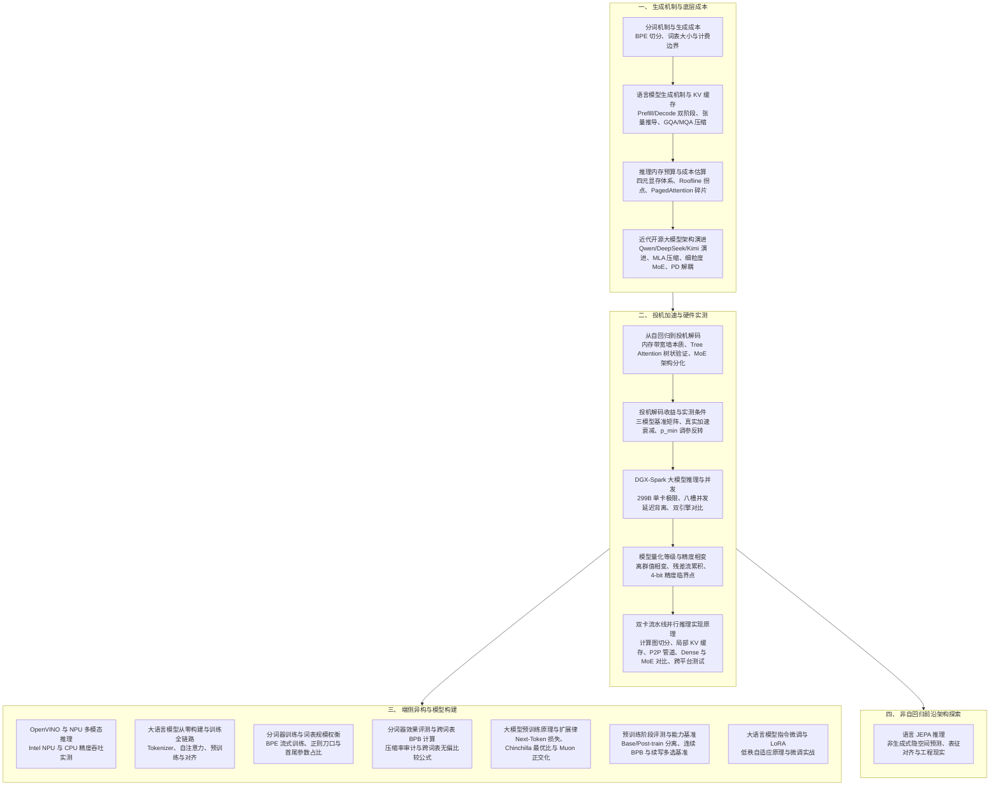

# 推理与大模型机理：从底层计算图到系统级优化

> **阅读导航**：[English](../../en/inference/README.md) · [项目首页](../../../README.md) · [实验地图](../README.md)

把大语言模型从实验环境部署到生产环境时，常会遇到几个具体问题：随着上下文变长或并发增加，显存监控只显示 60% 却突然 OOM（显存溢出）；单用户交互时出字很慢，换了算力更高的芯片后生成速度却几乎没变；引入投机解码后，某些业务负载下的吞吐不仅没有翻倍，反而明显下降。

推理优化不只是机械调用开源服务启动脚本，还需要理清计算图流转、访存总线、并行调度与因果掩码的作用机制。本专题从自回归生成的内存带宽墙和算力瓶颈出发，建立字节级显存预算模型，并在企业级硬件（NVIDIA DGX Spark 统一内存架构）与端侧芯片（Intel NPU/CPU）上开展多轮复现实测，提供可核查的量化参考。

---

## 核心内容与定位

围绕推理与大模型机理，本专题按四个部分组织内容：

1. **为什么看**：模型部署决定产品的响应速度和运维成本。如果不理解 Prefill 阶段与 Decode 阶段的差异，脱离硬件算力峰值与显存带宽盲目配置服务，很容易造成集群算力浪费或线上显存溢出。
2. **看了有什么收获**：
   - 掌握大语言模型自回归生成的底层机制，能够推导 KV Cache、静态权重与激活值的显存消耗；
   - 掌握 Roofline 模型分析法，识别 GPU 硬件平衡拐点与 MFU/MBU 利用率；
   - 获得在统一内存设备上针对 125B MoE、27B 稠密与 35B MoE 的投机解码实测矩阵与常见问题总结；
   - 掌握单卡加载超大 MoE、连续批处理多槽位权衡与异构硬件（NPU/CPU）推理优化的实用方法；
   - 了解扩散语言模型与语言 JEPA 等非自回归架构的能力边界与工程瓶颈。
3. **为什么写这套文档**：单篇模型启动教程通常只说明怎么跑通，很少解释运行时性能突变的原因。本专题将公式推导、真实压测、误差审计和边界声明结合起来，帮助工程师定位每一毫秒延迟和每一吉字节显存的来源。
4. **怎么做的**：划分四条主线；在统一硬件环境下锁定构建版本、单机独占运行并进行多轮重复实验以消除偶然抖动；对历史推导代码与开源实现进行数学和精度审计；将理论上界与实测结果对照呈现。

---

## 一、 知识体系结构

本专题围绕大模型从输入到生成的完整流程展开：

---

## 二、 专题核心篇章导览

### 主线一：生成机制与底层成本模型

从单 token 预测到全局显存规划，推导推理服务的数学确定性边界。

1. **[分词机制与生成成本](分词机制与生成成本.md)**
   - **核心问题**：文本如何转成整数 ID 流？主流 BBPE、WordPiece、Unigram LM 与无词表方案如何区别，又如何传导到吞吐与计费？
   - **关键产出**：拆解字节级编解码链路与流式 UTF-8 字节缓存；全面对比子词与去词表路线（ByT5 / BLT / PIXEL）；量化 token 粒度对上下文窗口与 API 计费的影响。
2. **[语言模型生成机制与 KV 缓存](语言模型生成机制与KV缓存.md)**
   - **核心问题**：为什么自回归生成必须引入 KV Cache？三种注意力头架构如何削减长文本显存？
   - **关键产出**：深入推导 Prefill（算力受限）与 Decode（带宽受限）的显存/计算图流转；给出增量注意力的张量算式；对比 MHA、GQA 与 MQA 的物理取舍与显存削减倍数；给出 CPU/GPU 下全量重算与增量缓存的数值一致性检验。
3. **[推理内存预算与成本估算](推理内存预算与成本估算.md)**
   - **核心问题**：单卡究竟能撑多少并发？为什么显存没满却会崩溃？生成速度由什么物理量决定？
   - **关键产出**：系统推导模型静态权重、KV Cache、动态激活值、运行时 Workspace 四元显存体系；给出 7B、13B、70B 在 FP16、FP8、INT4 下的参数与显存矩阵表；推导 Roofline 模型硬件平衡临界点与 MFU/MBU 利用率；剖析 PagedAttention 块内碎片与 CUDA Graph 预分配约束。
4. **[近代开源大模型架构演进：从密集 Transformer 到 MoE 与 MLA](开源大模型架构演进.md)**
   - **核心问题**：Qwen、DeepSeek、Kimi 等近代主流开源模型是如何从早期 LLaMA 架构演进的？MLA、细粒度 MoE、解耦式 RoPE 与 Mooncake 架构如何缓解算力与带宽限制？
   - **关键产出**：对比三个主流模型家族的演进路线；推导 MLA 低秩潜变量压缩（削减 93.3% 缓存显存）与矩阵吸收；解析细粒度 MoE 与动态偏置无辅助损失路由；说明 Mooncake Prefill 与 Decode 计算存储解耦与 MTP 多 Token 预测协同。

---

### 主线二：投机加速与硬件实测

跳出纯学术理论假设，用真实硬件独占压测数据揭示推理加速的真实条件。

4. **[从自回归到投机解码](从自回归到投机解码.md)**
   - **核心问题**：自回归为何困于内存带宽墙？小模型与大模型如何做到无损协同？
   - **关键产出**：推导单步解码计算强度极低（1 FLOP/Byte）的物理成因；详解 Draft-then-Verify 拒绝采样的无损概率数学证明；推导基于树状因果掩码（Tree Attention Mask）的单步多分支并行验证机制；剖析稠密模型全量摊薄与 MoE 专家并集膨胀的物理分化。
5. **[投机解码收益与实测条件](投机解码收益与实测条件.md)**
   - **核心问题**：为什么论文中的数倍加速在实测中经常落空甚至倒退？草稿深度与置信度过滤该如何设置？
   - **关键产出**：公开在 DGX Spark 硬件上对 125B MoE、27B 稠密与 35B MoE 的三模型实测矩阵；系统量化草稿耗时、验证衰减与任务发散性三大损耗路径；揭示 p_min 阈值调参反转（放开截断反而更优）与 n_max 深度陷阱。
6. **[DGX-Spark 大模型推理与并发](DGX-Spark大模型推理与并发.md)**
   - **核心问题**：统一内存设备如何承载超大模型？并发请求下个人延迟与整体吞吐如何权衡？
   - **关键产出**：复现单卡 128 GB 统一内存直接加载 2-bit 299B MoE 模型实测；严格对比单槽排队与八槽并发的逐请求响应延迟背离（聚合吞吐提升 52%，但单请求延迟膨胀 5.2 倍）；对比 llama.cpp 与 NInfer 双推理后端在 aarch64 上的算子表现。
   - **配套实测**：[Strata 与 llama.cpp 在 GB10 上的推理对照](Strata与llama.cpp在GB10上的推理对照.md)，比较不同引擎配置下的单请求生成速度及其限制。
7. **[模型量化等级与精度相变](模型量化等级与精度相变.md)**
   - **核心问题**：为什么模型小于 4-bit 后输出质量会急剧下降？不同量化算法在二阶梯度与激活保真上有什么主要区别？
   - **关键产出**：推导离群激活值（Outliers）在 4-bit 以下破坏信噪比的相变机理；解析 MoE 稀疏门控在低精度下的路由紊乱；对比 RTN、GPTQ、AWQ、SmoothQuant 与 BitNet b1.58 的数学机理；补充 Qwen2.5-7B 从 BF16 到 4-bit 在 GB10 上的速度阶梯实测；建立困惑度、多跳推理与 NIAH 长文本大海捞针三重质量门禁。
8. **[大模型推理加速多维范式：从权重量化、激活剪枝到协同投机](推理系统加速多维范式.md)**
   - **核心问题**：除量化与投机之外，模型剪枝如何依靠激活保护实现 50% 稀疏而保持精度？同源思想如何映射到 AWQ 量化，且量化一定比原生更快吗？
   - **关键产出**：梳理五大推理加速方法；推导 Wanda 激活加权剪枝与 2:4 硬件稀疏原理；公开 `Qwen2.5-0.5B-Instruct` 在 WikiText-2 上 11 组剪枝方案（幅值、Wanda、2:4、结构化通道）与 AWQ vs RTN 实测对照；对照 Qwen2.5-7B 不同内核（融合 Marlin 与未融合内核）的速度差异。
8. **[双卡流水线并行推理](双卡流水线并行推理.md)**
   - **核心问题**：双卡推理在工程底层是如何实现的？为什么局域网只能选流水线并行（PP）而不能选张量并行（TP）？双卡推理 Dense（如 Qwen 27B）与 MoE（如 Qwen 35B-A3B）的速度提升比有何不同？Windows 与 Linux 跨平台双机能否协同运行？
   - **关键产出**：拆解 TCPStore 会合握手、模型计算图深层切分、双端局部 KV-Cache 增量维护与 P2P 激活管道实现流程；推导 Dense 全量访存与 MoE 稀疏激活在 Batch=1（通信开销抵消加速）与 Batch>4（分担专家并集带宽压力）下的表现分化；验证 WSL2 与 Linux 主机小模型对照实验的可行性与边界。

---

### 主线三：端侧异构与模型构建

面向不同终端设备，提供跨芯片算力利用与模型生命周期的构建指南。

9. **[OpenVINO 与 NPU 多模态推理](OpenVINO与NPU多模态推理.md)**
   - **核心问题**：在无独立显卡的端侧 PC 上，如何高效运行视觉语言与跨模态多向量模型？
   - **关键产出**：对比 Intel NPU 与 CPU 在 Jina CLIP 等多模态模型上的算子迁移、量化精度保持与端到端延迟表现。
10. **[大语言模型从零构建与训练全链路](大语言模型从零构建与训练全链路.md)**
    - **核心问题**：现代大语言模型从张量初始化到分布式对齐的工程流程是怎样的？
    - **关键产出**：梳理分词器训练、网络结构搭建、预训练数据流、指令微调与人类对齐的端到端技术流程。
    - **配套阅读**：[模型训练的计量单位](模型训练的计量单位.md)，区分训练进度、数据量、资源与效果，并解释本实验的 step 口径。
11. **[分词器训练与词表规模权衡](分词器训练与词表规模权衡.md)**
    - **核心问题**：词表该设多大才不会让首尾参数占满预算或挤占注意力窗口，无 GPU 流式 BPE 训练和正则预切分有哪些常见问题？
    - **关键产出**：量化 `d_model=320` 首尾参数占比实测（6.27% 到 73.99%）、综述词表扩展律；拆解 `01_train_tokenizer.py` 的 Parquet 截断流式读取、GPT-4 正则隔离刀口、`\p{N}{1,3}` 算术副作用与三大输出产物。
12. **[分词器效果评测与跨词表 BPB 计算](分词器效果评测与跨词表BPB计算.md)**
    - **核心问题**：没训语言模型前如何独立评测词表好坏，为什么跨词表不能直接比困惑度（PPL）？
    - **关键产出**：解释 `bytes/token` 压缩率与 DGX Spark 七领域实测矩阵（中文 3.59× Token 税）、词表利用率与 `uint16` 内存开销；推导基于 `token_bytes.pt` 的 BPB 公式并揭示 `ByteLevel` 空格占位符导致的 `+16.331%` 分母高估审计。
13. **[大模型预训练原理与扩展律](大模型预训练原理与扩展律.md)**
    - **核心问题**：预训练 Next-Token 目标与数据配比遵循哪些扩展规律？Muon 矩阵正交化为何能加速收敛，又为何会在短语料上早停过拟合？
    - **关键产出**：推导算力最优与推理摊销扩展律（Kaplan / Chinchilla / Sardana），解析数据配方与 WSD 退火调度；对比 Muon Newton-Schulz 五步迭代与 AdamW 分组策略，并结合 `03_pretrain.py` 实测数据剖析 250 步下 step 49 与 step 149 的泛化反转。
14. **[预训练阶段评测与能力基准](预训练阶段评测与能力基准.md)**
    - **核心问题**：尚未经过对话微调的 Base 模型为什么不能直接测聊天命中率？预训练期应当用什么指标稳定追踪真实能力演化？
    - **关键产出**：划分 Base 续写期与 Post-train 指令期的评测边界，对比离散 Exact-Match 阶梯跳跃与连续 `val_bpb` 平滑曲线；梳理 MMLU / HellaSwag / PIQA / GSM8K 等核心基准的归一化计分、随机基线扣除法与现行评估脚本边界审计。
15. **[大语言模型指令微调与 LoRA](大语言模型指令微调与LoRA.md)**
    - **核心问题**：有限算力下如何高效注入领域知识与任务指令？
    - **关键产出**：推导低秩自适应（Low-Rank Adaptation, LoRA）的矩阵分解原理；分析超参数秩（rank）与缩放因子（alpha）对下游任务稳定性的量化影响。

---

### 主线四：非自回归前沿架构探索

不同于从左到右的自回归模式，本节介绍非自回归与隐空间架构。

    - **核心问题**：利用图像扩散去噪的思路生成自然语言真的能更快吗？
    - **关键产出**：推导离散掩码扩散（Masked Diffusion）的状态转移方程；对比全序列去噪与分块扩散（Fast-dLLM）；公开在 DGX Spark 上 Fast-dLLM 1.5B 与 Qwen2.5 以及 LLaDA-MoE 与 OLMoE 的端到端对比实测；分析无 KV Cache 时总 FLOPs 膨胀与固定步数短文本惩罚的工程瓶颈。
    - **核心问题**：大模型能否不逐字输出文本、而在抽象隐空间进行推理？
    - **关键产出**：对比生成式重构与联合嵌入预测架构（JEPA）的设计思路与架构差异；详解 LLM-JEPA 结合生成损失与双视角余弦对齐的训练机制；提供在单卡硬件上跑通微调通路的实测记录与 Tokenizer 填充审计经验；分析外挂解码器开销与表征坍塌的局限。

---

### 配套实验报告与诊断

- [299B-MoE单机2-bit推理实测](299B-MoE单机2-bit推理实测.md)
- [35B 双引擎推理对照](35B双引擎推理对照.md)
- [llama.cpp 单槽与八槽并发对照](llama.cpp单槽与八槽并发对照.md)
- [NInfer 在 GB10 上的移植与并发实测](NInfer在GB10上的移植与并发实测.md)
- [语言模型剪枝的质量与延迟对照](语言模型剪枝的质量与延迟对照.md)
- [语言模型量化的体积与推理性能对照](语言模型量化的体积与推理性能对照.md)
- [填充长度对训练损失的影响与逐层排查](填充长度对训练损失的影响与逐层排查.md)

---

## 三、 工程选型快速参考

在实际面临推理架构与硬件方案选型时，可根据核心业务特征参考下表：

| 业务主诉求 | 核心硬件瓶颈 | 推荐架构与技术选型 | 关键参数配置建议 | 注意事项 |
|---|---|---|---|---|
| **超长文本阅读理解与法律检索**（32k 以上） | 显存容量与 KV 缓存快速增长，容易 OOM | 选用原生 **GQA 架构模型**，并启用 **PagedAttention** 与 **FP8 KV Cache** | 显存利用率阈值设定在 0.85 至 0.90，块大小设为 16 | 避免使用未量化的原生 MHA 架构长文本模型；预留充足激活值余量防止 Prefill 阶段显存溢出 |
| **单用户实时交互对话**（强调低首字/低逐字延迟） | 内存带宽受限（Decode 阶段处于斜坡区） | 选用**同源 MTP 或轻量蒸馏草稿模型**开启**投机解码** | 设置草稿深度 $n=2 \sim 3$，置信度过滤放开（$p_{\min}=0.0$） | 避免在超大 MoE 上开启深层长草稿（会触发专家激活并集膨胀导致明显减速） |
| **高并发企业级后台问答**（吞吐优先，容忍适度等待） | 权重搬运与多请求算力争用 | 开启**连续批处理（Continuous Batching）**与大槽位调度 | 开启 Chunked Prefill，批处理槽位设为 8 至 16 | 槽位过深会导致单请求端到端耗时被大幅拉长，需在交互体验与总体吞吐间取得平衡 |
| **本地端侧办公与端侧边缘设备**（无独立大显卡） | 纯 CPU 计算吞吐慢，功耗敏感 | 采用 **OpenVINO** 或针对 ARM NEON 优化的量化后端，调用 **NPU** 协处理 | 采用 INT4/W4A16 权重量化，保持词表嵌入层与首尾层 FP16 | 部署前核对 NPU 算子支持清单，避免不支持的算子频繁回退 CPU 引发性能下降 |
