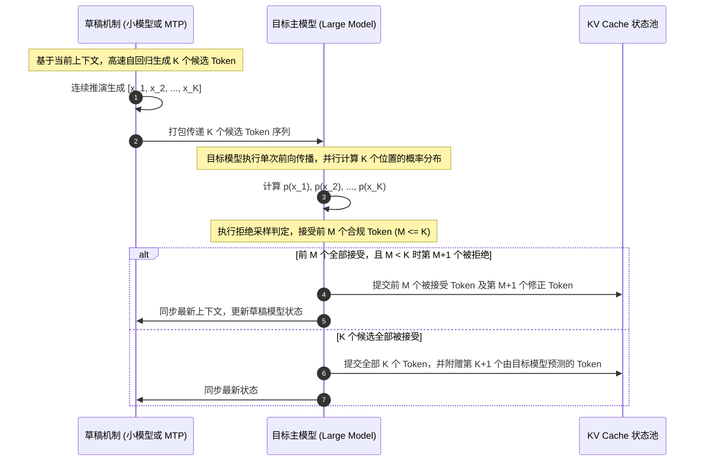
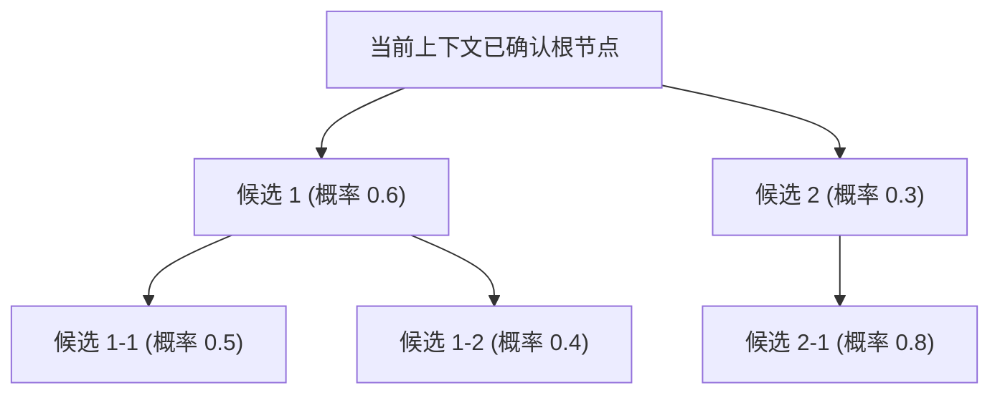

# 投机采样与协同解码

> **阅读导航**：[推理与部署](README.md) · [语言模型生成机制与 KV 缓存](语言模型生成机制与KV缓存.md) · [推理内存预算与成本估算](推理内存预算与成本估算.md) · [投机解码收益与实测条件](投机解码收益与实测条件.md)

自回归解码单步计算强度极低（1~4 FLOP/Byte），大模型 95% 以上的时间处于等待权重搬运的内存带宽墙瓶颈。投机解码（Speculative Decoding）通过轻量草稿机制预先推测候选序列，并由目标大模型并行矩阵验证，将算力闲置转化为物理加速。本文系统推导从带宽墙机理到 Draft-then-Verify 拒绝采样判据、Tree Attention 因果掩码推导以及稠密与 MoE 架构的分化边界。

---

## 一、概念与问题概述

### 1. 自回归单步解码的访存困境：内存带宽墙

在单请求解码阶段，每生成 1 个 token，GPU 必须从 HBM 显存将模型全量权重完整搬运一次至计算核心。硬件物理现实决定了计算强度与算力利用率的极度失衡：
要理解投机解码的作用前提，必须先看清自回归单步解码为何无法充分利用现代 GPU 的算力。

### 2. 算力闲置与访存瓶颈物理模型

例如一家大型图书档案馆配有一台运算速度很快的扫描仪（GPU 计算核心），但书库的自动传送带运送能力有限（显存带宽）：
- **自回归逐字生成**：读者要求扫描仪每打印一个字，传送带必须把整座馆藏的几十卷大百科全书从库房全部运出来一次，让扫描仪翻查一遍，打印出 1 个字，再把整套大百科全书运回库房；紧接着为了打印第 2 个字，传送带又把整套百科全书完整运出来一遍。扫描仪每次只工作了 0.1 毫秒，剩余 99% 的时间都在等待传送带运书。
- **内存带宽墙的物理现实**：此时系统的生成速度完全受限于传送带的运送速度。即便将扫描仪升级为十倍算力的新型号，只要传送带的速度没有提升，整套系统的出字速度几乎不会改变。

```mermaid
flowchart TD
    subgraph MemoryWall["自回归单步解码的访存困境 (Memory Bandwidth Wall)"]
        direction TB
        WeightStore["显存 HBM: 存储 70B 模型静态权重 (FP16 占用 140 GB)"]
        Bus["显存总线带宽: 例如 A100 标称 2039 GB/s"]
        SMCores["GPU 计算核心: FP16 峰值 312 TFLOPS"]
        
        WeightStore -->|单步生成 1 个 Token, 必须全量搬运 140 GB 权重| Bus
        Bus -->|搬运耗时约 68.6 毫秒| SMCores
        SMCores -->|执行单步计算仅需 0.45 毫秒 (算力利用率不足 1%)| Output["输出单 Token Logits"]
    end
```

### 3. 数学推导与算力闲置量化

设主模型参数量为 $P$，数据精度为 $b$ 字节。在单请求（Batch Size = 1）自回归生成中，生成单个 token 所需的浮点运算量为：

$$\mathrm{FLOPs} \approx 2P$$

而为了执行该 token 的前向计算，GPU 必须通过显存总线完整加载一次模型静态权重（假设 KV Cache 访存相对较小）：

$$\mathrm{Bytes} \approx P \times b$$

代入硬件计算强度公式：

$$I_{\mathrm{decode}} = \frac{2P}{Pb} = \frac{2}{b}$$

在 FP16 精度（$b=2$）下，$I_{\mathrm{decode}} = 1\text{ FLOP/Byte}$。以 NVIDIA A100 GPU 为例：
- 显存物理带宽 $\beta_{\max} = 2039\text{ GB/s}$；
- FP16 算力峰值 $\Pi_{\max} = 312\text{ TFLOPS} = 312,000\text{ GFLOP/s}$；
- 硬件平衡临界点 $I^* = 312,000 / 2039 \approx 153\text{ FLOP/Byte}$。

在自回归单步解码时，GPU 实际发挥的算力仅为：

$$P_{\mathrm{actual}} = I_{\mathrm{decode}} \times \beta_{\max} = 1 \times 2039 = 2039\text{ GFLOPS} \approx 2.04\text{ TFLOPS}$$

实际发挥的算力与硬件理论峰值（312 TFLOPS）相比：

$$\text{算力利用率} = \frac{2.04}{312} \approx 0.65\%$$

这意味着超过 99% 的硬件算力完全处于闲置浪费状态。这就是阻碍大模型单序列生成提速的**内存带宽墙（Memory Bandwidth Wall）**。

---

## 二、核心原理

### 1. Draft-then-Verify 双模型协同与无损采样

投机解码的核心思路，是用较低的计算代价绕开单步访存限制。

### 1. 运行流程与无损采样算法

投机系统由两个模型构成：
1. **草稿机制（Draft Model）**：一个参数量极小的小模型（例如主模型的 1/20 体积），或主模型自附带的多 Token 预测头（MTP）。由于参数量极小，小模型搬运权重的速度比大模型快数倍到数十倍；
2. **目标主模型（Target Model）**：原始的大语言模型，负责对草稿给出的连续预测执行批量并行校验。



### 2. 严格无损的概率采样数学推导

投机解码不是牺牲生成质量换取速度的有损启发式算法，而是在数学上被严格证明与目标大模型直接采样**具有完全相同概率分布**的无损算法。

对于草稿模型生成的候选序列中第 $i$ 个 token $x$，设草稿模型预测的概率分布为 $q(x)$，目标主模型预测的概率分布为 $p(x)$。
- **接受判定**：从均匀分布中抽取随机数 $r \sim U(0, 1)$。若满足下式，则接受候选 token $x$：

$$r < \min\left(1, \; \frac{p(x)}{q(x)}\right)$$

- **拒绝与修正**：若上述条件不满足，则候选 token $x$ 被拒绝，且投机链在此处立即截断。此时系统从以下修正分布中重新采样出一个新的替代 token $x'$ 并结束本轮投机：

$$p'(x) = \frac{\max(0, \; p(x) - q(x))}{\sum_y \max(0, \; p(y) - q(y))}$$

在贪心解码（温度为 0）时，上述准则退化为确定性比较：只要目标模型的最高概率 token 与草稿模型给出的候选 token 完全一致，即视为接受；一旦不一致，立即由目标模型的最高概率 token 替代。这一机制确保了生成的每一段文本在统计意义上与直接由目标大模型自回归生成毫无差异。

---

### 2. 从链状推测到树状验证：Tree Attention 因果掩码推导

早期投机解码采用单条线性的链状猜测（如每次生成一条长度为 $K$ 的连续候选序列）。链状猜测的主要局限在于：**一旦前端第 1 个 token 猜测错误被拒绝，后续生成的 $K-1$ 个 token 将全部作废。**

为了提高单次验证的接受期望，现代高性能投机系统（如 SpecInfer、EAGLE、Sequoia）普遍采用**树状注意力（Tree Attention）**技术。

### 1. 直观比喻与结构框架

例如棋手推演走法：
- **链状推测**：只设想一种单一的连续下法“走马、拱兵、飞相”。如果对手第一步没有走马，后面预想的所有招法全部落空；
- **树状推测**：同时构想一棵走法树，第 1 步预测 2 种最高概率的可能；针对第 1 种可能延伸出 2 种应对，针对第 2 种可能延伸出 1 种应对。无论真实局势落入哪一个分支，都能命中其中一条路径。



### 2. 树状因果注意力掩码（Tree Attention Mask）矩阵设计

在将这一棵包含多个分支的候选树一次性输入目标模型时，必须保证各分支在计算注意力时互不干扰，保持各自路径上的因果关系。这通过自定义的二维因果掩码矩阵实现。

假设候选树包含 5 个节点，其拓扑依赖关系如下：
- 节点 0：根上下文预测的第 1 个主干候选 token A；
- 节点 1：在 token A 基础上延伸的候选 token B；
- 节点 2：在 token A 基础上延伸的另一分支候选 token C；
- 节点 3：根上下文预测的第 2 个备选 token D；
- 节点 4：在 token D 基础上延伸的候选 token E。

在执行目标大模型单步并行验证时，我们将这 5 个 token 打包为一个长度为 5 的序列输入模型。为了让节点只能看到其上游祖先节点、而看不到其他平行分支，对应的注意力掩码矩阵 $M \in \mathbb{R}^{5 \times 5}$ 设计如下（其中 0 代表可关注，$-\infty$ 代表遮蔽不可见）：

$$M = \begin{pmatrix}
0 & -\infty & -\infty & -\infty & -\infty \\
0 & 0 & -\infty & -\infty & -\infty \\
0 & -\infty & 0 & -\infty & -\infty \\
-\infty & -\infty & -\infty & 0 & -\infty \\
-\infty & -\infty & -\infty & 0 & 0
\end{pmatrix}$$

解读矩阵行列可见性：
- 节点 0 只可见自身；
- 节点 1 可见祖先节点 0 与自身；
- 节点 2 可见祖先节点 0 与自身，但与节点 1 相互不可见；
- 节点 3 与节点 0、1、2 属于不同子树，相互不可见；
- 节点 4 可见祖先节点 3 与自身，与其他节点完全遮蔽。

目标模型仅需一次前向矩阵运算，就能同时完成对整棵树所有分支的 token 概率验证，提升了单步权重搬运所能推进的有效 token 期望值。

---

## 三、工程代价与加速方案

### 1. 稠密模型 vs MoE 架构的专家膨胀代价

在实际部署投机解码时，不同模型架构的收益表现差异很大。

### 1. 稠密模型（Dense）的适配性

在稠密大模型（如 LLaMA-3-70B、Qwen2.5-27B）中：
- 自回归单步无论是处理 1 个 token 还是并行验证 8 个 token，GPU 必须搬运的权重体积完全一样（均为该模型全部 100% 的静态参数）；
- 验证阶段将矩阵维度从 $[1, D]$ 扩大为 $[K, D]$，计算量虽增加 $K$ 倍，但由于原始计算强度较低，增加后的计算量仍然处在 GPU 的未饱和算力区间内，搬运权重的总时间基本不变；
- **物理结论**：稠密模型适合投机并行验证，只要草稿模型足够快且准确，就能取得接近理论接受期望的加速。

### 2. 稀疏激活 MoE 架构的专家激活膨胀问题

在超大稀疏激活 MoE 模型（如 DeepSeek-V3 671B、Qwen3.8-Flash-Next 180B）中，投机解码会遇到明显的访存瓶颈：

| 运行机制 | 传统单步自回归 | 投机批量验证（树长或链长 K） |
|---|---|---|
| **单 token 专家激活** | 固定激活少数专家，例如 top-2（如总参 180B 仅激活 6B） | 每个候选 token 独立路由至不同的专家 |
| **权重实际搬运量** | 仅需从显存读取被激活的少数专家参数 | **必须读取所有候选 Token 所需专家的并集（Expert Union）** |
| **显存带宽占用** | 较低（相当于 3B 至 6B 小模型的搬运量） | 随着 $K$ 增大，涉及的专家并集快速扩大，搬运量攀升至数十吉字节 |
| **单次前向耗时** | 较短 | 耗时随候选序列长度非线性增加，抵消少跑前向的收益 |

当 $K$ 个候选 token 分别指向不同的稀疏专家时，系统被迫在单次验证中从显存拉取远超单步比例的专家权重集合。这一现象称为**专家并集膨胀（Expert Union Inflation）**。

因此在超大 MoE 架构上，链状长草稿或大树状投机不仅很难获得加速，甚至经常出现端到端吞吐下降 30% 以上的情况。对 MoE 模型的投机解码应采用更短的草稿步数（如 $n=2$）或同源预测头，以限制专家激活集的发散。
---

## 四、选型指南与协同架构

### 1. 投机解码落地方案判定表

| 方案类别 | 代表实现 | 显存额外开销 | 适用场景与硬件边界 | 风险与降速陷阱 |
|---|---|---|---|---|
| **独立小模型（Draft Model）** | Llama-3-8B 辅助 70B | 高（需独占数 GB 权重显存） | 目标模型超大（70B+）、显存充足且草稿命中率稳定高于 65% | 草稿模型单步延迟过高，抵消验证收益 |
| **自给自足 MTP（多 Token 预测）** | DeepSeek MTP / Qwen MTP | 极低（仅增设 1~2 个线性预测头） | 原生支持 MTP 的现代模型，单卡显存受限环境 | 长序列长尾生成时接受率下降 |
| **无损树状推测（Tree Attention）** | Medusa / Eagle | 中（需维护拓扑因果掩码） | 高并发服务端推理引擎，计算受限型 GPU 部署 | 拓扑树过深导致验证阶段 Prefill 开销暴增 |

### 2. 真实加速工程防坑指标

- **理论接受率（Acceptance Rate）不等于实际加速比**：若草稿推测 5 个 token 耗时已达大模型单步解码的 60%，哪怕接受率达到 70%，端到端延迟收益依然接近于零；
- **MoE 模型的专家激活陷阱**：单步解码原本仅激活 $ 个专家，投机批量验证由于候选 token 跨度大，导致激活专家出现并集膨胀，反向击穿显存带宽。

---

## 五、参考资料

1. **Leviathan, Y., et al. (2023)**. *Fast Inference from Transformers via Speculative Decoding*. ICML 2023.
2. **Chen, C., et al. (2023)**. *Accelerating Large Language Model Decoding with Speculative Sampling*. arXiv:2302.01318.
3. **Miao, X., et al. (2024)**. *SpecInfer: Accelerating Generative LLM Serving with Tree-based Speculative Inference and Verification*. ASPLOS 2024.
4. **Cai, T., et al. (2024)**. *Medusa: Simple LLM Inference Acceleration Framework with Multiple Decoding Heads*. ICML 2024.
5. **Li, Y., et al. (2024)**. *EAGLE: Speculative Sampling Requires Rethinking Feature Uncertainty*. ICML 2024.
