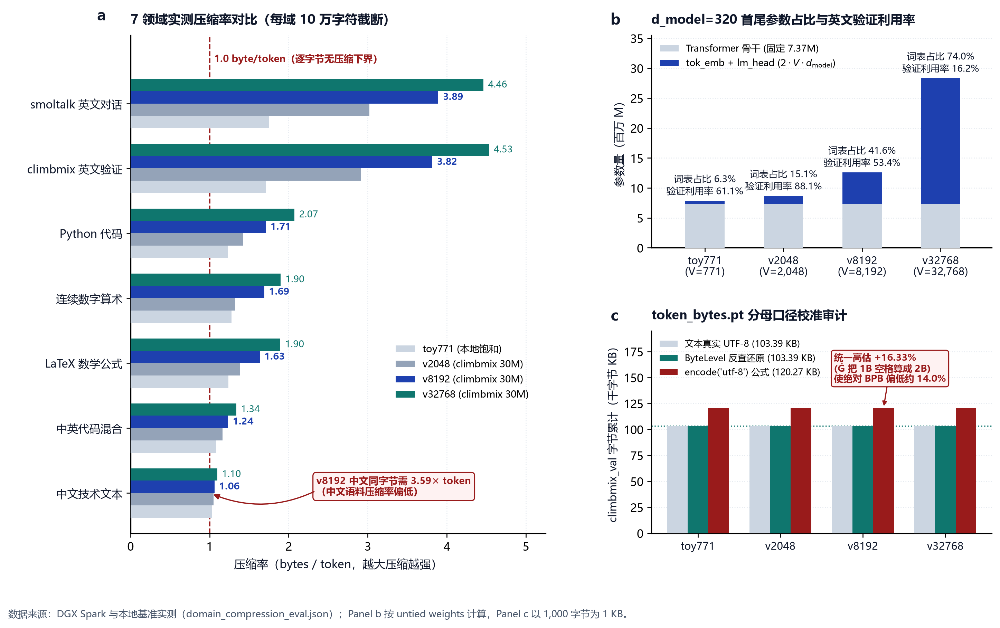

# 分词器效果评测与跨词表 BPB 计算：压缩率、Token 税与字节口径校准

> **阅读导航**：[大模型推理与机理](README.md) · [大语言模型从零构建与训练全链路](大语言模型从零构建与训练全链路.md) · 基础与训练：[分词机制与生成成本](分词机制与生成成本.md) · [分词器训练与词表规模权衡](分词器训练与词表规模权衡.md) · 多域评估：[eval_tokenizer_domains.py](../../../experiments/llm-lifecycle-fullchain/scripts/eval_tokenizer_domains.py)

把分词器训出来以后，是不是必须等大模型预训练几小时甚至几天，才知道这张词表合不合格？答案是不需要。在模型权重还没初始化的时候，就可以在 CPU 上独立做四道体检：往返还原校验、分领域压缩率实测、词表槽位利用率检查，以及面向后续预训练阶段对比用的 **BPB**（Bits Per Byte，每字节所需比特数）口径审计。

本文围绕多域评测脚本 [eval_tokenizer_domains.py](../../../experiments/llm-lifecycle-fullchain/scripts/eval_tokenizer_domains.py) 与公共评测函数 [llm_common.py](../../../experiments/llm-lifecycle-fullchain/scripts/llm_common.py#L838-L883)，结合 DGX Spark 四组词表在七个语域上的实测基准，讲清不靠模型做题怎么评测词表优劣，以及为什么对比不同词表的语言模型不能比困惑度（PPL），而必须使用经过字节校准的 BPB。

---

## 一、 无损往返校验：验证还原一致性

第一关看编码再解码是否一丝不差。抽取涵盖标准英文、连写数字、缩略词、连续空格缩进、换行符、特殊标点与中文多字节字符的探针语句，逐句执行编码和保留特殊控制标记的解码，严格断言输入文本与输出文本一字不差。任何丢字、吞并空格或解码替代码出现，训练入口立刻返回非零状态阻止流入预训练。

在本地探针验证集上，`50` 行混合测试句子全部无损通过；在 DGX Spark 多领域对照测试中，`toy771`、`v2048`、`v8192` 与 `v32768` 在全部 7 类领域切片上的 `roundtrip_ok` 也均为 `true`（详细输出见 [domain_compression_eval.json](../../../experiments/llm-lifecycle-fullchain/evidence/tokenizer-domain-compression-eval.json)）。

---

## 二、 什么叫压缩率：用装箱直觉看懂 7 领域实测与中文 Token 税

### 1. 「压缩率」到底代表什么意思？

日常做文件打包（例如 zip），压缩率常按「压缩后文件大小除以原始大小」计算，数字越小越省空间；但大语言模型分词行业习惯刚好相反，用**每单个 token 平均打包进多少个原始 UTF-8 字节**来衡量：

$$\text{Compression Ratio} = \frac{\text{UTF-8 总字节数}}{\text{Token 总数}} \quad (\text{单位: bytes/token})$$

可以用「集装箱装货」来做直觉类比：每个 token ID 就像一只标准集装箱，文字在硬盘上占多少 UTF-8 字节就是多少斤货物。假使一句 20 字节的英文被压成 5 个 token，等于平均每只箱子装进了 4 字节内容；若碰上冷门符号或未学过的汉字，一个原本占 3 字节的汉字被拆回单字节编号，就得连发 3 只箱子才能送走一个字。因此在大模型里，**压缩率数值越大，说明打包密度越高、同样一段上下文能塞进更多有效信息**；一旦压缩率跌向 `1.0 byte/token`，意味着词表几乎退化成逐字节硬切。

### 2. DGX Spark 七领域压缩率实测矩阵

只看训练集均值会严重掩盖偏科。我们在 DGX Spark 上用 [eval_tokenizer_domains.py](../../../experiments/llm-lifecycle-fullchain/scripts/eval_tokenizer_domains.py) 同口径评测四组分词器：`toy771`（本地 37 KB 微语料饱和）以及基于 `climbmix` 3,000 万英文字符练出的 `v2048`、`v8192`、`v32768`。每个语域按 `100,000` 字符或完整文档边界截断，实测数据见图 1 Panel a 与下表：

| 评估域 | 原始 UTF-8 字节 | `toy771` (tokens / BPT) | `v2048` (tokens / BPT) | `v8192` (tokens / BPT) | `v32768` (tokens / BPT) |
|---|---|---|---|---|---|
| `climbmix_val` (英文网页验证) | `103,386` | `60,507` / `1.7087` | `35,511` / `2.9114` | `27,097` / `3.8154` | `22,806` / `4.5333` |
| `smoltalk` (英文对话) | `101,764` | `58,050` / `1.7530` | `33,697` / `3.0200` | `26,150` / `3.8915` | `22,807` / `4.4620` |
| `python_code` (Python 代码) | `109,614` | `88,946` / `1.2324` | `76,854` / `1.4263` | `64,042` / `1.7116` | `52,895` / `2.0723` |
| `digits_arithmetic` (连续数字算术) | `100,000` | `78,345` / `1.2764` | `75,738` / `1.3203` | `59,085` / `1.6925` | `52,644` / `1.8996` |
| `latex_math` (LaTeX 数学公式) | `100,000` | `80,814` / `1.2374` | `72,384` / `1.3815` | `61,196` / `1.6341` | `52,765` / `1.8952` |
| `mixed_zh_en_code` (中英代码混合) | `154,228` | `142,068` / `1.0856` | `132,430` / `1.1646` | `124,851` / `1.2353` | `115,432` / `1.3361` |
| `chinese_tech` (中文技术文本) | `231,716` | `224,849` / `1.0305` | `220,473` / `1.0510` | `218,159` / `1.0621` | `211,379` / `1.0962` |

表里直接暴露出两条明显的工程规律：

1. **纯英文语料练出的词表在代码和数学上压缩率腰斩**：在标准规格 `v8192` 上，英文对话与英文网页分别达到 `3.89` 和 `3.82 bytes/token`，而换到 `python_code` 立刻跌到 `1.71`，`latex_math` 跌到 `1.63`。哪怕将词表扩充四倍至 `v32768`，`climbmix_val` 升到 `4.53`，`chinese_tech` 也仅仅从 `1.0621` 微升到 `1.0962 bytes/token`，`10` 万字符级中文技术语料照样要切出超过 `21 万` 个零碎 token。
2. **学术界所说的词元税（Token Tax）就在眼前**：常用汉字在 UTF-8 里固定占 3 字节，缺少中文语料训练的 BBPE 词表几乎没有双字词或多字节整字，只能退回单字节底层拼装。在 `v8192` 上，`chinese_tech` 单 token 字节压缩率只有 `climbmix_val` 的 `27.84%`，即表达同等字节量信息需要耗费英文 **`3.59` 倍的 token 数量**。Petrov et al. (2023) 与 Ahia et al. (2023) 实证指出这种词表偏斜会造成非英语用户面对成倍上涨的 API 账单和生成延迟；Lundin et al. (2025) 结合二次方注意力算力公式提醒，token 数翻倍往往意味四倍自注意力运算开销；Rust et al. (2021) 也以**生育率**（Fertility，一个完整词平均切成几个 token）证明词表覆写不足会系统拖慢多语言下游微调收敛。

换句话说，如果后续模型要接中文、代码或公式，在分词器训练语料阶段就必须混入相应比例的中文和代码分片；靠单纯把纯英文词表扩大几倍，根本救不回中文的切分膨胀。

### 3. 警惕「惟压缩率论」的无模型评测上限

压缩率很直观，却不能单独充当预测最终语言模型效果的排名依据。Zouhar et al. (2023a) 基于 Rényi 熵指出，如果少数极长词占据主导、大量低频碎块无人使用，即便表面总压缩率很高，实际分布失衡也会损伤模型学习；Gowda & May (2020) 也给出词表规模与样本频次匹配上限（例如其倡导至少 `95%` 的词表条目在训练语料中出现不少于 `100` 次）。Cognetta et al. (2026) 与 Zouhar et al. (2023b) 均提醒，纯静态分词内在指标与下游模型最终表现并不存在简单单调对应，但只要目标领域压降到 `1.0 byte/token` 左右，就一定已经落入序列膨胀低效区，应在开训模型前先纠正语料混合比。

---

## 三、 词表实际利用率与预处理张量存储开销

除了压缩紧实程度，还得核对词表槽位是不是建起来却闲着不用（图 1 Panel b 右上）。在同一组 10 万字符截断实测下，实际在验证集上露过面的独立 token 比例相差悬殊：

| 分词器 | `climbmix_val` 利用率 | `smoltalk` 利用率 | `python_code` 利用率 | `chinese_tech` 利用率 |
|---|---|---|---|---|
| `v2048` | `88.13%` | `82.32%` | `41.26%` | `9.42%` |
| `v8192` | `53.41%` | `42.22%` | `15.45%` | `2.34%` |
| `v32768` | `16.24%` | `12.12%` | `4.97%` | `0.55%` |

`v2048` 在单份英文切片就能用掉 `88.13%` 的槽位，而 `v32768` 在英文验证集中只激活 `16.24%`，到中文技术文本上激活率更低到 `0.55%`（绝大多数非基础字节的中文合并规则全未触发）。

在主机侧内存与磁盘预算方面，`vocab_size` 上限同样决定预切词缓存张量的体积：控制在 `65,536` 以内可以用无符号 16 位整型 `uint16` 存储全部 token ID；在 DGX Spark 上实测处理 `20,304,889` 个训练 token 时，存成默认 `int64` 占 `154.91 MB`，换成 `uint16` 直接降到 `38.73 MB`（见 [vram_batch_table_gb10.md](../../../experiments/llm-lifecycle-fullchain/evidence/vram-batch-table-gb10.md)）。

---

## 四、 跨词表不能直接比困惑度（PPL），怎么用 BPB 统一标准？

模型预训练时常在验证集上计算单 token 平均交叉熵损失与困惑度（$\text{PPL} = \exp(\text{mean\_loss})$）。然而 Mielke (2019) 与 Luitel et al. (2025) 反复强调过同一条评估纪律：**不同词表切出来的两个语言模型，绝对不能直接拿单 token PPL 比大小**。

原因很简单：假设模型本质预测能力丝毫未变，如果词表把同一段句子拆得更碎、切出更多 token，原本整句话承担的总惊讶度（总负对数似然）就会被更多「更短小的预测步数」平分；单步预测往往变成只要猜下一个字母或单字节，平均每步条件熵天然变小，PPL 也就凭空降低，产生「切得越碎、分数反而更好」的假象。

为此，Gao et al. (2020) 在 The Pile 基准中推广使用 **BPB**（Bits Per Byte，平均每原始字节耗费的信息比特数），把结果统一到原始文本的字节口径：

$$\text{BPB} = \frac{\sum_{i \in \text{valid}} \text{NLL}_i / \ln 2}{\sum_{i \in \text{valid}} \text{token\_bytes}(y_i)}$$

这个公式做了两层对齐（对应 [llm_common.py](../../../experiments/llm-lifecycle-fullchain/scripts/llm_common.py#L838-L883) 的 `evaluate_bpb_ppl` 与 [01_train_tokenizer.py](../../../experiments/llm-lifecycle-fullchain/scripts/01_train_tokenizer.py#L141-L155) 导出的 `token_bytes.pt`）：

1. **统一以比特和字节作为分子分母尺度**：分子把以自然对数底统计的负对数似然 $\text{NLL}_i$ 除以 $\ln 2$ 转为信息比特数，分母累计目标位置真正还原回的文本总字节数，无论一个词表是拆 3 刀还是拆 10 刀，总字节数这一客观标尺不变；
2. **用 `0` 屏蔽特殊填充位置**：把 `<|endoftext|>`、`<|pad|>` 在 `token_bytes.pt` 中写入 `0` 字节，既在损失掩码中剔除填充，又防止特殊标记掺入有效分母稀释字节开销。

### 实测工程校准：为什么不能直接套用 `token_str.encode("utf-8")`？

在实际导出 `token_bytes.pt` 时，一个容易忽略的编码细节会导致绝对 BPB 偏差。在 Hugging Face `tokenizers` 库的 `ByteLevel` 字母表内部，原始空格 `0x20` 等不可见单字节在词表字符串里会被替换成占位字符 `Ġ`（U+0120）。一个原本只有 1 字节的空格变成字符 `Ġ` 后，直接调用 `len(token_str.encode("utf-8"))` 会按 Unicode 编码占用 2 字节计算！

我们在 [eval_tokenizer_domains.py](../../../experiments/llm-lifecycle-fullchain/scripts/eval_tokenizer_domains.py) 里对比了旧版代码公式 [01_train_tokenizer.py](../../../experiments/llm-lifecycle-fullchain/scripts/01_train_tokenizer.py#L148-L150) 与 `ByteLevel` 反向查表还原后的真实字节长度，逐 token 审计结果见图 1 Panel c 与下表：

| 分词器 | 非特殊 token 数 | 字节数不一致 token 数 | 旧公式词表总字节 | 还原后真实总字节 | 词表合计高估幅度 | 盘上 `token_bytes.pt` 匹配公式 |
|---|---|---|---|---|---|---|
| `toy771` | `769` | `430` | `2,723` | `2,293` | `+18.75%` | `n/a` |
| `v2048` | `2,046` | `1,193` | `9,259` | `8,051` | `+15.00%` | `true` |
| `v8192` | `8,190` | `5,553` | `51,249` | `45,635` | `+12.30%` | `true` |
| `v32768` | `32,766` | `22,807` | `238,241` | `214,875` | `+10.87%` | `true` |

当把整套映射拉回真实的 `climbmix_val` 文本验证切片（`103,210` 字符，文本原始 UTF-8 精确为 `103,386` 字节）校验时：

- 按 `ByteLevel` 字母表逆查每个 token 对应的原始字节累加，四个不同规格词表的总和**全部精确还原等于 `103,386` 字节**；
- 沿用旧版 `token_str.encode("utf-8")` 公式直接统计，四组分词器统一得出 `120,270` 字节，比真实多出 `16,884` 字节，**分母统一虚高 `+16.331%`**（单独考虑分母变化、且分子相同时，BPB 偏低约 `14.04%`）。

上述 `+16.331%` 只对应这段验证文本，不能推广到其他文本或不同评估窗口，也不能据此认定旧结果的比较顺序不变。当前代码使用 ByteLevel 字母表计算字节数，并在 BPB 的分子与分母中同时排除特殊 token。旧缓存加载时会在内存中按词表校正；已经保存的 BPB 数值需要用原模型和原验证集重新评估，不能套用固定比例直接修正。

---

## 五、 小结：上游词表验收清单

| 检查对象 | 检查方式与工具 | 合格判据 |
|---|---|---|
| 无损编解码检查 | `roundtrip` 多语言与符号探针 | 全部断言严格等于原文，零空格吞并、零解码替代码 |
| 语域压缩与 Token 税 | `eval_tokenizer_domains.py` 7 域实测 | 主训练目标领域与中文/代码切片远离 `1.0 byte/token` 逐字节退化底线 |
| 词表利用率与槽位膨胀 | 统计验证集唯一命中占比与首尾参数比重 | 防止小模型大半参数被闲置长尾槽位占用，总规模控制在 `uint16` 上限 `65,536` 内 |
| 跨词表评估标尺 | `token_bytes.pt` 加上下游 `evaluate_bpb_ppl` | 不跨词表比 PPL；用真实字节数计算 BPB，旧结果按原数据重新评估 |

---

## 六、 参考文献

1. Mielke, S. J. (2019). *Can You Compare Perplexity Across Different Segmentations?* [Technical Note](https://sjmielke.com/comparing-perplexities.htm)
2. Gao, L., Biderman, S., Black, S., et al. (2020). *The Pile: An 800GB Dataset of Diverse Text for Language Modeling*. [arXiv:2101.00027](https://arxiv.org/abs/2101.00027)
3. Luitel, N., Bekoju, N., Sah, A. K., & Shakya, S. (2025). *Can Perplexity Predict Finetuning Performance? An Investigation of Tokenization Effects on Sequential Language Models for Nepali*. GEM@ACL 2025. [ACL Anthology](https://aclanthology.org/2025.gem-1.21/)
4. Gowda, T., & May, J. (2020). *Finding the Optimal Vocabulary Size for Neural Machine Translation*. Findings of EMNLP 2020. [ACL Anthology](https://aclanthology.org/2020.findings-emnlp.352/)
5. Zouhar, V., Meister, C., Gastaldi, J., Du, L., Vieira, T., Sachan, M., & Cotterell, R. (2023a). *Tokenization and the Noiseless Channel*. ACL 2023. [ACL Anthology](https://aclanthology.org/2023.acl-long.284/)
6. Zouhar, V., Meister, C., Gastaldi, J., Du, L., Vieira, T., Sachan, M., & Cotterell, R. (2023b). *A Formal Perspective on Byte-Pair Encoding*. Findings of ACL 2023. [ACL Anthology](https://aclanthology.org/2023.findings-acl.38/)
7. Rust, P., Pfeiffer, J., Vulić, I., Ruder, S., & Gurevych, I. (2021). *How Good Is Your Tokenizer? On the Monolingual Performance of Multilingual Language Models*. ACL 2021. [ACL Anthology](https://aclanthology.org/2021.acl-long.243/)
8. Petrov, A., La Malfa, E., Torr, P. H. S., & Bibi, A. (2023). *Language Model Tokenizers Introduce Unfairness Between Languages*. NeurIPS 2023. [NeurIPS Proceedings](http://papers.nips.cc/paper_files/paper/2023/hash/74bb24dca8334adce292883b4b651eda-Abstract-Conference.html)
9. Ahia, O., Kumar, S., Gonen, H., Kasai, J., Mortensen, D., Smith, N., & Tsvetkov, Y. (2023). *Do All Languages Cost the Same? Tokenization in the Era of Commercial Language Models*. EMNLP 2023. [ACL Anthology](https://aclanthology.org/2023.emnlp-main.614/)
10. Lundin, J. M., Zhang, A., Karim, N., Louzan, H., Wei, V., Adelani, D., & Carroll, C. (2025). *The Token Tax: Systematic Bias in Multilingual Tokenization*. [arXiv:2509.05486](https://arxiv.org/abs/2509.05486)
11. Cognetta, M., Akiki, C., Ammanamanchi, P. S., et al. (2026). *Tokenization: A Survey for Modern NLP*. Transactions on Machine Learning Research (TMLR). [OpenReview](https://openreview.net/forum?id=FTBiFXo1gz)
