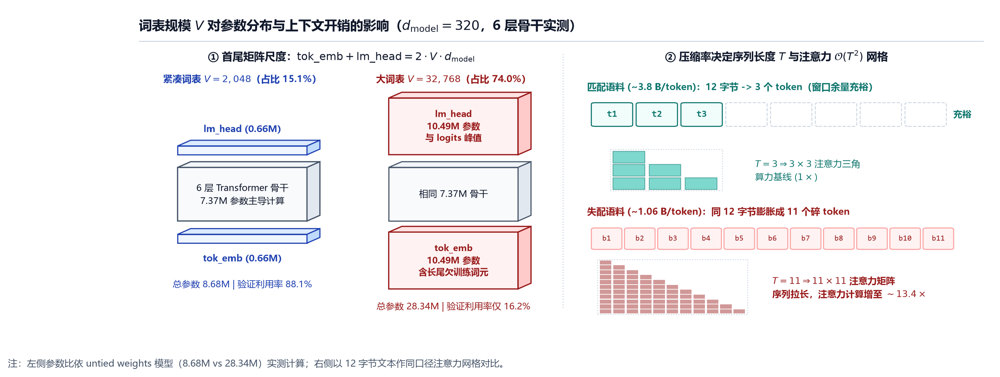

# 分词器训练与词表规模权衡：参数占比、正则切分与 BPE 构建

> **阅读导航**：[大模型推理与机理](README.md) · [大语言模型从零构建与训练全链路](大语言模型从零构建与训练全链路.md) · 前置原理：[分词机制与生成成本](分词机制与生成成本.md) · 评测指标：[分词器效果评测与跨词表 BPB 计算](分词器效果评测与跨词表BPB计算.md) · 训练脚本：[01_train_tokenizer.py](../../../experiments/llm-lifecycle-fullchain/scripts/01_train_tokenizer.py)

分词器阶段不涉及神经网络权重，也不执行梯度反向传播。它的职责是在开训大模型之前，用统计方法定死一张从原始字符串到整数编号的词表映射规则。正如 Cognetta et al. (2026) 所强调，分词器往往是整条训练流程里唯一脱离端到端联合优化、在后续步骤中保持固定的部件：一旦词表生成完毕，后续预训练、对话微调与强化学习全部依赖同一套 ID 规则运行。

本文围绕训练实验中的 [01_train_tokenizer.py](../../../experiments/llm-lifecycle-fullchain/scripts/01_train_tokenizer.py)，拆解工程落地前最关键的两组决策：其一，训练词表前为什么要权衡 `vocab_size`，不能一味求大也不能一味压小；其二，无 GPU 流式 BPE 训练流水线每一步怎么跑、正则切分有哪些算术与长尾词元问题，以及导出的三份产物分别给下游交什么契约。



---

## 一、 词表大小的三重权衡：参数占比、注意力窗口与缩放律

决定词表大小时，必须同时权衡模型参数分配、单序列算力与整库训练步数三条约束（如图 1 所示）：

1. **首尾矩阵与输出头峰值显存**：在不共享输入嵌入与输出预测头权重（untied weights）的架构里，词表会贡献两张大矩阵：`tok_emb` 与 `lm_head`，合计参数量为 $2 \times \text{vocab\_size} \times d_{\text{model}}$。计算交叉熵损失前，输出层还必须为批次内每个 token 生成长度为 `vocab_size` 的 `logits` 张量；词表翻倍，最后一层线性投影的计算量与峰值显存都会成比例上升。
2. **上下文窗口容量与二次方注意力开销**：如果强行把词表压得过小，同一句话就会被切出更多细碎 token。自注意力算子复杂度随序列长度平方（$\mathcal{O}(T^2)$）增长，且固定的上下文窗口（如 `block_size=256`）能装下的原文字符数会直接按压缩率比例缩水。
3. **压缩率对语料训练吞吐的乘法效应**：假设硬盘存着 1 GB 训练文本，词表平均每 4 字节压成 1 个 token，GPU 总共只需处理约 2.5 亿个 token；如果压缩率掉到每 token 2 字节，同一批语料就膨胀成 5 亿个 token，不仅数据搬运翻倍，跑完一轮训练的步数与总时长也同步翻倍。

### 1. 小模型上词表过大的参数失衡实测

当骨干网络只有几层时，套用商业大模型动辄几万的词表会把绝大部分参数浪费在查表层。按实验骨架配置（`d_model=320`，`n_layers=6`，`n_heads=8`，`d_ff=1280`，Transformer 骨干固定占 `7,372,800` 参数，untied weights）拆解实测参数，结果如下表（数据记录见 [domain_compression_eval.md](../../../experiments/llm-lifecycle-fullchain/evidence/tokenizer-domain-compression-eval.md)）：

| 分词器配置 | 嵌入层 `tok_emb` | 输出头 `lm_head` | 首尾参数合计 | 模型总参数量 | 词表参数占比 |
|---|---|---|---|---|---|
| `toy771` | `246,720` | `246,720` | `493,440` | `7,866,240` | `6.27%` |
| `v2048` | `655,360` | `655,360` | `1,310,720` | `8,683,520` | `15.09%` |
| `v8192` | `2,621,440` | `2,621,440` | `5,242,880` | `12,615,680` | `41.56%` |
| `v32768` | `10,485,760` | `10,485,760` | `20,971,520` | `28,344,320` | `73.99%` |

从 `v2048` 扩到 `v32768`，骨干网络一模一样，整张模型总参数却膨胀到 `2,834 万`，其中几乎四分之三参数全部集中在首尾词表矩阵里。

### 2. 学术界的词表缩放律研究边界

针对多大规模的模型该配多大的词表，近年文献给出了互补的定量研究边界：

- **估算计算最优曲线不能忽略嵌入层**：Porian et al. (2024) 复核历史缩放律分歧时发现，早期估算方法（如 Kaplan 与 Hoffmann 之间的斜率差异）忽略嵌入参数与算力占比较大比例影响了对中小模型预算的判断。
- **最优词表规模随骨干与算力同步放大**：Tao et al. (2024) 把词表尺寸 $V$ 直接写进计算最优缩放公式，证明更深的非嵌入骨干配更高算力预算时，应当对应匹配更大词表；Takase et al. (2025) 在英文和日文上的实测也支持扩大高容量模型词表的收益。
- **按原始字节看数据配比与逆向收敛**：Limisiewicz et al. (2026) 在统一 FLOP 标尺下把训练数据量换算成每参数对应的字节数后发现，不同分词器间的最优数据比例保持稳定，而骨干参数越大的模型反而对高文本压缩率需求更低。综合来看，词表选型是在「压短序列省注意力计算」与「控制首尾参数不挤占主干网络预算」之间权衡，实验体系选用 `2048` 到 `8192` 的紧凑词表正处在中小规模骨架的合适区间。

---

## 二、 CPU 无 GPU 训练三步流水线（基于 `01_train_tokenizer.py`）

[01_train_tokenizer.py](../../../experiments/llm-lifecycle-fullchain/scripts/01_train_tokenizer.py) 参考 `karpathy/nanochat` 的工程规范，全程仅需 CPU 内存即可完成词表训练，运行分为顺序衔接的三步：

### 1. 流式读取、单篇截断与总量封顶

训练 BPE 无需把动辄数十 GB 的数据集一次载入内存。[dataset.py](../../../experiments/llm-lifecycle-fullchain/scripts/dataset.py) 中的 `iter_texts` 会按行组（row group）从 Parquet 分片或文本文件中逐段产出语料，并设置两项上限：

- **单篇文档字符截断**（`--doc-cap`，默认 `10000`）：每篇文章只取前 1 万个字符参与共现频次统计，防止个别超长日志、网页或整本古籍垄断候选片段分布；
- **语料总字符封顶**（`--max-chars`）：累计读到设定上限立即停机。在 DGX Spark 验证上，截取 `climbmix` 切片前 3,000 万字符就足以稳定练出 `8,192` 与 `32,768` 两套高质量英文词表。

### 2. GPT-4 正则隔离预切分与算术数字切分问题

直接对原始句子跑 BPE 贪心合并，高频词汇会反复吞下后面挨着的逗号、句号和空格，使模型为了同一个词根不同标点背出许多重复词槽。为此流水线在 BPE 合并前插了一道正则预切分与字节映射步骤：

```python
GPT4_SPLIT_PATTERN = (
    "(?i:'s|'t|'re|'ve|'m|'ll|'d)"
    "|[^\r\n\\p{L}\\p{N}]?\\p{L}+"
    "|\\p{N}{1,3}"
    "| ?[^\\s\\p{L}\\p{N}]+[\\r\\n]*"
    "|\\s*[\\r\\n]+"
    "|\\s+(?!\\S)"
    "|\\s+"
)
```

七条分支分工明确，再配合 `Split(..., behavior="isolated")` 强制锁死边界（绝不允许后续 BPE 跨切分点把单词和句末标点粘连），紧接 `ByteLevel(add_prefix_space=False)` 映射到 `0` 到 `255` 基础字节表，消除 `<unk>` 带来的未知字符抹除问题（Radford et al., 2019）：

| 正则分支 | 切分对象 | 保护逻辑 |
|---|---|---|
| `(?i:'s\|'t\|'re\|...)` | 英文常见缩写尾缀 | 把 `'m`、`'re` 稳定切离，避免干扰主词根 |
| `[^\r\n\p{L}\p{N}]?\p{L}+` | 可选单符号前缀接文字 | 允许前置单个空格融入单词，但隔断尾随标点 |
| `\p{N}{1,3}` | 最多 3 位连续数字 | 防止词表被大量长年份、随机串或 ID 编号占满 |
| ` ?[^\s\p{L}\p{N}]+[\r\n]*` | 连续标点与特殊符号 | 单独成块，防止高频文本词吞并标点符号 |
| `\s*[\r\n]+` 与 `\s+` | 多换行与连续空白缩进 | 让代码缩进与段间换行各自成块，不污染正常文字词频 |

值得注意的是，看似直观的 `\p{N}{1,3}` 数字规则其实藏着一条从 GPT-3（Brown et al., 2020）沿用至今的算术副作用。从左向右按三位一刀切分时，7 位数 `8675309` 会被劈成 `867`、`530`、`9`。Singh & Strouse (2024) 通过对照实验证明：当语料规模有限时，词表并未收全所有 1,000 个三位数组合，且「左起三位切分」和人类竖式算术「从右起对齐个位、十位、百位」天然反向错位，是造成大模型多位算术稳定性受挫的重要上游因素之一。换言之，预切分正则不仅关乎存储格式，更在最上游决定了模型能直接看见什么颗粒度的数值。

### 3. BPE 合并停机、提前饱和与欠训练词元风险

训练器从 ID `0`（`<|endoftext|>` 文档结束符）、ID `1`（`<|pad|>` 填充符）以及 256 个基础单字节开始，反复挑出所有隔离切片里相邻出现次数最多的对进行合并，直到满足以下任一停止条件：

1. 词表总条数达到预设的 `--vocab-size`；
2. 所有剩余相邻切片的共现次数都低于 `--min-frequency`。

在本地 37 KB 微型合成语料上即使要求 `vocab_size=2048`，训练也会在合并到第 `771` 项时耗尽满足频次条件的切片对而提前停机（耗时 `0.02 s`，记录见 [tokenizer_info.json](../../../experiments/llm-lifecycle-fullchain/evidence/tokenizer-info-toy-synthetic.json)）；而在 DGX Spark 硬件上切分 `8,000 万` 字符规模的 `climbmix` 预训练数据时，整轮文本编码运行 `18.26 s`，产出 `20,304,889` 个整数 token（见 [vram_batch_table_gb10.md](../../../experiments/llm-lifecycle-fullchain/evidence/vram-batch-table-gb10.md)）。

如果训练词表所用的语料领域和真正拿去训练模型的主语料不一致，或者词表设得过大，还会衍生出**未充分训练词元**（under-trained tokens）：Land & Bartolo (2024) 探测了多个主流开源模型的词表后发现，大量偏僻长合并词和半截 UTF-8 片段在漫长的预训练过程中几乎从未被采样命中，对应的行向量停留在近乎随机初始化的未更新状态；Geh et al. (2025) 进一步证明构造非规范异常切分序列可能干扰模型的对齐与拒绝护栏。因此训练词表的语料配比必须尽量反映预训练全集构成。

---

## 三、 输出的三份下游契约产物

训练脚本结束时导出三份彼此配合的交付物，共同定义上游到下游的一切编码约定：

1. `tokenizer.json`：写入完整的正则切分表达式、ByteLevel 配置、特殊控制字符编号以及逐条合并清单，是后续预训练切词、对话微调（SFT）组装与流式生成阶段必须完全固定的编码配置。
2. `tokenizer_info.json`：记录实际到达的词表大小、特殊 ID、训练集字符口径以及 50 条多语言验证句子的 `roundtrip` 无损往返校验标志，用于快速核对词表是否提前饱和或存在编解码损耗。
3. `token_bytes.pt`：一个长度为 `vocab_size` 的一维整型张量，逐 ID 登记每个 token 所覆盖的字节长度，并把 `<|endoftext|>` 与 `<|pad|>` 位置显式写死为 `0`。关于为什么需要这张字节映射表、不同领域文本压缩有多大差别以及如何校准跨词表评估指标，见[分词器效果评测与跨词表 BPB 计算](分词器效果评测与跨词表BPB计算.md)。

---

## 四、 参考文献

1. Cognetta, M., Akiki, C., Ammanamanchi, P. S., et al. (2026). *Tokenization: A Survey for Modern NLP*. Transactions on Machine Learning Research (TMLR). [OpenReview](https://openreview.net/forum?id=FTBiFXo1gz)
2. Radford, A., Wu, J., Child, R., Luan, D., Amodei, D., & Sutskever, I. (2019). *Language Models Are Unsupervised Multitask Learners*. OpenAI Technical Report. [PDF](https://cdn.openai.com/better-language-models/language_models_are_unsupervised_multitask_learners.pdf)
3. Brown, T., Mann, B., Ryder, N., et al. (2020). *Language Models Are Few-Shot Learners*. NeurIPS 2020. [arXiv:2005.14165](https://arxiv.org/abs/2005.14165)
4. Singh, A. K., & Strouse, D. J. (2024). *Tokenization Counts: The Impact of Tokenization on Arithmetic in Frontier LLMs*. [arXiv:2402.14903](https://arxiv.org/abs/2402.14903)
5. Porian, T., Wortsman, M., Jitsev, J., Schmidt, L., & Carmon, Y. (2024). *Resolving Discrepancies in Compute-Optimal Scaling of Language Models*. NeurIPS 2024. [NeurIPS Proceedings](https://proceedings.neurips.cc/paper_files/paper/2024/file/b6341525cd84f3be0ef203e4d7cd8556-Paper-Conference.pdf)
6. Tao, C., Liu, Q., Dou, L., Muennighoff, N., Wan, Z., Luo, P., Lin, M., & Wong, N. (2024). *Scaling Laws with Vocabulary: Larger Models Deserve Larger Vocabularies*. NeurIPS 2024. [OpenReview](https://openreview.net/forum?id=sKCKPr8cRL)
7. Takase, S., Ri, R., Kiyono, S., & Kato, T. (2025). *Large Vocabulary Size Improves Large Language Models*. Findings of ACL 2025. [ACL Anthology](https://aclanthology.org/2025.findings-acl.57/)
8. Limisiewicz, T., Pagnoni, A., Iyer, S., Lewis, M., Mehta, S., Liu, A., Li, M., Ghosh, G., & Zettlemoyer, L. (2026). *Compute Optimal Tokenization*. [arXiv:2605.01188](https://arxiv.org/abs/2605.01188)
9. Land, S., & Bartolo, M. (2024). *Fishing for Magikarp: Automatically Detecting Under-Trained Tokens in Large Language Models*. EMNLP 2024. [ACL Anthology](https://aclanthology.org/2024.emnlp-main.649/)
10. Geh, R., Shao, Z., & Van Den Broeck, G. (2025). *Adversarial Tokenization*. ACL 2025. [ACL Anthology](https://aclanthology.org/2025.acl-long.1012/)
