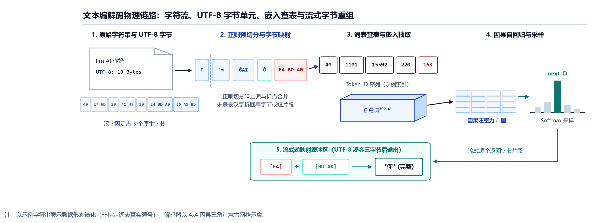
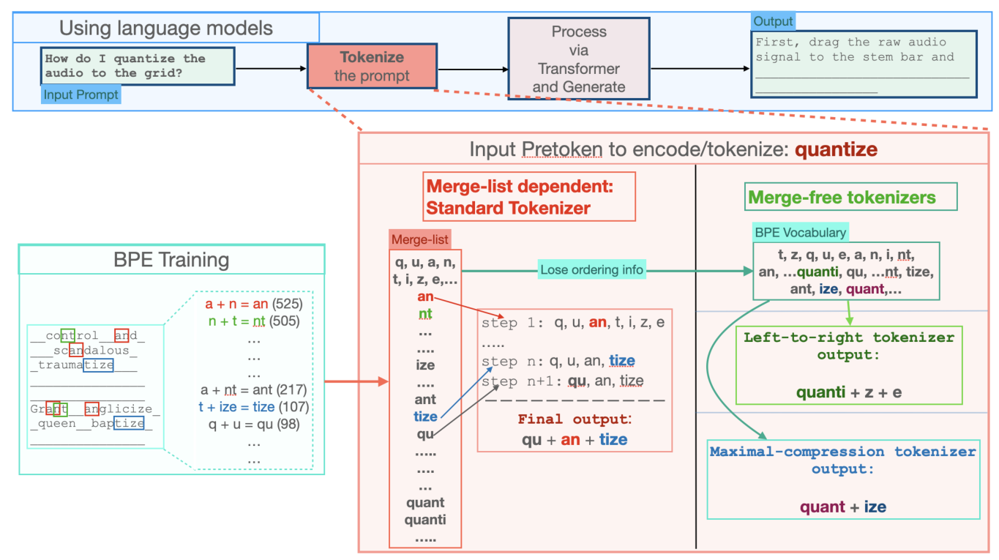
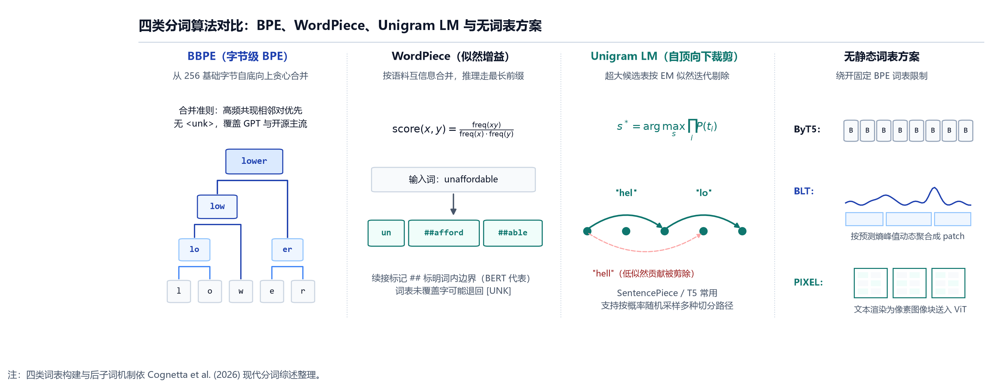

# 分词机制与生成成本

> **阅读导航**：[大模型推理与机理](README.md) · [Tokenizer 实验与复现](../../../experiments/tokenizer-mechanics/README.md) · 工程实战：[分词器训练与词表规模权衡](分词器训练与词表规模权衡.md) · 评测指标：[分词器效果评测与跨词表 BPB 计算](分词器效果评测与跨词表BPB计算.md)

文本在送入神经网络之前，必须经由离散分词器切分成整数编号（Token ID）序列。分词不仅界定了模型的词表边界，其切分粒度与压缩效率还直接决定了上下文窗口的有效容量、流式推理的字节拼接正确性以及按 token 计费的 API 服务成本。本文基于 Cognetta et al. (2026) 综述与开源实验套件，系统讲清从 UTF-8 字节流到子词切片的编解码全链路、四类主流分词范式机理、流式截断防护与成本估算准则。

---

## 一、概念与问题概述

### 1. 从文本到整数编号的物理链路

大语言模型本质上处理的是离散索引序列，无法直接摄入变长字符串。文本进入模型经历严格的三步变换：
1. **字节编码**：将原始字符串按 UTF-8 编码为底层字节序列（例如中文单字通常占 3 个字节）；
2. **切片匹配与查表**：结合正则预切分边界，通过贪心合并或词典匹配将字节序列切为子词切片，查静态词表得到连续整数 Token ID；
3. **输出重组**：自回归解码逐步预测出 Token ID 后，通过逆映射查表还原字节序列，并在解码端进行多字节码元重组。

### 2. 最小 BPE 统计合并的运行机理

分词合并规则的学习无需依赖深度学习训练。以自底向上的字节级 BPE（Byte-Pair Encoding）为例，其构建过程由统计频次驱动：
- **初始化基表**：将 0 至 255 的全部单字节纳入初始词表（尺寸为 256），确保任意未知文本均可退化为单字节表达，根除未登录词（<unk>）信息截断；
- **迭代频次合并**：在语料库上统计所有相邻字节或片段的共现频次，依次选出最高频的相邻切片对创建为新词表单元，并记入有序合并表（Merge List）；
- **重放规则推理**：推理阶段将新文本打散为基础单元后，严格按训练阶段确立的合并表优先级重放合并过程。

在受控微基准下，高频词汇可被压缩为极少 token，而未进入训练语料的冷门字符或 emoji 则退化为单字节 token。Merge List 的先后顺序与正则切分边界共同构成了分词器的行为语义，决定了最终切分结果。

---

## 二、核心原理

### 1. 四类主流分词范式对比

现代自然语言处理演化出了四种典型切分路线，其在训练准则、匹配策略与容错能力上存在本质取舍：

*来源：Sawada 与 Goyal (EMNLP 2025)，原论文 Figure 1*

| 算法 / 路线 | 训练构建思路 | 推理切分规则 | 标记格式与未知字行为 | 典型代表与资料 |
|---|---|---|---|---|
| **字符 / 词级基线** | 直接以整词或单字/单字符建表 | 查词典匹配或逐字符切分 | 词级易出现大量 <unk> 截断；字符级序列膨胀 3–5 倍拖垮 (T^2)$ 注意力 | 早期 NMT 系统（Sennrich et al., 2016） |
| **经典 BPE / 字节级 BBPE** | 从字符或 256 单字节起步，自底向上反复合并语料里最高频的相邻切片对 | 严格按训练学到的 merge 顺序从头重放合并规则 | 字节级 BBPE 以 256 字节为保底，无 <unk>；常配空格占位符（如 Ġ）和正则预切分 | GPT-4、	iktoken、Llama 3、开源主流 |
| **WordPiece** | 自底向上合并，但合并优先级按逐对似然与互信息增量排序，而非纯共现频次 | 最长前缀贪心匹配：优先匹配覆盖词首的最长词条，后续部分加续接符匹配 | 用 ## 标记词内续接片段；若包含未覆盖字符，整个词可能替换为 [UNK] | BERT、DistilBERT |
| **Unigram LM** | 自顶向下剪枝：先构造包含超大候选子词的超集，再按 EM 算法迭代剔除对数似然损失最小的词 | Viterbi 动态规划寻找联合概率 (s)=\prod_i P(t_i)$ 最大的合法路径；支持按概率随机采样 | 支持在确定性切分与子词正则化采样间切换，不依赖单一合并次序 | T5、SentencePiece 默认路线（Kudo, 2018） |

### 2. 去词表前沿路线：ByT5、BLT 与 PIXEL

静态词表虽然推理吞吐高，但预先固化的词表无法在字节内部或异种文字系统间自适应调整：
1. **纯字节免词表（ByT5）**：取消所有分词合并规则，模型直接读写 0 至 255 的原始 UTF-8 字节流。对拼写噪声与生僻字符鲁棒性强，但序列长度扩大 3 到 4 倍，带来计算二次方膨胀；
2. **按预测熵动态分块（BLT）**：通过轻量级前置模块检测字节预测熵，在平稳低熵片段自动将连续字节聚合成潜空间 Patch，仅在信息跳变高熵点保留细粒度切分，兼具细粒度表达与高计算效率；
3. **视觉像素渲染（PIXEL）**：脱离离散文本编码，将字符渲染为图像 patch 后经视觉 Transformer 编码，彻底免除预建字符集与对抗性形近字扰动。

---

## 三、工程代价与加速方案

### 1. 流式输出中的 UTF-8 字节截断防护

在自回归流式生成中，模型逐步预测出的单 token 可能仅代表汉字或多模态字符的前 1~2 个字节。若输出端每收到一个 Token ID 便直接调用解码函数，未凑齐的多字节序列会被错误替换为乱码占位符 U+FFFD。

**工程防护方案**：
- 客户端或网关层必须维护一个字节级增量缓冲区（Byte Buffer）；
- 将新到达的 Token ID 映射为原始字节流追加到缓冲区尾部；
- 仅当缓冲区前端凑出合法完整的 UTF-8 字符边界时，才取出字符并刷新上屏，未完成拼接的残余字节留在缓冲区等待下一 step。

### 2. 上下文预算与商业 API 成本估算

Token 粒度不仅决定生成步数，还直接线性传导至显存占用与调用费用：
- **有效上下文容量**：若英文分词器对中文的压缩比极低（例如 1 汉字切成 2~3 个 token），在固定的 8K 上下文窗口下，实际能够容纳的中文文本长度将萎缩至不到原来的三分之一；
- **分阶段计价模型**：商业 API 普遍采用输入与输出分离定价：

	ext{费用} = rac{N_{	ext{in}}}{10^6} P_{	ext{in}} + rac{N_{	ext{out}}}{10^6} P_{	ext{out}}

核算显存与 API 预算时，除用户正文外，必须将系统 Prompt 模板标记、多轮对话角色占位符、思维链（CoT）推理隐藏 token 与视觉切片 token 一并纳入物理预算。

---

## 四、选型指南与协同架构

### 1. 分词体系选型判定表

| 业务场景 | 推荐分词方案 | 核心决策考量 | 典型落地方案 |
|---|---|---|---|
| **从零训练大语言模型** | 字节级 BPE（BBPE） | 保证 100% 字节级无损往返，确定性高且支持高效单机/分布式加速 | Llama 3 / Qwen 系列（tiktoken 实现） |
| **多语言 / 拼写抗噪任务** | Unigram LM（子词正则化） | 训练期可按概率随机采样多种切分路径，显著提升模型抗扰动鲁棒性 | T5 / mT5（SentencePiece 实现） |
| **轻量端侧分类 / 判别模型** | WordPiece | 遵循成熟的双向编码器生态，匹配最长前缀 | BERT / DistilBERT |
| **生僻代码 / 工业协议解析** | 字节级 BPE（小粒度扩展） | 重点排查数字正则切分（避免长数字串被硬切）与特殊控制符隔离 | 专用 Code Tokenizer |

### 2. 常见混淆点辨析

- **Merge 顺序即语义**：词表条目相同但合并顺序不同的两个分词器，编码结果完全不兼容，下游嵌入权重绝不可混用；
- **SentencePiece 的本质**：它是包含了文本规范化（NFKC）、空格元字符替换与算法包装的工程库，而非独立于 BPE/Unigram 的第四种算法；
- **数字切分陷阱**：未加入数字拆分正则（如 [0-9]）的分词器会把多位数字随机合成为组合 token，严重损坏模型的基础算术对齐能力。

---

## 五、参考资料

1. **Cognetta, M., et al. (2026)**. *Tokenization: A Survey for Modern NLP*. TMLR.
2. **Sawada, T., & Goyal, N. (2025)**. *BPE Merge List Consistency and Determinism*. EMNLP 2025.
3. **Sennrich, R., et al. (2016)**. *Neural Machine Translation of Rare Words with Subword Units*. ACL 2016.
4. **Kudo, T. (2018)**. *Subword Regularization: Improving Neural Network Translation Models with Multiple Subword Candidates*. ACL 2018.
5. **Radford, A., et al. (2019)**. *Language Models Are Unsupervised Multitask Learners*. OpenAI Technical Report.
6. **Xue, L., et al. (2022)**. *ByT5: Towards a Token-Free Future with Pre-Trained Byte-to-Byte Models*. TACL 2022.
7. **Pagnoni, A., et al. (2024)**. *Byte Latent Transformer: Patches Scale Better Than Tokens*. ACL 2025 / arXiv:2412.09871.
