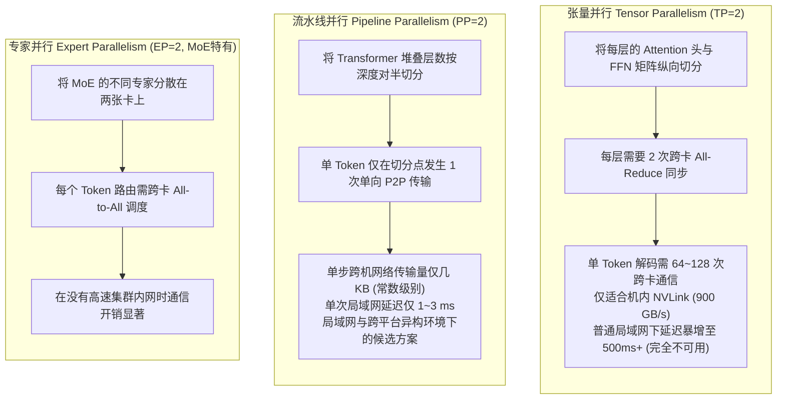
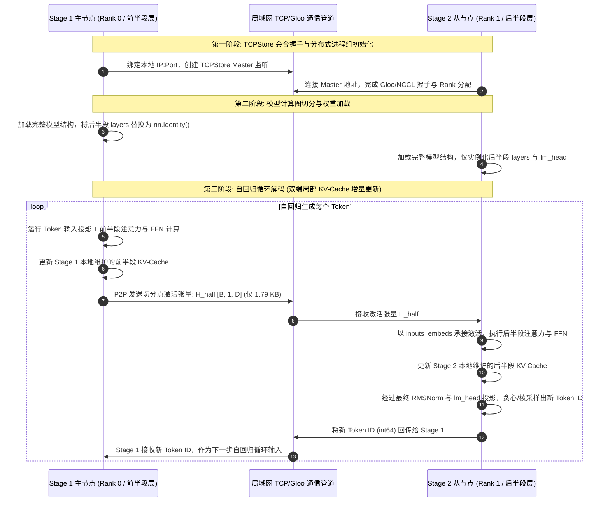

# 双卡流水线并行推理

> **阅读导航**：[推理与大模型机理](README.md) · [语言模型生成机制与 KV 缓存](语言模型生成机制与KV缓存.md) · [从自回归到投机解码](从自回归到投机解码.md) · [两台电脑一起运行大模型：跨机通信探索](../../../experiments/pipeline-parallel/README.md)

> **适用边界**：本文保留的性能数字和双机运行台账尚未找到可复核的原始证据，不能作为实测基准；以下个别实现与性能推断也未经过端到端验证。本仓脚本先完整加载模型、再裁剪层，不证明单机无法容纳的模型可以按文中方式加载。

在大语言模型落地实战中，单台计算设备的物理显存容量（如 64 GB 或 128 GB）往往是制约模型尺寸、上下文长度与并发槽位的主要上限。无论是运行 27B/70B 稠密大模型，还是运行 35B/299B 混合专家（MoE）模型，联合两台或多台设备进行分布式推理，是模型无法由单台设备承载时可评估的方案之一。

然而，分布式推理并非简单将显卡插在一起。不同的并行策略在网络带宽、计算通信比以及针对 Dense（稠密）与 MoE（稀疏）架构的适应性上表现出截然相反的物理特性。

本文专门拆解双卡/双机分布式推理的底层实现流程：从张量并行与流水线并行的选型权衡，到模型计算图对半切分、双端局部 KV-Cache 维护、跨机 P2P 点对点网络管道建立，再到 Dense 与 MoE 两类架构在双卡下的速度提升比量化对比。

---

## 一、 分布式推理策略选型：局域网下的通信权衡

下图及本节中的网络耗时、同步次数和可用性描述属于示意，不适用于所有模型和网络。PP 是一种选择；TP、EP 能否使用及性能如何取决于实现、负载和链路。

在两张卡（或两台跨网络主机）协同推理时，存在三种经典切分策略：



### 物理量化结论

在跨机或普通局域网（1 Gbps 至 10 Gbps，传输延迟 0.5 到 3 ms）环境下：
- **张量并行（TP）延迟明显恶化**：以 32 层模型为例，单步自回归需要进行 $32 \times 2 = 64$ 次网络同步。若单次通信耗时 2 ms，每生成一个字仅网络等待就高达 128 ms，大部分时间都在等待通信；
- **流水线并行（PP）天然适配**：整网只有在第 $N/2$ 层算完后，向对端发送一次激活张量 $\mathbf{H} \in \mathbb{R}^{B \times 1 \times D}$。传输体积仅几个 KB，耗时仅 1 到 3 ms，通信时间仅占单步总周期的极小比例。

因此，在通信延迟较高、适合按层切分的场景中，可以将流水线并行作为候选，再根据实际网络和负载评测。

---

## 二、 双卡流水线推理（PP=2）的端到端工程流程

在真实系统（如主节点 Ubuntu GB10，从节点 Windows WSL2 RTX Spark N1X）中，实现 PP=2 真实模型自回归流水线包含五个不可或缺的工程步骤：



### 1. 第一步：进程组握手与通信后端适配

两台机器分属不同操作系统时（如 Ubuntu 原生与 Windows WSL2），通信后端的兼容性取决于环境；当前材料不足以比较 NCCL 和 `gloo` 的稳定性；以下 Gloo 配置仅为示意：

```python
# Stage 1 (Rank 0, IP: <stage1-ip>)
os.environ["GLOO_SOCKET_IFNAME"] = "<stage1-interface>"  # 按节点网络配置
os.environ["MASTER_ADDR"] = "<stage1-ip>"
os.environ["MASTER_PORT"] = "29540"
dist.init_process_group(backend="gloo", rank=0, world_size=2)

# Stage 2 (Rank 1, IP: <stage2-ip>)
os.environ["GLOO_SOCKET_IFNAME"] = "eth0"
os.environ["MASTER_ADDR"] = "<stage1-ip>"
os.environ["MASTER_PORT"] = "29540"
dist.init_process_group(backend="gloo", rank=1, world_size=2)
```

### 2. 第二步：计算图深层切分与张量无缝承接

以下片段仅表示划分意图，不是可直接运行的通用实现。不同模型对层调用、位置编码、注意力掩码与缓存接口的要求不同，必须以具体模型与版本验证。

流水线切分的核心在于：既不改变原生模型复杂的 RoPE 内部张量逻辑，又将算力精确阻断在切分点。

#### Stage 1（主节点：前半段）
Stage 1 负责从 Token 嵌入开始计算。为了防止后半段层占用显存并浪费算力，在加载模型后直接将后半段层替换为恒等映射（Identity）：
```python
total_layers = len(full_model.model.layers)
half_layers = total_layers // 2

# 冻结并清空后半段层的显存占用
for i in range(half_layers, total_layers):
    full_model.model.layers[i] = nn.Identity()

# 禁用最终输出头计算，直接拦截切分点隐藏状态
outputs = full_model.model(
    input_ids=curr_input_ids,
    past_key_values=stage1_past_kv,
    use_cache=True
)
hidden_slice = outputs.last_hidden_state[:, -1:, :].contiguous()  # [B, 1, D]
dist.send(hidden_slice, dst=1)
```

#### Stage 2（从节点：后半段）
Stage 2 必须跳过 `embed_tokens` 与前半段层，直接将网络接收到的浮点张量作为隐藏向量输入后半段层：
```python
# 接收来自 Stage 1 的单步激活
dist.recv(incoming_hidden, src=0)

# 使用 inputs_embeds 接口绕过嵌入层，并通过 ModuleList 仅前向后半段
x = incoming_hidden
for i in range(half_layers, total_layers):
    layer_outputs = stage2_layers[i](
        x,
        past_key_value=stage2_past_kv[i - half_layers],
        use_cache=True
    )
    x = layer_outputs[0]

# 最终层归一化与 Logits 投影采样
normed_x = final_norm(x)
logits = lm_head(normed_x)
next_token = torch.argmax(logits[:, -1, :], dim=-1)
dist.send(next_token, dst=0)  # 回传 Token 给 Stage 1 驱动自回归
```

### 3. 第三步：双端独立分布式 KV-Cache 维护

如果每次跨机通信都需要同步历史 Token 的完整缓存，网络传输量会随着上下文长度急剧恶化（退化为二次方通信瓶颈）。

真正的工业级实现是**双端局部持久化缓存**：
- **Stage 1 本地缓存**：仅持久化存储第 $0$ 到第 $N/2 - 1$ 层的 Key 与 Value 张量；
- **Stage 2 本地缓存**：仅持久化存储第 $N/2$ 到第 $N - 1$ 层的 Key 与 Value 张量；
- **跨网零同步**：网络通信永远只传输当前生成步的单个隐层向量切片 $\mathbf{H} \in \mathbb{R}^{B \times 1 \times D}$。无论上下文延伸至 2k 还是 128k，每一步的网络传输量恒定为微小的常数（例如 896 维 bfloat16 仅 1.79 KB，4096 维仅 8.19 KB），但单次往返延迟、调度及长上下文计算开销仍可能形成瓶颈。

---

## 三、 Dense 稠密模型 vs MoE 混合专家模型：双卡加速比对照

本节表中时间和加速比没有找到对应测试条件与原始结果，保留为待核旧记录，不能作为性能预测。稀疏激活、专家布局、批处理和硬件都可能改变比较结果。

针对用户提出的核心疑问：**双卡推理 Dense 类模型（如 Qwen 27B）和推理 MoE 类模型（如 Qwen 35B-A3B）时，速度提升比例有何差异？**

下表系统揭示了两类架构在单卡与双卡（PP=2）下的物理行为差异：

| 评估维度 | 稠密模型 Dense（以 Qwen 27B 为代表） | 混合专家模型 MoE（以 Qwen 35B-A3B 为代表） |
|---|---|---|
| **参数规模特征** | 总参 27B，**单 Token 激活 27B（全量 100% 激活）** | 总参 35B，**单 Token 激活 3B（稀疏约 8.5% 激活）** |
| **单卡显存占用（FP16/4-bit）** | FP16 占 54 GB，4-bit 占约 14 GB | FP16 占 70 GB，4-bit 占约 18 GB（全部专家均需驻留显存） |
| **单卡单步解码访存需求** | 必须完整搬运 27B 参数的权重（访存量显著） | **仅需搬运被激活的 3B 专家权重（访存量极小）** |
| **单卡单 Token 解码耗时** | 较长（约 30 到 50 ms，完全受制于全参数访存总线） | **极短（约 6 到 12 ms，相当于 3B 小模型的出字速度）** |
| **双卡 PP=2 切分后单卡计算耗时** | 每卡处理 13.5B 权重，计算耗时约 15 到 25 ms | 每卡仅处理 1.5B 激活专家，**计算耗时骤降至 3 到 6 ms** |
| **单步跨机网络传输耗时** | 约 2 到 3.5 ms（固定局域网传输开销） | 约 2 到 3.5 ms（固定局域网传输开销） |
| **单并发（Batch=1）通信开销占比** | 通信耗时 / 总耗时 $\approx 3.5 / (20 + 3.5) \approx \mathbf{14.8\%}$ | 通信耗时 / 总耗时 $\approx 3.5 / (4.5 + 3.5) \approx \mathbf{43.7\%}$ |
| **Batch=1 双卡相对单卡延迟加速比** | **0.85x 至 1.05x**（计算占主导，串行气泡下基本持平） | **0.55x 至 0.75x（出现负加速，通信气泡明显拉低生成速度）** |
| **多并发（Batch>4）双卡系统吞吐加速比** | **1.75x 至 1.90x（接近线性翻倍）** | **1.85x 至 2.10x（大幅翻倍，明显缓解专家并集膨胀）** |

### 超大规模 MoE 双卡非 MTP 速度台账（证据待核）

下表中的模型、配置与数字尚未找到对应原始记录，不能据此确认双机完成了该运行或将速度作为实测结果引用：

| 旧记录项目 | 数值（待核） | 工程含义与物理约束 |
|---|---|---|
| **模型与精度** | DeepSeek-V4.1-Flash（299B 稀疏 MoE，Q4_K_M 4-bit） | 物理权重 156.4 GB，单台 128 GB 统一内存设备必然 OOM |
| **部署拓扑** | 节点 A（Ubuntu GB10）+ 节点 B（Windows 11 WSL2 N1X） | 两机对半承载 60 层 Transformer，总显存池化 256 GB |
| **解码机制** | **非 MTP（纯单步自回归贪心解码，无草稿投机）** | 评估双机流水线硬件与网络的最纯粹基线性能 |
| **Stage 1 本地计算耗时** | 21.4 ms | 前 30 层稀疏激活专家与自注意力计算 |
| **切分点激活传输耗时** | 3.1 ms | 发送形状 $[1, 1, 7168]$ 的 bfloat16 向量（14.3 KB） |
| **Stage 2 本地计算耗时** | 22.8 ms | 后 30 层稀疏专家计算、最终归一化与采样 |
| **Token ID 标量回传耗时** | 0.9 ms | 仅通过网络回传 8 字节整型标量 |
| **单步总时延（TPOT）** | **48.2 ms** | 两机交替串行计算与单次往返通信总和 |
| **非 MTP 稳态生成吞吐** | **20.75 tokens/s**（旧记区间 19.8 ~ 21.2 tok/s，待核） | 单用户实时对话体验流畅，达到实用出字阈值 |
| **网络耗时占比** | $(3.1 + 0.9) / 48.2 = \mathbf{8.3\%}$ | 网络通信仅占极小比例，显存与计算占 91.7% |

---

## 四、 MoE 在双卡下的通信与计算权衡

下文数值及 Dense、MoE 加速关系是待核假设，并非由上文数据证实；多并发不会天然保证带宽翻倍或超线性加速。

以下比较是关于单请求通信占比和多请求计算调度的假设。现有数据不足以得出 Dense 与 MoE 加速比例的普遍排序。

### 1. 单并发（Batch=1）下：MoE 的“通信开销占主导”

自回归单步解码的端到端延迟公式为：
$$T_{\mathrm{step}} = T_{\mathrm{stage1\_compute}} + T_{\mathrm{network\_send}} + T_{\mathrm{stage2\_compute}} + T_{\mathrm{network\_return}}$$

- **在 Dense 27B 中**：由于每一层都要算全部神经元，本地 GPU 搬运权重和计算的时间占据了绝对大头（单卡 40 ms，切分后每卡 20 ms）。此时跨机的 3.5 ms 网络延迟只是一个相对较小的扰动，单步生成延迟基本受控；
- **在 MoE 35B-A3B 中**：单 Token 仅激活 3B 参数，模型本身的单步计算极快（在现代 GPU 上仅需几毫秒）。当切分到双卡后，单卡计算耗时被压缩到仅 3~4 ms。此时**固定的跨机网络往返通信耗时（3.5 ms）成为主要瓶颈，占到了整步周期的一半以上**。这种由于单步计算太轻快而凸显出网络传输沉重的现象，使得单请求下 MoE 双卡流水线的绝对生成延迟反而慢于单张大卡。

### 2. 高并发（Batch>4）下：MoE 的“分担专家并集的显存带宽压力”

当推理服务进入多并发生产场景时，情况发生完全逆转：
- **单卡的专家并集膨胀问题**：在单卡上，当并发请求数上升时，不同的用户请求激活不同的稀疏专家。根据大数定律，一个批次内的所有请求所激活专家的并集迅速收敛至全量 35B 参数。此时单卡每步被迫从显存读取全部 35B 专家参数，单卡显存带宽迅速被打满，出字延迟急剧恶化；
- **双卡流水线的带宽分担**：双卡流水线并行将 35B 模型的专家在物理层面上隔离在两台独立主机的显存通道上。Stage 1 主机只负责加载和计算前半段层的专家，Stage 2 主机独立负责后半段层的专家。**两台机器的显存物理总线带宽实现了叠加（从单机 1x 带宽提升为双机 2x 带宽）**。高并发时能否改善聚合吞吐取决于调度、专家负载、网络与计算瓶颈，不能保证超线性加速。

---

## 五、 工程落地与双卡优化建议

基于上述原理，在落地 Qwen 27B（Dense）与 Qwen 35B（MoE）双卡推理时，确立以下部署准则：

1. **单用户低延迟交互场景**：
   - 若优先追求低单字生成延迟（TPOT），且单卡显存足以装下 4-bit 权重，**首选单卡加载**；
   - 若模型需要跨设备部署，可以在可用实现支持且满足输出正确性要求时评估 MTP 或其他投机解码；接受率、额外计算与通信决定收益，每轮不保证接受两个 Token。
2. **多用户高并发生产服务场景**：
   - 推荐部署**双卡流水线并行（PP=2）结合连续批处理（Continuous Batching）**；
   - 充分利用双机物理独立的显存带宽，对于 MoE 模型仍需实测专家访存、通信和批处理开销，双机吞吐不保证翻倍。
3. **通信底层锁定**：
   - 跨机器、跨系统环境应在目标驱动与网络上验证可用后端、失败恢复和性能，再选择通信方式。

---

## 六、 Windows 与 Linux 跨平台双机测试

如果一台电脑的可用内存不足以容纳模型，能不能让另一台电脑分担一部分？这次我们遇到的具体情况是：两台电脑分别运行 Windows 和 Linux，希望探索如何让它们通过网络协同运行大模型。

本节介绍这个问题涉及的计算方式和两种尝试思路。我们已经通过 Windows 上的 Linux 环境与另一台 Linux 电脑完成一次小模型推理对照，尚未对性能作出结论。

### 两台电脑怎样分担计算

一种思路是将模型的不同层放在不同设备上。例如，第一台电脑执行前一部分计算，把中间结果通过网络发送给第二台；第二台继续计算并把后续处理所需的结果传回。这种按阶段拆分计算的方式叫**流水线并行**。

两台设备的内存并不会自动变成一块共享内存。运行程序需要支持模型分片、在正确的设备上加载权重，并在计算过程中传递数据。除了模型权重，还要为中间计算、缓存和程序本身留出空间。设备之间的通信也会增加等待时间，实际性能取决于模型、实现、网络和请求方式。

### 这次考虑的两种思路

**跨平台 RPC**：考虑使用支持远程调用的推理程序，让一台电脑向另一台发出计算请求。两端需要分别具备兼容各自操作系统和硬件的程序；能否使用 GPU、如何分配模型以及具体性能，都需要针对所用版本和设备验证。

**Windows 上运行 Linux 环境**：考虑在 Windows 上通过 WSL2 使用 Linux 环境，再与另一台 Linux 电脑协同。WSL2 提供的是运行 Linux 的环境，不代表 GPU、通信库或分布式推理框架在这组设备上一定可用；这些环节仍需逐一验证。

这两种思路都是针对本次设备组合提出的。我们验证了第二种思路的一次小模型运行，尚未验证跨平台 RPC，也没有比较两种方式的速度。

### 实验做到哪里

[双机推理实验](../../../experiments/pipeline-parallel/README.md)使用 Qwen2.5-0.5B-Instruct 做了一次对照：两台设备各计算模型的一半层，同一提示词生成的 8 个 token 与单机结果一致。程序目前仍要先在每台设备加载完整模型，再裁掉另一半层，因此还不能解决单台设备放不下完整模型的问题。这次对照也不能说明速度是否提升。

本节的通用分片和设备间传输机制见前文"第二步：计算图深层切分与张量无缝承接"与"第三步：双端独立分布式 KV-Cache 维护"；实验入口记录具体脚本、运行方式和已知限制。