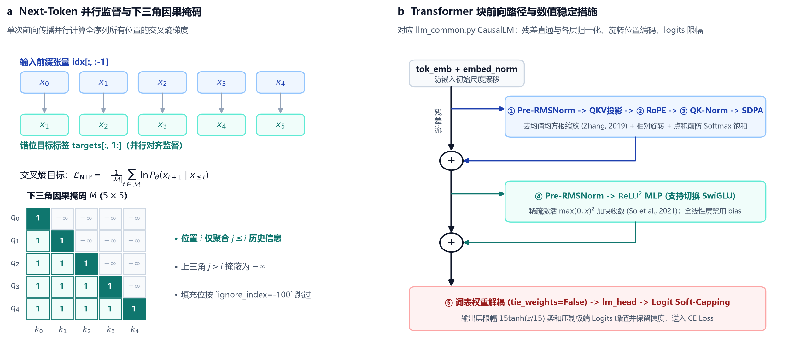
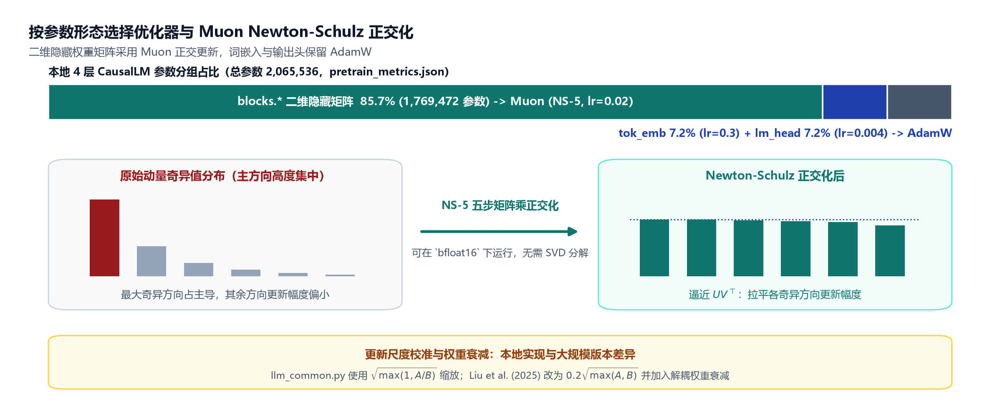
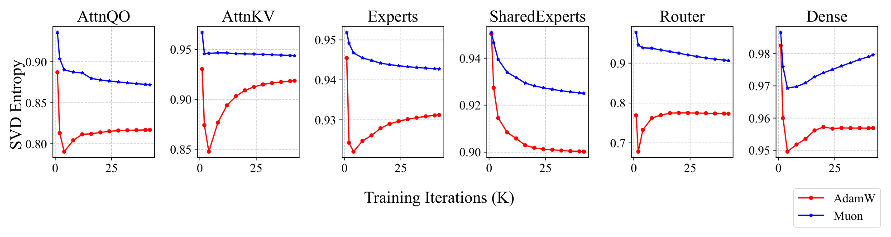
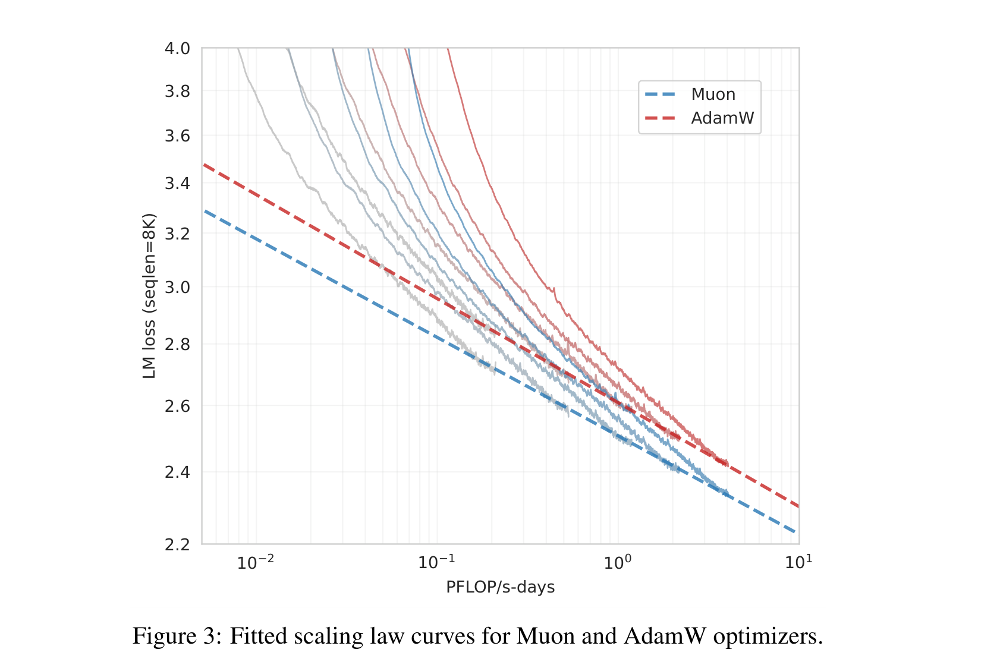
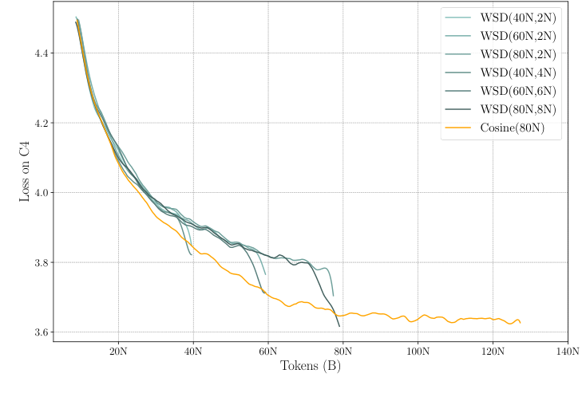
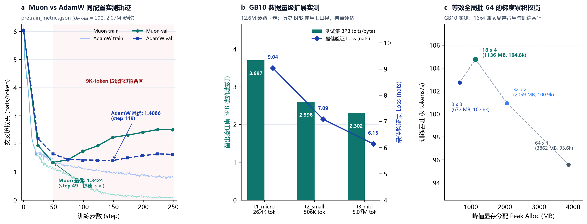
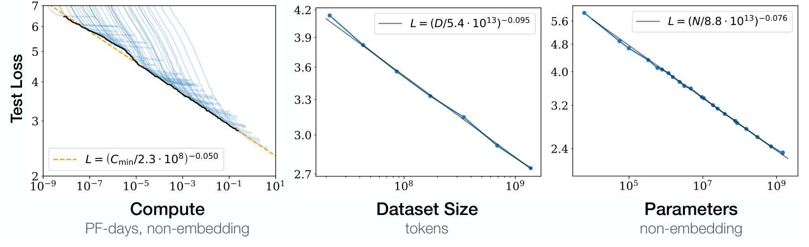
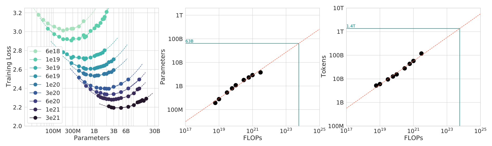

# 大模型预训练原理与扩展律：从自回归损失到 Muon 优化实战

> **阅读导航**：[大模型推理与机理](README.md) · [大语言模型从零构建与训练全链路](大语言模型从零构建与训练全链路.md) · 上游分词：[分词器效果评测与跨词表BPB计算](分词器效果评测与跨词表BPB计算.md) · 下游评测：[预训练阶段评测与能力基准](预训练阶段评测与能力基准.md) · 实验脚本：[03_pretrain.py](../../../experiments/llm-lifecycle-fullchain/scripts/03_pretrain.py)

预训练阶段决定了一个语言模型掌握多少语言规律与世界知识。后训练微调（SFT）和强化学习（RL）主要改变交互方式与输出格式，把海量无标注语料转化为模型权重的过程主要发生在预训练阶段。

本文对照仓内实现 [llm_common.py](../../../experiments/llm-lifecycle-fullchain/scripts/llm_common.py#L83-L303) 与预训练入口 [03_pretrain.py](../../../experiments/llm-lifecycle-fullchain/scripts/03_pretrain.py)，结合现代预训练架构文献与扩展律论文，梳理因果预测目标、架构稳定护栏、Muon 矩阵正交优化，以及本地与 NVIDIA GB10 平台的数据扩展规律。

---

## 一、 训练目标：全序列并行推进的下一个词元预测

自回归语言模型的预训练不需要人工标注答案，唯一任务是根据已经出现的前缀序列预测紧随其后的下一个词元。设输入切片长度为 $T$，模型内部将输入序列向右错开一格形成监督信号：用前缀位置 $0 \dots T-2$ 的隐藏表示同时预测位置 $1 \dots T-1$ 的目标词元（见图 1 Panel a 左上与 [llm_common.py](../../../experiments/llm-lifecycle-fullchain/scripts/llm_common.py#L281-L287)）。

$$\mathcal{L}_{\text{NTP}} = -\frac{1}{|\mathcal{M}|} \sum_{t \in \mathcal{M}} \ln P_\theta\left(x_{t+1} \mid x_{\le t}\right)$$

工程实现上借助下三角因果注意力掩码，使序列中每一个位置只能看到自身及更早的历史词元，无法访问右侧未来词元。因此前向传播一次即可并行算出整条序列所有位置的交叉熵梯度，不必在训练时像推理那样逐字串行生成。训练流里若遇到填充位（标记为 `ignore_index=-100`），损失计算自动跳过。

---

## 二、 现代预训练架构的五项稳定设计

对照经典初代 GPT 结构，参考 `nanochat` 设计的 [CausalLM](../../../experiments/llm-lifecycle-fullchain/scripts/llm_common.py#L244-L288) 集成了五项广泛验证过的现代架构改进（见图 1 Panel b）：

1. **无偏置 Pre-RMSNorm**：Zhang & Sennrich (2019) 证明去掉 LayerNorm 的均值中心化步骤，仅按向量的均方根做缩放（`F.rms_norm`），即可维持深层残差主干数值稳定并节省归一化算子开销；本实现同时在词嵌入之后追加一次归一化 `embed_norm=True`，抑制初始化阶段的尺度漂移。
2. **旋转位置编码 RoPE**：Su et al. (2021) 通过复平面旋转矩阵直接旋转查询向量和键向量，使注意力点积分数只依赖于两词元之间的相对偏移距离，避开了绝对位置向量加法的长度外推局限。
3. **点积前 QK-Norm**：Henry et al. (2020) 提出在查询与键做内积前先执行归一化（本代码设为 `qk_norm=True`，在 RoPE 之后执行 `norm(q)` 与 `norm(k)`）；后续 Dehghani et al. (2023) 将 ViT 扩展至 220 亿参数时验证，该操作能够防止低精度大模型中注意力 logits 指数膨胀导致的熵坍缩与发散。
4. **Squared ReLU 前馈层**：So et al. (2021) 在 *Primer* 神经架构搜索中发现，将前馈激活替换为 $\max(0, x)^2$（即代码默认 `mlp_type="relu2"`）能在相同计算下加快预训练收敛；工程上亦可切回 Shazeer (2020) 提出的门控结构 SwiGLU 作横向对照。
5. **词表解耦与 Logit Soft-Capping**：代码关闭权重共享（`tie_weights=False`）以释放输入查找空间与输出分类空间的不同几何约束，全线线性层禁用 `bias`；同时借鉴 Gemma 2 (2024) 在输出 logits 处加上平滑软截断 $15 \cdot \tanh(z / 15)$（对应 `softcap=15.0`），把极端激活峰值平滑折返，不像硬截断那样阻断梯度。

---

## 三、 优化器分治：为什么把隐藏矩阵交给 Muon

现代预训练逐渐跳出所有参数一律使用 AdamW（Loshchilov & Hutter, 2019）的惯例。`llm_common.py` 中的 [`build_optimizer`](../../../experiments/llm-lifecycle-fullchain/scripts/llm_common.py#L626-L700) 按参数张量本身的几何含义执行分治路由（见图 2 上半部）：

| 参数分组 | 本地 4 层模型占比 | 优化器选择 | 学习率设置依据 |
|---|---|---|---|
| `blocks.*` 二维隐藏层权重矩阵 | `1,769,472` (`85.67%`) | `Muon` (`ns_steps=5`) | 隐藏层矩阵充当空间线性算子，需要各奇异方向均衡学习 |
| `tok_emb` 词嵌入查找表 | `148,032` (`7.17%`) | `AdamW` (`lr=0.3`) | 仅稀疏命中当前批次词元，需要一维行级自适应动量平滑 |
| `lm_head` 输出分类头 | `148,032` (`7.17%`) | `AdamW` (`lr=0.004`) | 直接对齐离散交叉熵梯度，高条件数词频极差大，需稳健收尾步长 |

Keller Jordan et al. (2024) 指出，Transformer 内部线性矩阵由 SGD 动量或 Adam 算出的更新方向往往呈现病态低秩结构：少数几个最大奇异值方向占用了绝大部分更新幅度，其余携带稀缺语义的特征方向更新停滞。Muon 的做法是先计算动量矩阵，随后运行 5 步纯矩阵乘加组成的 **Newton-Schulz 多项式迭代**（可在 `bfloat16` 下高速稳定执行，避开昂贵精确 SVD），把动量矩阵近似投影为最接近它的半正交矩阵 $U V^\top$，把被压制的次要奇异方向拉回相近的更新幅度。

当推广到十亿至百亿参数工业规模时，Liu, Su et al. (2025) 进一步揭示了两项让 Muon 稳定放大且达到约 `2x` 训练算力效率（仅约 `52%` AdamW FLOPs）的必要改进：一是重新纳入与 AdamW 同构的解耦权重衰减以抑制长期过训练下的权值范数无界漂移；二是从理论上证明形状为 $[A, B]$ 的矩阵在正交化后更新均方根为 $\sqrt{1/\max(A,B)}$，因此需按维度比例统一缩放更新幅度（代码里 `Muon.step` 采用 `max(1.0, A/B) ** 0.5`，而大规模版推荐使用 $0.2 \cdot \sqrt{\max(A, B)}$ 直接对齐 AdamW 约 `0.2` 至 `0.4` 的更新尺度，从而免除大范围重新调参）。

> 来源：Liu et al. (2025)，[arXiv:2502.16982](https://arxiv.org/abs/2502.16982)；许可：CC BY-NC-ND 4.0。图像保持原样，发布前需人工复核第三方图复用权限。

> 来源：Liu et al. (2025)，[arXiv:2502.16982](https://arxiv.org/abs/2502.16982)；许可：CC BY-NC-ND 4.0。图像保持原样，发布前需人工复核第三方图复用权限。

在学习率调度上，[03_pretrain.py](../../../experiments/llm-lifecycle-fullchain/scripts/03_pretrain.py) 采用经典 SGDR 线性预热加余弦退火（Loshchilov & Hutter, 2017）；而在需要跨不同数据量级做连续扩展律标定的工业训练流程中，MiniCPM（Hu et al., 2024）提出的 **WSD 三段式调度**（预热、恒定高学习率稳定期、快速退火期）能够让同一条主训练分支复用于多个截断算力点。

> 来源：Hu et al. (2024)，[arXiv:2404.06395](https://arxiv.org/abs/2404.06395)；许可：CC BY 4.0。图像保持原样。

> 本图为仓内脚本重绘，数据来自 `pretrain_metrics.json`，用于说明本地实验的验证轨迹。

### 本地实测复盘：为什么终点差值是 `-0.8503` 却证明 Muon 更快

直接读取 [pretrain_metrics.json](../../../experiments/llm-lifecycle-fullchain/evidence/pretrain-metrics-toy-synthetic.json#L2206-L2217) 的全步数明细（见图 6），能够看清一个容易误判的指标陷阱：

- **收敛速度相差 3 倍**：`Muon + AdamW` 在第 `49` 步就将留出验证损失压到最佳点 `1.3424`，`AdamW` 直到第 `149` 步才触底到 `1.4086`。
- **小语料过拟合陷阱**：本地冒烟训练总语料不足 1 万 token，脚本却固定跑满 `250` 步。由于 `Muon` 较早拟合了训练集规律，第 `50` 步之后把训练损失继续压低到 `0.0924`，实质转入记忆训练样本，导致第 `250` 步终点验证损失反而回升到 `2.4978`（高出 `AdamW` 的 `1.6475` `0.8503`）。如果只看期末差值，就会得出 Muon 不如 AdamW 的错误结论；只有对比最优验证点步数和验证轨迹曲线，才看得懂优化效率的真实差异。

---

## 四、 算力扩展律与 GB10 硬件实测边界

决定预训练效果上限的，是在给定浮点算力预算 $C \approx 6 N D$ 下如何分配模型有效参数量 $N$ 与训练总词元数 $D$：

1. **从 Kaplan 偏参数到 Chinchilla 均衡配比**：Kaplan et al. (2020) 早期认为计算预算翻倍时应优先放大模型规模；Hoffmann et al. (2022) 通过 Chinchilla 系列实验反驳了这一点，提出 $N$ 与 $D$ 应当同比例同步放大，算力最优训练对应约每参数配 `20` 个高质量 token。
2. **分歧的工程根因校准**：Porian et al. (2024) 复现超过 `900` 组预训练运行后把差异归结为三项统计与超参失真：Kaplan 计算预算未纳入词嵌入与输出层计算量、小模型使用了过长的固定热身步数、以及未随模型规模同步调节批大小与 AdamW 的 $\beta_2$（在批大小 `128` 及以下需调高 $\beta_2$）。校准后结果与 Chinchilla 完全吻合。
3. **推理成本改写训练配比（过训练）**：Sardana & Frankle (2024) 把大规模部署期间的累计推理算力并入总账，Gadre et al. (2024) 验证即使输入超出 Chinchilla 最优比例数十倍的语料，下游损失仍遵循可预测幂律改善。换言之，面向高并发推理的小型基础模型故意压低 $N$、拉高 $D$ 才是全局成本最优解。

在 GB10 硬件上运行 `12,615,680` 参数统一基座（词表 `8,192`，详见 [scaling_summary.json](../../../experiments/llm-lifecycle-fullchain/evidence/scaling-summary.json) 与 [vram_batch_table_gb10.md](../../../experiments/llm-lifecycle-fullchain/evidence/vram-batch-table-gb10.md)），两组实测曲线给出了直观的工程刻度（图 7 与图 8）：

> 本图为仓内脚本根据 `scaling_summary.json` 的历史数据重绘。其中 BPB 使用旧版计算口径，数值和变化幅度须重新评估；验证 Loss 不受该字节计算错误直接影响；旧评估窗口还遗漏末位预测，PPL 也需要重新评估。

| 规模挡位 | 训练样本总量 $D$ | 最佳验证 Loss | 留出验证 BPB | 留出验证 PPL | 峰值显存分配 |
|---|---|---|---|---|---|
| `t1_micro_100k` | `26,447` tokens | `9.0413` | `3.697447` | `98,309.4` | `1,086.22 MB` |
| `t2_small_2m` | `506,151` tokens | `7.0872` | `2.596178` | `3,203.1` | `1,086.22 MB` |
| `t3_mid_20m` | `5,072,481` tokens | `6.1451` | `2.301836` | `1,282.7` | `1,086.22 MB` |

> 本图为仓内脚本重绘，数据来自 `vram_batch_table_gb10.md`，用于说明本地硬件实测边界。

> 来源：Kaplan et al. (2020)，[arXiv:2001.08361](https://arxiv.org/abs/2001.08361)；许可：arXiv 非独占分发许可，第三方图复用权限仍需人工复核。

> 来源：Hoffmann et al. (2022)，[arXiv:2203.15556](https://arxiv.org/abs/2203.15556)；许可：arXiv 非独占分发许可，第三方图复用权限仍需人工复核。

数据得出两条直接指导实验的规律：第一，GPU 训练峰值显存仅与模型规模、序列窗长和微批大小有关（三个量级恒定在 `1,086.22 MB`），跟磁盘上有多少语料毫无关系，语料体积增长仅体现在主机端内存（`2,030 万` tokens 存 `uint16` 仅占 `38.73 MB`）；第二，保持等效全局批 `64`（`block_size=256`）时，把微批从 `64 x 1` 拆成 `16 x 4` 梯度累积，峰值显存从 `3,861.66 MB` 降至 `1,135.91 MB`（仅占原本的 `29.4%`），训练吞吐反而从 `95,586.9` 升至全矩阵最高的 `104,786.5 tokens/s`。

---

## 五、 工程四要素总结

1. **前提**：具备无损词表映射与固定留出验证流，因果下三角掩码确保前缀无法访问未来词元。
2. **路径**：使用 Pre-RMSNorm、RoPE、点积前 QK-Norm、$\text{ReLU}^2$ 与 Logit Soft-Capping 构建前向稳定设计，将 2D 隐藏矩阵参数交由带尺度校准与权重衰减的 Muon 优化，其余参数保留 AdamW，并通过梯度累积换取低显存高吞吐。
3. **结论**：预训练收敛效率既取决于架构数值平稳性与正交化优化速度，也受数据量级与计算预算配比支配；验证优化器优劣必须对比最优验证点步数而非过拟合终点。
4. **边界**：在数万至数百万 token 的小规模实验中，仅能观察连续验证指标（Loss / BPB）随语料稳步下降的扩展趋势，不足以支撑复杂的零样本推理涌现。

---

## 六、 参考文献

1. Kaplan, J., McCandlish, S., Henighan, T., et al. (2020). *Scaling Laws for Neural Language Models*. [arXiv:2001.08361](https://arxiv.org/abs/2001.08361)
2. Hoffmann, J., Borgeaud, S., Mensch, A., et al. (2022). *Training Compute-Optimal Large Language Models*. NeurIPS 2022. [arXiv:2203.15556](https://arxiv.org/abs/2203.15556)
3. Porian, T., Wortsman, M., Jitsev, J., Schmidt, L., & Carmon, Y. (2024). *Resolving Discrepancies in Compute-Optimal Scaling of Language Models*. NeurIPS 2024 Spotlight. [arXiv:2406.19146](https://arxiv.org/abs/2406.19146)
4. Gadre, S. Y., et al. (2024). *Language Models Scale Reliably with Over-training and on Downstream Tasks*. [arXiv:2403.08540](https://arxiv.org/abs/2403.08540)
5. Sardana, N., & Frankle, J. (2024). *Beyond Chinchilla-Optimal: Accounting for Inference in Language Model Scaling Laws*. ICML 2024. [arXiv:2401.00448](https://arxiv.org/abs/2401.00448)
6. Zhang, B., & Sennrich, R. (2019). *Root Mean Square Layer Normalization*. NeurIPS 2019. [arXiv:1910.07467](https://arxiv.org/abs/1910.07467)
7. Su, J., Lu, Y., Pan, S., et al. (2021). *RoFormer: Enhanced Transformer with Rotary Position Embedding*. [arXiv:2104.09864](https://arxiv.org/abs/2104.09864)
8. Henry, A., Dachapally, P. R., Pawar, S., & Chen, Y. (2020). *Query-Key Normalization for Transformers*. Findings of EMNLP 2020. [arXiv:2010.04245](https://arxiv.org/abs/2010.04245)
9. So, D. R., Mańke, W., Liu, H., Dai, Z., Shazeer, N., & Le, Q. V. (2021). *Primer: Searching for Efficient Transformers for Language Modeling*. NeurIPS 2021. [arXiv:2109.08668](https://arxiv.org/abs/2109.08668)
10. Shazeer, N. (2020). *GLU Variants Improve Transformer*. [arXiv:2002.05202](https://arxiv.org/abs/2002.05202)
11. Gemma Team, Google DeepMind. (2024). *Gemma 2: Improving Open Language Models at a Practical Size*. [arXiv:2408.00118](https://arxiv.org/abs/2408.00118)
12. Loshchilov, I., & Hutter, F. (2019). *Decoupled Weight Decay Regularization*. ICLR 2019. [arXiv:1711.05101](https://arxiv.org/abs/1711.05101)
13. Jordan, K., Jin, Y., Boza, V., et al. (2024). *Muon: An optimizer for hidden layers in neural networks*. [Technical Blog](https://kellerjordan.github.io/posts/muon/)
14. Liu, J., Su, J., Yao, X., et al. (2025). *Muon is Scalable for LLM Training*. [arXiv:2502.16982](https://arxiv.org/abs/2502.16982)
15. Loshchilov, I., & Hutter, F. (2017). *SGDR: Stochastic Gradient Descent with Warm Restarts*. ICLR 2017. [arXiv:1608.03983](https://arxiv.org/abs/1608.03983)
16. Hu, S., et al. (2024). *MiniCPM: Unveiling the Potential of Small Language Models with Scalable Training Strategies*. [arXiv:2404.06395](https://arxiv.org/abs/2404.06395)
