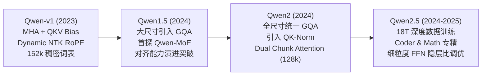
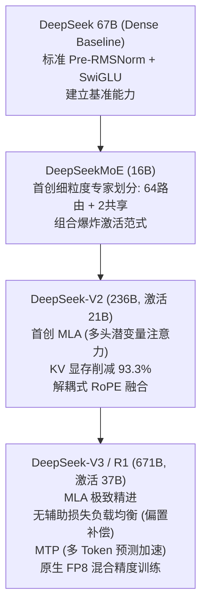
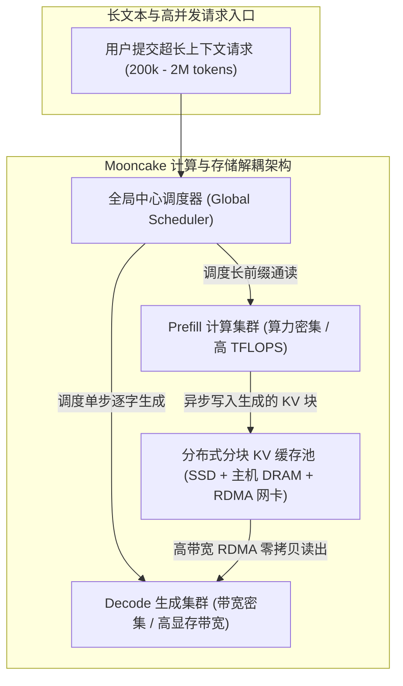

# 近代开源大模型架构演进：从密集 Transformer 到 MoE、MLA 与推理协同设计

> **阅读导航**：[推理与大模型机理](README.md) · [语言模型生成机制与 KV 缓存](语言模型生成机制与KV缓存.md) · [从自回归到投机解码](从自回归到投机解码.md) · [模型量化等级与精度相变](模型量化等级与精度相变.md)

自 2023 年 LLaMA 系列确立现代开源大语言模型的基础结构以来，以 Qwen（阿里通义）、DeepSeek（深度求索）和 Kimi（月之暗面 Moonshot）为代表的技术团队，推动了模型结构从早期复刻走向自主创新的持续演进。

当模型参数从 7B 扩展到 671B、上下文长度从 2k 扩展至 128k 乃至 2M 时，传统密集 Transformer 架构遭遇了两项硬件限制：一是计算总量的算力成本壁垒，二是自回归生成时的内存带宽与显存容量壁垒。为了在有限的硬件资源下提升模型容量与推理吞吐，大模型架构经历了从注意力头压缩（MHA 到 GQA、MLA）、前馈网络稀疏化（Dense 到细粒度 MoE）、位置编码解耦到系统级推理协同（MTP、PD 分离架构）的演进。

本文梳理以 Qwen、DeepSeek、Kimi 为代表的近代开源大模型架构，分析其数学机理、演进逻辑与硬件适应性。

---

## 一、 开源模型架构对照矩阵

在进入各家演进细节之前，下表对三大代表性开源模型架构及其早期基准进行横向对比：

| 架构维度 | 早期基准（LLaMA-1 / LLaMA-2） | 通义千问（Qwen2.5 密集 / MoE） | 深度求索（DeepSeek-V3 / R1） | 月之暗面（Kimi k1.5 / Mooncake 体系） |
|---|---|---|---|---|
| **基本模型形态** | 密集 Transformer（Dense） | 密集（7B/14B/32B/72B）与细粒度 MoE 并行 | 极稀疏 MoE（总 671B，激活 37B） | 长文本稠密 / 混合架构，配套长程推理对齐 |
| **注意力机制** | LLaMA-1: MHA；LLaMA-2: GQA（70B） | 全尺寸强制 GQA（8 组 Key/Value 头） | **MLA（多头潜变量注意力）** | 长文本注意力变体与多块上下文动态调度 |
| **KV Cache 显存占用** | 基准（MHA 为 1x，GQA 为 1/8x） | 1/8x 基准（标准 GQA 压缩） | **约 1/15x 至 1/20x（潜变量压缩 93.3%）** | 基于分块 Chunk 的外部共享 KV 池化 |
| **前馈层（FFN）结构** | 标准 SwiGLU 密集投影 | SwiGLU（密集）/ 细粒度 MoE（共享+路由专家） | **DeepSeekMoE（256 路由专家 + 1 共享专家）** | 针对长文本激活优化的稀疏与动态路由 |
| **专家激活配比** | 无（全量激活 100%） | 57B-A14B：激活约 24.5% 参数 | 671B：每 Token 仅激活 8 个路由专家（激活 5.5%） | 强化长链推理计算分配 |
| **门控负载均衡策略** | 无 | 传统辅助损失（Auxiliary Loss）平衡 | **无辅助损失负载均衡（偏置项动态补偿）** | 任务动态路由与推理步数弹性缩放 |
| **位置编码（PE）** | 标准 RoPE（旋转位置编码） | RoPE + Dual Chunk Attention + YaRN 扩窗 | **解耦式 RoPE（Decoupled RoPE，融入 MLA）** | 极长上下文自适应外推机制（200k 至 2M） |
| **归一化与稳定性** | Pre-RMSNorm | RMSNorm + **QK-Norm（防止超长序列注意力爆炸）** | RMSNorm + QK-Norm + 细粒度块级缩放 | RMSNorm + 深度激活梯度截断 |
| **推理协同加速** | 无特定原生协同（依赖通用引擎） | 原生支持连续批处理与主流量化算子 | **MTP（多 Token 预测，单步多输出）+ 原生 FP8** | **Mooncake 架构（Prefill 与 Decode 完全解耦）** |

---

## 二、 Qwen 系列演进史：从工程稳健到全尺寸 GQA 与细粒度长文本

阿里通义千问系列（Qwen、Qwen1.5、Qwen2、Qwen2.5）是开源界工程实现最稳健、生态覆盖最全面的模型家族。其演进路线体现了从早期对密集 Transformer 的细节打磨，到全面拥抱现代推理友好型架构的标准路径。

### 1. Qwen-v1：大词表与 QKV 偏置的工程选择

在 LLaMA-1 严格遵循去偏置（No Bias）的潮流下，初版 Qwen 做出了两项具体的架构选择：
- **保留 QKV 偏置（QKV Bias）**：在计算 $W_Q, W_K, W_V$ 投影时添加可学习偏置项。这一设计增加了注意力分数对序列相对长度与绝对位置的表达灵活性，为后续通过插值无损扩展上下文长度奠定了数学容错基础。
- **152k 超大 BPE 词表**：相较于 LLaMA-1 的 32k 词表，Qwen 原生采用针对中英双语与代码深度优化的超大词表。其单 Token 信息熵更高，在相同字符量下生成的 Token 数量减少 30% 到 40%，直接降低了自回归生成的总解码步数。
- **Dynamic NTK-Aware 插值**：原生结合 RoPE 的基频缩放，使 2k 预训练模型在无需微调的情况下可外推至 8k。

### 2. Qwen1.5 与 Qwen-MoE：GQA 下放与多专家探索

- **非对称 GQA 分级下放**：在 Qwen1.5 中，7B 以下模型由于显存敏感度相对算力偏弱仍保留 MHA，而在 14B 与 72B 上全面切换为 GQA（Grouped-Query Attention），将长文本下的 KV Cache 显存压力降至原来的 1/8。
- **细粒度多专家（Qwen1.5-MoE-A2.7B）实验**：与 Mixtral 8x7B 切分 8 个粗粒度专家不同，Qwen 团队验证了细粒度专家方案：将模型拆分为 64 个路由专家加 4 个常驻共享专家，每个 Token 激活 4 个路由专家与全部 4 个共享专家。共享专家专门承载全语料通识特征，路由专家专注特化领域，缓解了传统 MoE 专家间的语义干扰。

### 3. Qwen2 与 Qwen2.5：全尺寸标准收敛与 QK-Norm

到了 Qwen2 和最新的 Qwen2.5，架构设计完成了全方位的工业化收敛：
- **全尺寸推行 GQA**：不仅 72B，连最小的 0.5B 和 1.5B 均强制采用 GQA。这一决策使得所有尺寸模型的推理运行时内核、PagedAttention 块结构与端侧部署流水线完全标准化。
- **QK-Norm 机制**：随着模型上下文支持跨越至 128k，因果自注意力在极深层级容易出现注意力打分极端化（Logits 显著，Softmax 后近乎 One-hot 导致注意力熵坍塌）。Qwen2 在 Query 和 Key 投影后、计算点击注意力打分前，分别施加 RMSNorm。这一操作强制限制了注意力矩阵的数值范围，消除了大模型超长上下文训练中的数值溢出风险。
- **Dual Chunk Attention（双块注意力）**：针对 128k 极长序列，通过在块内计算局部精细注意力与块间捕捉长程抽象表示，结合 YaRN（Yet another RoPE extensioN）旋转基频重标定，实现了真实业务下长文档召回（Needle In A Haystack）的接近 100% 达成率。

---

## 三、 DeepSeek 系列演进史：MLA 与细粒度稀疏 MoE

DeepSeek（深度求索）近两年在模型底层数学架构上做了大量创新。其核心目标很明确：**在维持高参数量的前提下，将训练计算成本和推理显存带宽压低**。

### 1. MLA（Multi-Head Latent Attention）：重写自回归显存方程

在 DeepSeek-V2 和 V3 诞生前，学术界与工业界对长文本推理显存的压缩主要依赖 GQA。然而，GQA 仍然需要缓存物理头维度的完整 Key 与 Value 向量。对于 128k 序列，即便是 GQA，单请求也需占用数十吉字节显存。

DeepSeek 团队发明了 **MLA（多头潜变量注意力）**，其本质是**在投影端引入低秩矩阵分解，在推理缓存端只存低维压缩潜变量，在计算瞬间临时解压投影**：

#### 数学推导与核心算式

传统 MHA/GQA 在时间步 $t$ 生成时需要缓存 Key 和 Value 张量：
$$K_t \in \mathbb{R}^{H_{kv} \times d_h}, \quad V_t \in \mathbb{R}^{H_{kv} \times d_h}$$

MLA 引入一个低维潜变量投影矩阵 $W_{DKV} \in \mathbb{R}^{D \times d_c}$，其中压缩维度 $d_c \ll H \times d_h$（例如在 671B 模型中，$d_c$ 仅为 512，而原展开维度高达 $128 \times 128 = 16384$）：

1. **KV 联合压缩投影**：
   $$\mathbf{c}_t^{KV} = x_t W_{DKV} \in \mathbb{R}^{d_c}$$
2. **解耦式位置编码（Decoupled RoPE）**：
   由于旋转位置编码（RoPE）具有强烈的非线性旋转特性，如果直接施加在压缩潜变量 $\mathbf{c}_t^{KV}$ 上，解压矩阵将无法与位置编码交换次序，导致无法在推理时合并矩阵。MLA 创造性地将位置信息剥离：
   $$\mathbf{k}_t^R = \mathrm{RoPE}(x_t W_{KR}) \in \mathbb{R}^{d_R}$$
3. **推理阶段的缓存内容**：
   **显存中只保存两个低维向量**：内容潜变量 $\mathbf{c}_t^{KV}$（512 维）与未压缩的位置向量 $\mathbf{k}_t^R$（64 维）。二者拼接后仅 576 个浮点数。
4. **单步解码的矩阵吸收（Weight Absorption）**：
   在 Decode 计算阶段，甚至无需真正把 $\mathbf{c}_t^{KV}$ 解压还原成几万维的 $K$ 和 $V$。根据矩阵乘法结合律：
   $$q_t K^T = q_t (c^{KV} W_{UK})^T = (q_t W_{UK}^T) (c^{KV})^T$$
   模型直接将解压矩阵 $W_{UK}$ 提前吸收到 Query 投影矩阵中。这意味着在自回归解码时，**显存带宽只需要搬运常数 576 维度的激活值，计算量与显存占用同比削减了 93.3%**。这正是 DeepSeek 能够以较低成本提供百万上下文推理服务的原因。

### 2. DeepSeekMoE 与无辅助损失负载均衡（Auxiliary-Loss-Free）

传统的 MoE 模型（如 GShard、Mixtral）存在两个主要问题：一是专家粒度过粗导致专业知识重叠，二是为防止个别专家过载而施加的辅助损失（Auxiliary Balancing Loss）干扰了主任务语言建模目标。

DeepSeek-V3 对这两个问题做了改进：
- **细粒度与共享专家拓扑**：总计 256 个路由专家中每个 Token 仅激活 8 个，同时配备 1 个恒定激活的共享专家（Shared Expert）。共享专家承担代词解析、语法连接等跨领域公共逻辑，路由专家更加专精。
- **动态偏置补偿替代辅助损失**：传统方案强制要求每个专家处理相同数量的 Token，导致模型不得不在损失函数中增加惩罚项，抑制了优秀专家的能力发挥。DeepSeek-V3 在路由门控处为每个专家维护一个动态偏置值 $b_i$：
  $$s_i = \mathrm{Softmax}(\mathrm{TopK}(x \cdot W_{gate, i} + b_i))$$
  监控系统在后台根据各专家的排队拥挤程度微调 $b_i$。偏置项仅作为调度参考，不参与反向传播梯度计算。这一设计避免了辅助惩罚对主任务损失的干扰，提升了模型在数学、代码与长逻辑链上的表现。

### 3. 多 Token 预测（MTP, Multi-Token Prediction）

DeepSeek-V3 原生在主干网络顶部级联了额外的 MTP 预测模块。每一层 MTP 模块利用当前步完整的特征表示，独立预测未来第 $k$ 个 Token（$k=1, 2, \dots, D$）。
- **训练期增益**：强制隐藏层在当前时间步就提前规划未来词语的语义路径，提供了更稠密的监督信号，显著加快了代码与推理逻辑的收敛速度；
- **推理期用途**：支持相应实现的 MTP 模块可用于提供草稿，但是否提高吞吐取决于接受率和额外计算。此前引用的双机 50.40 token/s 缺少运行证据，相关脚本也没有实现投机接受校验，不能用来证明 MTP 收益。

---

## 四、 Kimi（Moonshot）体系：长文本极限外推与计算存储解耦架构

月之暗面（Moonshot AI）以长文本作为核心战略切入点。在工程落地中，面对真实生产环境下数百万 Token 的极长上下文对话与海量并发，Kimi 团队的架构创新集中在**长文本注意力机制优化**与**推理系统级解耦（Mooncake）**两大维度。

### 1. 上下文长度的扩展与长程推理（Kimi k1.5）

- **长文本强化学习（RL）对齐**：Kimi 团队在 k1.5 的研发中采用了长程推理对齐方法。不同于短上下文问答，长链思考（Long-chain CoT）要求模型在超过 10 万 Token 的单次生成过程中不遗忘前提、保持逻辑自洽。Kimi 引入了课程强化学习（Curriculum RL），从万级逐步递进至百万级，动态惩罚长文本中的逻辑漂移与注意力幻觉。
- **多模态 Token 动态压缩选择**：处理高分辨率图像或图表与超长文本混合时，传统视觉投影会产生数以千计的平铺视觉 Token，挤占上下文带宽。Kimi 架构在视觉编码器后端引入动态门控网络，根据文本查询的相关度自动剔除低信息量背景 Token，将视觉 Token 压缩 60% 以上而保持细节感知。

### 2. Mooncake 架构：Prefill 与 Decode 的物理分离

Kimi 团队开源的 Mooncake 架构改变了业界对大模型分布式服务的部署方式。在单卡或同构集群上将 Prefill（首字通读）与 Decode（逐字解码）混合部署（PD Co-location），在面对 200k 以上的请求时长文本通读会瞬时占用所有计算单元，导致并发用户的逐字生成发生数十秒的明显卡顿。

Mooncake 提出了以 **KVCache 为中心的解耦架构**：
1. **角色解耦**：Prefill 节点专门负责读取超长文档并计算注意力状态，采用大 GEMM 矩阵乘打满 GPU 浮点核心；Decode 节点仅负责单步生成，专注优化内存带宽；
2. **分块共享缓存池（Chunk-based KV Pool）**：利用节点间 RDMA（远程直接内存访问）与本地 NVMe SSD，构建统一的分布式 KV 存储池。当多位用户上传相同文档或多轮对话共享长系统提示词时，KV Cache 仅在 Prefill 节点计算一次并写入共享池，后续 Decode 节点直接通过网络切片读取，命中率超过 80%，消除了长文本服务中重复通读带来的算力损耗。

---

## 五、 五大核心组件演进逻辑

纵观近代开源大模型的演进轨迹，其底层组件的演进具有一致的工程动因：

```mermaid
flowchart TD
    subgraph C1["1. 注意力头机制"]
        MHA["MHA (全多头, 1x 显存)"] --> GQA["GQA (分组查询, 1/8x 显存, 行业基准)"]
        GQA --> MLA["MLA (潜变量压缩, 1/20x 显存, 理论极限)"]
    end

    subgraph C2["2. 前馈计算层"]
        DenseFFN["标准 Dense SwiGLU (算力开销恒定)"] --> CoarseMoE["粗粒度 MoE (如 8 选 2, 组合受限)"]
        CoarseMoE --> FineMoE["细粒度 MoE + 常驻共享专家 (DeepSeek/Qwen)"]
    end

    subgraph C3["3. 归一化与稳定性"]
        PreLN["标准 Pre-RMSNorm"] --> QKNorm["RMSNorm + QK-Norm (压制超长文本注意力熵坍塌)"]
    end

    subgraph C4["4. 位置编码"]
        AbsPE["绝对位置编码"] --> RoPE["标准 RoPE (动态基频缩放)"]
        RoPE --> DecoupledRoPE["解耦式 RoPE (与潜变量分解无损融合)"]
    end
```

### 1. 注意力机制：从无损表达向显存吞吐优化

- **MHA 时代（2020-2023）**：Query、Key、Value 头数严格 1:1 对等。注意力表达最丰富，但每增加一个用户请求，KV 显存随上下文线性增长，单机并发容量受限严重。
- **GQA 时代（2023-2024）**：Key 和 Value 头数被压缩至 4 或 8。模型质量在 99% 以上场景几乎无损，自回归访存带宽开销削减至原来的八分之一，成为 Qwen2.5、LLaMA-3 的行业标配。
- **MLA 时代（2024 至今）**：跳出简单删减头数的做法，引入低秩潜变量与矩阵吸收。在保持 MHA 级别表达能力的同时，将推理期缓存体积进一步削减一个数量级，大幅缓解了长文本显存压力。

### 2. 前馈计算层：从全量激活走向细粒度稀疏

- **稠密模型（Dense）的算力瓶颈**：每一次前向计算必须经过全部数百亿参数，模型容量增长与运算 FLOPs 呈 1:1 线性锁定。
- **细粒度 MoE 的破局**：现代架构（DeepSeekMoE、Qwen-MoE）将每个 FFN 拆分为更小的子单元（例如 64 到 256 个），单 Token 动态选择激活其中一小部分（如 8 个），同时设立常驻共享专家。这既保证了通用语言知识的稳定承载，又依靠专家组合的组合数效应（$C_{256}^8 \approx 4.3 \times 10^{14}$），使模型在仅消耗较低推理算力的情况下，展现出接近更大稠密模型的知识容量。

### 3. 位置编码与归一化：为了超长序列的数值稳定

- **绝对位置编码的淘汰**：绝对位置编码在超出预训练长度后无法外推。RoPE 依靠复数平面的内积旋转性质，成为全行业统治级方案。
- **解耦式 RoPE 的出现**：在 MLA 出现前，RoPE 被硬编码在 Key 向量内部；MLA 将位置编码从隐藏内容中剥离出来独立传输，既保障了位置感知，又为权重矩阵在推理时的数学吸收扫清了障碍。
- **QK-Norm 成为必须标配**：当序列长度突破 32k、64k 时，点积注意力的分子 $Q K^T$ 会随序列累积而出现浮点溢出风险，QK-Norm 强制保证了注意力打分的归一化方差，成为长文本训练不崩溃的核心保障。

### 4. 推理协同设计（Co-Design）：训练期即为部署期铺路

过去的模型研发与系统部署是脱节的：算法人员只关注评测打分，部署人员接手后才面对显存与延迟问题。近代开源模型展现出明显的**架构与推理协同设计特征**：
- **原生多 Token 预测（MTP）**：在预训练阶段就内嵌自投机能力，为推理服务省去了寻找外部草稿模型的需求；
- **原生低精度支持**：DeepSeek-V3 在训练阶段直接引入细粒度块缩放的 FP8 混合精度，模型权重与激活更能适应低精度量化；
- **调度友好型结构**：配合 Mooncake 等前后端分离架构，KV 块的大小、通信包的边界均在模型头结构与隐层维度设计时经过了硬件总线（NVLink、PCIe、以太网）的吞吐对齐。

---

## 六、 总结与未来趋势

纵览 Qwen、DeepSeek 与 Kimi 的演进历程，近代开源大语言模型的竞争焦点已不再局限于「谁的训练数据更多」，而是深入到了「谁能在数学结构与硬件物理特性之间找到更好的平衡」。

未来的开源大模型架构演进预计将呈现以下方向：
1. **潜变量注意力（MLA）向全行业扩散**：随着其显存压制力的充分验证，未来主流大模型将逐步以 MLA 或其变体替代传统 GQA；
2. **极稀疏 MoE 成为参数扩张唯一路径**：千亿以上稠密模型的训练成本已逼近边际效益拐点，数千细粒度专家、极低单步激活率将成为通往万亿参数的必经之路；
3. **长程推理（Reasoning Token）驱动的模型深度动态化**：结合强化学习探索，模型在前向生成中根据问题难度动态调整思考步数与注意力跨度，将进一步重塑底层的计算流图。