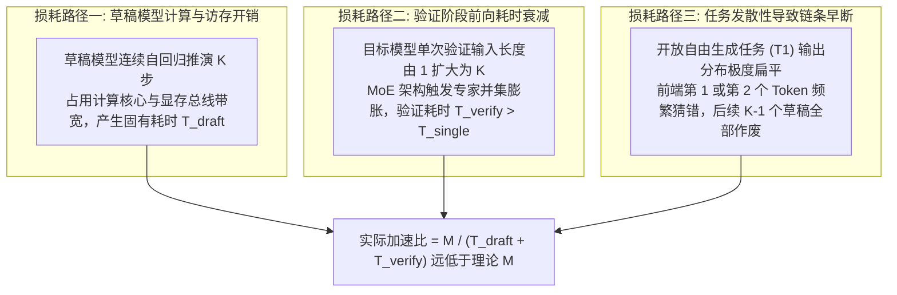

# 投机解码收益与实测条件：三模型基准矩阵、真实加速衰减与调参反转

> **阅读导航**：[推理与部署](README.md) · [语言模型生成机制与 KV 缓存](语言模型生成机制与KV缓存.md) · [大语言模型从零构建与训练全链路](大语言模型从零构建与训练全链路.md) · 代码实践：[`llm-inference-perf`](../../../experiments/llm-inference-perf/README.md)

在关于投机解码的学术文献与技术宣传中，人们经常看到 2 倍到 3 倍甚至更高的理论加速比。但在企业级推理集群与端侧硬件实际部署时，许多工程师却遇到了与预期相反的情况：在某些任务上系统确实跑得很快，但在另一些场景下端到端吞吐不仅没有提升，甚至相比原始自回归基线出现吞吐下降。

本项目在 **LLM 实验三部曲**中定位于**三阶：宏观系统工程实测**。向前可溯源一阶微观单步生成与 KV 缓存机理（[语言模型生成机制与 KV 缓存](语言模型生成机制与KV缓存.md)，对应 [`llm-mechanics`](../../../experiments/llm-mechanics/README.md)）以及二阶因果模型完整生命周期训练（[大语言模型从零构建与训练全链路](大语言模型从零构建与训练全链路.md)，对应 [`llm-lifecycle-fullchain`](../../../experiments/llm-lifecycle-fullchain/README.md)）。

这种收益波动并非硬件偶然，而是由草稿提出机制、验证阶段访存衰减、任务发散性与服务参数之间的交互决定的。本文基于在 NVIDIA DGX Spark（GB10 芯片）统一内存计算平台上的多轮独占实测，公开 125B MoE、27B 稠密与 35B MoE 三大模型在五档投机配置与三类典型负载下的实测矩阵，分析真实加速比远低于理论接受率的损耗路径，并说明置信度过滤阈值的调参反转。原始三轮记录在 [`log/`](../../../experiments/llm-inference-perf/log)，参数在 [`configs/`](../../../experiments/llm-inference-perf/configs)。脚本在 [`experiments/llm-inference-perf`](../../../experiments/llm-inference-perf/README.md)。

---

## 核心价值与技术定位

针对投机解码在真实硬件上的收益波动与工程落地条件，本文从四个方面展开：

1. **为什么看**：投机解码在工程上并不是开箱即用的免费提速工具。如果不清楚哪些模型结构、哪些负载类型与哪些参数档位能带来正向收益，盲目开启投机容易导致算力空耗与服务吞吐下跌。
2. **看了有什么收获**：获取在统一内存硬件平台上经过多轮重复压测验证的三模型实测吞吐矩阵（包含均值与标准差）；了解真实加速比远低于理论接受率的三大损耗路径；理解任务发散性（自由写作 vs 代码重构）对草稿接受率的非线性影响；掌握投机深度（n_max）与置信度过滤阈值（p_min）的调优准则。
3. **为什么需要进行严格的实测条件分析**：投机解码的端到端吞吐由以下代数方程决定：

$$\text{端到端吞吐} = \frac{\text{单轮投机平均推进的有效 Token 数}}{\text{草稿生成耗时} + \text{目标模型单次批量验证耗时}}$$

草稿模型本身需要占用计算核心与显存带宽；若任务具有高度不确定性，或者草稿长度设置过长导致后续 token 大面积被拒，分母的耗时增加将直接超越分子的推进收益，导致整体净吞吐落入负区间。
4. **怎么做的**：在 GB10 独占环境下锁定服务构建与运行时参数，采用单配置连续三轮测量机制（消除瞬时系统抖动），对三类任务执行固定 400 token 输出压测；系统统计草稿总数、接受数与主模型前向计算次数，定量还原每一轮验证的有效推进效率。

---

## 一、 实测环境与三模型评测矩阵

为了排除网络传输抖动、排队调度与不同框架实现的干扰，所有实测均在硬件环境完全独占的状态下完成。

### 1. 硬件平台与测试基准设计

- **测试硬件**：NVIDIA DGX Spark 设备（ARM64 aarch64 架构，GB10 芯片，集成 128 GB 统一内存，标称总线带宽 273 GB/s）；
- **推理后端**：锁定 `llama.cpp` 原生编译构建（锁定 commit `a0e6dc7`，build 792）；
- **执行口径**：统一通过底层 `/completion` 端点压测，统一参数为 `-ngl 99 -np 1 -t 8 --cache-type-k q8_0 --cache-type-v q8_0`，指定 `n_predict=400` 并设置 `ignore_eos` 强制统一输出长度；每组实验前执行暖机请求，正式测试严格连续执行三轮并采集均值与标准差。

### 2. 被测模型规格与草稿机制

| 模型代号 | 主模型名称与量化格式 | 主模型结构特征 | 活跃参数量 | 挂载的草稿机制形态 | 草稿体积与属性 |
|---|---|---|---|---|---|
| **主模型 A** | Qwen3.8-Flash-Next (IQ4_XS 三分片) | 稀疏 MoE 架构，总参约 180B（主干 125B） | 单步激活约 6B | 同源 MTP（多 Token 预测头） | 3.85 GiB，训练期绑定的专属预测头 |
| **主模型 B** | Qwen3.8-27B (UD-Q4_K_M) | 标准全稠密（Dense）架构 | 27B 全部全量激活 | 独立训练的 DFlash2 小草稿模型 | 1.06 GiB，轻量级同数据源蒸馏小模型 |
| **主模型 C** | Qwen3.6-35B-A3B (UD-Q4_K_M) | 稀疏 MoE 架构，总参约 35B | 单步激活约 3B | 模型原生内置 MTP 头 | 随主模型统一加载，无独立权重文件 |

### 3. 三类代表性负载特征

| 任务代号 | 任务类型 | 提示词输入长度 | 文本发散度与上下文复用关系 |
|---|---|---|---|
| **T1** | 自由生成（开放式创作） | 28 token（短输入） | **高度发散**。输出词汇与输入提示词几乎无重合，模型需从零构思内容，概率分布扁平 |
| **T2** | 长文本改写（信息保留） | 276 token（中等长度） | **强约束收敛**。要求保持原技术说明的数字、产品名与核心结论不变，输出高度复用前文词汇 |
| **T3** | 代码重构（类型注解补全） | 约 250 token（代码片段） | **极高确定性**。语法规则强约束，变量名、函数名与公共错误处理结构高度确定 |

### 4. 这次的吞吐

生成吞吐是三轮均值，括号内是样本标准差。引擎 commit `a0e6dc7`。`/completion`，`n_predict=400`，`ignore_eos`，`-np 1`。每类任务只有 `tasks/` 里的一条提示词。重复请求的 prefill 会从完整提示词掉到 4 个 token，下表只比较生成。模型、量化、草稿和提示词同时在变，不能把差距单独写成稠密对 MoE，或改写对自由生成。没有给草稿和验证分项计时。

125B 主矩阵见 `configs/matrix-125b.cfg`。MTP 是 `n_max=2`、`p_min=0.75`。

| 配置 | T1 自由生成 | T2 长文本改写 | T3 代码改写 |
|---|---:|---:|---:|
| base | 36.89 (0.06) | 36.65 (0.06) | 36.63 (0.03) |
| mtp n2 p0.75 | 38.38 (1.46) | 46.20 (1.38) | 47.94 (9.06) |
| ngram-simple | 35.98 (0.62) | 34.93 (0.49) | 30.29 (3.32) |
| ngram-map-k | 33.85 (0.13) | 32.89 (1.09) | 32.11 (1.24) |
| ngram-mod | 35.24 (0.39) | 33.04 (1.81) | 33.06 (2.13) |

`n_max=2, p_min=0.75` 在 T1 上只比基线高 1.49 t/s。阶段一曾用一个短提示词，把接近零的收益写成 125B 上 MTP 没有收益。T2、T3 对不上那个说法。

125B 的 `n_max` 与 `p_min` 是另一次扫描，见 `configs/matrix-125mtp2.cfg`。

| 配置 | T1 自由生成 | T2 长文本改写 | T3 代码改写 |
|---|---:|---:|---:|
| n3 p0 | 42.94 (2.03) | 48.31 (0.72) | 57.52 (2.23) |
| n3 p0.75 | 39.53 (0.98) | 47.89 (1.36) | 53.21 (0.73) |
| n5 p0 | 32.52 (2.07) | 44.89 (9.62) | 54.93 (14.16) |

`n3 p0` 相对各自基线是 +16.4%、+31.8%、+57.0%。同一 `n_max=3` 下，T1 的 `p_min=0` 三轮合计草稿 1366、接受 740，接受率 54.2%，吞吐 42.94。`p_min=0.75` 草稿 783、接受 660，接受率 84.3%，吞吐 39.53。接受率更高的那档草稿更少，吞吐更低。`n5 p0` 的 T1 是 32.52，低于基线 36.89。T2、T3 的标准差是 9.62 和 14.16，不能再写成深度定律。

27B 见 `configs/matrix-27b.cfg`。DFlash2 只写了 `n_max=3`，没有写 `p_min`。

| 配置 | T1 自由生成 | T2 长文本改写 | T3 代码改写 |
|---|---:|---:|---:|
| base | 12.76 (0.00) | 12.76 (0.00) | 12.76 (0.01) |
| dflash n3 | 19.68 (1.06) | 29.77 (0.53) | 29.53 (3.42) |
| ngram-simple | 12.45 (0.01) | 12.43 (0.03) | 12.45 (0.01) |
| ngram-map-k | 14.34 (3.24) | 12.39 (0.11) | 12.64 (0.02) |
| ngram-mod | 12.59 (0.17) | 13.36 (0.65) | 12.62 (0.12) |

相对基线是 +54.2%、+133.3%、+131.4%。这是这个草稿、这三个提示词上的读数。

35B 主矩阵见 `configs/matrix-35b.cfg`。MTP 是 `n_max=2`，并打开了 `--spec-draft-backend-sampling`，没有写 `p_min`。

| 配置 | T1 自由生成 | T2 长文本改写 | T3 代码改写 |
|---|---:|---:|---:|
| base | 64.07 (0.73) | 65.29 (0.21) | 65.13 (0.13) |
| mtp n2 + backend-sampling | 90.11 (2.15) | 87.19 (2.94) | 94.29 (5.36) |
| ngram-simple | 61.44 (0.68) | 66.06 (11.60) | 61.76 (0.11) |
| ngram-map-k | 69.06 (11.07) | 60.10 (6.94) | 56.62 (1.06) |
| ngram-mod | 59.27 (3.23) | 56.95 (2.74) | 58.55 (0.58) |

相对基线是 +40.6%、+33.5%、+44.8%。

35B 另一轮见 `configs/matrix-35b-mtp.cfg`。`n_max=2` 和 `n_max=3` 都没有 backend-sampling。这轮的 `n_max=2` 和主矩阵不是同一条命令，T1 分别是 82.07 和 90.11。

| 配置 | T1 自由生成 | T2 长文本改写 | T3 代码改写 |
|---|---:|---:|---:|
| n2 | 82.07 (3.34) | 86.80 (4.90) | 99.19 (6.74) |
| n2 p0.75 | 74.14 (2.21) | 73.48 (1.05) | 89.39 (2.00) |
| n3 | 76.87 (9.14) | 85.51 (4.86) | 109.29 (0.82) |
| n3 + backend-sampling | 85.42 (0.59) | 85.30 (5.02) | 97.94 (5.44) |

`n3` 的 T3 是 109.29，同轮 T1 是 76.87。不能拿 109.29 去和主矩阵的 T1、T2 拼成一套最优配置。

三张主矩阵里的 n-gram 档，多数均值不高于基线。高于基线的格子标准差很大，例如 35B 的 ngram-map-k 在 T1 是 69.06（11.07）。

---

## 二、 深度归因：为什么真实加速比远低于理论接受率？

接受率高不等于吞吐高。125B 补测里，`n_max=3` 的 T1 在 `p_min=0.75` 时接受率 84.3%、吞吐 39.53 t/s；`p_min=0` 时接受率 54.2%、吞吐 42.94 t/s。草稿条数从 1366 降到 783。格子见第一节的吞吐表。

### 1. 直观示例与概念框架

例如大巴车与接驳中巴的协同运输：
- 理论计算只关注大巴车一次拉走了多少人（接受率）；
- 现实运行中，接驳中巴在狭窄街道里来回接送乘客需要消耗大量时间（草稿模型计算耗时）；大巴车在一次性装载 4 名乘客时，安检门通行耗时比只过 1 个人要长（批量验证算力与访存增加）；如果中途发现第 2 名乘客车票无效，后面 2 名乘客必须一同下车（因果链前端截断）。这三大物理损耗共同削弱了总运力提升。

### 2. 真实加速的三大损耗路径量化剖析

#### 损耗路径一：草稿模型并非零延迟（Draft Latency Overhead）
草稿模型虽然体积较小，但仍然遵循自回归串行解码的规律。例如草稿推演 $K=3$ 步，草稿模型本身必须前向计算 3 次。即便小模型单次前向极快，连续执行 3 次前向所累积的耗时 $T_{\mathrm{draft}}$ 仍然要算进总时间。本次实验没有分项计时，这里不给草稿耗时占目标模型单步的比例。

#### 损耗路径二：目标模型验证耗时膨胀（Verification Latency Inflation）
单步自回归时，目标模型输入张量为 $[1, D]$；而在投机验证阶段，输入张量扩大为 $[K, D]$：
- 对于稠密模型，虽然搬运权重时间相同，但长序列自注意力计算与 FFN 矩阵乘法计算量随 $K$ 线性增加；
- 对于 MoE 稀疏激活模型，多个候选 token 路由至不同的专家，导致单步所需加载的专家并集显著扩大，单次验证耗时 $T_{\mathrm{verify}}$ 明显高于单步自回归耗时 $T_{\mathrm{single}}$。

#### 损耗路径三：任务发散性与因果链前端截断（Task Divergence and Early Rejection）
以 125B MoE 模型的实测数据为例，对比 T1（自由生成）与 T2（长文本改写）的真实前向推进情况：

125B 补测 `n_max=3, p_min=0` 的三轮合计里，T1 草稿 1366、接受 740，吞吐 42.94 t/s；T2 草稿 1191、接受 798，吞吐 48.31 t/s。这是同一个模型和同一档配置下两个提示词的差别。27B 上另外一个草稿的 +133% 不能和 125B 的 +57% 收成「确定性任务带来 57% 至 133%」。

---

## 三、 关键实战经验与调参反转

在对投机参数进行微调时，本轮严格对照揭示了两个违背直觉的关键调参反转：

### 1. 置信度阈值（p_min）的反转验证

#### 四要素界定
- **前提**：早期的启发式优化假定：草稿模型输出的预测中，低概率猜测极易被主模型拒绝，若在推测过程中设置置信度下限（如 `p_min=0.75`），一旦草稿概率低于该阈值便提前终止本轮推测，能够有效提高整体接受率，从而应当带来更高的吞吐。
- **路径**：在 125B MoE 与 35B MoE 模型上，保持服务构建与参数完全一致，固定推测深度 $n_{\max}=3$，针对三类任务严格执行 `p_min=0.0`（完全不截断）与 `p_min=0.75` 的三轮压测对比。
- **结论**：125B 上 `n_max=3` 时，`p_min=0` 的均值不低于 `p_min=0.75`。T2 只差 0.42 t/s，小于标准差，不能说三个任务都明显更好：

| 任务类型 | p_min=0.0 吞吐 (tok/s) | p_min=0.75 吞吐 (tok/s) | 性能变化幅度 |
|---|---:|---:|---:|
| **T1 自由生成** | **42.94** | 39.53 | **下降 8.0%** |
| **T2 长文本改写** | **48.31** | 47.89 | 下降 0.9% |
| **T3 代码重构** | **57.52** | 53.21 | **下降 7.5%** |

深入排查底层统计发现：将 `p_min` 从 0.0 提升到 0.75，虽然使表观接受率从 54.3% 抬升至 84.3%，但草稿总数从 1366 降至 783（下降 43%）。换言之，**设置置信度过滤虽然让被投递的每一个猜测看起来更准，但由于大幅减少了猜测总量，减少了整体推进基数，最终净吞吐下降。** 因此在多数场景下，放开截断（`p_min=0.0`）是更优的默认选择。
- **边界**：该结论建立在草稿模型推理成本极低（同源 MTP 头或轻量蒸馏模型）的前提下。若草稿机制本身是一个体量较大、推理耗时漫长的大模型，放任低置信度推测可能导致草稿耗时剧烈膨胀，此时适度截断仍具必要性。

### 2. 草稿深度（n_max）的非线性陷阱

增加草稿深度并非越深越好。在 125B MoE 模型上，固定 `p_min=0.0`，扫描不同的推测深度：
- 当 $n_{\max}=3$ 时，T1 吞吐达到最高峰 **42.94 tok/s**（相对基线提升 16.4%）；
- 当推测深度扩大至 $n_{\max}=5$ 时，草稿生成总数从 1366 增至 2266，但接受率降至 32.9%。在自由生成（T1）任务上，吞吐降至 **32.52 tok/s**，相比无投机基线（36.89 tok/s）**净下降 11.8%**。

深度过长时，草稿后端的 token 建立在前序推测完全正确的高难度假设之上；一旦第 2 个 token 被拒，后序第 3、4、5 个 token 的前向计算与内存搬运全部沦为无效算力消耗。因此工程上，草稿深度建议限制在 **2 到 3 步** 之间。

### 3. N-gram 投机的有效性边界

在本次对 `ngram-simple`、`ngram-map-k`、`ngram-mod` 三种纯文本匹配草稿机制的 9 组系统实测中，在所测提示词与输出长度下，无一组展现出稳定的正向加速收益。N-gram 匹配缺乏语义泛化能力，在短文本与高变异输出中命中率极低，且文本查找与比对引入了非平凡的 CPU 调度开销。在生产环境中，基于神经网络表征的同源 MTP 或轻量蒸馏小模型才是更可靠的加速路径。

---

## 四、 2-bit 超大 MoE 下的投机倒退复现与机制拆解（DeepSeek-V4-Flash on GB10）

在前面的稠密模型与常规 4-bit MoE 测试中，同源 MTP 往往能带来 16% 至 67% 的提速。但在实际部署中，如果把极低比特（2-bit 向量量化）MoE 放进单卡（NVIDIA DGX Spark / GB10，128 GB 统一内存）并在 `vLLM 0.23.0 + vq2-vllm` 栈上开启 MTP，**实测吞吐反而会出现明显下降**。

### 1. 同口径复现实验数据（2026-11-11 实测）

我们在同一台 GB10 主机上拉取 96.31 GiB 的 `DeepSeek-V4-Flash-2bit` 权重，分别测试了关闭投机与开启 MTP（$K=2, 3$，开启 FR-Spec 裁剪草稿词表 `lm_head`）在 `max_tokens=128` 下的单流解码速率：

| 运行配置 | 显存实占 | 128 步解码速度 | 单步有效延迟 | 相对同模式 MTP=0 变化 |
|---|---|---|---|---|
| **MTP=0（开启 CUDA Graph）** | 94.69 GiB | **20.34 tok/s** | **49.17 ms/tok** | CUDA Graph 基线 |
| **MTP=2 / 3（开启 CUDA Graph）** | 加载期失败 | 触发 `cudaErrorIllegalAddress` | 捕获阶段中断 | sm_121 图重放越界 |
| **MTP=0（`enforce_eager=True`）** | 94.69 GiB | **17.46 tok/s** | **57.26 ms/tok** | Eager 对照基线 |
| **MTP=2（`enforce_eager=True`）** | 96.93 GiB | **12.22 tok/s** | **81.85 ms/tok** | **下降 30.0%** |
| **MTP=3（`enforce_eager=True`）** | 96.93 GiB | **10.42 tok/s** | **95.97 ms/tok** | **下降 40.3%** |

所有顺利跑完的组别均通过同一问答一致性校验（正常输出 `'The capital of France is **Paris**.'`），排除了模型损坏导致的早停或乱码干扰。

### 2. 三层原因归因：为什么 2-bit MoE 开 MTP 反而变慢？

结合实测数据与 `vq2_vllm` 插件源码分析，速度倒退由三层累加约束造成：

1. **无完整 CUDA Graph 保护时，草稿头发射开销高于接受收益**：
   即便开启 FR-Spec 把草稿词表投影从 530 MB 压低至 34 MB，Eager 模式下每一次单步草稿仍需完整经历 Python 调度与 Triton / TileLang 小算子发射。在单步基线已达 `57.26 ms/tok` 的前提下，连续执行 $K=2$ 或 $K=3$ 次草稿再叠加目标模型验证，总耗时升至 `81.85 ms/tok`（$K=2$）与 `95.97 ms/tok`（$K=3$），吞吐下降 30% 到 40%。
2. **原生 vLLM 默认强行把草稿模型切入 `PIECEWISE` 模式**：
   核对 `vq2_vllm/__init__.py` 的 `_patch_drafter_full_cudagraph` 可见，原生 `SpecDecodeBaseProposer.initialize_cudagraph_keys` 硬编码禁止草稿模型使用全图捕获，导致草稿在每个注意力算子处被打断退化为分段甚至近乎 Eager 执行（源码实测注记单步草稿约 `182ms x K`）；若未注入 `VQ2_DRAFTER_FULL_CG=1` 放行全图捕获，哪怕主模型开启了 CUDA Graph，开 MTP 仍会被草稿分段发射拖慢。
3. **2-bit MoE 专家聚集（Gather）惩罚放大了 $K=3$ 过度投机代价**：
   根据仓库官方 `docs/ARCHITECTURE.md` 记录，即便在主模型与草稿头双双跑通全图 CUDA Graph 的最优环境中，$K=2$ 是最高拐点（无投机 `17.4` $\rightarrow$ $K=1$ `21.4` $\rightarrow$ $K=2$ `22.5 tok/s`）；将草稿步数推高到 $K=3$ 时，平均接受长度仅从 `2.08` 微增到 `2.14`，但主模型单次并行验证的批长膨胀到 $K+1=4$，在 2-bit 码本查表（Gather-bound）MoE 上触发更宽的路由专家并集与带宽争抢，净吞吐回落至 `20.6 tok/s`。

这组复现给出一条明确的工程边界：**投机解码能否赚钱，不单取决于草稿模型有多小或接受率有多高，还受制于草稿头是否纳入全量 CUDA Graph、以及 2-bit VQ MoE 验证阶段多 token 并行触发的专家加载膨胀**；当其中任一环退回分段/Eager 执行或草稿步数超出 $K=2$ 拐点时，关闭 MTP 反而更快。
