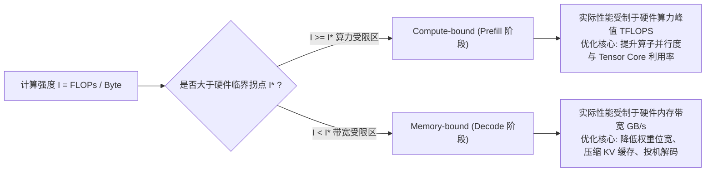

# 推理内存预算与成本估算：四元显存体系、Roofline 拐点与硬件利用率

> **阅读导航**：[推理与部署](README.md) · [语言模型生成机制与 KV 缓存](语言模型生成机制与KV缓存.md) · [从自回归到投机解码](从自回归到投机解码.md) · [推理成本实验](../../../experiments/inference-cost-models/)

在大语言模型部署上线与容量规划过程中，工程团队经常面临一系列实际问题：一张 24 GB 的消费级显卡或 80 GB 的数据中心显卡，究竟能支撑多大的并发请求与上下文长度；为什么静态监控显示显存利用率只有 60%，服务却突然发生 OOM（显存溢出）；为什么优化了矩阵乘法算子之后，生成阶段的吞吐却没有明显改善。

要摆脱盲目试错，必须建立精确的数学模型。本文推导大语言模型推理的四元显存预算体系，提供主流参数规模在不同量化位宽下的矩阵基准，推导基于 Roofline 模型的算力与带宽瓶颈拐点，并解析 PagedAttention 块内碎片与 CUDA Graph 对显存余量设计的工程约束。

---

## 核心价值与技术定位

针对推理成本与显存预算的量化推导，本文从四个方面展开：

1. **为什么看**：模型部署从来不只有模型权重本身。若脱离 KV Cache、动态激活值与运行时 Workspace 的交互关系，脱离硬件算力与显存带宽的物理限制，任何容量规划与性能调优都将脱离实际。
2. **看了有什么收获**：掌握由静态权重、KV Cache、激活值、运行时 Workspace 组成的四元显存预算公式；能够直接查阅或计算 7B、13B、70B 模型在 FP16、FP8、INT4 精度下的显存底线；理解 Roofline 模型中 Prefill 算力受限与 Decode 带宽受限的原因；掌握 MFU（模型计算利用率）与 MBU（内存带宽利用率）的评估方法与显存安全余量设计。
3. **为什么选择四元预算与 Roofline 模型**：
   - 选四元预算：单纯按权重体积买卡容易在长文本与高并发场景下显存溢出，将显存拆解为确定性的四项，能为推理引擎的参数配置（如显存利用率上界、最大并发槽位）提供定量依据；
   - 选 Roofline 模型：它从硬件的浮点算力峰值与显存物理带宽两个维度画出性能上限，帮助工程师看清当前瓶颈究竟是算力不足还是访存受限，避免用优化算力的手段去解决访存瓶颈。
4. **怎么做的**：通过逐项推导权重参数、注意力状态张量与运行时分配器的开销公式建立显存方程；通过计算强度（FLOPs/Byte）与硬件平衡点比值界定运行区间；结合 PagedAttention 块大小与 CUDA Graph 捕获机制确立生产环境下的余量边界。

---

## 一、 推理显存四元预算体系

大模型推理部署所需的总显存不是一个单一静态数值，而是由四个相互独立的组成部分叠加而成：

$$M_{\mathrm{Total}} = M_{\mathrm{Weights}} + M_{\mathrm{KVCache}} + M_{\mathrm{Activation}} + M_{\mathrm{Workspace}}$$

```mermaid
flowchart TD
    subgraph TotalMemory["总显存预算 M_Total"]
        direction TB
        MW["1. 模型静态权重 M_Weights<br>参数量 P 与量化位宽 w 决定，常驻不可释放"]
        MKV["2. 上下文 KV Cache M_KVCache<br>随并发量 B 与序列长 T 动态膨胀，长文本主要杀手"]
        MA["3. 动态激活值峰值 M_Activation<br>前向传播中间张量，Prefill 阶段达到峰值"]
        MWk["4. 运行时 Workspace M_Workspace<br>CUDA 上下文、NCCL 通信池、CUDA Graph 静态图显存"]
        
        MW --> TotalMemory
        MKV --> TotalMemory
        MA --> TotalMemory
        MWk --> TotalMemory
    end
```

### 1. 模型静态权重（$M_{\mathrm{Weights}}$）

模型权重在初始化加载完成后长久常驻显存。其理论占用取决于模型总参数量 $P$ 与参数存储位宽 $w$（bit）：

$$M_{\mathrm{Weights}} \approx P \times \frac{w}{8} \times (1 + \epsilon_{\mathrm{scale}}) \quad \text{(Bytes)}$$

其中 $\epsilon_{\mathrm{scale}}$ 为量化元数据与结构冗余系数：
- 在原生 FP16 或 BF16 精度下，$w = 16$，每个参数占 2 字节，$\epsilon_{\mathrm{scale}} = 0$；
- 在 INT4 量化（如 AWQ 或 GPTQ）下，$w = 4$，每个参数占 0.5 字节。但量化并非均匀压缩，通常每组参数（如 group_size=128）需附带 FP16 的缩放因子（scale）与零点（zero point）；且词表嵌入层（Embedding）与最终输出层（LM Head）为了保证生成稳定性，通常保持 FP16 不量化。因此实际显存会比纯理论值多出 5% 至 10% 的冗余（$\epsilon_{\mathrm{scale}} \approx 0.05 \sim 0.10$）。

### 2. 上下文 KV Cache（$M_{\mathrm{KVCache}}$）

在服务运行过程中，KV Cache 随着请求并发数与会话长度动态伸缩。对于堆叠 $L$ 层、具有 $H_{kv}$ 个 KV 注意力头、每头维度为 $d_h$ 的 Transformer 模型：

$$M_{\mathrm{KVCache}} = 2 \times L \times B \times T \times H_{kv} \times d_h \times b \quad \text{(Bytes)}$$

公式中参数定义如下：
- 常数 $2$：分别存储 Key 向量与 Value 向量；
- $L$：Transformer 层数；
- $B$：系统当前承载的并发序列总数（Batch Size）；
- $T$：每个序列的平均上下文长度（包含 Prompt 与已生成 Token）；
- $b$：KV 缓存的数据精度字节数（FP16 为 2，FP8 为 1，INT4 为 0.5）。

### 3. 动态激活值显存（$M_{\mathrm{Activation}}$）

激活值是指在执行网络各层矩阵乘法、注意力点积、偏置加法与激活函数时产生的临时中间张量。
- **Prefill 阶段**：输入序列长度 $T_{\mathrm{prompt}}$ 较大。传统注意力实现的中间注意力矩阵尺寸为 $[B, H_q, T_{\mathrm{prompt}}, T_{\mathrm{prompt}}]$，显存占用随长度呈平方级增长；现代推理引擎均采用 FlashAttention 算子，通过分块（Tiling）在线计算 Softmax，将激活值显存降为随序列长度线性增长，峰值约在数十兆至数吉字节（GB）之间。
- **Decode 阶段**：由于单步推进时序列长度输入仅为 1，临时激活值张量极小（通常在几十兆字节以内），远低于 Prefill 阶段。
- **预算设计原则**：系统必须预留出能够容纳最大允许输入长度（Max Prompt Length）执行 Prefill 时所需的峰值激活显存，防止长请求突发涌入时发生瞬时 OOM。

### 4. 运行时 Workspace 显存（$M_{\mathrm{Workspace}}$）

这部分显存由运行环境与推理引擎本身占用，容易在初步规划中被忽视：
- **CUDA Runtime 与 Driver 上下文**：初始化 CUDA 环境需固定消耗约 300 MB 至 800 MB 显存；
- **NCCL 通信缓冲区**：在张量并行（Tensor Parallelism）多卡部署下，NCCL 初始化时会为 GPU 间的跨卡同步分配专用的通信环形缓冲区，每卡占用数百兆至数吉字节；
- **CUDA Graph 预捕获显存池**：为了消除 Decode 阶段 CPU 发射算子的调度延迟，推理引擎会针对固定 batch size 预先捕获执行图，该机制会锁定一部分专用显存池，通常占用 1 GB 至 3 GB 不等。

---

> **实验审计边界（2026-11-07）**：本文中的公式推导与数值示例属于确定性理论模型；但对应实验脚本的历史记录经 2026-11-07 代码审阅后，尚不能将这些数字直接外推为跨硬件或跨工作负载的性能预测。引用实验数字前，请先阅读[使用边界与审计](../../../experiments/inference-cost-models/records/使用边界与审计.md)。

## 二、 主流模型在不同精度下的显存预算矩阵

为了给硬件选型提供实操依据，下表整理了 7B、13B、70B 常见规格模型在 FP16、FP8、INT4 精度下的静态权重开销，以及在典型长文本并发场景下的显存矩阵。

### 1. 模型架构典型物理参数表

| 模型规格 | 层数 $L$ | 隐藏维度 $D$ | Query 头数 $H_q$ | KV 头数 $H_{kv}$ | 架构类型 | 头维 $d_h$ |
|---|---|---|---|---|---|---|
| **7B 规格（如 Qwen2.5-7B）** | 28 | 3584 | 28 | 4 | GQA (7:1) | 128 |
| **13B/14B 规格（如 Qwen2.5-14B）** | 48 | 5120 | 40 | 8 | GQA (5:1) | 128 |
| **70B 规格（如 LLaMA-3-70B）** | 80 | 8192 | 64 | 8 | GQA (8:1) | 128 |

### 2. 静态权重与单 token KV Cache 占用对照

| 模型规格 | 精度格式 | 权重位宽 $w$ | 理论静态体积 | 实装显存（含冗余） | 单序列单 Token 的 KV Cache 体积（FP16 缓存） |
|---|---|---|---|---|---|
| **7B 规格** | FP16 / BF16 | 16 bit | 14.0 GB | 14.8 GB | $2 \times 28 \times 4 \times 128 \times 2 = 57.34\text{ KB}$ |
| 7B 规格 | FP8 | 8 bit | 7.0 GB | 7.5 GB | 57.34 KB（若 KV 同步量化为 FP8，则为 28.67 KB） |
| 7B 规格 | INT4 (AWQ/GPTQ) | 4 bit | 3.5 GB | 4.1 GB | 57.34 KB |
| **14B 规格** | FP16 / BF16 | 16 bit | 28.0 GB | 29.5 GB | $2 \times 48 \times 8 \times 128 \times 2 = 196.61\text{ KB}$ |
| 14B 规格 | FP8 | 8 bit | 14.0 GB | 15.0 GB | 196.61 KB |
| 14B 规格 | INT4 (AWQ/GPTQ) | 4 bit | 7.0 GB | 8.0 GB | 196.61 KB |
| **70B 规格** | FP16 / BF16 | 16 bit | 140.0 GB | 146.0 GB | $2 \times 80 \times 8 \times 128 \times 2 = 327.68\text{ KB}$ |
| 70B 规格 | FP8 | 8 bit | 70.0 GB | 74.0 GB | 327.68 KB |
| 70B 规格 | INT4 (AWQ/GPTQ) | 4 bit | 35.0 GB | 39.0 GB | 327.68 KB |

### 3. 典型并发部署场景的总显存测算实例

以 **70B 模型在 INT4 量化部署**为例，分析其在不同并发和上下文深度下的整机显存需求（假设系统 Workspace 固定预留 3 GB，激活值预留 2 GB）：
- **场景 A（单人长文本问答，B=1，T=64,000，KV 采用 FP16）**：
  $$M_{\mathrm{Total}} = 39.0\text{ GB (权重)} + (64,000 \times 327.68\text{ KB}) + 2.0\text{ GB} + 3.0\text{ GB} = 39.0 + 20.97 + 5.0 \approx 64.97\text{ GB}$$
  结论：单张 80 GB 显卡（如 A100/H100 80GB）即可承载单会话 64k 交互。
- **场景 B（企业级多并发，B=16，平均 T=8,000，KV 采用 FP16）**：
  $$M_{\mathrm{Total}} = 39.0\text{ GB} + (16 \times 8,000 \times 327.68\text{ KB}) + 2.0\text{ GB} + 3.0\text{ GB} = 39.0 + 41.94 + 5.0 \approx 87.94\text{ GB}$$
  结论：显存突破 80 GB，必须扩容至双卡张量并行（$2 \times 80\text{ GB}$）或对 KV Cache 施加 FP8 量化（KV 体积直接从 41.94 GB 减半至 20.97 GB，使得总需求回落至 66.97 GB，重返单卡容量安全区间）。

---

## 三、 Roofline 模型推导与 Prefill/Decode 真实拐点

在明确显存容量之后，下一个核心问题是：**这套硬件配置能够跑到多大的每秒 Token 生成速度？** 这需要利用 Roofline 模型进行严格分析。

### 1. 直观比喻与机理模型

例如物流车队调度：
- 显存带宽就像货运卡车装卸货物并穿梭于仓库与车间之间的道路吞吐量（GB/s）；
- GPU 算力核心就像车间内工人们对零件进行精密组装的加工速度（TFLOPS）。
- 如果每一个零件运进车间后需要经历 500 道复杂打磨工序，工人们忙得不可开交，而道路非常空闲，这属于**算力受限（Compute-bound）**；
- 如果每一个零件运进车间后工人只需扫一眼直接打包，工人们大部分时间在工位上发呆等待卡车送货，这属于**内存带宽受限（Memory-bound）**。



### 2. 数学推导与硬件平衡拐点定义

Roofline 模型将算法执行的物理性能上限定界为计算强度的函数：

$$P_{\mathrm{peak}} = \min(\Pi_{\max}, \; I \times \beta_{\max})$$

各项定义如下：
- $\Pi_{\max}$：硬件理论浮点算力峰值（单位为 TFLOPS）；
- $\beta_{\max}$：硬件显存物理带宽（单位为 GB/s）；
- $I$：当前计算任务的**计算强度（Operational Intensity）**，定义为单位内存数据搬运所支撑的浮点计算次数：

$$I = \frac{\text{计算量 } (\text{FLOPs})}{\text{访存量 } (\text{Bytes})}$$

硬件临界平衡拐点（Machine Balance Point）$I^*$ 定义为两者比值：

$$I^* = \frac{\Pi_{\max}}{\beta_{\max}}$$

当算法计算强度 $I \geq I^*$ 时，系统处于算力受限区；当 $I < I^*$ 时，系统处于内存带宽受限区。

### 3. 主流硬件规格与平衡拐点对照

| 硬件平台 | 显存容量 | FP16/BF16 算力峰值 ($\Pi_{\max}$) | 显存物理带宽 ($\beta_{\max}$) | 硬件平衡拐点 ($I^* = \Pi_{\max} / \beta_{\max}$) |
|---|---|---|---|---|
| **NVIDIA A100 SXM4** | 80 GB HBM2e | 312 TFLOPS | 2039 GB/s | **153.0 FLOP/Byte** |
| **NVIDIA H100 SXM5** | 80 GB HBM3 | 989 TFLOPS (无稀疏) | 3350 GB/s | **295.2 FLOP/Byte** |
| **NVIDIA RTX 4090** | 24 GB GDDR6X | 165 TFLOPS (Tensor Core) | 1008 GB/s | **163.7 FLOP/Byte** |
| **NVIDIA DGX Spark (GB10)** | 128 GB 统一内存 | 约 100 TFLOPS (FP16) | 273 GB/s | **366.3 FLOP/Byte** |

### 4. Prefill 与 Decode 阶段的真实强度推导

设模型参数量为 $P$，数据精度为 $b$ 字节（如 FP16 下 $b=2$）：

#### (1) Prefill 阶段
输入包含 $T_{\mathrm{prompt}}$ 个 token。矩阵乘法所需浮点运算量约为：

$$\mathrm{FLOPs}_{\mathrm{prefill}} \approx 2 \times P \times T_{\mathrm{prompt}}$$

访存量主要由读取一次完整模型静态权重组成（激活值读写相对较小）：

$$\mathrm{Bytes}_{\mathrm{prefill}} \approx P \times b$$

代入计算强度公式：

$$I_{\mathrm{prefill}} \approx \frac{2 \times P \times T_{\mathrm{prompt}}}{P \times b} = \frac{2 \times T_{\mathrm{prompt}}}{b}$$

当输入提示词长度 $T_{\mathrm{prompt}} = 1024$，且采用 FP16（$b=2$）时：

$$I_{\mathrm{prefill}} \approx \frac{2 \times 1024}{2} = 1024\text{ FLOP/Byte}$$

该计算强度（1024 FLOP/Byte）远高于 A100 的拐点（153 FLOP/Byte）与 H100 的拐点（295.2 FLOP/Byte）。因此 **Prefill 阶段是算力受限（Compute-bound）**。此阶段生成吞吐直接取决于 Tensor Core 的算力密度与矩阵分块效率。

#### (2) Decode 阶段
在单请求（Batch Size = 1）自回归生成中，每推进 1 个 token，需执行的计算量为：

$$\mathrm{FLOPs}_{\mathrm{decode}} \approx 2 \times P \times 1 = 2P$$

然而，为了计算这单个 token 的前向传播，GPU 必须将模型的全部活跃权重从显存完整遍历读取进片上缓存一次：

$$\mathrm{Bytes}_{\mathrm{decode}} \approx P \times b$$

代入计算强度公式：

$$I_{\mathrm{decode}} \approx \frac{2P}{Pb} = \frac{2}{b}$$

在 FP16 精度（$b=2$）下，计算强度恒等于：

$$I_{\mathrm{decode}} = \frac{2}{2} = 1\text{ FLOP/Byte}$$

即使使用 INT4 量化（$b=0.5$），计算强度也仅为：

$$I_{\mathrm{decode}} = \frac{2}{0.5} = 4\text{ FLOP/Byte}$$

这一数值（1 到 4 FLOP/Byte）与硬件平衡拐点（153 到 366 FLOP/Byte）相差两个数量级以上。因此 **单请求 Decode 阶段是内存带宽受限（Memory-bandwidth bound）**。GPU 的上百个流式多处理器（SM）绝大部分时间处于空闲停顿（Stall）状态，等待显存控制器搬运数据。

由此可得出单请求自回归生成的理论速度极限公式：

$$\text{单请求最大生成速度 (Token/s)} \approx \frac{\text{显存物理带宽 } \beta_{\max} \text{ (GB/s)}}{\text{活跃模型权重显存 } M_{\mathrm{Weights}} \text{ (GB)}}$$

以 A100（2039 GB/s）运行未量化 70B FP16 模型（权重 140 GB）为例：

$$\text{生成极限} \approx \frac{2039}{140} \approx 14.56\text{ Token/s}$$

无论如何优化 CUDA 汇编或注意力计算内核，只要无法压缩权重体积或增加并发，生成速度都不可能突破这一带宽上限。

### 5. 效率指标：MFU 与 MBU 的评估界线

在推理性能分析中，严禁脱离运行阶段混用效率指标：
- **MFU（Model FLOPs Utilization，模型算力利用率）**：

$$\mathrm{MFU} = \frac{\text{实际测得每秒生成的浮点运算总量}}{\text{硬件理论浮点峰值 } \Pi_{\max}}$$

MFU 专门用于衡量 **Prefill 阶段** 的性能利用率。优秀的推论文档与引擎在长序列 Prefill 下 MFU 通常可达到 45% 至 65%。若在 Decode 阶段汇报 MFU，数值通常仅有 1% 至 3%，这属于指标误用。
- **MBU（Model Bandwidth Utilization，模型带宽利用率）**：

$$\mathrm{MBU} = \frac{\text{单步实际搬运的模型权重与 KV 缓存字节数} \times \text{单秒生成 Token 数}}{\text{硬件理论显存带宽 } \beta_{\max}}$$

MBU 专门用于衡量 **Decode 阶段** 的访存效率。优化良好的推理系统（如 vLLM、SGLang）在单请求自回归解码时，MBU 通常能够达到 70% 至 85%，表明硬件显存总线已接近满载。

---

## 四、 生产级显存管理常见问题与安全余量设计

在真实生产部署环境中，单纯依据公式推导的显存总和若与显卡物理显存完全等额，服务上线后仍会发生 OOM。需要了解以下两项底层机制：

### 1. PagedAttention 的块内碎片（Internal Fragmentation）

传统推理框架采用连续显存数组为每个请求预分配最大长度（如 4096）的 KV Cache，导致严重的显存外碎片（内存利用率往往不足 30%）。vLLM 引入 PagedAttention 技术，模仿操作系统的虚拟内存分页机制，将 KV Cache 划分为固定大小的物理块（Block，常见 block_size 设置为 16 或 32 个 token）。

虽然 PagedAttention 完全消除了块间的外碎片，但引入了**块内碎片**：
- 例如系统分配的物理块大小为 16 个 token；
- 若某个会话在第 17 个 token 结束，系统必须为其分配第 2 个完整的物理块（容纳第 17 至 32 个 token）；
- 该块中仅使用了 1 个槽位，剩余 15 个槽位被空置浪费。

数学上，每个活跃并发序列平均浪费半个物理块的显存：

$$\text{单序列平均碎片显存} \approx \frac{\mathrm{block\_size}}{2} \times 2 \times L \times H_{kv} \times d_h \times b$$

当并发连接数（$B$）达到数百上千时，累计的块内碎片将达到数吉字节。

### 2. CUDA Graph 预分配机制

在自回归解码中，由于单步 token 计算极快（几毫秒到十几毫秒），CPU 发射 CUDA 算子的开销（Python 运行时与驱动开销）会占据很大比例。为了消除 CPU 开销，现代推理引擎采用 CUDA Graph 技术：针对常见并发 Batch Size（例如 1, 2, 4, 8, 16...）预先执行一次前向传播，捕获完整的 GPU 任务拓扑图并锁定所涉及的所有中间张量显存地址。

这一预捕获过程会在系统启动期开辟一块专属的显存池，该内存池在整个服务生命周期内不可被释放。若并发档位覆盖广泛，CUDA Graph 锁定的常驻显存可高达 2 GB 至 4 GB。

### 3. 显存安全余量设计准则

综合四元预算体系、块内碎片与静态图预留，生产环境部署必须严格遵循以下原则：

1. **设定显存分配上限阈值（gpu_memory_utilization）**：在 vLLM 或 SGLang 启动配置中，该参数建议设置在 **0.85 至 0.90**，保留 10% 至 15% 的物理显存给驱动、CUDA 上下文突发、短时激活值波动与网络请求反序列化。
2. **防止并发突发时的 Prefill 显存峰值溢出**：当多路用户在同一时刻提交超长 Prompt 时，多个序列并发执行 Prefill，瞬间产生的激活值张量会在短时间内重叠。必须通过严格的排队调度（Chunked Prefill）限制单次迭代计算的最大 Prompt Token 总量，避免显存瞬时尖峰引发 OOM。
