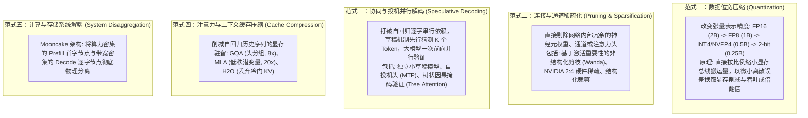
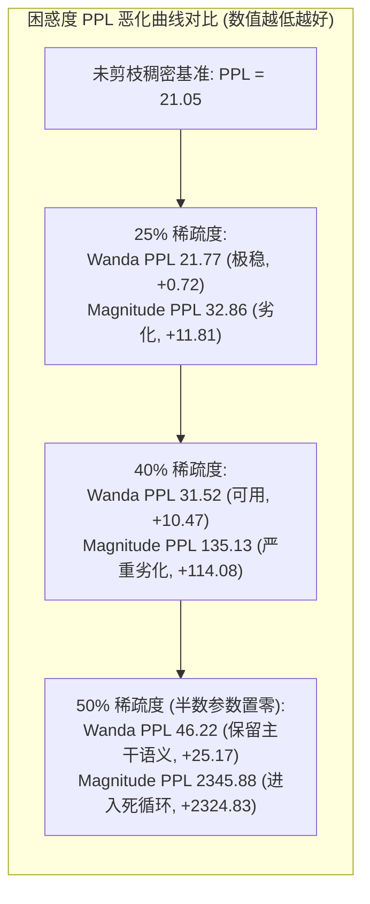

# 推理系统加速多维范式

> **阅读导航**：[推理与大模型机理](README.md) · [语言模型生成机制与 KV 缓存](语言模型生成机制与KV缓存.md) · [从自回归到投机解码](从自回归到投机解码.md) · [模型量化等级与精度相变](模型量化等级与精度相变.md) · 代码实践：[llm-mechanics/pruning](../../../experiments/llm-mechanics/pruning/README.md)

大语言模型自回归生成受限于硬件内存带宽墙，单靠权重量化无法覆盖所有业务场景的高并发与长上下文诉求。现代工业级推理系统依托量化压缩、连接稀疏、投机协同、缓存解耦与硬件并行五维协同架构。本文系统梳理五类加速范式的数学机理与物理边界，深入推导基于激活重要性的 Wanda 剪枝、NVIDIA 2:4 硬件稀疏与 AWQ 量化，并给出多维选型与协同落地指南。

---

## 一、概念与问题概述

### 1. 内存带宽墙与推理加速五维谱系

为了缓解这一访存瓶颈，业界主要有五个方向的加速方法：

---

---

## 二、核心原理

### 1. 模型剪枝机理：为什么大模型剪枝必须看激活？

在传统卷积网络时代，最经典的剪枝方法是**幅值剪枝（Magnitude Pruning）**：计算所有权重绝对值 $|W_{ij}|$，将数值最小的一批连接直接置零。

然而在大语言模型上，直接套用幅值剪枝在稀疏度达到 30% 以上时就会导致困惑度大幅上升和输出重复乱码（即陷入重复循环）。其原因在于大模型隐藏层中普遍存在**离群激活特征（Outlier Activations）**。

### 1. 离群特征对传统剪枝的破坏机制

在 Transformer 的线性投影计算中：
$$Y_i = \sum_{j} W_{ij} X_j$$

研究发现，在深层隐藏状态中，极少数输入通道 $j$ 的激活值幅值很大（正常神经元输出在 $[-1, 1]$ 之间，而离群神经元输出可达 $50$ 乃至上百）。
- 若某个连接的权重本身很小（例如 $W_{ij} = 0.02$），幅值剪枝会将其判定为无用连接并强制置零；
- 但如果该权重恰好与一个大激活输入特征相乘（例如 $X_j = 80$），二者乘积贡献高达 $1.6$，直接影响输出 Logits 的分布；
- 幅值剪枝忽略了输入特征 $X_j$ 的实际幅值，误剪了这批权重小但对输出影响大的关键连接，导致模型生成质量急剧下降。

### 2. Wanda 剪枝算法：权重与激活特征范数的乘积矩阵

为了解决上述缺陷，**Wanda（Pruning by Weights and Activations）** 提出了基于激活引导的权重得分矩阵。

#### 执行三步骤：

1. **校准数据前向采样（Calibration）**：
   准备一小批无标签通用文本（例如 32 到 128 条语料，无需人工标注），将其送入模型执行前向传播。在各层线性算子（`q_proj`, `k_proj`, `v_proj`, `o_proj`, `gate_proj`, `up_proj`, `down_proj`）的输入端挂载钩子（Hook），统计每个输入通道 $j$ 在所有样本与 Token 上的 $L_2$ 范数：
   $$\|X_j\|_2 = \sqrt{\sum_{b=1}^B \sum_{s=1}^S (X_{b, s, j})^2}$$
2. **构建 Wanda 重要性得分矩阵**：
   对于权重矩阵 $W \in \mathbb{R}^{D_{\mathrm{out}} \times D_{\mathrm{in}}}$，每个元素的得分定义为权重绝对值与输入特征范数的逐元素外积：
   $$S_{ij} = |W_{ij}| \cdot \|X_j\|_2$$
   * 若某个输入通道在实际语料中**从不激活或激活极小**（$\|X_j\|_2 \approx 0$），该列对应的权重得分极低，会被优先安全剔除；
   * 只有当权重本身与激活特征都具有显著规模时，连接才被视作核心通路并予以保留。
3. **逐行阈值截断（Per-row Sparsification）**：
   针对输出维度的每一行，根据设定的目标稀疏度 $s$（例如 50%），计算该行前 $s$ 分位的阈值 $\tau_i$，并将低于该阈值的权重设为 0：
   $$W_{ij} = \begin{cases} W_{ij}, & S_{ij} \geq \tau_i \\ 0, & S_{ij} < \tau_i \end{cases}$$

### 3. NVIDIA 2:4 半结构化剪枝（Hardware-accelerated Sparsity）

虽然非结构化 Wanda 能够保全模型精度，但普通 GPU 处理随机分布的零权重矩阵时无法带来硬件加速。

NVIDIA 从 Ampere（A100）架构起引入、并在 Blackwell（GB10/B200）上进一步强化的 **2:4 稀疏 Tensor Core** 实现了物理提速：
- **物理规则**：在权重矩阵的每连续 4 个元素中，强制要求其中必须有且仅有 2 个元素为零（保持 50% 结构化稀疏）；
- **硬件收益**：Tensor Core 硬件指令自动跳过零权重的乘加运算，将矩阵乘法的计算吞吐与显存搬运效率直接翻倍（理论加速接近 2.0x）。

---

---

## 三、工程代价与加速方案

### 1. 真实剪枝实测对比：Wanda 与幅值剪枝性能对照

我们在真实硬件环境（NVIDIA GB10 GPU，CUDA 13.0）上，以开源因果模型 **Qwen2.5-0.5B-Instruct** 为实验对象，使用多语种与代码校准语料，测量了不同剪枝算法在不同稀疏度下的困惑度（PPL）变化与生成质量：

### 真实 GPU 实测数据

| 剪枝算法类别 | 稀疏度等级 | 验证集 PPL 困惑度 | 相对稠密基线恶化度 | 文本生成连贯性实际表现 |
|---|---|---|---|---|
| **稠密未剪枝基线（Dense）** | **0%（全量参数）** | **21.0495** | 0.0000 | 语法完整，推理严谨，格式规范 |
| **幅值剪枝（Magnitude）** | 25% 稀疏 | 32.8577 | +11.8083 | 尚可生成完整短句，但语义严密性开始松散 |
| **Wanda 激活加权剪枝** | 25% 稀疏 | **21.7743** | **+0.7248（近乎无损）** | 语言通畅度与未剪枝基线几乎不可区分 |
| **幅值剪枝（Magnitude）** | 40% 稀疏 | 135.1317 | +114.0823 | 出现明显逻辑跳跃与幻觉词汇 |
| **Wanda 激活加权剪枝** | 40% 稀疏 | **31.5168** | **+10.4673（稳健）** | 语言逻辑清晰，仍具备完整问答能力 |
| **幅值剪枝（Magnitude）** | **50% 稀疏** | **2345.8819（进入重复死循环）** | **+2324.8324** | **输出完全破坏，陷入重复死循环（“一个10. 1. 1. 1...”）** |
| **Wanda 激活加权剪枝** | **50% 稀疏** | **46.2163（语义主干完整）** | **+25.1669** | **依然能生成正确语义的选择题分析与主干谓语** |
| **NVIDIA 2:4 Wanda 稀疏** | **50% 稀疏（2:4 硬件规整）** | **152.3288** | **+131.2794** | 骨架语法保留，配合短步 LoRA 微调即可恢复基准能力 |

### 标准 WikiText-2 四类剪枝方法实测对比（结构化加速验证）

为进一步验证「参数置零能否在常规推理栈里换来实际提速」，我们在标准 `WikiText-2 raw`（4088 个计分 Token）上对 **Qwen2.5-0.5B-Instruct** 完成了四类剪枝方法的基准测试（代码与原始 JSON 指标见 [`experiments/llm-mechanics/pruning`](../../../experiments/llm-mechanics/pruning/README.md)）：

| 剪枝范式 | 实际可剪稀疏度 | WikiText-2 PPL | 相对重构误差 | 前向（Prefill）加速 | 解码（Decode）加速 | 实测物理效应 |
| :--- | :--- | :--- | :--- | :--- | :--- | :--- |
| **基线（稠密未剪）** | 0% | **17.23** | 0.000 | 1.00x (987.1 ms) | 1.00x | 基准参考 |
| **Magnitude** | 20% | 20.61 | 0.224 | 1.01x | 0.98x | 零值未跳过，无加速 |
| **Wanda（激活感知）** | 20% | **17.81** | **0.087** | 0.99x | 0.93x | **精度几乎无损（+3%）** |
| **Magnitude** | 40% | 65.35 | 0.491 | 0.98x | 1.00x | 语言逻辑严重劣化 |
| **Wanda（激活感知）** | 40% | **21.07** | **0.253** | 0.97x | 0.99x | **优于 20% 幅值剪枝** |
| **Magnitude** | 50% | 505.83 | 0.662 | 1.00x | 1.06x | 困惑度升至 505.8，失去可用语义 |
| **Wanda（激活感知）** | 50% | **28.86** | **0.376** | 0.97x | 0.93x | **保持连贯可用** |
| **2:4（幅值打分）** | 50% | 19328.78 | 0.908 | 1.02x | 1.02x | **无视激活，困惑度飙升至近两万** |
| **2:4（Wanda 打分）** | 50% | **86.38** | **0.620** | 1.01x | 1.03x | **挽救 200 倍困惑度** |
| **结构化通道剪枝（留 80%）** | 19.1% | 547.12 | 0.717 | **1.13x** | **1.08x** | **物理缩表，通用算子直接提速** |
| **结构化通道剪枝（留 60%）** | 39.7% | 2486.83 | 0.933 | **1.31x** | **1.24x** | **物理瘦身，模型文件缩小** |
| **结构化通道剪枝（留 50%）** | 48.5% | 5910.27 | 0.920 | **1.51x** | **1.37x** | **前向提速 51%，解码提速 37%** |

这一组实测说明了三条工程结论：
1. **常规框架下，非结构化与 2:4 稀疏没有自动加速**：通用矩阵乘法算子（GEMM）依然会把零值权重完整读取并乘零，延迟比全部在 `1.00x` 左右。要利用零值减少计算，必须显式启用 `cuSPARSELt` 等硬件稀疏内核；
2. **2:4 硬件稀疏的精度取决于打分准则**：同为 50% 稀疏，纯幅值打分困惑度升至 `19328.8`，而切换为 Wanda 激活打分后降为 `86.38`；
3. **结构化剪枝无需专用内核即可获得实际加速**：因为物理剔除了注意力头与中间维通道（权重落盘体积由 1976 MB 降至 1283 MB），普通运行时即可获得 **1.13x 至 1.51x** 的实机提速，但在实际工程中通常需要配合少量微调来恢复精度。

---

### 2. 激活感知的同构延伸：AWQ 权重量化机理

模型剪枝中「看重激活幅值而非孤立权重大小」的思路，在权重量化领域也催生了 **AWQ（Activation-aware Weight Quantization）** 算法。

### 1. 数学同构：为什么朴素舍入量化（RTN）会伤害显著通道？

在线性运算 $Y = X \cdot W$ 中，对权重执行均匀低位宽舍入量化会产生量化噪声 $\Delta W = W - Q(W)$，下游激活承接的输出误差为：

$$\Delta Y = X \cdot \Delta W$$

由于只有极少数输入通道携带巨大的离群激活（Outlier Features），这些通道哪怕只产生很小的权重舍入误差 $\Delta W_j$，也会被输入端上百倍的激活幅度 $\|X_j\|$ 放大。早期方案尝试对 1% 的高权重通道保留 FP16、其余使用 INT4，但这种混合精度会导致 GPU 内部执行两条分离的核函数与拼合（Gather）操作，反而拖慢端到端推理速度。

### 2. 等价缩放变换：不用混合精度也能保全 FP16 级的显著通道

AWQ 利用乘法分配律的数学等价变形绕开了这个硬件限制：

$$Y = (X \cdot S^{-1}) \cdot (S \cdot W)$$

- **校准定标**：通过校准文本统计每个输入通道的平均特征能量 $\|X_j\|_2$，构造对角保护缩放矩阵 $S = \mathrm{diag}(s_1, s_2, \dots, s_d)$，其中高活跃通道赋予更大的缩放倍数 $s_j = (\|X_j\|_2)^\alpha$；
- **量化抗噪**：在执行低位宽分桶量化前，先将显著通道的权重预先乘以 $s_j$ 扩大动态范围，由于基数放大，整数分桶产生的相对截断误差会随 $s_j$ 成比例缩减；
- **零额外开销推理**：反向补偿因子 $S^{-1}$ 可直接并入前一层归一化层（LayerNorm / RMSNorm）的权重中，不增加推理计算量。最终存储与运算的全部都是规整统一的纯 INT4 张量，既能跑满硬件带宽，又能保住关键通道精度。

### 3. GB10 真实 GPU 实测对比：AWQ vs 朴素 RTN

在 NVIDIA GB10 GPU 上，我们对 `Qwen2.5-0.5B-Instruct` 全部 168 个线性投影层执行同口径校准与低位宽注入，实测隐状态相对重构误差与生成文本质量如下：

| 量化策略 | 有效位宽 | 评测集困惑度（PPL） | 隐状态相对重构误差 | 真实文本生成行为表现（选择题续写测试） |
| :--- | :--- | :--- | :--- | :--- |
| **FP16 原生基准** | 16-bit | **34.71** | **0.0000** | `C) Paris. Paris is the capital city of France...`（准确流畅） |
| **朴素 RTN INT4** | 4-bit | 49.12 | 0.3952 | `: C) Paris The capital of France is indeed...`（句首混入异常冗余冒号） |
| **AWQ INT4（激活感知）** | 4-bit | 49.79 | **0.2914（误差降 26.3%）** | **`C) Paris. Paris, also known as the City of Light...`（输出稳健且能准确扩写）** |
| **朴素 RTN INT3** | 3-bit | 1255.04 | 0.8360 | `the capital of France? 1. ____1400, 2ndiarka...`（输出混乱） |
| **AWQ INT3（激活感知）** | 3-bit | **998.99** | **0.7989** | 数值漂移与失真度相比朴素 RTN 均明显缓解 |

实测结果表明：**通过基于激活特征的能量定标缩放，AWQ 在 4-bit 下将深层隐状态的重构偏差从 `0.3952` 压低至 `0.2914`（相对缩减 26.3%）**，减少了量化截断噪音引发的标点错乱与输出抖动。

### 4. 从 16-bit 到 4-bit 的真实提速阶梯与算子融合门槛（Qwen2.5-7B on GB10）

精度保住之后，大家最关心的是量化到底能不能带来真实的逐字提速。我们在同一台 DGX Spark（GB10，128 GB 统一内存）上使用 `vLLM 0.23.0`，对 **Qwen2.5-7B-Instruct** 从 16-bit 到 4-bit 进行了完整的吞吐阶梯对照（2026-11-11 实测，详细记录见 [模型量化等级与精度相变](模型量化等级与精度相变.md)）：

| 量化格式与运行内核 | 显存占用 | 单并发解码速度 | 8 并发聚合吞吐 | 相对 BF16 倍率 |
|---|---|---|---|---|
| **BF16 原生基准** | 14.19 GiB | 13.42 tok/s（74.52 ms/tok） | 129.49 tok/s | 1.00x |
| **GPTQ-Int8** | 8.25 GiB | 29.56 tok/s（33.83 ms/tok） | 243.09 tok/s | **2.20x** |
| **AWQ-Marlin（INT4 融合内核）** | 5.19 GiB | 48.36 tok/s（20.68 ms/tok） | 403.57 tok/s | **3.60x** |
| **GPTQ-Int4（融合内核）** | 5.19 GiB | **48.85 tok/s（20.47 ms/tok）** | **407.97 tok/s** | **3.64x** |
| **AWQ Legacy（未融合通用内核）** | 5.19 GiB | 5.54 tok/s（180.63 ms/tok） | 42.53 tok/s | **0.41x（反而更慢）** |

这组对照说明了一个常见误区：压缩权重体积本身不自动带来加速。只有配合 `awq_marlin` 或 `auto_gptq` 这类把反量化与矩阵乘法融合成单次内核执行的后端，4-bit 才把单并发速度推到 BF16 的 **3.64 倍**；一旦退回未融合的旧式 `awq` 内核，逐元素反量化开销会把速度拉低到 **5.54 tok/s**，比融合内核慢了 **8.7 倍**。

---

---

## 四、选型指南与协同架构

### 1. 五类加速方法工程选型矩阵

在实际系统设计中，面对不同的应用需求与硬件条件，五类方法的适用边界如下：

| 优化技术 | 硬件门槛要求 | 精度保全难度 | 典型收益特征 | 推荐适用场景 |
|---|---|---|---|---|
| **数值量化（INT4 / FP8）** | 低（通用显卡均支持） | 低（4-bit 以上近乎无损） | 显存与访存吞吐直接提升 **2x 至 3.8x** | **大模型上线的首选方案** |
| **Wanda 激活剪枝** | 中等（需前置校准数据） | 较低（40% 稀疏以内可用） | 减少浮点乘法开销，与量化可正交叠加 | 算力受限但不想重新训练的大模型瘦身 |
| **NVIDIA 2:4 稀疏** | 需 Ampere 及以上 GPU | 中等（需配合短步恢复微调） | 矩阵乘法吞吐物理级提升 **接近 2.0x** | 追求高吞吐且具备专用 GPU 的生产系统 |
| **投机解码（MTP）** | 低（需同源头或草稿模型） | **无损（输出分布数学等价）** | 单并发下出字提速 **1.5x 至 2.5x** | 面向个人用户的实时交互对话场景 |
| **PD 解耦架构（Mooncake）** | 需多机集群与高带宽网络 | 无损（纯系统调度） | 消除超长上下文 Prefill 引起的卡顿排队 | 超长文档解析与高并发生产 API 服务 |

---

## 五、参考资料

1. **Sun, M., et al. (2023)**. *A Simple and Effective Pruning Approach for Large Language Models (Wanda)*. ICLR 2024.
2. **Frantar, E., & Alistarh, D. (2023)**. *SparseGPT: Massive Language Models Can Be Accurately Pruned in One-Shot*. ICML 2023.
3. **Lin, J., et al. (2024)**. *AWQ: Activation-aware Weight Quantization for On-Device LLM Compression and Acceleration*. MLSys 2024.
4. **Mishra, A., et al. (2021)**. *Accelerating Sparse Deep Neural Networks with NVIDIA Ampere Architecture and Tensor Cores*. NVIDIA Whitepaper.
5. **Qin, Y., et al. (2024)**. *Mooncake: A KVCache-Centric Disaggregated Architecture for LLM Serving*. arXiv:2407.00079.
