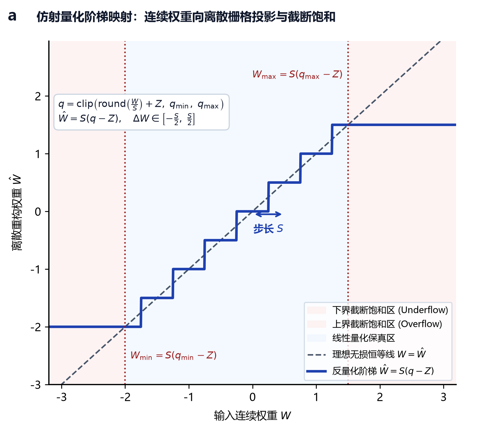
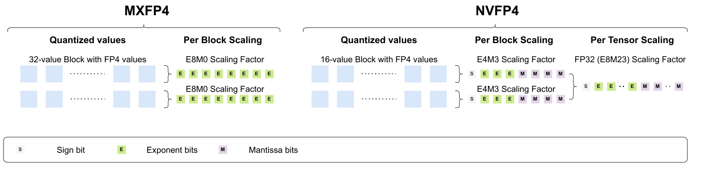
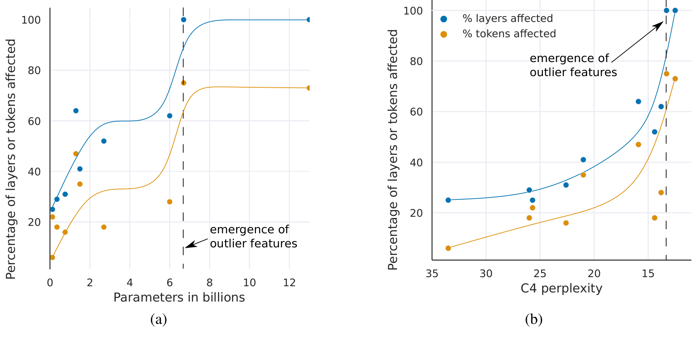
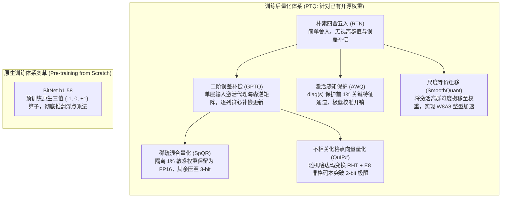
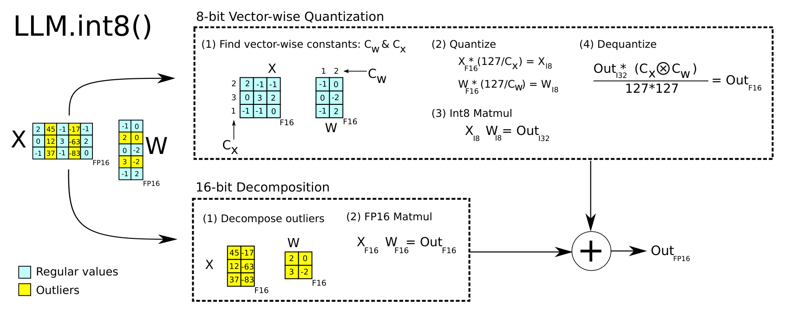

# 模型量化等级与精度变化：为什么 4-bit 稳得住，低于 4-bit 容易崩

> **阅读导航**：[推理与大模型机理](README.md) · [推理内存预算与成本估算](推理内存预算与成本估算.md) · [DGX-Spark 大模型推理与并发](DGX-Spark大模型推理与并发.md) · 相关探索：[双卡流水线并行推理实现原理](双卡流水线并行推理.md) · 代码实践：[`moe-2bit-fit`](../../../experiments/moe-2bit-fit/README.md)

部署大模型时，用低比特量化来省显存是常规操作。但位宽并不是越低越好：实际测试里经常看到，模型从 FP16 压到 FP8 或 4-bit 时，对话、写代码和基准分数几乎不掉；一旦压到 3-bit 甚至 2-bit，虽然还能输出通顺的句子，但在多步推理、复杂代码和长文回忆上会明显失准。

这篇文章从数值格式、极端离群值、深层误差累积和 MoE 路由四个方面，讲清楚 4-bit 为什么是常见的可用底线，以及 RTN、GPTQ、AWQ、SmoothQuant、BitNet b1.58 这些量化方法各自解决什么问题、适合什么场景。

---

## 核心价值与技术定位

1. **为什么看**：只为了省显存而直接上 3-bit 或 2-bit，很容易把模型的推理准确率压垮。看懂不同位宽在什么地方失真，选型时才不会只图显存小而丢掉效果。
2. **看了有什么收获**：
   - 了解各量化等级（FP16/BF16、FP8/INT8、4-bit、3-bit、2-bit）的离散档位数、体积压缩比与适用边界；
   - 理解为什么 4-bit 通常能保住推理能力，而 2-bit 容易在离群值、深层残差和 MoE 路由上出问题；
   - 分清 RTN、GPTQ、AWQ、SmoothQuant、SpQR、QuIP# 与 BitNet b1.58 的核心思路和工程代价；
   - 掌握量化上线前的三项检查：困惑度（PPL）、推理/代码基准、长文本大海捞针（NIAH），以及结合实际硬件内核的实测对比。
3. **为什么写这篇**：很多量化教程只给一个「压缩后省了多少显存」的数字，不说明什么任务会掉点、不同算子内核为什么速度差几倍。这里把原理、公式和实测对照放在一起，方便直接用于部署决策。
4. **怎么做的**：先用仿射量化公式说明离散档位与截断误差，再逐层分析误差如何放大，最后对照主流补偿算法与 GB10 硬件实测数据给出选型边界。

---

## 一、 大模型量化等级与精度保留对照

大模型权重量化本质上是将连续的浮点参数矩阵映射到有限的离散状态集合：

$$q = \operatorname{clip}\left(\operatorname{round}\left(\frac{W}{S}\right) + Z, \; q_{\min}, \; q_{\max}\right)$$

反量化（Dequantization）重构公式为：

$$\hat{W} = S \cdot (q - Z)$$

其中 $S$ 为量化缩放因子（Scale），决定离散台阶的宽度；$Z$ 为零点偏移（Zero-point），决定实数零点在离散网格中的对齐位置。量化位宽 $b$ 决定了离散表示的状态总数 $2^b$：

| 量化等级 | 典型代表格式 | 可用档位数 | 权重体积倍率 | 困惑度 PPL 波动 | 核心基准准确率保留 | 常见工程定位 |
|---|---|---|---|---|---|---|
| **Full / Half** | FP16, BF16 | 65,536 | 1.0x (基准) | 0.0 (基准) | 100.0% | 训练原始精度，效果参照基准 |
| **8-bit** | FP8 (E4M3/E5M2), INT8 | 256 | 0.50x | < +0.05 | > 99.5% | 生产主力基线，效果几乎无损 |
| **4-bit** | NVFP4, AWQ, GPTQ, Q4_K_M | 16 | 0.25x ~ 0.28x | +0.10 ~ +0.25 | 96.0% ~ 98.5% | **显存与效果的常用平衡点**，推理基本可用 |
| **3-bit** | IQ3_S, Q3_K_L | 8 | 0.19x ~ 0.21x | +0.40 ~ +0.80 | 85.0% ~ 92.0% | 过渡区间，日常问答尚可，复杂逻辑开始掉点 |
| **2-bit** | 2-bit VQ, IQ2_XXS, BitNet | 4 | 0.13x ~ 0.16x | +1.00 ~ +2.50 | 50.0% ~ 70.0% | **高风险区间**，长程推理与数学推导易严重失真 |

### 1. 仿射量化的两种误差

从图 1 可以直观看到量化带来的两类误差：

1. **区间内的台阶误差（线性量化保真区）**：
   在 $[W_{\min}, W_{\max}]$ 之间，连续权重被四舍五入到最近的离散台阶，误差 $\Delta W = W - \hat{W}$ 最多不超过半个台阶宽度，即 $\Delta W \in [-S/2, \; S/2]$。只要台阶够细，参数之间的相对大小关系就能保留下来。
2. **超出边界的截断误差（饱和区）**：
   一旦数值超过 $[W_{\min}, W_{\max}]$，$\operatorname{clip}$ 会把它们强行卡在两端的极值档位 $q_{\min}$ 或 $q_{\max}$ 上，超出越多误差越大。这里就出现了一个两难：如果把步长 $S$ 设太小，极端大值全被截断；如果把步长 $S$ 设太大去包住极端值，中间正常范围的台阶又会被拉得太宽，细小的权重差异全被抹平。

---

## 二、 硬件原生数值格式与位结构剖析：从 BF16 到 NVFP4

大模型的量化精度不仅取决于算法公式，更受制于底层计算芯片（GPU、NPU、CPU）在硬件电路与 Tensor Core 层面能够原生执行的二进制数值格式（见图 3）。

不同的硬件平台提供了截然不同的硬件加速能力：

### 1. IEEE 754 经典格式 vs BF16（Bfloat16）

* **FP32（单精度浮点）**：
  * 位结构：1 位符号位 + 8 位指数位 + 23 位尾数位；
  * 特点：动态范围高达 $10^{\pm 38}$，拥有 24 位有效精度。是深度学习早期的基准，但在万亿参数时代其显存搬运与计算开销已经难以为继。
* **FP16（半精度浮点）**：
  * 位结构：1 位符号位 + 5 位指数位 + 10 位尾数位；
  * 特点：动态范围骤降至 $10^{\pm 5}$，最小正正规数仅为 $6.1 \times 10^{-5}$。在大模型训练与长上下文推理中，极易因指数位过窄触发数值下溢（Underflow），必须依赖复杂的动态 Loss Scaling 机制。
* **BF16（Brain Floating Point 16）**：
  * 位结构：1 位符号位 + 8 位指数位 + 7 位尾数位；
  * **设计思路**：BF16 由 Google Brain 针对深度学习特点专门定制。它直接将 FP32 的 23 位尾数截断为 7 位，但**完整保留了 FP32 的全部 8 位指数位**！
  * **工业意义**：大模型权重对尾数精度的轻微损失不敏感，但对指数动态范围很敏感。BF16 与 FP32 拥有完全一致的 $10^{\pm 38}$ 动态范围，消除了下溢问题，已成为现代大模型预训练（如 LLaMA、DeepSeek、Qwen）的主流工业标准。
  * **硬件支持**：NVIDIA Ampere（A100/RTX 30 系列及以上）、Intel Xeon AMX、Intel Core Ultra NPU、ARM v9 架构。

### 2. 8-bit 浮点格式：FP8（E4M3 vs E5M2）

在 NVIDIA Hopper（H100/H800）与 Blackwell 架构中，引入了第一代与第二代 Transformer Engine，定义了两种互补的 FP8 格式：

* **FP8 E4M3（1 位符号 + 4 位指数 + 3 位尾数）**：
  * 最大可表示数值为 448，精度相对较高（3 位尾数提供 8 个量化细分台阶）；
  * **专用场景**：专用于**正向推理（Forward Pass）中的模型权重（Weights）与隐藏层激活值（Activations）**。在保证数值分辨率的同时，直接将访存带宽压力削减 50%。
* **FP8 E5M2（1 位符号 + 5 位指数 + 2 位尾数）**：
  * 最大可表示数值为 57344，与 FP16 拥有完全相同的 5 位指数位；
  * **专用场景**：专用于**反向传播中的梯度（Gradients）张量**。梯度在各层间的反向流动中跨度显著，E5M2 凭借与 FP16 平级的动态范围，能够防范梯度爆炸与下溢。
* **硬件支持**：NVIDIA Hopper、NVIDIA Blackwell、AMD Instinct MI300X、Intel NPU 4000。

### 3. 4-bit 硬件原生格式：NVFP4 与 OCP MXFP4（Microscaling）

在 Blackwell 架构（如 GB10、B200）发布之前，所有的 4-bit 量化（如 GPTQ、AWQ、GGUF Q4_K_M）本质上皆属于**“仅权重量化（W4A16）”**：模型权重在显存中存储为 4-bit，但在进入 Tensor Core 计算前，必须由 CUDA Core 先解包反量化为 FP16，计算单元本身并没有实现 4-bit 并行加速。

NVIDIA Blackwell 联合 OCP（Open Compute Project）标准联盟，首次在硬件级落地了原生 **NVFP4（微缩放浮点 4-bit）**：

* **设计思路**：采用两级分层表示：
  * **基础数据格式（E2M1）**：每个元素占 4 位（1 位符号 + 2 位指数 + 1 位尾数）；
  * **微块缩放因子（Microscaling Block Scale）**：每 32 个连续权重打包为一个小块（Block），共享一个 8-bit 浮点缩放系数（FP8 E8M0，只存指数，没有符号位和尾数位）。
* **为什么有效**：按 32 个元素分块后，极少数异常大值只影响自己所在的那一小块，这一块会配一个更大的 E8M0 缩放系数；其余 99% 的普通小块依然能用紧凑的缩放尺度保持精细度。
* **吞吐提升**：NVFP4 Tensor Core 实现了真正的 W4A4 计算流，矩阵乘法的理论算力密度达到 Hopper FP8 的 2 倍、FP16 的 4 倍。

> 原论文 Figure 1，来源：Egiazarian 等，[arXiv:2509.23202](https://arxiv.org/abs/2509.23202)。图像保持原样。许可：arXiv 非独占分发许可，第三方图复用权限仍需人工复核。

### 4. 主流硬件平台的原生格式支持

| 硬件平台与芯片架构 | 原生硬件加速格式 | 典型工业代表设备 | 最佳适配推理格式与算子通道 |
|---|---|---|---|
| **NVIDIA Blackwell** (sm_120 / sm_121) | **NVFP4**, FP8 (E4M3/E5M2), BF16, FP16, INT8, INT4 | NVIDIA B200, GB200, DGX Spark (GB10) | 原生 NVFP4 (W4A4) / FP8 高并发推理 |
| **NVIDIA Hopper** (sm_90) | **FP8 (E4M3/E5M2)**, BF16, FP16, INT8, TF32 | NVIDIA H100, H800, H200 | Transformer Engine FP8 / GPTQ 4-bit (W4A16) |
| **NVIDIA Ampere / Ada** (sm_80 / sm_89) | **BF16**, FP16, INT8, INT4, TF32 (无原生 FP8) | A100, RTX 3090, RTX 4090 | AWQ / GPTQ INT4 (W4A16), BF16 全精度 |
| **Intel NPU 平台** (Meteor/Lunar Lake) | **INT8**, **INT4**, FP16 (硬件混合精度) | Intel Core Ultra 系列轻薄本 NPU | OpenVINO W4A16 (对称量化) / INT8 VNNI |
| **ARM Neoverse / Cortex** (ARM v9) | **BF16**, FP16, INT8, INT4 (SVE2 / SME 向量扩展) | NVIDIA Grace CPU, 苹果 M 系列, 高通骁龙 X Elite | llama.cpp ARM NEON 点积指令 / Q4_K_M |
| **AMD CDNA 3** (gfx942) | **FP8 (E4M3/E5M2)**, BF16, FP16, INT8 | AMD Instinct MI300X | vLLM ROCm FP8 / CK GEMM 加速算子 |

---

## 三、 为什么低于 4-bit 效果容易急剧下滑

很多工程师会疑惑：从 8-bit 压到 4-bit 同样省了一半体积，模型表现很稳；为什么从 4-bit 再压到 2-bit 只少了 2 个 bit，复杂推理成绩却会大幅下滑？

主要原因来自以下四个方面：

### 1. 少数极端离群值把量化范围撑坏

量化时要先区分两类不同的极端数值：
* **激活离群值（Activation Outliers）**：Dettmers 等人在 LLM.int8() 中发现，模型参数超过 6.7B 后，隐藏层激活里会出现约 0.1% 的极端通道，数值比普通通道大 20 到 100 倍，而且固定出现在少数特定维度上；
* **敏感权重（Weight Outliers）**：SpQR (2024) 进一步指出，权重矩阵里也有少量对输出高度敏感的参数，直接影响注意力聚焦和 RoPE 位置编码。

> 原论文 Figure 3，来源：Dettmers 等，[arXiv:2208.07339](https://arxiv.org/abs/2208.07339)。图像保持原样。许可：CC BY 4.0。

到了不同位宽下，这些极端值的影响完全不同：
* **4-bit 还能兜住**：4-bit 通常配合**分组缩放（Group-wise Scaling，如每 64 或 128 个权重共用一个 Scale）**，再加上 AWQ 或 GPTQ 的误差补偿，局部范围内的 16 个档位足够保住绝大多数权重分布；
* **2-bit 只有 4 个档位，顾头不顾尾**：每个单元只有 $2^2 = 4$ 个可选值。如果为了包住 100 倍大的极端值而把步长 $S$ 拉大，组内 99% 的正常权重就会全被压到同一个档位里；如果直接把极端值截掉，关键的注意力通道就会失效；
* **缓解方案与代价**：后来的 **SpQR** 把最敏感的 1% 权重单独留成 FP16 稀疏矩阵，其余 99% 压到 3-bit；**QuIP#** 先用随机哈达玛变换把极端峰值摊平，再做 E8 格点向量量化。但这两类方案在推理时都需要专用解压算子，会增加计算和内存访问的开销。

### 2. 深层网络把每层的误差一路放大

70B 到 299B 参数的模型往往有 60 到上百层 Transformer。
* 每一层线性层产生的量化误差 $\Delta W$ 并不会互相抵消；
* 误差穿过前馈网络的非线性激活（如 SwiGLU: $\text{Swish}(x W_g) \cdot (x W_u)$）和 Softmax 后，会被进一步放大；
* 随着层数加深，有效信号和累积误差之间的**信噪比（SNR）越往后越低**。在 4-bit 下，单层误差很小，叠完 80 层后隐层状态依然接近原模型；到了 2-bit，前 20 到 30 层的误差就会把后面的输出带偏，最后输出看似通顺但逻辑跑偏的句子。

### 3. MoE 模型的门控选错专家

对于大型混合专家模型（如 299B MoE），低比特量化还会干扰**专家路由选择**。

* **专家得分差距**：设输入状态为 $h_t$，路由权重为 $W_g$，排第一的专家 $e_1$ 与排第二的专家 $e_2$ 之间的得分差距为：
  $$\Delta = |h_t \cdot W_{g, e_1} - h_t \cdot W_{g, e_2}|$$
* **噪声干扰**：当 $h_t$ 带着前面各层累积的误差 $\delta_h$ 进来时，门控得分会被扰动约 $\epsilon \approx \|\delta_h \cdot W_g\|$；
* **路由错配**：4-bit 下 $\epsilon \ll \Delta$，Top-k 选出来的还是原来的专家；到了 2-bit 下，误差 $\epsilon$ 大到接近甚至超过 $\Delta$，专家选择就会出错。原本该送给数学或代码专家的 Token 被分给了普通专家，模型回答流畅但专业能力大打折扣。

### 4. 只按权重均值最小化，保不住关键路径

在 2-bit 压缩里经常用到向量量化（Vector Quantization, VQ）：
* **均方误差的盲区**：普通 VQ 只盯着把权重矩阵本身的均方误差 $\|W - \hat{W}\|^2_2$ 压到最小；
* **参数重要性不均等**：不同权重对最终预测的影响（可以用二阶海森敏感度衡量）相差悬殊。有些权重绝对值不大，但恰好位于关键推理路径上；如果只按数值平均误差来聚簇，这些小而关键的连接最容易被抹掉；
* **QuIP# 的做法**：QuIP# 先做正交随机哈达玛变换（RHT），把权重和激活里的极端方向打散均匀，再映射到高密度的 E8 格点码本，从而缓解了普通 VQ 压坏关键路径的问题。

---

## 四、 主流量化补偿算法比较：从启发式到二阶优化

为了在有限位宽下尽可能压制量化误差，学术界发展出了多代量化补偿机制：

### 1. 朴素舍入（RTN, Round-To-Nearest）
* **机制**：对权重独立进行离散化标度变换与取整，完全不考虑不同通道的激活重要性与层间相关性；
* **边界**：仅在 8-bit 下表现尚可；一旦进入 4-bit 及以下，由于无法吸收离群值冲击，模型困惑度直接发散。

### 2. GPTQ（基于逆海森矩阵的逐列误差补偿）
* **数学核心**：基于最优脑外科手术（OBS）理论，将量化建模为逐层局部二次优化问题：
  $$\min_{\hat{W}} \operatorname{Tr}\left((W - \hat{W}) \mathbf{H} (W - \hat{W})^T\right)$$
  **关键认知**：此处 $\mathbf{H} = 2 X X^T$ 是**单层输入激活的外积期望（代理海森矩阵）**，并非全网全局海森矩阵。GPTQ 采用 Cholesky 分解逆海森矩阵，以贪心方式逐列量化并动态补偿更新未量化列：
  $$W_{:, j} \leftarrow W_{:, j} - \frac{E_q}{\left[\mathbf{H}^{-1}\right]_{q, q}} \cdot \left[\mathbf{H}^{-1}\right]_{q, j}$$
* **优势与局限**：在 4-bit 稠密模型上几乎能够平滑弥补量化精度损失；但其本质是逐列序列近似而非全局最优解，且高度依赖校准集分布。

### 3. AWQ（Activation-aware Weight Quantization）
* **数学核心**：通过观察真实推理时的激活张量，发现仅有 1% 的显著权重通道承载了绝大部分预测置信度。AWQ 并不将这 1% 的权重保留为全精度浮点，而是引入逐通道的保护缩放因子 $s$：
  $$W' = \operatorname{diag}(s) \cdot W, \quad X' = X \cdot \operatorname{diag}(s)^{-1}$$
  在保持数学等价性（$W' X' = W X$）的前提下，通过网格搜索最优的缩放向量 $s$，将重要权重通道的相对离散化误差降至最低；
* **优势**：无需重算耗时的逆海森矩阵，校准开销极小，且对保护长文本上下文回忆和 MoE 门控路由具有更优越的鲁棒性。

### 4. SmoothQuant（激活到权重的难度迁移）
* **数学核心**：在大模型推理中，激活值的量化难度远高于权重（激活存在强烈的通道离群值，且动态范围随输入实时变化）。SmoothQuant 利用数学等价性变换：
  $$Y = (X \cdot \operatorname{diag}(s)^{-1}) \cdot (\operatorname{diag}(s) \cdot W) = \hat{X} \cdot \hat{W}$$
  将难以量化的激活离群值除以缩放因子 $s$，平摊转移到相对容易量化的权重矩阵中，从而使得 INT8/FP8 下的矩阵乘法（GEMM）能够完全以整型加速器执行。

> 原论文 Figure 2，来源：Dettmers 等，[arXiv:2208.07339](https://arxiv.org/abs/2208.07339)。图像保持原样。许可：CC BY 4.0。

### 5. SpQR 与 QuIP#（突破 2-bit/3-bit 极限的方案）
* **SpQR（Sparse-Quantized Representation, ICLR 2024）**：
  * 发现权重敏感度集中在少数行/列和 RoPE 相关位置上；
  * 把不到 1% 的高敏感权重单独留成 FP16 稀疏矩阵，其余 99% 通过二级量化压到 3-bit，在平均约 4.75 bit/param 时基本不掉困惑度。
* **QuIP#（Hadamard Incoherence + E8 Lattice, ICML 2024）**：
  * 先用随机哈达玛变换（RHT）把权重和激活里的尖峰打散，让数值分布更均匀；
  * 再用高密度的 E8 格点码本（256 码字 × 8 维）做向量量化，使模型在 2-bit 下依然能维持较好的连贯性。

### 6. BitNet b1.58（原生三值网络）
* **做法**：前面几种都是在模型训完后再压缩（PTQ）；BitNet 则从预训练一开始就把权重限制为 $\{-1, 0, +1\}$ 三个值，推理时把高开销的浮点乘法变成纯整数加减：
* **局限**：虽然省显存、能效高，但必须从零重训，没法直接套在现有的开源模型权重上。

---

## 五、 工程选型与质量验收准则

评估一个量化模型能不能上线，不能只看单一指标，建议过下面三关：

1. **困惑度检查（Perplexity）**：
   在标准验证集（如 WikiText-2 或 C4）上测困惑度变化，按业务容忍度设阈值：
   * **日常闲聊与摘要**：PPL 上升在 $+0.30$ 到 $+0.50$ 以内通常体感不明显；
   * **代码生成与数学推理**：对误差很敏感，PPL 上升超过 $+0.20$ 就可能引发 GSM8K 或 HumanEval 通过率大幅下跌，建议控制在 $+0.15$ 以内；
   * **底线**：通用 PPL 上升超过 $+0.80$ 时，无论什么任务都不建议直接上线。
2. **推理与代码基准（GSM8K / HumanEval / MMLU）**：
   直接拿真实会掉点的数学题、代码生成和学科问答跑一遍。如果成绩明显下滑，说明低位宽已经损伤了深层推理，不能为了省显存硬上。
3. **长文本大海捞针（NIAH）**：
   把关键事实藏在 8k 到 32k 长文的不同位置里测试召回。极低位宽最先出问题的往往是远距离信息遗忘，全绿通过才算长文本注意力没有受损。

### 4. 同硬件不同量化位宽实测速度阶梯（Qwen2.5-7B on GB10）

自回归解码主要是显存带宽受限。压小权重能等比例减少从显存搬运参数的时间，但前提是推理内核必须把「反量化」和「矩阵乘法」融在一起。

我们在 NVIDIA DGX Spark（GB10，128 GB 统一内存）上锁定 `vLLM 0.23.0`，对同源 `Qwen2.5-7B-Instruct`（分别跑单并发 128 token 与 8 并发批量生成，测试于 2026-11-11）进行全量位宽阶梯与内核对照压测，结果如下：

| 量化方案与内核后端 | 实占显存 | 单并发速度 | 单步延迟 | 8 并发总吞吐 | 相对 BF16 加速比 |
|---|---|---|---|---|---|
| **BF16 原生基准** | 14.19 GiB | 13.42 tok/s | 74.52 ms | 129.49 tok/s | 1.00x |
| **GPTQ-Int8** | 8.25 GiB | 29.56 tok/s | 33.83 ms | 243.09 tok/s | **2.20x** |
| **AWQ-Marlin (INT4 融合内核)** | 5.19 GiB | 48.36 tok/s | 20.68 ms | 403.57 tok/s | **3.60x** |
| **GPTQ-Int4 (`auto_gptq` 融合内核)** | 5.19 GiB | **48.85 tok/s** | **20.47 ms** | **407.97 tok/s** | **3.64x** |
| **AWQ Legacy（未融合基础内核）** | 5.19 GiB | 5.54 tok/s | 180.63 ms | 42.53 tok/s | **0.41x（倒退 59%）** |

这组对照说明了两点：

1. **有融合内核时，4-bit 提速基本贴着显存压缩比走**：模型体积从 BF16 的 14.19 GiB 降到 8-bit 的 8.25 GiB 和 4-bit 的 5.19 GiB，单并发速度也从 13.42 tok/s 升到 29.56 tok/s（8-bit）与 48.85 tok/s（4-bit）。
2. **量化不会自动变快，内核是否融合才是关键**：同一份 4-bit AWQ 权重，走融合内核 `awq_marlin` 能跑到 **48.36 tok/s**；退回未融合的 `awq` 内核后，每步要先反量化写回寄存器再算矩阵乘，速度直接跌到 **5.54 tok/s**，比 16-bit BF16 还慢一半多，和融合内核差了 **8.7 倍**。

> **工程实操延伸**：
> 4-bit 往往是守住模型效果的常用底线，但遇到 299B 这类超大 MoE 模型时，单台 128 GB 统一内存设备（如单台 DGX Spark）放不下约 160 GB 的 4-bit 权重。如何用多台现成设备跨机拼出足够显存，相关方案探索见：[双卡流水线并行推理实现原理](双卡流水线并行推理.md)。

---

## 六、 参考文献

1. **LLM.int8() (NeurIPS 2022)**: Dettmers, T., Lewis, M., Belkada, Y., & Zettlemoyer, L. *LLM.int8(): 8-bit Matrix Multiplication for Transformers at Scale*. Advances in Neural Information Processing Systems, 35, 30318-30332.
2. **GPTQ (ICLR 2023)**: Frantar, E., Ashkboos, S., Hoefler, T., & Alistarh, D. *GPTQ: Accurate Post-Training Quantization for Generative Pre-trained Transformers*. International Conference on Learning Representations.
3. **AWQ (MLSys 2024)**: Lin, J., Tang, J., Tang, H., Yang, S., Chen, W. M., Wang, W. C., ... & Han, S. *AWQ: Activation-aware Weight Quantization for On-Device LLM Compression and Acceleration*. Proceedings of Machine Learning and Systems, 6.
4. **SmoothQuant (ICML 2023)**: Xiao, G., Lin, J., Seznec, M., Wu, H., Demouth, J., & Han, S. *SmoothQuant: Accurate and Efficient Post-Training Quantization for Large Language Models*. International Conference on Machine Learning, pp. 38087-38099.
5. **SpQR (ICLR 2024)**: Dettmers, T., Svirschevski, R., Egiazarian, V., Kuzmin, D., Dupuis, T., & Alistarh, D. *SpQR: A Sparse-Quantized Representation for Near-Lossless LLM Weight Compression*. International Conference on Learning Representations.
6. **QuIP# (ICML 2024)**: Tseng, A., Chee, J., Sun, Q., Kuleshov, V., & De Sa, C. *QuIP#: Even Better LLM Quantization with Hadamard Incoherence and Vector Quantization*. International Conference on Machine Learning.
7. **BitNet b1.58 (2024)**: Wang, H., Ma, S., Dong, L., Huang, S., Wang, H., Ma, L., ... & Wei, F. *The Era of 1-bit LLMs: All Large Language Models are in 1.58 Bits*. arXiv preprint arXiv:2402.17764.
