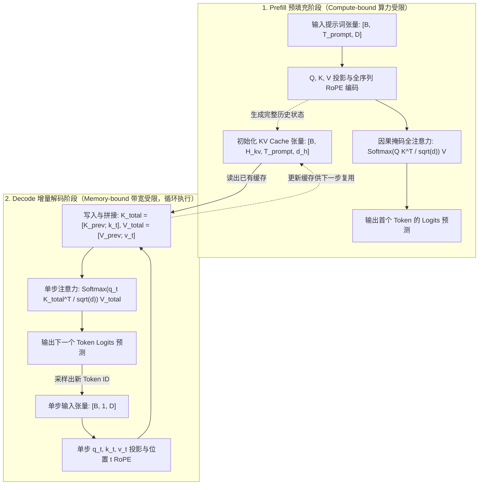
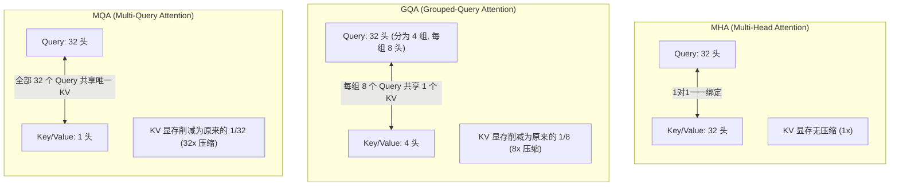
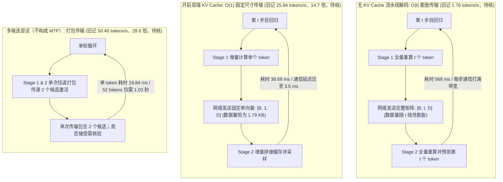

# 语言模型生成机制与 KV 缓存

> **阅读导航**：[推理与部署](README.md) · [开源大模型架构演进](开源大模型架构演进.md) · [大语言模型从零构建与训练全链路](大语言模型从零构建与训练全链路.md) · [投机解码收益与实测条件](投机解码收益与实测条件.md) · 代码实践：[llm-mechanics](../../../experiments/llm-mechanics/README.md)

在大语言模型推理部署中，首字延迟（TTFT）与后续每字生成延迟（TPOT）的严重分化，以及长上下文导致的显存溢出（OOM），根源均在于自回归生成范式。本文基于底层计算图推导，系统讲清 Prefill 算力受限与 Decode 带宽受限的物理本质，剖析键值缓存（KV Cache）降低单步计算复杂度的张量机理，对比 MHA、GQA 与 MQA 的显存压缩比，并给出生产环境下的容量预算与工程选型指南。

---

## 一、概念与问题概述

### 1. 自回归生成双阶段：Prefill 与 Decode

大语言模型生成并非均速推进，而是严格划分为计算特征截然相反的两个阶段：
- **Prefill 预填充阶段（算力受限）**：模型一次性读入全部提示词序列（长度为 {	ext{prompt}}$），并行计算各位置的隐藏状态与注意力张量，输出首个预测 token 的概率分布。此阶段计算强度极高，充分填满 GPU 核心；
- **Decode 增量解码阶段（带宽受限）**：拿到新预测的 token 后，将其追加到历史序列尾部，单步推理预测下一个 token，循环往复直至触发终止符。此阶段每步仅处理单个 token，访存开销主导耗时。
大语言模型的文本生成并非均速推进，而是严格划分为计算特征截然相反的两个阶段。

### 2. 计算图流转与阶段对比

例如用户向模型提交一篇包含 2000 个词的论文摘要，要求模型输出一段 50 词的简短评价：
- **阶段一（Prefill）**：模型必须一口气读完这 2000 个词，建立全局上下文感知，最后输出评价的第 1 个字。这一步就像开卷考试前通读全文，计算量大，但一次性完成。
- **阶段二（Decode）**：模型拿到了第 1 个字，将其拼入历史，推导第 2 个字；再拿第 2 个字推导第 3 个字，循环重复 50 次，直到输出终止符。这一步就像逐字口述作答，每一步只生成一个字，连续进行 50 轮。

从计算图流转的角度，这两个阶段在张量维度、显存吞吐与算力饱和度上存在根本差异：

### 2. 双阶段的核心物理特征对比

| 物理维度 | Prefill 阶段（预填充） | Decode 阶段（自回归解码） |
|---|---|---|
| **单步输入张量形状** | $[B, T_{\mathrm{prompt}}, D]$，序列维度长 | $[B, 1, D]$，序列维度恒为 1 |
| **计算类型** | 大规模矩阵乘法（GEMM） | 矩阵与向量乘法（GEMV） |
| **硬件瓶颈属性** | **算力受限（Compute-bound）** | **内存带宽受限（Memory-bound）** |
| **计算强度（FLOP/Byte）** | 极高，通常达到数十至上百 FLOP/Byte | 极低，通常小于 1 FLOP/Byte |
| **GPU 核心状态** | Tensor Core 高度打满，运算单元饱和 | Tensor Core 绝大部分时间处于空闲，等待内存搬运权重 |
| **KV Cache 操作** | 一次性计算全量提示词的 Key 与 Value 并写入显存 | 每一步读出全部历史 KV 向量，并将新增的一列写入显存 |
| **业务延迟指标** | 决定首字延迟（Time to First Token, TTFT） | 决定逐字生成延迟（Time Per Output Token, TPOT） |

在单请求低并发场景下，Prefill 阶段的瓶颈在于 GPU 的浮点运算峰值能力（TFLOPS）；而 Decode 阶段由于每生成一个 token 都需要将模型全部静态权重从显存完整搬运至片上缓存，瓶颈完全受制于显存带宽（GB/s）。

---

## 二、核心原理

### 1. KV Cache 增量机制与张量推导

理解 KV Cache 的数学推导，是量化显存预算与优化推理引擎的前提。

### 1. 单步注意力的增量张量算式

设 Transformer 隐藏层维度为 $D$，注意力头数为 $H_q$，每头维度为 $d_h$（满足 $D = H_q \times d_h$）。当生成进行到时间步 $t$ 时，输入为上一时刻预测出的单个 token 隐藏向量 $x_t \in \mathbb{R}^{B \times 1 \times D}$。

第一步，计算当前步的 Query、Key、Value 投影并施加旋转位置编码（RoPE）：

$$q_t = \mathrm{RoPE}(x_t W_Q, t) \in \mathbb{R}^{B \times H_q \times 1 \times d_h}$$

$$k_t = \mathrm{RoPE}(x_t W_K, t) \in \mathbb{R}^{B \times H_{kv} \times 1 \times d_h}$$

$$v_t = x_t W_V \in \mathbb{R}^{B \times H_{kv} \times 1 \times d_h}$$

第二步，将新计算得到的 $k_t$ 与 $v_t$ 写入持久化缓存中，与历史步骤拼接：

$$K_{\leq t} = [K_{<t} \;;\; k_t] \in \mathbb{R}^{B \times H_{kv} \times t \times d_h}$$

$$V_{\leq t} = [V_{<t} \;;\; v_t] \in \mathbb{R}^{B \times H_{kv} \times t \times d_h}$$

第三步，执行单步注意力权重计算与聚合。注意此时 Query 序列长度为 1，而 Key 与 Value 的有效长度已累积至 $t$：

$$S_t = \frac{q_t K_{\leq t}^{\mathsf T}}{\sqrt{d_h}} \in \mathbb{R}^{B \times H_q \times 1 \times t}$$

$$A_t = \mathrm{softmax}(S_t) \in \mathbb{R}^{B \times H_q \times 1 \times t}$$

$$O_t = A_t V_{\leq t} \in \mathbb{R}^{B \times H_q \times 1 \times d_h}$$

随后注意力输出张量 $O_t$ 经过输出投影矩阵 $W_O$ 变换后传入前馈神经网络（FFN），完成该层的单步前向传播。

### 2. KV Cache 的显存占用精确公式

对于一个总层数为 $L$、并发批大小为 $B$、当前上下文长度为 $T$ 的模型，其在系统中常驻的 KV Cache 理论显存字节数为：

$$M_{\mathrm{KVCache}} = 2 \times L \times B \times T \times H_{kv} \times d_h \times b \quad \text{(Bytes)}$$

各项参数物理含义严格界定如下：
- 常数 $2$：分别存储 Key 向量与 Value 向量；
- $L$：模型 Transformer 堆叠层数；
- $B$：当前推理服务的并发序列数（Batch Size）；
- $T$：当前序列的累积总 token 数（包含提示词与已生成内容）；
- $H_{kv}$：注意力机制中 Key 与 Value 的头数；
- $d_h$：单个注意力头的隐藏维度大小；
- $b$：存储每个浮点数所需的字节数（FP16/BF16 为 2 字节，FP8 为 1 字节，INT4 为 0.5 字节）。

---

### 2. 注意力头压缩：MHA、GQA 与 MQA 架构演进

长文本推理的主要瓶颈在于 KV Cache 占用的显存超过了模型静态权重本身。为了压缩 KV 缓存体积，现代模型架构经历了从多头注意力（MHA）向分组查询注意力（GQA）和多查询注意力（MQA）的演进。

### 1. 直观比喻与结构框架

例如在阅读理解场景中，有 32 位分析员（32 个 Query 头）同时研读文档并提取不同线索：
- **MHA（多头注意力）**：为每一位分析员分别配备 1 名专属摘要员（Key）和 1 名专属摘录员（Value），一共需要维护 32 组 Key/Value 账本。每个人的记录互不干扰，表达最丰富，但记录开销很大。
- **MQA（多查询注意力）**：整个会议室只设 1 名公共摘要员和 1 名公共摘录员，32 位分析员共用这一份公共记录。显存账本缩减至 1/32，但所有分析员只能基于同一份摘要做检索，表达多样性受到压制。
- **GQA（分组查询注意力）**：折中方案。将 32 位分析员分为 4 个小组，每组 8 人，每组配备 1 对专属的摘要员与摘录员，全场共维护 4 组 Key/Value。账本缩小到原来的 1/8，同时组内维持高效率、组间维持多样性。

### 2. 三种注意力形态的系统级量化对比

| 架构名称 | Query 头数 ($H_q$) | Key/Value 头数 ($H_{kv}$) | KV Cache 显存缩减倍数 | 吞吐与表达力权衡特征 | 代表模型 |
|---|---|---|---|---|---|
| **MHA**（多头注意力） | $H$ | $H$ | 基准（1 倍，无压缩） | 注意力头完全独立，表达力最强；长文本下 KV 显存膨胀严重，易触发 OOM | GPT-3、LLaMA-1 (7B/13B/33B/65B) |
| **GQA**（分组查询注意力） | $H$ | $G$（满足 $1 < G < H$） | **$H / G$ 倍压缩**（通常削减至 1/4 或 1/8） | 显存带宽与容量大幅下降，模型性能非常接近 MHA，成为现代开源大模型事实标准 | LLaMA-2-70B、LLaMA-3、Qwen2、Qwen2.5 |
| **MQA**（多查询注意力） | $H$ | 1 | **$H$ 倍压缩**（削减至 1/32 乃至 1/64） | 极致的显存节约，但在复杂长文本逻辑与代码微调中可能出现注意力坍缩与容量受限 | Falcon-40B、PaLM、ChatGLM2 |

以 70B 模型（80 层、Query 头数 64、头维 128、BF16 精度）在 128k 上下文、单请求为例：
- 若使用标准 MHA（$H_{kv}=64$）：单序列 KV 缓存占用高达 **160 GB**，单张消费级或专业级 GPU 甚至无法放下单人单请求；
- 采用当前主流的 8 组 GQA（$H_{kv}=8$）：KV 缓存直接缩减至 **20 GB**（削减至原来的 1/8），单卡部署长上下文才具备了工程可行性。

---

### 3. 全量重算 vs 缓存增量：数值一致性与误差分析

在推理系统实现或优化注意力算子时，必须严格验证引入 KV Cache 是否破坏了数值正确性。

### 1. 验证的四要素界定

- **前提**：因果掩码 Transformer 在理论数学上具有时间步不变性。对前缀 $[x_1, x_2, \dots, x_t]$ 执行一次性前向传播得到的位置 $t$ 的输出 logits，与从 $x_1$ 开始逐步增量缓存、在第 $t$ 步只输入 $x_t$ 得到的位置 $t$ 的 logits，在实数算术域内必须严格相等。
- **路径**：构建一个包含两层因果注意力与前馈网络的轻量级 Qwen2 随机初始化模型（对应实验代码 [`experiments/llm-mechanics/kv-cache/kv_cache_check.py`](../../../experiments/llm-mechanics/kv-cache/kv_cache_check.py)），在相同输入 token 序列下，一条路径每次将包含最新 token 的完整前缀送入网络执行全量重算；另一条路径初始化首步后，逐步传入增量 `past_key_values`，并比对每一步最后一个位置的输出概率向量。
- **结论**：在 CPU 平台、float32 精度、相同算子调用下，连续 5 个步长的逐位置 logits 最大绝对误差稳定保持在 **$4.47 \times 10^{-8}$**。该数量级完全落在单精度浮点运算的舍入误差范围内，证明了增量缓存与全量重算在逻辑图上的严格等价性。
- **边界**：
  1. **硬件浮点结合律失效**：当在 GPU 上使用 FP16 或 BF16 精度时，全量重算（GEMM 大矩阵分块累加）与增量计算（GEMV 向量内积累加）由于并行分块尺寸不同，浮点数加法顺序发生改变，最大绝对误差会上升至 $10^{-3}$ 到 $10^{-4}$ 量级；
  2. **贪心采样敏感性**：如果两个候选 token 的原始 logits 分数高度接近（差值小于 $10^{-4}$），微小的浮点累加误差可能导致贪心采样判定发生跳变，进而导致后续自回归生成的整句文本发生分叉。这属于数值计算的固有敏感性，不代表缓存实现存在逻辑缺陷。

---

## 三、工程代价与加速方案

### 1. 复杂度物理转化与显存预算公式

许多刚接触大模型推理的工程师常提出一个核心疑问：开启与未开启 KV Cache 到底有多大速度差距，这种差距在分布式并行下又会产生何种相变？本节统一给出数学推导与基于真实双机物理集群的量化基准。

### 1. 单机单卡维度：二次方计算量到常数增量的变化

在没有引入 KV Cache 时，自回归解码推进到第 $t$ 步时，模型必须把包含前 $t-1$ 个历史 token 在内的完整前缀 $[x_1, x_2, \dots, x_t]$ 作为一个长度为 $t$ 的完整序列重新输入 Transformer。
- **计算开销**：每一层都要对这 $t$ 个向量重新执行一次 $W_Q, W_K, W_V$ 投影矩阵乘法，并计算 $t \times t$ 维度的注意力打分矩阵。生成总长度为 $T$ 的文本时，累积浮点运算量（FLOPs）为：
  $$\sum_{t=1}^T \mathcal{O}(t \cdot D^2 + t^2 \cdot D) = \mathcal{O}(T^2 \cdot D^2 + T^3 \cdot D)$$
- **延迟特征**：自回归循环中，后续每生成一个 token 的耗时呈严格线性增长，越往后生成越慢，文本较长时生成体验会迅速恶化。

引入 KV Cache 之后，历史前缀的 Key 与 Value 投影向量全部常驻显存：
- **计算开销**：第 $t$ 步只需对当前这一个新 token $x_t$ 进行投影，随后直接将 $k_t$ 与 $v_t$ 拼入历史缓存矩阵中。注意力打分退化为 $1 \times t$ 的向量与矩阵乘法。生成总长度为 $T$ 的累积计算量骤降为：
  $$\sum_{t=1}^T \mathcal{O}(1 \cdot D^2 + t \cdot D) = \mathcal{O}(T \cdot D^2 + T^2 \cdot D)$$
- **延迟特征**：单步增量计算时间（TPOT）基本保持常数，仅注意力加权求和部分随历史长度极轻微增长，整体吞吐获得数量级的提升。

### 2. 分布式流水线并行（PP=2）维度：网络传输量与通信气泡相变

当模型超出单机显存承载能力，采用跨机流水线并行（PP=2）进行层级切分时（例如节点 A 运行前半段层，节点 B 运行后半段层），KV Cache 的开启与否不仅决定了计算量，更直接决定了跨机网络传输的数据量级与协议栈延迟。

以下图表保留既有记录，尚未找到对应双机运行证据，数字和加速比不可作为实测结论。`real_pp2_speculative.py` 将单位置 top-k 候选当作连续 token，没有投机接受校验，也没有验证缓存回滚，不能证明图中 MTP 路径或生成质量。脚本实际通过网络传输 CPU float32 激活，图表中 bf16 字节数不适用于该脚本。

#### 三级性能对比旧记录（证据待核）

| 推理模式与优化技术 | 单步跨机传输数据量 | 平均每步总耗时 (TPOT) | 旧记生成吞吐 (Tokens/s) | 相对基准加速比 | 物理瓶颈分析 |
|---|---|---|---|---|---|
| **第一级：无 KV Cache 原生重算** | $\mathcal{O}(t \cdot D)$，随序列长度累积膨胀 | 568.0 ms / tok | **1.76 tokens/s** | 1.0x（基准） | 网络传输量呈二次方暴增，TCP 往返握手严重堵塞，通信开销占比超 80% |
| **第二级：启用双端局部 KV Cache** | $\mathcal{O}(1 \cdot D)$，恒定 1.79 KB（896维 bf16） | 38.69 ms / tok | **25.84 tokens/s** | **14.7x** | 跨机数据传输压减为常数级微量包，单次传输仅 3.5 ms，受限于串行等待气泡 |
| **第三级：多候选尝试（不构成 MTP）** | 恒定打包 2 个 Token 激活向量 | 19.84 ms / tok | **50.40 tokens/s** | **28.6x** | 候选未经过正确性校验，无法用于证明生成或加速效果 |

---

### 2. 大规模模型在流水线并行下的显存与通信权衡

针对 27B 至 70B 级别大模型，在双卡或双机分布式环境下是否能够获得加速，需要从显存容量相变、访存带宽瓶颈以及流水线气泡三个层面客观评估。

### 1. 显存容量相变：突破单卡物理壁垒

- **单卡显存溢出极限**：
  以 27B 模型（如标准 27B 或 32B 密集架构）为例，在 FP16/BF16 精度下，仅模型静态权重本身就需要占据约 $27 \times 10^9 \times 2 \approx 54\text{ GB}$ 显存。若在单张 64 GB 显存的显卡（如 RTX Spark N1X）上运行，扣除驱动与 CUDA Context 保留内存后，剩余空间已无法支撑稍微复杂的上下文激活与 KV Cache，极易发生 OOM（Out of Memory）导致服务崩溃。
- **双卡流水线切分分摊显存**：
  采用两阶段流水线切分（PP=2，Stage 1 部署在 128 GB 节点，Stage 2 部署在 64 GB 节点），将模型的 64 个 Transformer 层对半分拆。此时每张卡仅需加载 32 层（约 27 GB 权重）。在 64 GB 节点上，权重占用由 54 GB 砍半至 27 GB，释放出多达 37 GB 的充裕空间用于存放动态 KV Cache，从而使原本单卡无法运行的中长文本推理与并发任务成为可能。

### 2. 速度加速与延迟分析的三个支点

在双卡单并发（Batch=1）自回归场景下，单纯切分模型并不意味着单 Token 生成延迟会自动缩短一半，这是由流水线的物理串行特性决定的：

1. **流水线气泡机制**：在单 Batch 自回归生成中，Stage 1 计算前半段层，Stage 2 处于空闲等待；Stage 1 算完通过网络发送激活张量后，Stage 2 开始计算，Stage 1 又陷入空闲等待。两卡本质处于串行交替执行状态，计算气泡占比接近 50%。
2. **突破带宽瓶颈的加速来源**：
   - **4-bit 量化（NVFP4 / W4A4）带来的带宽释放**：自回归解码（Decode）是典型的访存受限型计算（Memory-bound）。模型每生成一个 token，都必须将该卡上的权重完整从显存搬进计算单元。27B 模型在 4-bit 量化后总权重缩减至 14 GB（每卡仅 7 GB）。双卡独立内存总线并行运作，每卡单步只需读取 7 GB 权重，相较于 FP16 的 54 GB 访存开销，硬件访存延迟缩短至原来的四分之一；
   - **MTP 与通信开销**：实现正确的投机解码可在验证接受多个草稿时摊薄部分开销；接受数量和实际吞吐取决于模型、采样方式及额外计算，本实验现有记录不能证明加速；
   - **微批处理（Micro-batching）**：流水线可交错处理不同请求，减少设备空闲时间；实际利用率和吞吐增益取决于任务、调度和网络，需在目标负载下测量。

---

## 四、选型指南与协同架构

### 1. 注意力架构选型与缓存优化准则

针对 KV Cache 的工程管理与性能优化，有以下实施建议：

1. **文档定位说明**：本篇为 XiaokeAILabs 仓库关于 KV Cache 速度差距、时间复杂度变化、通信开销与流水线并行设计的参考文档。后续子实验（包括 `pipeline-parallel`、`llm-mechanics`、`llm-lifecycle-fullchain` 等）可直接引用本篇，不再重复展开长篇理论。
2. **长文本场景优先选择 GQA 架构**：在模型选型时，若业务依赖 32k 以上的长文档理解或多轮对话，应优先选择配置 GQA 的模型（如 Qwen2.5、LLaMA-3），避免 MHA 的显存膨胀问题。
3. **结合 PagedAttention 消除外碎片**：在自回归动态生成中，由于文本长度不可预知，传统连续显存预分配会导致严重的显存外碎片。采用分页缓存技术按块（如 block_size=16）动态分配，能够将显存有效利用率拉升至 90% 以上。
4. **低精度 KV 量化前置评估**：将 KV Cache 从 FP16 量化为 FP8 或 INT4 可以使并发承载能力翻倍，但对于高精度代码补全或数学公式推导场景，需先测试困惑度与长距离注意力召回率，确认量化噪声不会引起模型生成质量坍塌。
---

## 五、参考资料

1. **Vaswani, A., et al. (2017)**. *Attention Is All You Need*. NeurIPS 2017.
2. **Shazeer, N. (2019)**. *Fast Transformer Decoding: One Write-Head is All You Need*. arXiv:1911.02150.
3. **Ainslie, J., et al. (2023)**. *GQA: Training Generalized Multi-Query Transformer Models from Multi-Head Checkpoints*. EMNLP 2023.
4. **Kwon, W., et al. (2023)**. *Efficient Memory Management for Large Language Model Serving with PagedAttention*. SOSP 2023.
5. **Su, J., et al. (2024)**. *RoFormer: Enhanced Transformer with Rotary Position Embedding*. Neurocomputing 2024.
