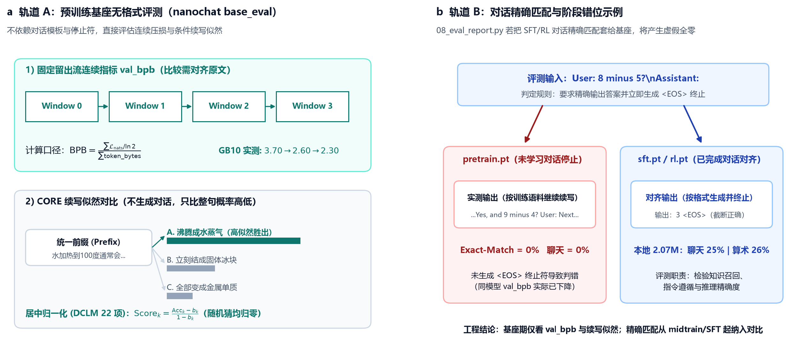
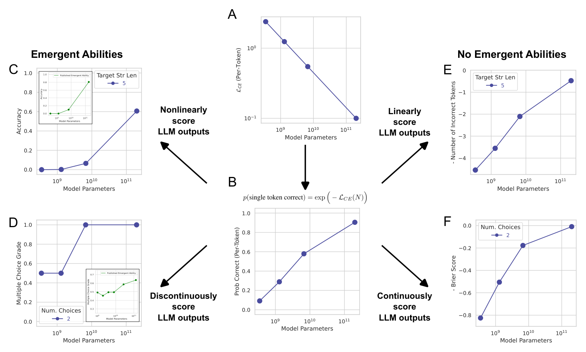
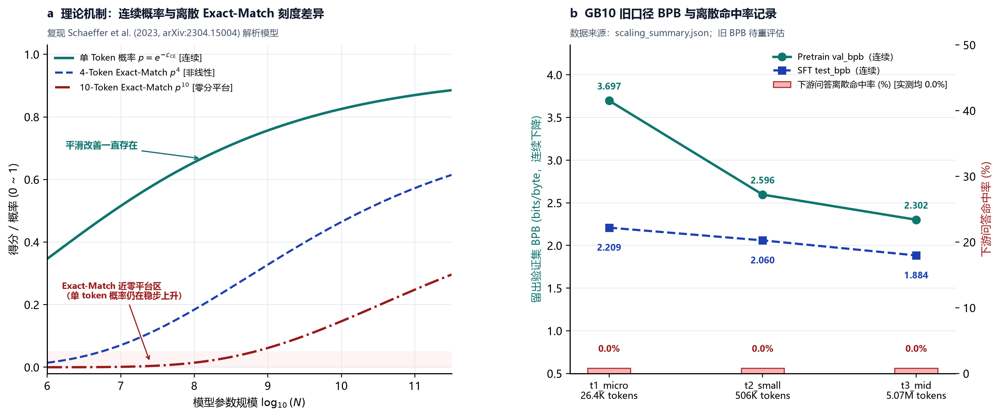

# 预训练阶段评测与能力基准：为什么基座模型不能直接做对话问答

> **阅读导航**：[大模型推理与机理](README.md) · [大语言模型从零构建与训练全链路](大语言模型从零构建与训练全链路.md) · 上游原理：[大模型预训练原理与扩展律](大模型预训练原理与扩展律.md) · 词表标尺：[分词器效果评测与跨词表BPB计算](分词器效果评测与跨词表BPB计算.md) · 评估入口：[08_eval_report.py](../../../experiments/llm-lifecycle-fullchain/scripts/08_eval_report.py)

训练完基座模型之后，拿一套统一的对话问答测试集跑一遍各阶段检查点，结果往往令人意外：预训练阶段 `pretrain.pt` 的问答命中率为 `0%`，算术精确匹配率为 `0%`，哪怕在 GB10 上把训练语料扩大到两百倍，如果评估脚本继续复用后训练的问答题，整张横向对比表依然是一片全零。

这到底是因为预训练白跑了，还是我们用错了考卷？答案是后者。本文依据连续度量理论与 `DataComp-LM`、`nanochat` 开源评测分期体系，说明预训练模型的真实能力边界，揭示离散字符串匹配制造的虚假零分平台效应，并解剖现有评估脚本的混考错位与修正方向。

---

## 一、 预训练基座能测什么、不该强考什么

把预训练阶段和后训练阶段硬塞进同一份开放问答试卷，根源在于混淆了模型在不同生命周期获得的两种截然不同的能力：

1. **分布记忆与条件续写能力（预训练获得）**：预训练结束时，模型只是一个在大量无结构语料上学会预测下一个词元概率分布的统计续写器。你给它一段文本前缀，它能判断哪种延续更符合语法、物理常识或世界事实。
2. **轮次对话与主动停止能力（中训练与 SFT 获得）**：什么时候轮到助手发言、必须在说完答案后立即输出终止符 `<EOS>`、遇到未知问题如何组织解答格式，这些交互边界几乎全部来自后训练微调。

把 `User: What is the capital of Japan?\nAssistant:` 直接输入给还没经过指令微调的基座模型，它通常不会只输出 `Tokyo` 然后停下，而是顺手模仿网页语料接出乱序提问碎片或继续无穷续写下去（见全链路实录 [samples.md](../../../experiments/llm-lifecycle-fullchain/evidence/generation-samples-toy-synthetic.md)）。按照精确字符串匹配规则一刀切判 `0%`，测到的根本不是知识储备缺口，而是模型还没学过交卷答题格式。

---

## 二、 为什么不能只看精确匹配率：连续度量理论

哪怕排除了对话格式干扰，纯靠离散 `Exact-Match` 或单选非连续指标去追踪小模型或预训练早期的进展，也会系统性地掩盖进步。Schaeffer et al. (2023) 在分析所谓能力突发涌现现象时，用一段简洁的数学机制解释了这一指标假象（见图 2）：

设每个预测位置上的真实交叉熵随着参数或数据增长呈现平滑幂律下降 $\mathcal{L}_{CE}(N) = (N/c)^\alpha$，那么单步猜对的概率 $p = \exp(-\mathcal{L}_{CE})$ 也是单调平稳攀升的。但如果评测要求模型一字不差地连续生成长度为 $L$ 的目标答案（例如一道多位数算术结果或完整句子），整体精确匹配率会变成单步成功率的 $L$ 次方：

$$\text{Accuracy}_{\text{exact}}(N) \approx \left(\exp\left(-(N/c)^\alpha\right)\right)^L$$

只要长度 $L$ 稍长，早期阶段即使单步概率已经从 `0.1` 稳定爬升到 `0.5`，乘方之后的精确匹配得分依然长期贴在 `0.0` 地板上纹丝不动；直到突破某个隐含门槛后才陡然抬升，让人产生「先前毫无长进、突然开窍」的错觉。

来源：Schaeffer et al. (2023)，原论文 Figure 2：[arXiv:2304.15004](https://arxiv.org/abs/2304.15004)；许可：CC BY-NC-ND 4.0，图像保持原样，发布前需人工复核第三方图复用权限。

GB10 数据量级实验 [scaling_summary.json](../../../experiments/llm-lifecycle-fullchain/evidence/scaling-summary.json) 记录了语料规模变化时的两类指标（图 3）。其中 BPB 使用旧版计算口径，须重新评估后才能判断变化幅度。

注：本图根据历史实验记录重绘。BPB 的旧计算口径存在字节数和特殊 token 处理问题，图中 BPB 数值与趋势需要重新评估；问答命中率不受该计算错误直接影响。

- **历史连续指标记录**：旧口径的 `pretrain val_bpb` 分别为 `3.6974`、`2.5962`、`2.3018`；SFT 留出集 `test_bpb` 从 `2.2091` 到 `1.8837`。修正口径后尚未重评，不能直接据此确认变化幅度。
- **离散下游命中率却纹丝不动**：三个档位的留出问答命中率记录均为 `0.0%`（另见汇总表 [comparison_table.md](../../../experiments/llm-lifecycle-fullchain/evidence/scaling-comparison-table.md)）。这些记录本身不能确定未命中的具体原因。

---

## 三、 基座能力标准体系：`val_bpb` 加 `CORE` 续写似然基准

既然开放生成式问答题会卡在格式对齐门槛上，学术界与工程界对纯预训练基座的评测收敛出两条免对话格式干扰的标准轨道（见图 1 左半部分）：

### 1. 轨道一：固定留出流的连续信息度量 `val_bpb`

验证集切分必须保证与任何训练分片物理隔离，并在连续不重叠窗口上按原始字节口径汇总交叉熵（对应公共函数 [`evaluate_bpb_ppl`](../../../experiments/llm-lifecycle-fullchain/scripts/llm_common.py#L838-L888) 与 Gao et al., 2020 提出的字节校正方案）。`val_bpb` 直接测量模型对未见语料的数据压缩效率，是衡量预训练损失下降与扩缩对比最灵敏的第一道标尺；但要检验它是否真的记住了常识而不是只学会了标点拼写规律，就必须再配第二条轨道。

### 2. 轨道二：基于条件似然排序的 `CORE` 基准

为了在不做任何微调的前提下直接测基座模型有没有装进知识，Li et al. (2024) 在 **DataComp-LM** 中提出了面向预训练基座的 **CORE** 综合基准，挑选出 `22` 项在小模型阶段就能提供低方差连续信号的完形填空与多选推理任务。典型代表任务无需模型自己组织话语或输出停止符，而是把同一段题干前缀分别拼上几个不同候选续写，计算模型对整条候选句的条件对数似然谁更高：

- **HellaSwag**（Zellers et al., 2019）：生活事件句尾补全四选一，看基座是否更偏爱符合现实因果链条的后续情节。
- **PIQA**（Bisk et al., 2020）：物理常识二选一，判断工具用法和物体物理特性哪个概率更高。
- **WinoGrande**（Sakaguchi et al., 2020）：依赖常识推理的代词指代消歧，将两项可能实体代回句中比对平均似然。
- **ARC-Easy / Challenge**（Clark et al., 2018）与 **LAMBADA**（Paperno et al., 2016）：分别测验科学常识选择题候选延续似然，以及需要跨越长段落记忆上下文才能填出的末尾关键单词。

由于二选一任务的随机猜测基线高达 `50%`，四选一任务的随机猜测基线是 `25%`，不同选项数不能直接求算术平均。因此 DCLM 对每个子任务先按随机基线 $b_k$ 做**居中归一化**，再跨 22 项取均值：

$$\text{Centered Score}_k = \frac{\text{Acc}_k - b_k}{1 - b_k}$$

随机猜测恰好对应 `0.0` 分，完全答对对应 `1.0` 分（作为尺度参考，`nanochat` 测得经典 `GPT-2 124M` 在该基准上的居中均分为 `0.2565`）。

---

## 四、 `nanochat` 评测分期对照与现有脚本错位诊断

在 `karpathy/nanochat` 代码架构里，预训练评测与后训练评测分开设计，两套逻辑严格隔离在两个独立入口中（表 1）：

| 评测维度 | 预训练基座阶段 `base_eval` | 中训练 / SFT / RL 后训练阶段 `chat_eval` |
|---|---|---|
| 评测脚本分工 | 独立基座评估（无聊天气泡模板） | 对话模板评估（依赖回合起止标记与验证器） |
| 核心量化指标 | `val_bpb` + `CORE` 22 项居中续写分 | `ChatCORE`、`MMLU`、算术 `GSM8K`、代码 `HumanEval` |
| 评分方式 | 连续交叉熵 + 候选句平均对数似然比较 | 真实自回归生成输出 + 规则精确匹配 |
| MMLU 的特殊定位 | 小基座 5-shot 极易落回随机线 | 作为后训练知识召回与指令遵循的综合指标 |

对照 [08_eval_report.py](../../../experiments/llm-lifecycle-fullchain/scripts/08_eval_report.py#L117-L138) 与输出矩阵 [report.md](../../../experiments/llm-lifecycle-fullchain/evidence/fullchain-eval-report-toy-synthetic.md#L8-L13)，可以明确定位出目前脚本设计中的一条混考缺陷：**脚本把专属于 SFT 的 `chat_eval` 和专属于 RL 的 `arith_eval` 无差别运行在 `pretrain.pt` 与 `midtrain.pt` 上，导致报告首行给出全零命中率，误导读者以为预训练阶段能力毫无产出**。

按本节建立的双轨标准，后续评测改造应严格分期：

1. **基座轨仅测 `val_bpb` 加上下游续写对比基准**：既保留口径一致的连续指标，也在本地玩具数据上改用陈述句正反续写对（例如对比 `8 minus 5 = 3.` 与错误干扰句 `8 minus 5 = 9.` 的条件似然高低）替代对话题，用来真实检验预训练模型究竟有没有记进语料里的先验知识。
2. **对话与精确匹配指标从对齐阶段起评**：把需要主动输出答案并按 `EOS` 止步的聊天命中率和算术 `exact-match` 严格限定在 `midtrain`、`SFT` 与 `RL` 检查点上对照，展示后训练如何激活已学会的预训练先验并对齐交互界面。

---

## 五、 小结：分阶段评测对照表

| 检查点阶段 | 必测指标 | 禁止混入的失真考法 | 合格演进信号 |
|---|---|---|---|
| `pretrain.pt` | `val_bpb`、`CORE` 候选续写似然居中分 | 拿未微调基座跑聊天模板与无提示精确匹配 | 相同词表下 `val_bpb` 随语料持续下滑，正句似然高于误句 |
| `midtrain.pt` | `val_bpb`、对话轮次起止符触发率 | 期望未经 SFT 就具备严密指令拒答与高精度数学推理 | 能够识别对话头并切出答复词元，不再全盘乱序复读 |
| `sft.pt` / `rl.pt` | `test_bpb` 回归保护、对话命中率、算术/代码 `exact-match` | 忽略留出盲测集只在训练集上刷分 | 训练集与未见留出集同时跨越格式门槛，且不破坏语言分布 |

---

## 六、 参考文献

1. Schaeffer, R., Miranda, B., & Koyejo, S. (2023). *Are Emergent Abilities of Large Language Models a Mirage?* NeurIPS 2023. [arXiv:2304.15004](https://arxiv.org/abs/2304.15004)
2. Li, J., Fang, A., Smyrnis, G., Ivgi, M., Jordan, M., Gadre, S. Y., et al. (2024). *DataComp-LM: In search of the next generation of training sets for language models*. NeurIPS 2024. [arXiv:2406.11794](https://arxiv.org/abs/2406.11794)
3. Gao, L., Biderman, S., Black, S., et al. (2020). *The Pile: An 800GB Dataset of Diverse Text for Language Modeling*. [arXiv:2101.00027](https://arxiv.org/abs/2101.00027)
4. Paperno, D., Kruszewski, G., Lazaridou, A., et al. (2016). *The LAMBADA dataset: Word prediction requiring a broad discourse context*. ACL 2016. [arXiv:1606.06031](https://arxiv.org/abs/1606.06031)
5. Clark, P., Cowhey, I., Etzioni, O., et al. (2018). *Think you have Solved Question Answering? Try ARC, the AI2 Reasoning Challenge*. [arXiv:1803.05457](https://arxiv.org/abs/1803.05457)
6. Zellers, R., Holtzman, A., Bisk, Y., Farhadi, A., & Choi, Y. (2019). *HellaSwag: Can a Machine Really Finish Your Sentence?* ACL 2019. [arXiv:1905.07830](https://arxiv.org/abs/1905.07830)
7. Sakaguchi, K., Le Bras, R., Bhagavatula, C., & Choi, Y. (2020). *WinoGrande: An Adversarial Winograd Schema Challenge at Scale*. AAAI 2020. [arXiv:1907.10641](https://arxiv.org/abs/1907.10641)
8. Bisk, Y., Zellers, R., Le Bras, R., Gao, J., & Choi, Y. (2020). *PIQA: Reasoning about Physical Commonsense in Natural Language*. AAAI 2020. [arXiv:1911.11641](https://arxiv.org/abs/1911.11641)
9. Hendrycks, D., Burns, C., Basart, S., et al. (2021). *Measuring Massive Multitask Language Understanding*. ICLR 2021. [arXiv:2009.03300](https://arxiv.org/abs/2009.03300)
10. Karpathy, A. (2025-2026). *nanochat (`scripts/base_eval.py`, `nanochat/core_eval.py`, `scripts/chat_eval.py`)*. [GitHub Repository](https://github.com/karpathy/nanochat)
