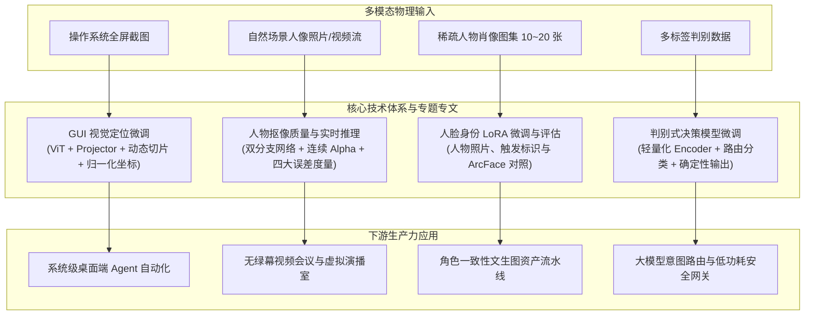

# 视觉与多模态：界面定位、边缘抠像、生成适配与决策评测

> **阅读导航**：[English](../../en/multimodal/README.md) · [项目首页](../../../README.md) · [实验地图](../README.md)

多模态系统负责将连续的图像像素、高分辨率屏幕截图与音视频信号，转化为下游系统可消费的精确结构化数据；同时在需要跨模态生成时，提供像素级的精准控制与无主观偏差的客观评估标准。

本方向面向实际生产场景，覆盖了感知定位、细节提取、受控生成与轻量决策四类多模态工程任务。

---

## 专题架构与阅读地图

根据业务目标与工程所处阶段，推荐按如下技术路线阅读：

### 1. 核心专文索引

| 业务场景与工程挑战 | 核心专文 | 关键技术机制 | 对应实测实验与可复现工程 |
|---|---|---|---|
| **边缘设备如何实现发丝级人像背景替换且帧率超 100 FPS？** | [人物抠像质量与推理速度](人物抠像质量与推理速度.md) | 图像合成物理模型、Trimap-free 自动化、双分支网络（细节精细化 + 语义下采样）、SAD/MSE/Gradient/Connectivity 四大度量体系 | [portrait-matting](../../../experiments/portrait-matting/) |
| **如何用少量照片让文生图模型学习特定人物的外观？** | [人脸身份 LoRA 微调与量化评估](人脸身份LoRA微调与量化评估.md) | SDXL 的 LoRA 微调、触发标识、人脸特征与目标人物对照 | [image-finetune](../../../experiments/image-finetune/) |
| **分类与路由任务为何优先采用轻量判别模型而非生成大模型？** | [决策模型系列导览](../decision-models/README.md) | 判别式损失构建、确定性分类输出、低功耗边缘端高吞吐部署、对抗样本容错评测 | [decision-model-benchmark](../../../experiments/decision-model-benchmark/) / [finetuning](../../../experiments/decision-model-finetuning/) |

---

## 核心技术矩阵与选型指南

在多模态工程实践中，必须根据输入模态、时延预算与精度要求进行审慎选型：

| 技术维度 | GUI 视觉定位 (Grounding) | 人物高保真抠像 (Matting) | 人像一致性生成 (Identity LoRA) | 判别式决策模型 (Discriminative) |
|---|---|---|---|---|
| **基础模型** | Qwen3-VL-2B 等多模态 LLM | RVM (MobileNetV3) / MODNet | SDXL (Stable Diffusion XL) | DeBERTa-v3 / RoBERTa / ViT |
| **参数规模** | 20 亿至 80 亿参数 | 数百万至数千万参数 | 26 亿参数基础模型 + 约 300 万 LoRA 参数 | 数千万至 3 亿参数 |
| **输出信号类型** | 离散归一化坐标字符串 `(x, y)` | 连续浮点透明度矩阵 $\alpha \in [0, 1]$ | 512 × 512 或 1024 × 1024 RGB 图像 | 类别概率分布与分类标签 |
| **显存与硬件门槛** | 单卡 16GB 至 24GB (训练/推理) | 本地普通显卡甚至 CPU (推理) | 单卡 16GB 以上 (LoRA 训练) | 本地轻量设备或边缘芯片 |
| **核心评估标准** | 边界框命中率、配对 Bootstrap 区间 | SAD、MSE、Gradient、Boundary F1 | ArcFace 正负对照相似度、CLIP 对齐度 | 准确率、F1 分数、确定性延迟 |

---

## 体系关联与进阶探索

本方向与 XiaokeAILabs 其它工程方向深度交织，可延伸参考以下专题：

1. **多模态多向量检索与视觉切片**：结合 ColPali 将 PDF 页面或高密截图编码为多向量，实现文档图文跨模态检索，详见 [视觉多向量检索](../retrieval/colbert/视觉多向量检索.md)；
2. **异构计算平台与本地边缘端推理**：利用 OpenVINO 在 Intel CPU 与 NPU 上进行轻量化多模态加速，详见 [OpenVINO 与 NPU 多模态推理](../inference/OpenVINO与NPU多模态推理.md)；
3. **软硬件协同的底层系统调度**：从底层驱动层面探究大模型推理时的显存带宽与算子流水线，详见 [推理内存预算与成本估算](../inference/推理内存预算与成本估算.md)。
