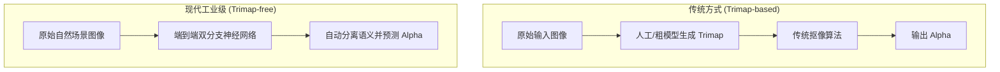
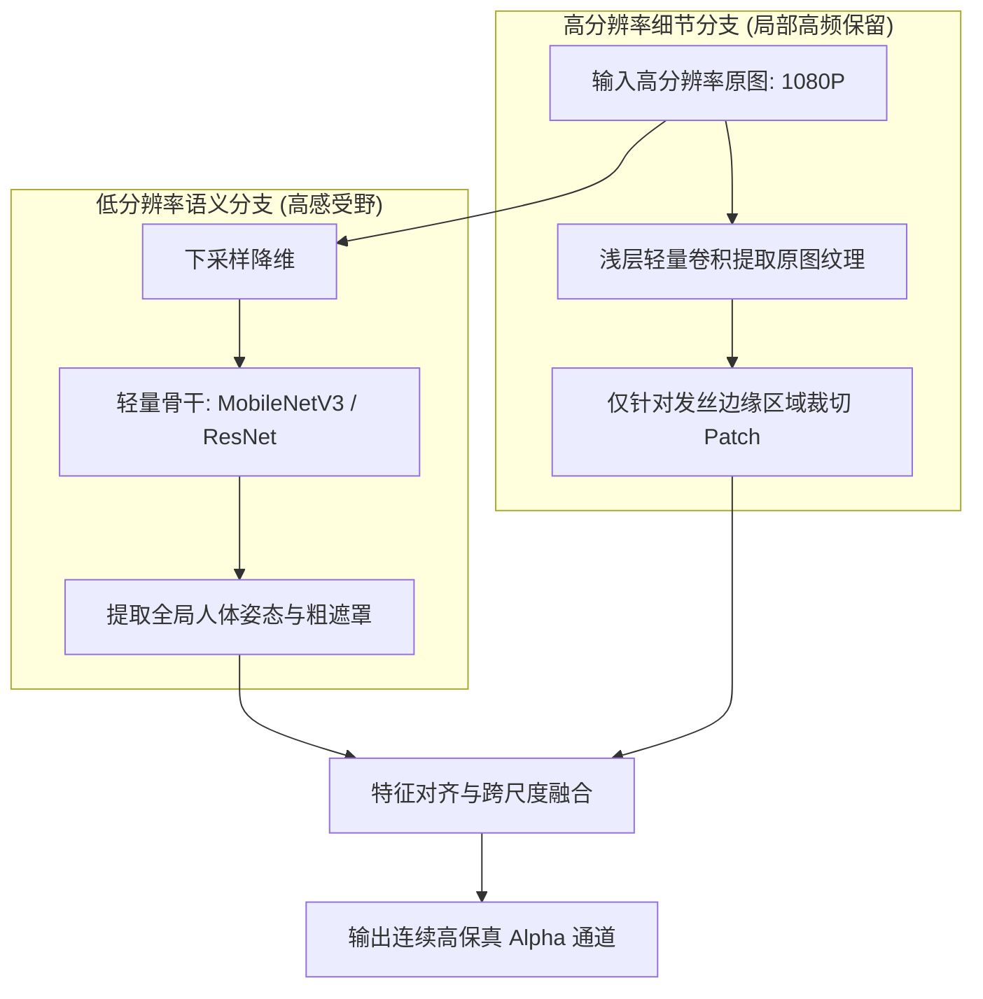
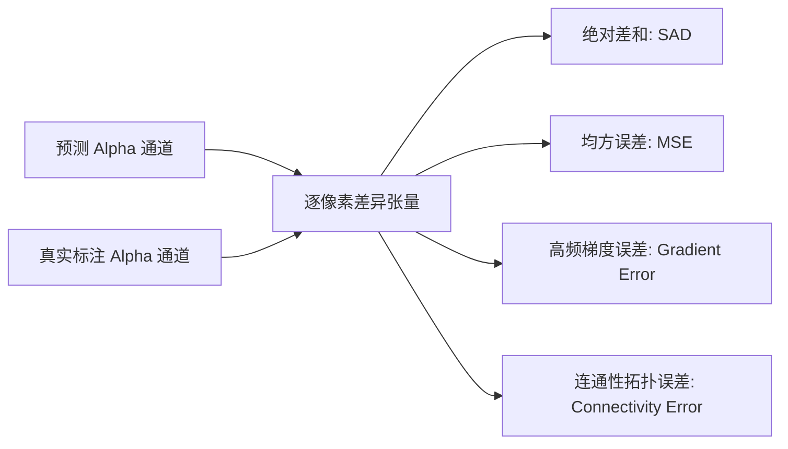

# 人物抠像质量与推理速度：发丝级 Alpha 提取、双分支网络与实时推理优化

> **阅读导航**：[视觉与多模态](README.md) · [项目首页](../../../README.md) · [人物抠像实验与复现](../../../experiments/portrait-matting/)

在视频会议虚拟背景、XR 沉浸式直播以及高精度视觉设计后期中，将人物从纷繁复杂的自然背景中剥离出来是一项基础前置任务。如果抠出的人物边缘充满锯齿、漏掉细碎发丝，或者衣物半透明边缘残留原始背景色块，合成后的画面就会产生明显的违和感。

然而，在边缘终端或本地显卡上，抠像任务面临质量与延迟的尖锐冲突：追求发丝级高保真通常需要高分辨率特征图和庞大的计算网络，但这会导致帧率暴跌、画面卡顿；而追求实时高帧率又极易退化成粗糙的边缘剪切。

本文基于在 NVIDIA GB10 硬件平台上的实测证据（以 RVM MobileNetV3 为基础模型，在标准人物测试集上评测），深入拆解图像抠像的合成物理模型、Trimap-free 自动化演变、双分支网络架构、工业级四大误差度量体系，以及单帧与视频循环状态的工程优化技巧。

---

## 一、 为什么看：实时绿幕与无绿幕抠像的工程矛盾

在电影工业中，影视级抠像通常依赖纯色绿幕或蓝幕。后期技术人员通过色度键控（Chroma Keying）并配合精细手工绘制的三分图（Trimap），经过多轮反复渲染才能提取出纤毫毕现的发丝透明度。

而在大众化的桌面端或移动端视频场景中，拍摄环境大多是光照不均、背景杂乱的自然生活场景。用户无法搭建专业绿幕，更不可能在视频通话过程中实时手动圈定未确定区域。

此时系统面临两个严酷挑战：
1. **边缘精度与背景虚化**：普通人物的头部边缘存在成百上千根随机飘动的发丝，其宽度往往不足 1 个像素，混合了前景发色与背景杂色。若无法精确估计每个像素的连续覆盖程度，就会出现“塑料头套”式的生硬边缘；
2. **计算复杂度与高帧率吞吐**：高清视频流通常以 1080P 或 4K 分辨率、每秒 30 到 60 帧连续输入。留给单帧图像的端到端处理时间预算仅有 16 到 33 毫秒。任何超出该延迟的复杂模型都会导致音画不同步和帧率骤降。

---

## 二、 看了有什么收获：四大核心认知与工程技能

读完本专文，读者可以建立如下完整的技术路径：

1. **厘清抠像与分割的本质差异**：深入理解图像合成方程的物理含义，掌握连续 Alpha 透明度（0.0 到 1.0）与二值掩码（0 或 1）在数学和视觉上的分界；
2. **掌握 Trimap-free 自动化架构演进**：对比传统依赖交互式先验的抠像方案与现代完全自动化的端到端无先验方案；
3. **掌握双分支网络与循环状态机制**：理解高分辨率细节精细化分支与低分辨率语义下采样分支的互补原理，推导视频级时序循环记忆的传递机制；
4. **掌握工业级四大评估指标与推理加速技巧**：掌握绝对差和（SAD）、均方误差（MSE）、梯度误差（Gradient）和连通性误差（Connectivity）的计算与物理意义，学会运用 ONNX Runtime 与 TensorRT 进行多级精度量化。

---

## 三、 为什么要做/为什么选型：语义分割的局限与抠像的物理本质

理解抠像的必要性，先看一个二值语义分割的失真案例：

使用最先进的二值语义分割模型（如 Mask R-CNN 或 Segment Anything）处理一张人物被风吹拂的长发照片，模型给出的输出是一个仅包含数值 0 与 1 的硬遮罩（Binary Mask）。如果将该遮罩用于更换背景，人物头发边缘会呈现出明显的阶梯状锯齿。更致命的是，那些半透光的轻薄发丝或者薄纱衣袖，在二值判定下要么被粗暴判定为完全不透明（连带将原背景色一起保留下来，产生严重色溢），要么被判定为完全透明（导致发丝大片缺失，发际线秃缺）。

### 图像合成方程与连续 Alpha

图像抠像（Image Matting）遵循经典的物理图像合成模型：

$$
I = \alpha F + (1 - \alpha) B
$$

- $I \in [0, 1]^3$：终端相机传感器观测到的 RGB 图像；
- $F \in [0, 1]^3$：真实的前景颜色（例如纯发丝本身的色素）；
- $B \in [0, 1]^3$：真实的背景颜色；
- $\alpha \in [0, 1]$：前景色在该像素占据的覆盖比例或透明度。

在一个三通道 RGB 图像中，每个像素提供 3 个已知观测值，但存在 7 个未知量（$F$ 的 3 个分量、$B$ 的 3 个分量以及 $\alpha$）。这是一个高度欠定的逆问题，无法通过简单逆向方程求解，必须依赖深度神经网络结合强大的自然图像先验进行概率回归。

下表总结了语义分割与人物抠像的核心技术差异：

| 维度对比 | 语义分割 (Segmentation) | 人物抠像 (Matting) |
|---|---|---|
| **输出数值类型** | 离散二值掩码：$\{0, 1\}$ | 连续浮点通道：$\alpha \in [0.0, 1.0]$ |
| **边缘处理模式** | 判定像素属于前景或背景，非黑即白 | 估计前景与背景的混合比例，保留羽化微积分特征 |
| **关键应用场景** | 目标检测、自动驾驶路面分割、人像区域计数 | 发丝级背景替换、虚拟演播室合成、电影级特效 |
| **细微发丝表现** | 边缘锯齿化，细碎发丝大量丢失或连片色溢 | 细发丝半透明过渡自然，真实还原毛发透光感 |

---

## 四、 核心机制解析：架构演进、双分支拓扑与四大度量

### 1. 从 Trimap-based 到 Trimap-free 的自动化演进

在深度学习早期，抠像算法（如 Deep Image Matting）依赖人工输入的三分图（Trimap）。三分图标注了三个明确区域：绝对前景（$\alpha=1$）、绝对背景（$\alpha=0$）以及未确定过渡区域（$\alpha \in (0, 1)$）。

在日常视频通话与自动化流水线中，无法预先提供精确的三分图。现代工业模型全面转向**无三分图（Trimap-free）**架构，直接从 RGB 原始输入中同时完成人像主体检测与发丝边缘回归。

### 2. 双分支网络与高低分辨率协同架构

以 MODNet 与 RVM（Robust Video Matting）为代表的现代架构，采用解耦的双分支设计：

1. **低分辨率语义分支（Semantic Branch）**：将输入图像缩小（例如缩小至原本的四分之一），通过轻量级编码器（如 MobileNetV3）快速提取高层语义特征。它的任务是准确定位人体躯干，判定哪些大块区域是绝对前景，避免将背景中的其他人形海报误判为操作主体；
2. **高分辨率细节分支（Detail Branch）**：保持原始图像尺寸，但只针对语义分支判定为边缘过渡带的局部区域进行浅层卷积。这一设计避免了对整张高分辨率图像进行深层卷积运算，使得计算资源高度集中在最具挑战的发丝边缘；
3. **时序循环记忆（针对视频）**：RVM 额外引入了门控循环单元（GRU/ConvGRU），将上一帧的隐层状态传递给下一帧。利用相邻时间帧的几何连续性，大幅降低视频抠像中的边缘高频闪烁（Flickering）。

### 3. 主流抠像模型选型横向对比

| 模型架构 | 运行模式 | 网络特点 | 典型优势 | 局限性与工程代价 |
|---|---|---|---|---|
| **MODNet** | 单帧静态 | 显式三阶段监督（语义、细节、融合） | 结构简洁，单张图推理开销极低 | 缺乏时序连续性，用于视频时发丝有抖动 |
| **RVM (MobileNetV3)** | 视频时序循环 | 深度可分离卷积 + 跨帧循环记忆单元 | 帧率高，视频边缘非常稳定抗闪烁 | 初次进入或快速大幅晃动时有轻微拖尾 |
| **MatAny / ViT-Matte** | 单帧高质量 | 基于大型 Vision Transformer 提取多尺度特征 | 发丝细节非常精细，可处理复杂遮挡 | 显存与算力开销巨大，无法胜任实时流媒体 |

### 4. 工业级四大客观误差评估指标

在学术界与工业界，衡量预测透明度 $\alpha$ 与真值标注 $\alpha^*$ 的吻合程度，依赖四个数学维度：

#### 指标一：绝对差和（Sum of Absolute Differences, SAD）
统计全图所有像素的绝对误差之和：

$$
\text{SAD} = \sum_{i \in \Omega} |\alpha_i - \alpha_i^*|
$$

通常除以 1,000 便于汇报。SAD 对误差具有线性惩罚特性，直观反映全图预测透明度的累积偏移量。

#### 指标二：均方误差（Mean Squared Error, MSE）
统计全图像素误差的均方值：

$$
\text{MSE} = \frac{1}{|\Omega|} \sum_{i \in \Omega} (\alpha_i - \alpha_i^*)^2
$$

MSE 对较大偏差的容忍度极低，能够严厉惩罚大面积将前景误判为背景的灾难性区域。

#### 指标三：梯度误差（Gradient Error）
衡量预测透明度与真值在空间变化率（一阶导数）上的差异：

$$
\text{Grad} = \sum_{i \in \Omega} \left\| \nabla \alpha_i - \nabla \alpha_i^* \right\|_2
$$

其中 $\nabla$ 通过 Sobel 算子或高斯一阶偏导滤波器计算。梯度误差专门衡量边缘发丝的锐利度，监控输出是否出现过度平滑或模糊伪影。

#### 指标四：连通性误差（Connectivity Error）
评估连续前景组件的拓扑完整性。它惩罚发丝在空中突兀断裂、或者孤立浮动噪点的现象，保证人体轮廓的拓扑自洽。

---

## 五、 怎么做的：实测实验配置、数据分析与推理优化

### 1. 实验基准与环境配置
- **测试模型**：RVM（Robust Video Matting，骨干网络采用轻量级 MobileNetV3，FP32 精度）；
- **计算平台**：NVIDIA GB10 架构 GPU，PyTorch 2.14.0 配合 CUDA 13.0；
- **评估数据集**：采用 PPM-100（Portrait Photo Matting）基准数据集中的自然背景人物图像及对应的高精 Alpha 真实标注；
- **样本抽取**：使用固定随机种子 20261107，严格抽取 30 张高分辨率复杂人像（包含各种发型、背包、坐姿与逆光场景），输入图像最长边约束在 1024 像素以内。

### 2. 评测指标与耗时实测表现

对 30 张留出测试样本执行预热后前向推理，预测结果保存为 8 位灰度 PNG，并与真实标注进行像素级严密对比。单项指标在各图计算后进行等权宏平均：

| 评估维度与指标名称 | 实测宏平均数值 | 物理意义与工程解读 |
|---|---|---|
| **二值主体重合度 (IoU)** | **0.9730** | 0.5 阈值二值化后，躯干主体与真值高度重合，几乎无大块漏判 |
| **二值前景重合度 (Dice)** | **0.9862** | 进一步确认核心人体区域提取非常稳定 |
| **边界匹配度 (Boundary F1)** | **0.8916** | 在 3 像素容差距离内，发丝与边缘轮廓的综合精准召回率 |
| **全图绝对误差 (Alpha MAE)** | **0.00857** | 平均每个像素的透明度误差不足 1%，背景抑制非常彻底 |
| **全图均方误差 (Alpha MSE)** | **0.00417** | 大面积灾难性误判极少 |
| **过渡带误差 (中间值区域 MAE)** | **0.1101** | 专门针对标注中 $0 < \alpha < 1$ 的半透明发丝区域计算，反映精细毛发难度 |
| **平均模型前向耗时** | **6.91 毫秒 / 图** | 单帧纯前向耗时，波动区间为 5.55 到 10.14 毫秒，折合吞吐量超 140 FPS |

### 3. 推理速度与工程优化技巧

在工业落地中，要将 6.91 毫秒的纯前向耗时转化为真实的端到端高帧率流水线，需要落实如下优化技巧：

1. **异步双缓冲与 CUDA 流重叠**：图像捕获、色彩格式转换（YUV 转 RGB）、张量归一化以及模型推理应当分配在独立的硬件流或多线程工作队列中，通过双缓冲队列隐藏数据拷贝延迟；
2. **ONNX Runtime 与 TensorRT 引擎固化**：将 PyTorch 模型导出为静态 ONNX 格式，利用 TensorRT 进行算子融合（例如将卷积、BatchNorm 与激活函数融合为一个内核）；
3. **降采样策略自适应**：RVM 允许通过 `downsample_ratio` 参数动态调节低分辨率分支的尺寸。在 1080P 视频中，设置该比例为 0.25 到 0.35 之间，可以在完全不损伤发丝边缘的前提下降低 60% 的计算量。

### 4. 实验边界与客观局限

1. **单帧独立评估未覆盖视频时序稳定性**：本次测试为了建立严格的静态可复现基线，对每张输入图片均显式重置了 RVM 的循环隐层状态。因此该数据反映的是单帧冷启动精度，未体现视频流连续多帧下的跨帧抗闪烁收益；
2. **数据源压缩伪影的影响**：部分公开分发的数据集采用了有损 JPEG 压缩格式，JPEG 的离散余弦变换（DCT）块效应会在细发丝边缘引入肉眼难以察觉的高频噪点，使标注中的中间过渡带含有一定的有损压缩伪影；
3. **前向耗时与端到端延迟的差距**：实测的 6.91 毫秒仅包含 GPU 模型计算时间，在真实的生产桌面端，摄像头采集耗时（通常 15 到 30 毫秒）、显示渲染流水线耗时必须一并纳入整体系统延迟预算。
