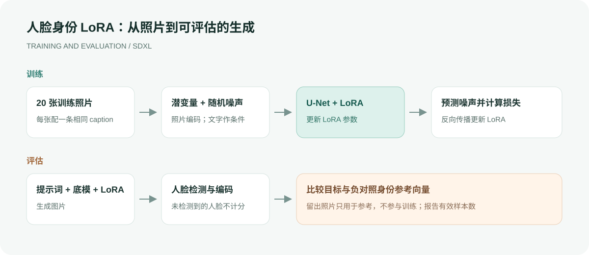

# 人脸身份 LoRA 微调与量化评估

> **阅读导航**：[视觉与多模态](README.md) · [图像微调实验与复现](../../../experiments/image-finetune/face-identity-lora/README.md)

想用文生图模型给同一个人物生成不同服饰和背景的图片，只写“一个穿黑色外套的人”通常不足以指定其面孔。一个办法是用这个人的少量照片微调模型，让它把一个特定标识与人物外观联系起来；生成时再在提示词里使用该标识。

本实验使用 20 张同一人物的照片，在 SDXL 上训练 LoRA，探索模型能否生成带有目标人物身份特征的人脸。

## 为什么选择 LoRA

SDXL 原本具备根据文字生成图片的能力，但一般提示词无法准确指定模型没有专门学习过的面孔。全参数微调需要更新大量模型参数，训练和保存的成本较高。LoRA 则冻结基础模型，在部分权重旁增加可训练的低秩分支，只保存学到的增量。生成时加载基础模型和对应 LoRA，即可使用这次学习到的内容。

冻结基础权重不代表加载 LoRA 后的所有生成能力都不会变化；训练数据、训练量和提示词都会影响结果。

## 从照片到生成

1. **准备照片和标识**：从 CelebA 中选取同一人物的 20 张照片用于训练，另留 10 张照片用于评估。每张训练照片配上包含 `vkqzm, a photo of a person` 的文字描述，`vkqzm` 是本次使用的触发标识。
2. **训练 LoRA**：以 SDXL 为基础模型，训练 U-Net 上的 LoRA，文本编码器保持冻结。训练时模型接收加噪后的图像表示和文字条件，学习预测噪声；优化过程更新 LoRA 参数。
3. **加载并生成**：生成时加载训练得到的 LoRA，在提示词中加入触发标识，也可以描述服饰、表情或背景，由模型逐步去噪生成图片。

触发标识是提示模型使用所学人物特征的约定，并不能保证每次生成都保留同样的面孔。训练样本的多样性、参数设置和生成提示词都会影响表现。

## 实验观察

历史实验中，使用 ArcFace 提取生成图的人脸特征，分别与目标人物和另一位人物的参考特征比较。在一次小样本测试中，同一批生成图对目标人物的相似度高于对另一位人物的相似度，表明本次生成结果呈现出一定的目标身份特征。

这是特征模型给出的相对比较，不能直接说明肉眼看起来有多像。实验目录未保存原图与生成图的对照图片，历史结果以转录的评估数据保留；训练配置、评估方法和数据边界见[人脸身份 LoRA 实验](../../../experiments/image-finetune/face-identity-lora/README.md)。
