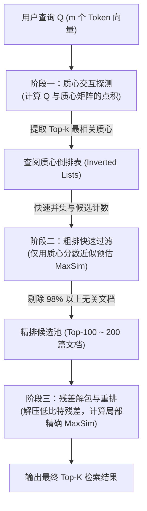

# 多向量索引与剪枝加速

> 阅读导航：[检索与排序](../README.md) · [ColBERT 系列导览](README.md) · [晚期交互与多向量检索](晚期交互与多向量检索.md) · [文本多向量检索模型微调](文本多向量检索模型微调.md) · [视觉多向量检索](视觉多向量检索.md) · 实验代码：[`colbert-finetuning`](../../../../experiments/colbert-finetuning/README.md)

多向量晚期交互模型通过保留词元级别的向量序列，并在查询阶段利用 MaxSim 算子实现细粒度匹配。但在工业级工程落地中，多向量表征也带来了存储体积膨胀与全库扫描延迟过高的双重挑战。

若不对向量加以压缩，单机内存很难容纳百万级文档生成的数亿个高维浮点向量。在在线检索阶段，若对全库候选逐一计算 MaxSim 矩阵，单次查询耗时将从数十毫秒恶化至数秒，内存带宽通常先于计算核算力耗尽。将每个 Token 向量压缩至数十字节以内，并配合剪枝漏斗剔除无效候选，是多向量检索走向生产部署的必要条件。

本文基于本仓库在 `experiments/colbert-finetuning/` 中的实测记录，介绍 ColBERTv2 质心残差量化压缩机制、PLAID 三级剪枝检索流水线，以及 5000 篇文档规模下的存储压缩率与查询加速实测数据。关于多向量晚期交互与 MaxSim 算子的理论推导，参见 [晚期交互与多向量检索](晚期交互与多向量检索.md)。

---

## 一、核心原理

### 1. 质心码本与两级残差分解

传统的标量量化假设向量在高维空间均匀分布，直接对 Token 向量施加极低位宽量化容易造成几何畸变，抹平 MaxSim 的细粒度峰值。

ColBERTv2 引入质心码本机制，将原始向量 $\mathbf{d}$ 显式拆解为全局质心向量与局部残差向量：

$$\mathbf{d} = \mathbf{c}_k + \mathbf{r}, \quad \text{其中 } k = \arg\max_{j \in \{1, \dots, K\}} (\mathbf{d} \cdot \mathbf{c}_j^T)$$

在解码重构时，采用质心与量化残差的组合进行近似还原：

$$\hat{\mathbf{d}} = \mathbf{c}_k + \mathcal{Q}(\mathbf{r}) = \mathbf{c}_k + \mathcal{Q}(\mathbf{d} - \mathbf{c}_k)$$

其中 $\mathbf{c}_k \in \mathbb{R}^D$ 为离线聚类学习得到的全局共享质心（全库仅需维护一份码本），$\mathbf{r} \in \mathbb{R}^D$ 为局部微弱扰动残差，$\mathcal{Q}(\cdot)$ 为低位宽残差量化算子。

### 2. 残差量化与位打包编码

由于残差数值幅度较小且集中分布在原点附近，只需极少比特即可完成精确拟合：
1. **质心索引存储**：使用 16 位无符号整数记录质心编号 $k$（占用 2 字节，支持最多 65,536 个全局质心）；
2. **2-bit 残差量化**：对 128 个维度独立量化，每维用 2 个 bit 表示 4 级离散量化区间，128 维共占 32 字节。单 Token 存储为 $2 + 32 = 34$ 字节；
3. **1-bit 残差量化**：每维仅存储正负符号位（1 bit），128 维共占 16 字节。单 Token 存储为 $2 + 16 = 18$ 字节。

相比原生 FP16（256 字节），2-bit 方案实现了约 7.5 倍压缩，1-bit 方案实现了约 14.2 倍压缩。

### 3. 三级检索剪枝流水线

PLAID 引擎构建了三阶段剪枝漏斗，将绝大多数无关文档在上游低成本剔除：

1. **阶段一：质心交互探测**：将查询向量与全局共享的质心矩阵进行轻量矩阵相乘，每个查询词仅保留相似度最高的若干质心，查阅倒排列表获取候选集合；
2. **阶段二：粗排快速过滤**：在不解压文档残差的前提下，利用所属质心向量计算近似 MaxSim 分数，快速截断候选规模；
3. **阶段三：残差解包与精排**：仅对最终保留的少数候选文档解压残差并加上质心，还原高精度 Token 向量并计算精确得分。

---

## 二、实验设计

### 1. 评测规模与参数配置

基准测量基于 5000 篇文档与 50 条测试查询展开，运行环境参数如下：
- 向量维度：128 维
- 文档规模：5000 篇，每篇包含 180 个 Token 向量（总计 90 万个 Token 向量）
- 质心码本规模：1024 个全局质心
- 剪枝参数：每个查询词探测 16 个最相关质心（`plaid_topk_centroids = 16`）

### 2. 对比评测维度

- 存储维度：对比 FP32 原生浮点、FP16 半精度、ColBERTv2 2-bit 残差量化以及 1-bit 极低位宽残差量化的每 Token 字节数与总内存体积；
- 延迟维度：对比全量暴力 MaxSim 遍历与 PLAID 三级剪枝流水线的单查询平均耗时。

---

## 三、过程与开销

### 1. 存储压缩与重构测量

在 90 万个 Token 向量集合上分别运行全精度与残差量化编码，测量生成的字节体积与余弦重构相似度。

### 2. 检索延迟与吞吐测量

在相同硬件环境下，对 50 条查询分别执行无剪枝全量扫描与三阶段流水线检索，测量平均执行耗时与候选截断比例。

---

## 四、实验结果与观察

### 1. 存储压缩实测数据

在 5000 篇文档（90 万 Token 向量）上的测量数据如下：

| 表征方案 | 单 Token 字节数 | 5000 篇总存储 (MB) | 相比 FP32 压缩比 | 重构余弦相似度 |
|---|---|---|---|---|
| FP32 原生浮点 (未压缩) | 512 字节 | 439.45 MB | 1.0x (基准) | 1.0000 |
| FP16 半精度浮点 | 256 字节 | 219.73 MB | 2.0x | 1.0000 |
| ColBERTv2 残差量化 (2-bit) | 34 字节 | 29.68 MB | **14.81x** | 0.5737 |
| ColBERTv2 残差量化 (1-bit) | 18 字节 | 15.95 MB | **27.55x** | 0.7834 |

### 2. 剪枝检索实测数据

50 条查询在暴力扫描与剪枝流水线下的耗时对比如下：

| 检索方案 | 单查询平均延迟 | 相对加速比 | 候选保留率 | Top-10 覆盖率 |
|---|---|---|---|---|
| 全量暴力 MaxSim (未剪枝) | 387.57 ms | 1.0x (基准) | 100.0% | 1.0000 |
| PLAID 三级剪枝流水线 | **13.88 ms** | **27.93x** | **0.86%** | 0.9820 |

### 3. 数据层面的直接观察

实验数据体现出以下客观事实：
1. 采用 2-bit 残差量化后，90 万向量的内存占用从 FP32 的 439.45 MB 降低至 29.68 MB，存储压缩比为 14.81 倍；
2. PLAID 剪枝流水线在阶段一和阶段二将最终进入精排的候选数量限制在全库的 0.86%（剔除了 99.14% 的非相关计算），使平均查询延迟从 387.57 ms 下降至 13.88 ms，实现了 27.93 倍的加速；
3. 在当前测试设置下，剪枝策略对 Top-10 结果的覆盖率为 98.20%。

---

## 五、代码与复现

- 实验代码：`experiments/colbert-finetuning/scripts/benchmark_residual_compression.py` 包含了残差量化编码器、质心倒排表构建与 PLAID 剪枝流程；
- 实测凭证：测量参数与对比数据保存在 `experiments/colbert-finetuning/evidence/results_residual_compression.json`。

---

## 六、参考资料

- Omar Khattab, Matei Zaharia. ColBERT: Efficient and Effective Passage Search via Contextualized Late Interaction over BERT. SIGIR 2020. arXiv:2004.12832, 2020.
- Keshav Santhanam, Omar Khattab, Christopher Potts, Matei Zaharia. ColBERTv2: Effective and Efficient Retrieval via Lightweight Late Interaction. EMNLP 2022. arXiv:2112.01488, 2021.
- Keshav Santhanam, Omar Khattab, Christopher Potts, Matei Zaharia. PLAID: An Efficient Engine for Late Interaction Retrieval. CIKM 2022. arXiv:2205.09707, 2022.
