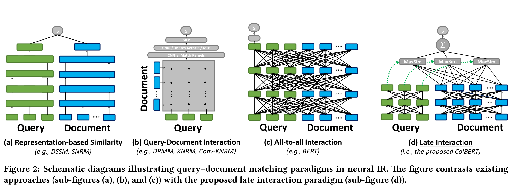

# 晚期交互与多向量检索

> 阅读导航：[检索与排序](../README.md) · [ColBERT 系列导览](README.md) · [多向量索引与剪枝加速](多向量索引与剪枝加速.md) · [文本多向量检索模型微调](文本多向量检索模型微调.md) · [视觉多向量检索](视觉多向量检索.md) · 代码实践：[`colbert-finetuning`](../../../../experiments/colbert-finetuning/README.md)

在学术论文检索、法律合规审核与复杂多实体问答场景中，用户的查询往往包含多个相互独立的约束条件（例如同时约束药物名称、适应症、不良反应与剂量要求）。ColBERT 提出的多向量晚期交互范式，通过离线保留文档 Token 级的上下文隐层向量、在线仅通过轻量级 MaxSim 算子计算局部点积求和，在独立建库效率与细粒度跨词交互之间取得了平衡。本文系统梳理多向量晚期交互的匹配范式演进、MaxSim 算子代数推导、查询前缀扩展机制以及工程加速边界。

---

## 一、概念与问题概述

在信息检索系统的架构演进中，系统设计始终在“交互深度”与“计算成本”之间寻求平衡。为了兼顾深层语义表达与全库离线建库的可行性，神经信息检索逐步演化出四类具有代表性的匹配范式：



1. **表示型单向量匹配（Representation-focused）**：将整篇文档通过均值池化压缩为单一固定向量，交互仅发生在高层向量内积。检索吞吐高、支持离线建库，但长文本中局部细粒度实体容易被稀释；
2. **早期交互匹配（Early Interaction）**：在浅层网络或词级别即刻进行匹配交互，但缺乏深层多层 Transformer 的全上下文语境建模能力；
3. **全注意力交叉编码（All-to-All Cross-Encoder）**：查询与文档拼接后送入各层进行跨词自注意力交互，打分精度最高，但无法离线独立向量化，候选量增多时计算开销呈线性笛卡尔积增长；
4. **晚期交互多向量匹配（Late Interaction / ColBERT）**：文档离线独立编码为一组 Token 级向量矩阵，将交互推迟到最顶层输出之后。在线检索时通过轻量局部点积最大值求和（MaxSim）评分，兼顾了离线独立建库能力与细粒度语义匹配精度。

---

## 二、核心原理

### 1. MaxSim 晚期交互算子推导

设查询 $Q$ 经过分词与编码后，输出包含 $m$ 个 Token 向量的矩阵 $\mathbf{E}_Q \in \mathbb{R}^{m \times D}$：
$$\mathbf{E}_Q = [\mathbf{q}_1, \mathbf{q}_2, \dots, \mathbf{q}_m], \quad \mathbf{q}_i \in \mathbb{R}^D, \quad \|\mathbf{q}_i\|_2 = 1$$

候选文档 $D$ 编码后，输出包含 $n$ 个 Token 向量的矩阵 $\mathbf{E}_D \in \mathbb{R}^{n \times D}$：
$$\mathbf{E}_D = [\mathbf{d}_1, \mathbf{d}_2, \dots, \mathbf{d}_n], \quad \mathbf{d}_j \in \mathbb{R}^D, \quad \|\mathbf{d}_j\|_2 = 1$$

在输出端通常将向量投影到较小的紧凑维度（如 $D = 128$），以降低后续存储与计算开销。ColBERT 计算查询 $Q$ 与文档 $D$ 之间相关性分数的 MaxSim 算子定义为：

$$\operatorname{Score}_{\text{MaxSim}}(Q, D) = \sum_{i=1}^{m} \max_{j=1}^{n} (\mathbf{q}_i \cdot \mathbf{d}_j^T)$$

### 2. 软对齐矩阵的几何直觉

MaxSim 算子的计算过程可以分解为三个阶段：
1. **内积矩阵全展开**：计算所有查询词元与所有文档词元两两之间的余弦相似度，形成跨度为 $m \times n$ 的相关性矩阵；
2. **行内最大池化**：对于矩阵的第 $i$ 行（对应第 $i$ 个查询 Token $\mathbf{q}_i$），在文档所有词元中寻找与它相似度最高的单点峰值；
3. **全局证据求和**：将所有查询词找到的各自最大支撑强度相加。

这种计算方式具备两项抗干扰特性：
- **局部证据不被稀释**：若文档篇幅很长，但其中仅有一小段精确回答了查询中的核心问题，该段落对应的词元便能为查询词提供高达 0.8 以上的局部内积峰值，不会被其余无关内容冲淡；
- **多实体并行约束**：查询中的词元各自寻找最佳佐证。如果文档只提到了部分实体词，其余未命中词元的得分极低，累加后的总分依然被压低，有效减少了断章取义式的误召回。

在小批量候选打分中，MaxSim 可以用一条简洁的张量批量矩阵乘法与最大值聚合表达：

```python
import torch

def colbert_maxsim(
    query_embeddings: torch.Tensor, # [B, Q_len, D], 已 L2 归一化
    doc_embeddings: torch.Tensor,   # [B, D_len, D], 已 L2 归一化
    doc_mask: torch.Tensor | None = None # [B, D_len], 消除 padding 干扰
) -> torch.Tensor:
    """计算 Query 与 Document 序列之间的 ColBERT MaxSim 相似度分数。"""
    sim_matrix = torch.bmm(query_embeddings, doc_embeddings.transpose(1, 2))
    
    if doc_mask is not None:
        mask_expanded = doc_mask.unsqueeze(1)
        sim_matrix = sim_matrix.masked_fill(~mask_expanded.bool(), -1e4)
        
    max_scores, _ = torch.max(sim_matrix, dim=-1)
    total_scores = torch.sum(max_scores, dim=-1)
    return total_scores
```

### 3. 查询扩展与隐式掩码机制

ColBERT 在工程实现中包含两个前缀设计：
- **非对称控制标记**：为了让共享参数的 Transformer 编码器区分输入是简短的查询还是详尽的段落，ColBERT 在分词首位分别插入控制标记：查询端前缀为 `[CLS] [Q]`，文档端前缀为 `[CLS] [D]`。这使得同一词汇在查询端（表达意图）与在文档端（表达事实）能够获得适应性的非对称向量表征；
- **查询掩码填充扩展**：用户的提问通常较短，ColBERT 使用特殊标记 `[MASK]` 将所有查询固定填充扩展至固定长度（通常为 32 个 Token）。这一机制允许模型在深层自注意力中，利用空闲的 `[MASK]` 位置隐式生成相关同义词与背景上下文表征，同样参与最终的 MaxSim 累加。

---

## 三、工程代价与加速方案

虽然多向量晚期交互显著提高了语义召回的精度上限，但在生产落地中必须评估其系统资源代价：

### 1. 多向量存储膨胀测算

单向量模型下 100 万篇文档仅需约 1.5 GB 存储；而在 ColBERT 原生多向量下，每篇若切分为 200 个 Token，即使降维至 128 维，也会产生 2 亿个向量，原始浮点存储超过 50 GB，内存带宽往往先于计算核算力耗尽。

### 2. 质心残差量化与剪枝检索

在工业级生产环境中，ColBERT 必须配合残差量化压缩与剪枝索引（如 PLAID 引擎）使用：
- **ColBERTv2 2-bit 残差量化**：通过全局共享的质心码本，将每个 Token 向量分解为“质心索引 + 低比特残差”，单 Token 存储压缩至 34 字节以内（14.8 倍压缩）；
- **PLAID 三级剪枝流水线**：利用质心倒排表与粗排过滤，将 99% 以上的无关文档在上游低成本剔除，仅对百篇候选解压残差进行精确重排，使单次查询延迟恢复至毫秒级。具体工程实现见 [多向量索引与剪枝加速](多向量索引与剪枝加速.md)。

---

## 四、选型指南与协同架构

### 1. 适用场景与规避条件

- **优先适用**：业务对召回精度要求极高（如法律条文检索、医药文献证据匹配、专业代码搜索），且用户提问普遍包含复合多实体约束；
- **建议规避**：单机内存低于 4 GB 的极端边缘端设备，或数亿规模超大库且无预算支持残差索引的场景。

### 2. 多阶段协同检索流水线

在海量级工业检索系统中，通常不必由多向量承担全库第一道粗召回。更稳健的做法是多阶段协同流水线：
- 第一阶段：BM25 词法或轻量单向量初筛前 500 个候选；
- 第二阶段：ColBERT 多向量对这 500 个候选进行细粒度晚期交互重排，输出 Top-50；
- 第三阶段：最终由大尺寸 Cross-Encoder 执行最后精排。

---

## 五、参考资料

- Omar Khattab, Matei Zaharia. ColBERT: Efficient and Effective Passage Search via Contextualized Late Interaction over BERT. SIGIR 2020. arXiv:2004.12832, 2020.
- Keshav Santhanam, Omar Khattab, Christopher Potts, Matei Zaharia. ColBERTv2: Effective and Efficient Retrieval via Lightweight Late Interaction. EMNLP 2022. arXiv:2112.01488, 2021.
- Keshav Santhanam, Omar Khattab, Christopher Potts, Matei Zaharia. PLAID: An Efficient Engine for Late Interaction Retrieval. CIKM 2022. arXiv:2205.09707, 2022.
