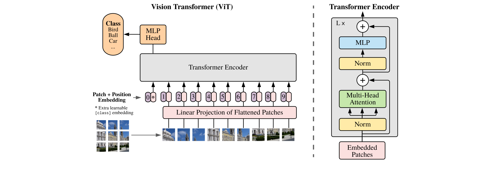
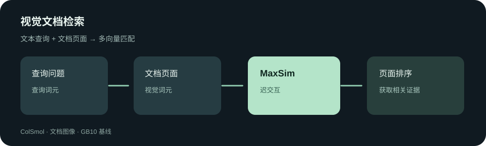

# 视觉多向量检索

> 阅读导航：[检索与排序](../README.md) · [ColBERT 系列导览](README.md) · [多向量索引与剪枝加速](多向量索引与剪枝加速.md) · [视觉多向量检索模型微调](视觉多向量检索模型微调.md) · [视觉多向量检索模型蒸馏](视觉多向量检索模型蒸馏.md) · 实验代码：[`visual-multivector-retrieval`](../../../../experiments/visual-multivector-retrieval/README.md)

在金融研报、技术规范、学术论文与法律合同等专业文档中，关键商业与技术线索往往分布在排版表格、趋势折线图、结构流程图或特定标题层级中。传统的文档检索流水线采用分步串联架构：先通过光学字符识别与版面分析将 PDF 转换为纯文本，再对文本进行规则切块与单向量编码。

这种传统链路不仅容易产生前后传递的级联误差（如表格串列、跨栏断句），而且在文本转换瞬间彻底抹杀了表格的二维对齐关系、图表的色彩走势与字号排版等关键视觉元数据。一旦 OCR 阶段识别出错或漏掉字符，下游检索模型无法修复。

视觉多向量检索颠覆了上述分阶段流水线：它跳过独立的 OCR 文本提取与规则分块，直接将原始页面原生渲染为高保真图像，利用 Vision Transformer 的网格切块将整页映射为多向量矩阵，并通过跨模态晚期交互算子实现文本问题与页面局部特征的细粒度端到端对齐。本文基于真实实验记录，详细拆解其网络架构映射、MaxSim 跨模态匹配、本地评测基准与存储开销测算。

---

## 一、核心原理

### 1. 图像网格切块与隐藏层对齐

参考 Vision Transformer 的结构设计，输入的文档页面图像记为 $\mathbf{I} \in \mathbb{R}^{H \times W \times C}$：
1. 模型将整幅图像切割为大小为 $P \times P$（例如 $P = 14$）的不重叠小矩形网格，整页生成的 Patch 数量为：
   $$N_p = \frac{H \cdot W}{P^2}$$
2. 每个扁平化的 Patch 经过线性映射与二维位置编码，作为视觉序列输入主干网络；
3. 视觉主干网络输出每个 Patch 的上下文表征矩阵 $\mathbf{H}_{\text{vision}} \in \mathbb{R}^{N_p \times D_{\text{vis}}}$，经由线性投影层映射至与文本查询相同的维度空间：
   $$\mathbf{E}_D = \mathbf{H}_{\text{vision}} \mathbf{W}_{\text{proj}} \in \mathbb{R}^{N_p \times D}$$
4. 归一化后，整张页面被表示为一个包含 $N_p$ 个 $D$ 维向量的稠密矩阵。

### 2. 跨模态晚期交互算子

用户的文本查询经过文本编码器后生成 $m$ 个 Token 向量序列 $\mathbf{E}_Q = [\mathbf{q}_1, \mathbf{q}_2, \dots, \mathbf{q}_m]$。

查询文本 $Q$ 与页面图像 $D$ 之间的跨模态匹配分数定义为每个查询词在所有图像 Patch 上的内积峰值累加：

$$\operatorname{Score}(Q, D) = \sum_{i=1}^{m} \max_{j \in \{1, \dots, N_p\}} (\mathbf{q}_i \cdot \mathbf{v}_j^T)$$

### 3. 跨模态局部特征匹配机制

单向量图文检索将整页图像压缩为单一全局向量，无法定位具体局部的单元格。在视觉多向量模型中：
- 查询中的每个词元会在所有 Patch 中寻找内积最大的空间坐标，实现细粒度局部证据匹配；
- 当查询涉及表格中的数值时，对应词元的峰值集中在表格单元格所在的物理网格；
- 多约束查询要求页面必须同时具备多个匹配区域，如果缺少其中一个关键实体，总分将被显著拉低。

---

## 二、实验设计

### 1. 评测基准与模型设置

基准评测基于轻量级视觉多向量架构 ColSmol-256M 进行：
- 图像输入分辨率：统一预处理至模型适配尺寸；
- 向量维度：投影层输出 128 维；
- 评测方式：全库计算完整 MaxSim 匹配矩阵并输出排名。

### 2. 数据集划分与评测场景

实验覆盖两个维度的评测场景：
- **真实复杂文档集合**：DocVQA 评测集中的 100 张真实排版页面（包含印刷扫描件、发票、技术文档）与 100 条真实问题；
- **独立合成报表集合**：64 张包含多列密集数字的三线运营报表页面与 192 条多实体约束查询。

---

## 三、过程与开销

### 1. 存储空间账本与膨胀倍数

以典型企业级知识库（10 万页文档）为例，测算不同表征方案的存储需求：

| 表征方案 | 单页向量数量 | 单向量维度与精度 | 单页存储占用 | 10 万页纯向量存储 |
|---|---|---|---|---|
| 传统单向量 (BGE-large) | 1 个向量 | 1024 维，FP16 | 2 KB | 0.2 GB |
| ColSmol 原生多向量 | 1024 个 Patch 向量 | 128 维投影，FP16 | 256 KB | 25.6 GB |
| ColPali 大模型原生输出 | 1024 个 Patch 向量 | 2048 维未降维，FP16 | 4 MB | 400.0 GB |
| ColPali 搭配残差量化 | 1024 个 Patch 向量 | 128 维（34 字节/Patch） | 34.8 KB | 3.48 GB |

未经压缩的原生视觉多向量存储消耗较高。在规模化部署时，可配合残差量化索引，将单页存储开销控制在 35 KB 左右。

### 2. 检索延迟与硬件开销

在单机硬件环境下进行基准测量：
- DocVQA 100 页面暴力 MaxSim 遍历评测中，单查询平均检索延迟为 781.2 ms；
- 在 64 页面独立评测中，256M 参数规模模型的运行峰值显存为 3.02 GB。

---

## 四、实验结果与观察

### 1. DocVQA 真实文档评测指标

在 100 张真实文档与 100 条真实问题的检索评测中，测量结果如下：

| 评测维度 | 实测指标结果 | 测量口径说明 |
|---|---|---|
| 首位命中准确率 (Recall@1) | 55.0% (55 / 100) | 查询直接将唯一配对页面排在首位 |
| 前五命中率 (Recall@5) | 78.0% (78 / 100) | 配对页面进入检索结果前五位 |
| 排序质量 (NDCG@5) | 0.6664 | 归一化折损累计增益 |

### 2. 独立报表复测指标

在 64 张合成报表页面与 192 条查询的独立测试集中，对三组模型进行对比评测：

| 评估模型方案 | Recall@1 命中数 | Recall@1 准确率 | Recall@5 命中数 | Recall@5 准确率 |
|---|---|---|---|---|
| ColSmol 原始基线 | 149 / 192 | 77.60% | 186 / 192 | 96.88% |
| LoRA 监督微调模型 | 154 / 192 | 80.21% | 187 / 192 | 97.40% |
| 多模态教师蒸馏模型 | 151 / 192 | 78.65% | 186 / 192 | 96.88% |

### 3. 数据层面的直接观察

实验数据反映出以下客观事实：
1. 原始预训练基线在未微调状态下，在 64 候选页面中取得了 96.88% 的 Top-5 召回率；
2. 经过 LoRA 监督微调后，首位命中数从 149 条增加至 154 条，准确率达到 80.21%；
3. 蒸馏模型在此项测试中的首位命中数为 151 条，准确率高于原始基线，但低于纯监督微调模型。

---

## 五、代码与复现

- 实验代码：`experiments/visual-multivector-retrieval/` 目录下包含了 DocVQA 评测脚本、独立评测集生成与评估逻辑；
- 实测凭证：DocVQA 基线数据保存在 `evidence/baseline100.json`，独立复测数据保存在 `independent-evaluation/results.json`。

---

## 六、参考资料

- Manuel Faysse, Hugues Sibille, Tony Wu, et al. ColPali: Efficient Document Retrieval with Vision Language Models. arXiv:2407.01449, 2024.
- Alexey Dosovitskiy, Lucas Beyer, Alexander Kolesnikov, et al. An Image is Worth 16x16 Words: Transformers for Image Recognition at Scale. ICLR 2021. arXiv:2010.11929, 2020.
- Xiaohua Zhai, Basil Mustafa, Alexander Kolesnikov, Lucas Beyer. Sigmoid Loss for Language Image Pre-Training. ICCV 2023. arXiv:2303.15343, 2023.
- Omar Khattab, Matei Zaharia. ColBERT: Efficient and Effective Passage Search via Contextualized Late Interaction over BERT. SIGIR 2020. arXiv:2004.12832, 2020.
