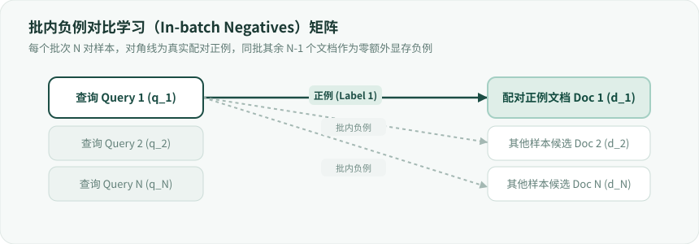

# 文本向量模型微调

> 阅读导航：[检索与排序](../README.md) · [Embedding 体系导览](README.md) · [稠密向量表示与最近邻检索](稠密向量表示与最近邻检索.md) · [对比学习与表征几何](对比学习与表征几何.md) · [Embedding 蒸馏](Embedding蒸馏.md) · 代码实践：[`embedding-finetuning`](../../../../experiments/embedding-finetuning/README.md)

通用开源预训练 Embedding 模型（如 BGE、E5、Conan）虽然在大规模开放语料上具备良好的连续流形分布，但在垂直专业领域（如医疗诊断、金融合规、特定工程简称）中，通用模型难以捕捉特定业务场景下的语义关联。当调整分词规则或改写检索提示词仍无法消除关键信息漏召回时，使用领域业务数据进行有监督对比微调（Supervised Contrastive Finetuning）成为提升检索精度的核心路径。关于对比学习的超球面几何机理与 InfoNCE 损失梯度推导，参见 [对比学习与表征几何](对比学习与表征几何.md)。本文系统梳理文本单向量模型的监督微调流程、批内负例实现、难负例挖掘策略、防过拟合门禁与复现验证。

---

## 一、核心原理

### 1. 批内负例与对称 InfoNCE 损失

在有监督对比微调中，每条训练样本至少包含一个**查询（Query）**和一个**正例文档（Positive Document）**。当单批次包含 $N$ 组配对时，最经典高效的训练策略是**批内负例（In-batch Negatives）**：每个查询仅与它对应的文档构成正例，而与同批次内其余 $N-1$ 个样本的文档自动构成负例。



设查询编码向量为 $\mathbf{q}_i$，文档编码向量为 $\mathbf{d}_j$（均经过 L2 归一化），两者缩放余弦相似度为：

$$s_{ij} = \frac{\mathbf{q}_i^\top \mathbf{d}_j}{\tau}$$

其中 $\tau$ 为温度超参数（通常设为 0.02）。整个批次的对称 InfoNCE 对比损失函数为：

$$\mathcal{L} = -\frac{1}{N} \sum_{i=1}^N \log \frac{\exp(s_{ii})}{\sum_{j=1}^N \exp(s_{ij})}$$

较小的温度（如 $\tau=0.02$）放大点积差异对 Softmax 概率分布的影响，促使模型把正例相似度拉近，同时推开负例；批内负例无需为负例单独分配额外的前向计算，复用了批次内已编码的文档向量。

### 2. 难负例挖掘机制与梯度贡献

单纯依靠随机批内负例容易遇到优化瓶颈：批次内的其他文档大多与当前查询主题完全无关（简单负例，Easy Negatives），模型仅凭粗粒度分类就能区分，反向传播梯度很小。
要提升细粒度区分能力，需要引入**难负例（Hard Negatives）**：即那些字面高度相似、包含大量相同关键词，但在语义上不能回答问题的候选文档。常见来源包括：
1. **BM25 词项倒排挖掘**：使用传统 BM25 检索全库，召回与当前查询字面重合但未标注为正例的文档，迫使模型学习区分“关键词重合”与“真实语义相关”；
2. **预训练模型 Top-K 挖掘**：使用未微调的基线模型召回余弦相似度排名前 10~50 位的未命中负例。

### 3. 交叉编码器置信度过滤与假负例防范

挖掘出的高分负例有时在客观上确实包含相关证据（未被标注的假负例，False Negatives）。如果强行将其作为负例惩罚，会干扰模型的语义判断并破坏特征空间连续性。工程上通常采用大尺寸交叉编码器（Cross-Encoder）进行离线打分，仅保留教师打分低于严格置信度阈值（如 Score < 0.2）的真实硬负例。

---

## 二、实验设计

### 1. 样本三元组与数据划分防泄漏约束

训练样本规范组织为多元组 $(\mathbf{q}, \mathbf{d}^+, \mathbf{d}_1^-, \dots, \mathbf{d}_K^-)$。在数据划分阶段严格执行防泄漏门禁：
- **严格切断文档级泄漏**：测试集与验证集的查询，其相关文档不能出现在训练集中；
- **同源段落聚合划分**：同一篇长文档如果切分成多个段落，所有段落必须整体划分至同一集合，防止模型依靠记忆特有专有名词产生虚假高分。

### 2. 模型骨干与温度超参数配置

- **基础模型**：以 BERT-base 或 BGE-base 为骨干网络，采用掩码加权均值池化（Masked Mean Pooling）并施加 L2 归一化；
- **超参数配置**：学习率设为 $2 \times 10^{-5}$（采用带线性预热的余弦衰减调度），Batch Size 设为 64 到 128，温度系数 $\tau$ 设为 0.02。

---

## 三、过程与开销

### 1. 批大小与双塔前向显存占用

微调过程中的显存消耗主要由三部分构成：查询塔 Transformer 前向激活值、文档塔 Transformer 前向激活值，以及 $B \times B$ 的相似度点积矩阵。
采用梯度检查点（Gradient Checkpointing）技术后，在 24 GB 消费级显卡上可支持 Batch Size 达到 128（最大序列长度 256）。

### 2. 训练收敛动态与梯度裁剪

在引入难负例后，训练初期局部梯度可能出现较大波动。工程上采用全局梯度范数裁剪（`max_norm=1.0`），防止异常样本导致模型参数发生破坏性震荡。

---

## 四、实验结果与观察

### 1. 垂直领域评估指标（Recall@k 与 MRR@k）

在垂直业务测试集上进行评估，主要考察候选池内的排序与召回质量：
- **Recall@1、Recall@5 与 Recall@10**：衡量真实正例文档是否进入前 Top-K 列表；
- **MRR@10（平均倒数排名）**：衡量正例文档在返回列表中的位置靠前程度。微调后模型在垂直术语查询上的 MRR@10 通常有显著提升。

### 2. 通用语义基准监测与防灾难性遗忘

微调过程中必须监测通用语义基准（如通用百科或通用语义检索留出集）：
- 若特定领域指标提升的同时，通用语义检索召回率下降超过 3%，表明模型已发生过拟合与特征退化；
- **应对方案**：在训练集中以 1:1 或 2:1 的比例混合通用语料，或引入与预训练基线模型的输出蒸馏约束。

---

## 五、代码与复现

### 1. 核心损失实现与训练流程拓扑

本项目在 `experiments/embedding-finetuning/` 提供了模块化微调脚本与架构流程：
- **[训练流程拓扑图](../../../../experiments/embedding-finetuning/assets/training-flow.svg)**：图解查询与文档的双塔前向、相似度矩阵构建与损失回传路径。

```python
import torch
import torch.nn as nn
import torch.nn.functional as F

class InBatchContrastiveLoss(nn.Module):
    def __init__(self, temperature: float = 0.02):
        super().__init__()
        self.temperature = temperature

    def forward(self, q_vecs: torch.Tensor, d_vecs: torch.Tensor) -> torch.Tensor:
        # q_vecs: [B, D], d_vecs: [B, D] 均已完成 L2 归一化
        scores = torch.matmul(q_vecs, d_vecs.T) / self.temperature  # [B, B]
        labels = torch.arange(q_vecs.size(0), device=q_vecs.device)
        loss = F.cross_entropy(scores, labels)
        return loss
```

### 2. 脚本入口与快速验证

- **实验代码入口**：[`experiments/embedding-finetuning`](../../../../experiments/embedding-finetuning/README.md)
- **依赖安装与快速启动**：
  ```bash
  pip install -r experiments/embedding-finetuning/requirements.txt
  python experiments/embedding-finetuning/scripts/train.py --batch_size 64 --temperature 0.02
  ```

---

## 六、参考资料

1. **Sentence-BERT (EMNLP 2019)**: Reimers, N., & Gurevych, I. *Sentence-BERT: Sentence Embeddings using Siamese BERT-Networks*. In Proceedings of the 2019 Conference on Empirical Methods in Natural Language Processing (EMNLP 2019). [ACL:D19-1410](https://aclanthology.org/D19-1410/).
2. **DPR (EMNLP 2020)**: Karpukhin, V., Oğuz, B., Min, S., Lewis, P., Wu, L., Edunov, S., Chen, D., & Yih, W. *Dense Passage Retrieval for Open-Domain Question Answering*. EMNLP 2020. [arXiv:2004.04906](https://arxiv.org/abs/2004.04906).
3. **BGE (2023)**: Xiao, S., Liu, Z., Zhang, P., & Muennighoff, N. *C-Pack: Packaged Resources To Advance General Chinese Embedding*. arXiv preprint [arXiv:2309.07597](https://arxiv.org/abs/2309.07597) (2023).
