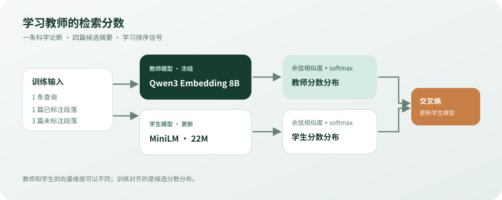

# 文本向量模型蒸馏

> 阅读导航：[检索与排序](../README.md) · [Embedding 体系导览](README.md) · [知识蒸馏与软标签监督](../知识蒸馏与软标签监督.md) · [稠密向量表示与最近邻检索](稠密向量表示与最近邻检索.md) · [Embedding 监督微调](Embedding监督微调.md) · 代码实践：[`embedding-distillation`](../../../../experiments/embedding-distillation/README.md)

在科学文献检索与专业垂直领域问答中，大尺寸稠密向量模型（如 8B 参数级别）具备强大的长程语义建模与细粒度排序能力，但因高显存与推理延迟无法直接部署于高并发在线服务；轻量双编码器（如 MiniLM，约 22M 参数）推理极快，但在专业术语上的召回精度存在瓶颈。关于知识蒸馏三大训练信号形态（词表级、标量差值 Margin-MSE、候选分布 Softmax KL）的系统数学推导，参见 [知识蒸馏与软标签监督](../知识蒸馏与软标签监督.md)。本实验检验 MiniLM 双编码器能否从 Qwen3-Embedding-8B 教师的候选相似度分布中学习软标签排序信号，并通过严格配对 Bootstrap 置信区间与同预算纯监督对照评估实际增益。

---

## 一、核心原理

### 1. 跨维度分布级知识传递机制

教师模型（Qwen3-Embedding-8B）输出维度为 4096，学生模型（all-MiniLM-L6-v2）输出维度为 384。由于师生向量空间维度异构，无法直接进行特征级均方误差（MSE）回归。
蒸馏采用**候选集合上的相对打分分布对齐**：对于同一查询下的候选文档，教师与学生分别计算余弦相似度，将连续打分经由 Softmax 转化为概率分布，由学生模型拟合教师的排序分布。



### 2. 候选相似度 Softmax 与交叉熵损失推导

对每个查询 $q_i$，候选文档 $d_{ij}$（包含 1 个标注正例与 3 个未标注候选）由教师与学生各自产生余弦相似度 $s^T_{ij}$ 和 $s^S_{ij}$。
分别将分数除以温度系数 $\tau=0.05$ 并执行 Softmax 归一化，得到教师概率分布 $p^T_{ij}$ 与学生概率分布 $p^S_{ij}$：

$$p^X_{ij} = \frac{\exp(s^X_{ij}/\tau)}{\sum_{k=1}^{4}\exp(s^X_{ik}/\tau)}, \quad X \in \{T, S\}$$

蒸馏交叉熵损失函数为：

$$\mathcal{L}_{\text{distill}} = -\frac{1}{B}\sum_{i=1}^{B}\sum_{j=1}^{4}p^T_{ij}\log p^S_{ij}$$

教师网络参数保持冻结，反向传播梯度仅更新学生模型参数。同预算标注监督对照组则将第一列正例作为硬标签（One-Hot）执行标准交叉熵优化。

---

## 二、实验设计

### 1. 师生模型架构与异构维度配置

- **教师模型**：Qwen3-Embedding-8B（4096 维，BF16 精度，带任务指令前缀）；
- **学生模型**：all-MiniLM-L6-v2（384 维，约 22.7M 参数，FP32 精度）；
- **输入序列长度**：各自分词器截断上限统一为 192 Token。

### 2. 严格留出集划分与四条件对照设计

基于 BEIR SciFact 科学事实检索基准数据集进行严格划分：
- **训练集**：从 390 条合格查询中按固定随机种子（20261107）抽取 128 条，每条查询配置 1 个标注正例与 3 个 BM25 未标注候选；
- **留出测试集**：300 条互斥查询（经 Jaccard 规则过滤近重复），每条配置固定的前 30 个 BM25 候选；
- **四组对照条件**：
  1. Qwen3-Embedding-8B 教师基线；
  2. MiniLM 原生未微调基线；
  3. MiniLM 同预算标注监督训练组；
  4. MiniLM 教师分数分布蒸馏组。
两组训练均从同一学生初始化出发，采用完全一致的训练样本、批次顺序与 128 步更新预算。

---

## 三、过程与开销

### 1. 教师离线打分与学生训练耗时

在单台计算设备（DGX Spark GB10）上运行记录：
- **教师离线前向耗时**：教师处理 3929 篇训练与测试文献总耗时约 262.45 秒（批大小 2）；
- **学生训练耗时**：蒸馏组 128 步全参数训练耗时 7.07 秒，同预算监督组耗时 6.52 秒（查询批大小 4，AdamW 学习率 $2 \times 10^{-5}$）。

### 2. 显存占用与推理速度测量

- **学生评价吞吐**：MiniLM 处理测试集 3864 篇文献耗时约 3.60~3.77 秒，吞吐量约为教师模型的 70 倍以上；
- **参数开销比**：学生参数量（22.7M）仅占教师（8B）的约 0.28%，显存常驻开销显著降低。

---

## 四、实验结果与观察

### 1. 留出查询排序指标（nDCG@10 与 MRR@10）

在 300 条留出测试查询上评估固定候选集合的排序表现（其中 39 条查询因 BM25 前 30 候选未包含真实正例而无法召回）：

| 模型与训练方式 | nDCG@10 | MRR@10 | 相对原模型增量 |
|---|---:|---:|---:|
| **Qwen3-Embedding-8B 教师** | 0.7341 | 0.7044 | +0.0687 |
| **MiniLM 原生未微调** | 0.6654 | 0.6228 | 基线 (0.0000) |
| **MiniLM 同预算标注监督** | 0.6702 | 0.6269 | +0.0048 |
| **MiniLM 教师分数蒸馏** | **0.6711** | **0.6308** | **+0.0057** |

### 2. 配对 Bootstrap 置信区间与因果对比

为评估抽样不确定性，采用按查询配对 Bootstrap 重采样 10,000 次进行显著性检验：
- **蒸馏相对原模型**：$\Delta\text{nDCG@10} = +0.0057$，95% 置信区间为 **[−0.0074, 0.0190]**；
- **蒸馏相对同预算监督**：$\Delta\text{nDCG@10} = +0.0009$，95% 置信区间为 **[−0.0182, 0.0200]**。

### 3. 数据层面的直接事实观察

1. **置信区间跨越零点**：两项对比的 95% 置信区间均包含 0，且未达到预设的 +0.02 增益门槛。当前样本量（128 条训练查询）下，观察到学生排序指标有数值提升，但无法断言该提升具有统计显著性；
2. **软标签排序一致性**：在教师处理的 128 条训练查询中，有 116 条将已标注正例排在候选首位；剩余 12 条中未标注候选被赋予更高分数，提供了平滑的软标签泛化信号。

---

## 五、代码与复现

### 1. 凭证复算与指标重核

测试集结果可直接由逐查询评测记录重算验证：
- **实验根目录**：[`experiments/embedding-distillation`](../../../../experiments/embedding-distillation/README.md)
- **逐查询评测明细**：`evidence/eval_test_records.jsonl`
- **复算验证脚本**：
  ```bash
  python experiments/embedding-distillation/scripts/recompute_eval.py
  ```

### 2. 复现命令与权重校验

- **权重校验**：教师模型权重对应 HuggingFace 官方 revision `1d8ad4ca9b3dd8059ad90a75d4983776a23d44af`，学生对应 revision `1110a243fdf4706b3f48f1d95db1a4f5529b4d41`；
- **完整蒸馏复现命令**：
  ```bash
  python experiments/embedding-distillation/scripts/train_distill.py \
      --teacher_model Qwen/Qwen3-Embedding-8B \
      --student_model sentence-transformers/all-MiniLM-L6-v2 \
      --batch_size 4 \
      --num_steps 128 \
      --temperature 0.05
  ```

---

## 六、参考资料

1. **MiniLM (NeurIPS 2020)**: Wang, W., Wei, F., Dong, L., Bao, H., Yang, N., & Zhou, M. *MiniLM: Deep Self-Attention Distillation for Task-Agnostic Compression of Pre-Trained Transformers*. In Advances in Neural Information Processing Systems (NeurIPS 2020). [arXiv:2002.10957](https://arxiv.org/abs/2002.10957).
2. **SciFact (EMNLP 2020)**: Wadden, D., Lin, S., Lo, K., Wang, L. L., van Zuylen, M., Cohan, A., & Hajishirzi, H. *Fact or Fiction: Verifying Scientific Claims with Evidence*. In Proceedings of EMNLP 2020. [arXiv:2004.14974](https://arxiv.org/abs/2004.14974).
3. **BEIR Benchmark (NeurIPS 2021 Datasets & Benchmarks)**: Thakur, N., Reimers, N., Rücklé, A., Srivastava, A., & Gurevych, I. *BEIR: A Heterogeneous Benchmark for Zero-shot Evaluation of Information Retrieval Models*. [arXiv:2104.08663](https://arxiv.org/abs/2104.08663).
