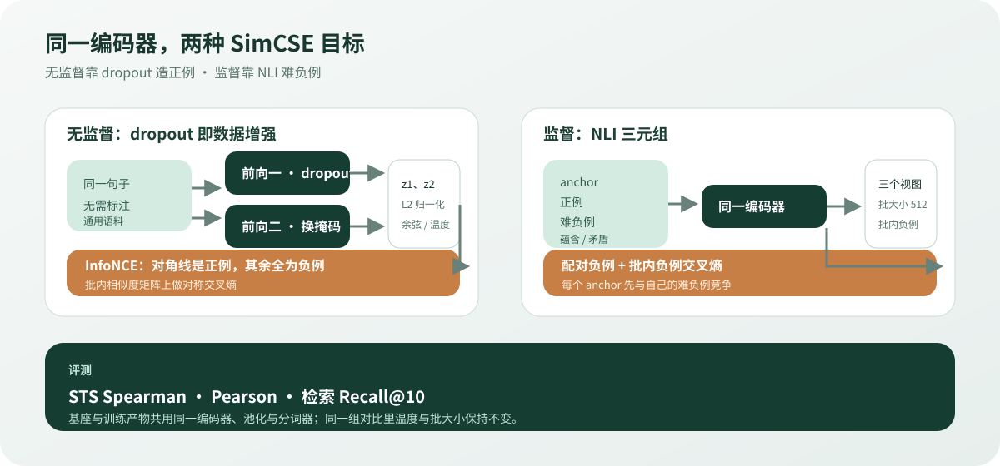

# SimCSE对比学习

> 阅读导航：[检索与排序](../README.md) · [Embedding 体系导览](README.md) · [对比学习与表征几何](对比学习与表征几何.md) · [Embedding 监督微调](Embedding监督微调.md) · 代码实践：[`contrastive-learning-simcse`](../../../../experiments/contrastive-learning-simcse/README.md)

对比学习在超球面上消除表示塌缩的前提是构造高质量的正负例对。在监督场景中可以依赖人工标注的蕴含对，但在无标注纯文本上，传统的文本数据增强（如回译、同义词替换或随机删除）往往面临两难：改动过大破坏语义，改动过小则难以提供有效梯度。关于超球面几何测度与 InfoNCE 梯度的理论推导，参见 [对比学习与表征几何](对比学习与表征几何.md)。SimCSE 提出了一种机制：将同一输入文本两次送入带有 Dropout 的 Transformer 编码器，利用训练期神经元随机丢弃产生的细微扰动构造自一致正例，并结合批内负例完成对比微调。本文梳理无监督与监督 SimCSE 的核心原理、损失计算流、关键参数边界与工程复现脚本。

---

## 一、核心原理

### 1. Dropout 随机特征扰动作为天然正例

在深度神经网络处于训练模式（Train Mode）时，Dropout 每一轮前向传播都会以概率 $p$（BERT-base 默认 0.1）随机将部分神经元置零。
对于同一句话 $\mathbf{x}_i$：
- 两次前向丢弃的是不同的隐藏神经元子集，输出隐藏状态 $\mathbf{h}_i^{(1)}$ 与 $\mathbf{h}_i^{(2)}$ 数值存在细微差异；
- 但由于保留了绝大部分连接权重，句子的全局语义并未改变；
- 形成无需额外数据增强模块、无需人工标注的自一致正例对 $(\mathbf{h}_i^{(1)}, \mathbf{h}_i^{(2)})$。



### 2. 批内相似度矩阵与 InfoNCE 损失

将一个批次内部的 $N$ 个文本分别复制前向，得到 $2N$ 个视图。在施加 L2 归一化后计算余弦相似度矩阵并除以温度 $\tau$：

$$\mathcal{L} = -\frac{1}{N}\sum_{i=1}^{N}\log\frac{\exp(\mathbf{z}_i^{(1)} \cdot \mathbf{z}_i^{(2)} / \tau)}{\sum_{j=1}^{N} \exp(\mathbf{z}_i^{(1)} \cdot \mathbf{z}_j^{(2)} / \tau)}$$

- **批内负例线性增长**：批大小为 $N$ 时，每个正例拥有 $N-1$ 个批内负例；
- **温度 $\tau = 0.05$**：将余弦相似度放大 20 倍，使 Softmax 更加尖锐，迫使模型将混淆候选向远离正例的方向更新；
- **双向对称优化**：在实现上对 $\mathbf{z}^{(1)} \to \mathbf{z}^{(2)}$ 与 $\mathbf{z}^{(2)} \to \mathbf{z}^{(1)}$ 取平均，保证梯度更新的数值稳定性。

### 3. NLI 蕴含正例与矛盾难负例

在监督场景下，数据来源于自然语言推理（NLI）数据集（如 SNLI、MNLI）。每个样本组织为三元组：
- **Anchor（前提）**：基准句子；
- **Positive（蕴含假设）**：与前提语义一致但措辞不同，由人工标注保证高质量；
- **Negative（矛盾假设）**：与前提语义矛盾，但共享大量实体词与上下文背景，形成天然的**难负例（Hard Negative）**。

候选集合为“自身正例 + 自身难负例 + 批内其他样本的正例”，通过强惩罚梯度迫使模型识别细微逻辑矛盾。

---

## 二、实验设计

### 1. 无监督版 vs 监督版数据与架构设计

- **模型基准**：以 BERT-base 为骨干网络，在最后一层隐藏状态的 `[CLS]` 向量后挂载一层带 `tanh` 激活的可学习线性投影头（Pooler）；
- **无监督输入**：来自维基百科的 100 万条无标注纯文本，单批次输入相同序列；
- **监督输入**：275k 对来自 SNLI 和 MNLI 的三元组样本，批大小扩大至 512，引入配对难负例。

### 2. 评测口径与 STS 语义相似度基准

评测基于标准语义文本相似度（STS 2012-2016、STS-Benchmark、SICK-Relatedness）共 7 项基准数据集：
- **评估指标**：计算模型预测的余弦相似度与人工评分之间的 Spearman 等级相关系数；
- **口径一致性约束**：基础模型与微调后模型必须保持完全相同的池化方式、截断长度与温度参数。

---

## 三、过程与开销

### 1. 两次前向传播与显存峰值控制

在无监督 SimCSE 训练中，由于同一批次需要前向两次，等效批大小扩大为 $2B$：
- 显存瓶颈主要集中在 Transformer 多层自注意力的激活值；
- 在消费级单 GPU 环境下，若显存受限，优先将最大序列长度从 512 截断为 64 或 128（句向量任务短句已包含核心语义），而非盲目调小 Batch Size。

### 2. Batch Size 对批内负例容量的敏感度

批大小直接决定负例的数量：
- 当 $B = 8$ 时仅有 7 个负例，其中绝大多数是与主题无关的简单负例，回传梯度极弱；
- 论文与实践表明，无监督版 $B$ 推荐设为 64~128，监督版推荐设为 256~512，以保证超球面负例推力的全局均匀性。

---

## 四、实验结果与观察

### 1. 论文基线指标参照（未本地全量训练声明）

本仓库当前聚焦于脚本工程验证与最小冒烟跑通，尚未在本地执行耗时数天的全量数据集端到端训练。下述基线指标来自 SimCSE 原文（Gao et al., EMNLP 2021），作为技术参考：

| 训练配置 | STS-B Spearman | 7 任务平均 Spearman | 核心特征来源 |
|---|---|---|---|
| **BERT-base 原生未微调** | 58.70 | 56.70 | 各向异性圆锥塌缩严重 |
| **无监督 SimCSE (BERT-base)** | 76.85 | 76.25 | 双 Dropout 视图弱增广 |
| **监督版 SimCSE (BERT-base)** | **84.25** | **81.57** | NLI 蕴含正例 + 矛盾难负例 |

### 2. 容易导致训练失效的五个关键细节

在本地工程实现与复现时，需严格规避以下常见陷阱：
1. **Eval 模式误用**：若模型误处于 `eval()` 状态或关闭了 Dropout，两次前向前向输出严格相同，损失退化为平凡解；
2. **池化头初始化**：`[CLS]` 后的线性投影头必须随骨干网络共同训练；
3. **温度超参数敏感**：$\tau$ 必须严格维持在 0.05 附近，过大（如 1.0）导致分布平滑，过小（如 0.005）导致数值下溢；
4. **假负例干扰**：在垂直业务语料中，同批次内若包含同义不同词的查询，会被 InfoNCE 错误推开，需在前处理中做 Jaccard 去重；
5. **L2 归一化不可缺失**：不归一化时向量模长会成为模型规避惩罚的旁路。

---

## 五、代码与复现

### 1. 模块化脚本与冒烟验证

本仓库在 [`experiments/contrastive-learning-simcse`](../../../../experiments/contrastive-learning-simcse/README.md) 下提供了模块化纯 PyTorch / Transformers 实现：

| 脚本文件 | 功能职责 |
|---|---|
| `scripts/simcse_lib.py` | 编码器、投影头、InfoNCE 损失计算与评测指标库 |
| `scripts/train_unsup_simcse.py` | 无监督双 Dropout 前向对比训练入口 |
| `scripts/train_sup_simcse.py` | 监督版 NLI 三元组训练入口 |
| `scripts/evaluate_sts.py` | STS 测试集 Spearman / Pearson 相关系数评估 |
| `scripts/smoke_test.py` | 本地合成小样本全链路链路连通性冒烟测试 |

### 2. 复现命令与参数入口

- **一键冒烟测试（验证环境与模型前向）**：
  ```bash
  python experiments/contrastive-learning-simcse/scripts/smoke_test.py
  ```
- **无监督训练命令示例**：
  ```bash
  python experiments/contrastive-learning-simcse/scripts/train_unsup_simcse.py \
      --model_name_or_path bert-base-chinese \
      --train_file data/wiki_sentences.txt \
      --batch_size 64 \
      --learning_rate 3e-5 \
      --temperature 0.05
  ```

---

## 六、参考资料

1. **SimCSE (EMNLP 2021)**: Gao, T., Yao, X., & Chen, D. *SimCSE: Simple Contrastive Learning of Sentence Embeddings*. In Proceedings of the 2021 Conference on Empirical Methods in Natural Language Processing (EMNLP 2021). [arXiv:2104.08821](https://arxiv.org/abs/2104.08821).
2. **Wang & Isola (ICML 2020)**: Wang, T., & Isola, P. *Understanding Contrastive Representation Learning through Alignment and Uniformity on the Hypersphere*. ICML 2020. [arXiv:2005.10242](https://arxiv.org/abs/2005.10242).
3. **InfoNCE (2018)**: van den Oord, A., Li, Y., & Vinyals, O. *Representation Learning with Contrastive Predictive Coding*. arXiv:1807.03748 (2018).
4. **SNLI (EMNLP 2015)**: Bowman, S. R., Angeli, G., Potts, C., & Manning, C. D. *A large annotated corpus for learning natural language inference*. EMNLP 2015.
