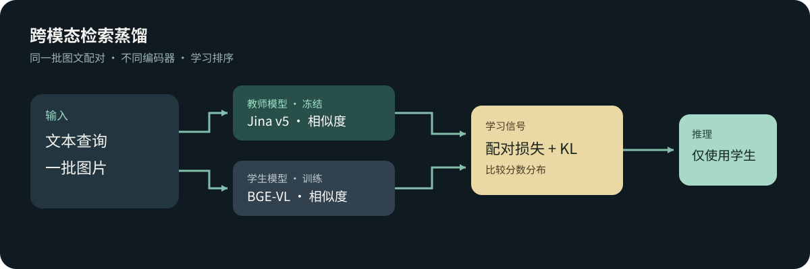

# 图文向量模型蒸馏

> 阅读导航：[检索与排序](../README.md) · [Embedding 体系导览](README.md) · [知识蒸馏与软标签监督](../知识蒸馏与软标签监督.md) · [稠密向量表示与最近邻检索](稠密向量表示与最近邻检索.md) · [文本向量模型蒸馏](Embedding蒸馏.md) · 代码实践：[`multimodal-embedding-distillation`](../../../../experiments/multimodal-embedding-distillation/)

在图文检索与跨模态召回任务中，全模态大模型（如 1.74B 参数的 Jina v5）具备强大的图文联合表征能力，但参数体量与显存占用限制了其实时部署能力；轻量图文双编码器（如约 150M 参数的 BGE-VL）推理高效，但在复杂图文匹配上的判别精度相对有限。关于跨架构知识蒸馏三大训练信号形态（词表级、标量差值 Margin-MSE、候选分布 Softmax KL）的系统数学推导，参见 [知识蒸馏与软标签监督](../知识蒸馏与软标签监督.md)。本实验探究将 Jina v5 教师模型给出的批内图文相似度分布迁移至 BGE-VL 学生的实际增益，通过严格的同预算配对监督对照与 10,000 次配对 Bootstrap 采样揭示蒸馏门禁与数据容量对最终指标的影响。

---

## 一、核心原理

### 1. 双向跨模态相似度矩阵与分布映射

在图文检索任务中，输入包含 $B$ 对配对图像与文本描述。令学生的归一化文本与图像向量分别为 $\mathbf{q}_i, \mathbf{v}_j$，教师对应向量分别为 $\mathbf{Q}_i, \mathbf{V}_j$。
在批次内分别计算文本到图像以及图像到文本的相似度矩阵：
$$s_{ij} = \mathbf{q}_i^\top \mathbf{v}_j, \quad t_{ij} = \mathbf{Q}_i^\top \mathbf{V}_j$$

通过温度超参数 $\tau_d$ 将打分转化为沿候选维度的 Softmax 概率分布：
$$P^T_{ij} = \operatorname{softmax}_j(t_{ij}/\tau_d), \quad P^S_{ij} = \operatorname{softmax}_j(s_{ij}/\tau_d)$$



### 2. 双向 KL 散度蒸馏损失与联合优化目标

跨模态蒸馏采用双向 KL 散度对齐教师与学生的图文相对匹配概率：

$$\mathcal{L}_{\text{KD}} = \frac{1}{2} \left[ \operatorname{KL}(P^T_{\text{text}\to\text{image}} \parallel P^S_{\text{text}\to\text{image}}) + \operatorname{KL}(P^T_{\text{image}\to\text{text}} \parallel P^S_{\text{image}\to\text{text}}) \right]$$

蒸馏组的总损失为配对硬标签交叉熵与蒸馏损失的加权组合：
$$\mathcal{L} = 0.5 \mathcal{L}_{\text{pair}} + 0.5 \mathcal{L}_{\text{KD}}$$
教师向量在训练前预先计算并冻结，反向传播梯度仅更新学生的文本与图像投影网络。

---

## 二、实验设计

### 1. 师生模型参数与跨模态架构对比

- **教师模型**：[Jina Embeddings v5 Omni Small](https://huggingface.co/jinaai/jina-embeddings-v5-omni-small)，约 1.74B 参数，支持多模态输入；
- **学生模型**：[BGE-VL-base](https://huggingface.co/BAAI/BGE-VL-base)，实测 149,620,737 参数（约 150M），参数比约为 11.6:1；
- **运行环境**：单卡 DGX Spark GB10，学生权重使用 FP32 存储，前向采用 BF16 自动混合精度。

### 2. Flickr30k 样本划分与教师优势前置检验

基于 Flickr30k 标准 Karpathy 划分抽取样本：
- **样本集构成**：随机种子（20261107）抽取 512 张训练图、128 张验证图与 100 张测试图，每张图取第一条英文描述作为基准查询；
- **四组对照条件**：
  1. Jina v5 教师模型基线；
  2. BGE-VL 学生原生未微调基线；
  3. BGE-VL 仅图文配对监督训练组；
  4. BGE-VL 配对监督加教师软分数蒸馏组。
两组学生使用完全一致的初始权重、批次顺序（Batch Size = 16）与 64 步训练预算。

---

## 三、过程与开销

### 1. 离线图文编码耗时与显存峰值

在单台计算设备上记录各阶段系统开销：
- **教师离线编码**：为 740 对图文生成高维表征总耗时 84.69 秒，PyTorch 峰值显存分配 3.55 GiB；
- **学生端训练耗时**：64 步训练中，监督组耗时 13.57 秒，蒸馏组耗时 12.99 秒，完整学生训练流程的峰值显存为 3.56 GiB。

### 2. 双向批内训练动态与反向传播检查

在训练初期通过两图两文前向与反向传播检查，确认文本编码器与视觉投影层均产生有效梯度回传；通过双向损失同时约束文本检索图片与图片检索文本。

---

## 四、实验结果与观察

### 1. 测试集检索指标（R@1、R@5 与 MRR）

在 100 张测试图片构成的闭集候选库上评估以文搜图表现：

| 评估方法 | R@1 | R@5 | MRR | 相对原学生变化 |
|---|---:|---:|---:|---:|
| **Jina v5 教师** | 0.94 | 1.00 | 0.9658 | +0.0100 |
| **BGE-VL 学生原始模型** | 0.93 | 0.99 | 0.9584 | 基线 (0.0000) |
| **学生：仅图文配对监督** | 0.93 | 1.00 | 0.9608 | 0.0000 |
| **学生：配对监督加教师蒸馏** | **0.91** | **1.00** | **0.9508** | **-0.0200** |

### 2. 配对 Bootstrap 检验与数据层面的直接观察

1. **Top-1 命中降级**：相对纯监督组，蒸馏组有 2 条查询的目标图片从第 1 位滑落至后方，没有查询从非第 1 位提升到第 1 位，其余 98 条查询的 R@1 状态保持不变；
2. **重采样置信区间**：按查询配对重采样 10,000 次，蒸馏组相对监督组的 R@1 差值 95% 置信区间为 **[−0.05, 0.00]**。

### 3. 蒸馏增益缺失的因果与方法学归因

本次实验提供了关于知识蒸馏实施前置条件的直接反思依据：
- **教师优势显著度不足（Teacher Advantage Gate）**：测试集上教师模型的 R@1 仅比初始学生高 1 个百分点（0.94 vs 0.93），且未预先在独立开发集上确认教师具备显著统计优势；
- **指标饱和与候选容量有限（Ceiling Effect）**：在 100 个候选的紧凑测试集中，初始学生的 R@1 已高达 0.93，进一步优化的裕度极小；
- **损失权重与梯度干扰**：蒸馏组采用 $0.5\mathcal{L}_{\text{pair}} + 0.5\mathcal{L}_{\text{KD}}$ 的固定配比，在降低配对硬监督梯度的同时，引入了教师并不显著优异的软分布，造成了微幅性能扰动。

---

## 五、代码与复现

### 1. 训练数据结构与输入格式

训练脚本读取标准三列数据格式，建立文件名、划分与描述的映射关系：

```csv
filename,split,raw
example_001.jpg,train,"['a dog running on the grass', 'canine sprinting in yard', ...]"
```

### 2. 脚本入口与复算验证

- **实验根目录**：[`experiments/multimodal-embedding-distillation`](../../../../experiments/multimodal-embedding-distillation/)
- **数据与模型检验**：对应教师权重 revision `5c54692f22e186fc12ea38a9193e3ff9e1cda2a3`，学生 revision `cc4c733ed997dbee4ac70ccffb911e70c9c24b93`；
- **快速复测命令**：
  ```bash
  python experiments/multimodal-embedding-distillation/scripts/evaluate.py
  ```

---

## 六、参考资料

1. **Jina Embeddings v5 Omni (2024)**: Jina AI Technical Report on Multimodal Embeddings. [HuggingFace:jina-embeddings-v5-omni-small](https://huggingface.co/jinaai/jina-embeddings-v5-omni-small).
2. **BGE-VL (2024)**: BAAI Visual-Language Embedding Base Model. [HuggingFace:BGE-VL-base](https://huggingface.co/BAAI/BGE-VL-base).
3. **Flickr30k (TACL 2014)**: Young, P., Lai, A., Hodosh, M., & Hockenmaier, J. *From image descriptions to visual denotations: New benchmarks for semantic properties and syntactic structures*. Transactions of the Association for Computational Linguistics (TACL 2014).
