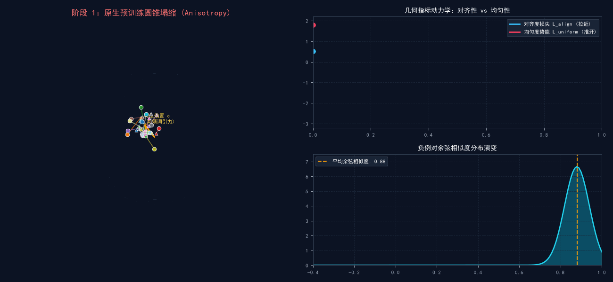

# 对比学习与表征几何

> 阅读导航：[检索与排序](../README.md) · [Embedding 体系导览](README.md) · [稠密向量表示与最近邻检索](稠密向量表示与最近邻检索.md) · [Embedding 监督微调](Embedding监督微调.md) · 代码实践：[`embedding-finetuning`](../../../../experiments/embedding-finetuning/README.md) · [`contrastive-learning-simcse`](../../../../experiments/contrastive-learning-simcse/README.md)

未经针对性调优的预训练语言模型（如 BERT、RoBERTa），其高维隐藏状态直接经均值池化后的检索表现往往低于基于词频的 BM25。其根本原因在于高维表示空间的各向异性（Anisotropy）与表示塌缩（Representation Collapse）：文本向量均聚集在高频词主导的狭窄圆锥区域内，导致任意两段无关文本的余弦相似度均维持在 0.8 以上。对比学习（Contrastive Learning）通过在单位超球面上施加“拉近正例、推开负例”的双向几何约束，系统消除空间塌缩并恢复各向同性。本文系统推导表示塌缩的几何机理、Wang & Isola 超球面两项测度（Alignment 与 Uniformity）、InfoNCE 梯度的非对称加权性质，以及无监督 Dropout 扰动与难负例采样的工程边界。

---

## 一、概念与问题概述

### 1. 原生预训练模型的表示塌缩与各向异性

在理想的高维向量空间（各向同性，Isotropic）中，文本向量应当均匀分布在单位超球面的各个方向上，任意两个随机采样的非相关文本向量，其内积的数学期望应当接近于零：
$$\mathbb{E}_{\mathbf{x}, \mathbf{y} \sim \mathcal{S}^{D-1}} [\mathbf{x}^T \mathbf{y}] \approx 0$$

然而，在未经对比学习调优的原生预训练语言模型中，向量空间表现出明显的各向异性：
- **奇异值急剧衰减**：对数万条句子的嵌入矩阵执行奇异值分解（SVD），前几个主成分的奇异值偏大，占据了绝大部分方差，其余维度的奇异值迅速衰减至零；
- **均值偏移（Mean Offset）**：所有句向量都包含一个共同且巨大的偏置向量 $\mathbf{c}$。即任意句子向量可以被分解为：
  $$\mathbf{u}_i = \mathbf{c} + \mathbf{r}_i, \quad \|\mathbf{c}\| \gg \|\mathbf{r}_i\|$$
  当计算两个句子 $\mathbf{u}_1$ 和 $\mathbf{u}_2$ 的余弦相似度时，巨大的公共分量 $\mathbf{c}$ 直接主导了点积结果：
  $$\mathbf{u}_1 \cdot \mathbf{u}_2 = \|\mathbf{c}\|^2 + \mathbf{c} \cdot (\mathbf{r}_1 + \mathbf{r}_2) + \mathbf{r}_1 \cdot \mathbf{r}_2 \approx \|\mathbf{c}\|^2 > 0$$
  这在几何上表现为向量分布局限在狭窄圆锥内部，显著削弱了模型区分语义细微差异的能力。

### 2. 几何退化的数学诱因与奇异值衰减

这种几何缺陷源于掩码语言模型（MLM）的预训练机制：
1. **高频词诱导的梯度偏置**：模型最后一层的 Softmax 损失按词频调整词向量排布。高频词（标点符号、连词、停用词）更新频率远高于低频词，将词向量整体拉向同一方向；
2. **未经正则化的隐藏层均值累积**：Transformer 内部的残差连接（Residual Connections）层层累加，未经过正则化约束的无监督前向传播导致深层特征越来越倾向于保留主成分背景噪声。

---

## 二、核心原理

### 1. 超球面几何测度：对齐性与均匀性

Wang & Isola（ICML 2020）提出了衡量超球面表示质量的两项核心几何测度：**对齐性（Alignment）与均匀性（Uniformity）**。设所有经过 L2 归一化的文本表征均分布在 $D$ 维单位超球面 $\mathcal{S}^{D-1} = \{\mathbf{x} \in \mathbb{R}^D : \|\mathbf{x}\|_2 = 1\}$ 上。



对比学习在超球面上同时施加两个方向相反的几何约束：
1. **对齐性拉力（Alignment）**：对于语义相同或互为问答的正例对（如 $\mathbf{q}$ 与 $\mathbf{d}^+$），拉近它们的空间距离，使同义表达聚集在一起；
2. **均匀性推力（Uniformity）**：对于空间中所有非配对的负例文档，施加全局排斥约束，把向量均匀推散到整个球面上。两者的平衡消除了局部圆锥塌缩。

#### 对齐性（Alignment）：拉近正例
对齐性衡量语义相近的正例对在超球面上的接近程度。对于正例样本对分布 $p_{\text{pos}}(\mathbf{x}, \mathbf{x}^+)$，对齐性损失定义为正例对之间的期望欧氏距离平方：

$$\mathcal{L}_{\text{align}}(f; \alpha) \triangleq \mathbb{E}_{(\mathbf{x}, \mathbf{x}^+) \sim p_{\text{pos}}} \left[ \|f(\mathbf{x}) - f(\mathbf{x}^+)\|_2^\alpha \right], \quad \alpha > 0$$

当取 $\alpha = 2$ 且向量模长归一化时，$\|f(\mathbf{x}) - f(\mathbf{x}^+)\|_2^2 = 2 - 2 f(\mathbf{x})^T f(\mathbf{x}^+)$。最小化对齐性损失，等价于最大化正例对之间的余弦相似度。

#### 均匀性（Uniformity）：推开负例
如果单纯追求对齐性，损失函数存在一个平凡解（Trivial Solution）：把所有输入映射到超球面上的同一个固定点。此时对齐性损失达到最小值，但所有向量重合在一起，完全失去区分能力。
均匀性要求空间中所有样本的整体分布 $p_{\text{data}}(\mathbf{x})$ 尽量接近超球面上的均匀分布（Uniform Distribution），借助高斯核势能（Gaussian Potential）定义：

$$\mathcal{L}_{\text{uniform}}(f; t) \triangleq \log \mathbb{E}_{\mathbf{x}, \mathbf{y} \stackrel{i.i.d.}{\sim} p_{\text{data}}} \left[ \exp\left( -t \|f(\mathbf{x}) - f(\mathbf{y})\|_2^2 \right) \right], \quad t > 0$$

高斯势能类似于带电粒子在球壳上的相互排斥。只有当向量在整个球面上充分分散、彼此距离拉开时，均匀性损失才会收敛到较小值。

### 2. InfoNCE 与对齐/均匀性的渐近统一

在负例数量趋于无穷的渐近极限下，InfoNCE 严格等价于对齐性优化与均匀性优化的协同加权：

$$\mathcal{L}_{\text{InfoNCE}} = -\log \frac{\exp(\mathbf{q}^T \mathbf{d}^+ / \tau)}{\exp(\mathbf{q}^T \mathbf{d}^+ / \tau) + \sum_{j=1}^K \exp(\mathbf{q}^T \mathbf{d}_j^- / \tau)}$$

当负例数量 $K \to \infty$ 时，根据大数定律进行渐近展开：

$$\mathcal{L}_{\text{InfoNCE}} \xrightarrow{K \to \infty} \underbrace{-\frac{1}{\tau} \mathbb{E}[\mathbf{q}^T \mathbf{d}^+]}_{\text{严格对应对齐性优化 (拉近正例)}} + \underbrace{\mathbb{E} \left[ \log \mathbb{E}_{\mathbf{d}^-} \exp(\mathbf{q}^T \mathbf{d}^- / \tau) \right]}_{\text{严格对应均匀性高斯势能优化 (推开负例)}} + \text{常数}$$

InfoNCE 的分子项把语义正例拉近，分母项则把非相关样本推开，促使向量在超球面上更均匀地分布，缓解各向异性。

### 3. InfoNCE 负例梯度的非对称加权推导

推导 InfoNCE 对查询向量 $\mathbf{q}$ 的负例反向传播梯度可以看出其权重机制：
设正例相似度为 $s^+ = \mathbf{q}^T \mathbf{d}^+ / \tau$，第 $j$ 个负例相似度为 $s_j^- = \mathbf{q}^T \mathbf{d}_j^- / \tau$。令 Softmax 归一化后的负例概率权重为：

$$p_j^- = \frac{\exp(s_j^-)}{\exp(s^+) + \sum_{k} \exp(s_k^-)}$$

对负例文档向量 $\mathbf{d}_j^-$ 求偏导，其获得的惩罚梯度为：

$$\frac{\partial \mathcal{L}}{\partial \mathbf{d}_j^-} = \frac{1}{\tau} \cdot p_j^- \cdot \mathbf{q}$$

每一个负例推开力度的大小，直接正比于其 Softmax 概率分配系数 $p_j^-$。

---

## 三、工程代价与加速方案

### 1. 批内负例对 Batch Size 的算力依赖

在无外部负例库的标准对比学习中，模型严重依赖当前 Batch 内部的其他样本作为负例（In-batch Negatives）。
- **显存与样本量的平方级开销**：当批次大小为 $B$ 时，需要计算 $B \times B$ 的相似度矩阵并进行双向 Cross-Entropy 运算。为使负例覆盖足够的语义空间，通常需要较大的 Batch Size（如 $B \ge 512$ 或 $1024$），这带来了极高的显存峰值；
- **优化路径**：工程上通常采用**跨 GPU 梯度聚合（Gradient Cache）**或**动量编码器负例队列（MoCo 机制）**，在不显著增加单卡显存占用的前提下解耦 Batch Size 与负例候选容量。

### 2. 简单负例的梯度消失与计算冗余

在常规的随机批内负例中，绝大多数同批其他文档与当前查询主题完全无关（例如查询是“糖尿病”，负例是“Python 数据清洗”）。其相似度很低，导致 $s_j^- \ll s^+$，此时对应的权重 $p_j^- \approx 0$。这意味着简单负例回传的反向传播梯度几乎为零，模型在此类负例上的参数更新收益很小，造成显存和算力的空转浪费。

### 3. 难负例挖掘策略与假负例污染防范

难负例（Hard Negatives）是指字面高度重合、但本质无法回答问题的样本（例如查询是“如何办理公积金提取”，难负例是“公积金缴存基数计算办法”）。
由于字面相近，其未经惩罚前的得分逼近正例（$s_j^- \approx s^+$），此时其对应的概率权重 $p_j^-$ 较大，能够产生高权重的反向传播梯度，促使模型将此类高混淆度负例向远离查询的方向更新。

然而引入难负例时必须严防**假负例（False Negatives）**污染：
- 如果通过 BM25 挖掘出的候选负例在真实语义下也能回答用户的查询（由于人工未标注或标注遗漏）；
- 此时模型会对其施加反向排斥梯度，强迫原本语义相关的正向表达彼此远离，破坏局部连续流形结构；
- **防范机制**：先使用大尺寸 Cross-Encoder 教师模型对候选难负例打分，仅保留教师打分低于严格置信度阈值（如 Score < 0.2）的真实硬负例。

---

## 四、选型指南与协同架构

### 1. 无监督 SimCSE 与正例 Dropout 扰动机制

在缺少人工标注的问答正负例场景下，普林斯顿大学提出的 SimCSE 利用 Transformer 内置的 Dropout 作为最小语义扰动，构造无监督正例对：

对于同一句话 $\mathbf{x}_i$，在网络处于训练模式（Train Mode）下连续执行两次前向传播：
- 第一次前向传播：激活神经元子网络 A，输出隐藏状态 $\mathbf{h}_i = f_{\text{drop}_1}(\mathbf{x}_i)$；
- 第二次前向传播：激活随机神经元子网络 B，输出隐藏状态 $\mathbf{h}_i^+ = f_{\text{drop}_2}(\mathbf{x}_i)$。

两组特征来源于同一个文本，语义保持一致；仅由于 Dropout 掩码在特征维度的随机丢弃，使得两者的数值存在细微扰动，形成天然的自一致语义正例对。在维基百科无标注纯文本上微调后，SimCSE 将 BERT 原生句向量在标准 STS 基准上的 Spearman 相关系数由 58% 提升至 76% 以上（Gao et al., 2021）。

```python
import torch
import torch.nn as nn
import torch.nn.functional as F

class UnsupervisedSimCSE(nn.Module):
    def __init__(self, encoder, temperature: float = 0.05):
        super().__init__()
        self.encoder = encoder
        self.temperature = temperature

    def forward(self, input_ids, attention_mask):
        batch_size = input_ids.size(0)
        # 批次复制拼接: [2B, T]
        doubled_input_ids = torch.cat([input_ids, input_ids], dim=0)
        doubled_mask = torch.cat([attention_mask, attention_mask], dim=0)

        # 一次前向传播应用两组不同 dropout 掩码
        outputs = self.encoder(doubled_input_ids, attention_mask=doubled_mask)
        embeddings = outputs.last_hidden_state[:, 0, :]  # CLS 向量
        embeddings = F.normalize(embeddings, p=2, dim=1)

        z1 = embeddings[:batch_size]  # [B, D]
        z2 = embeddings[batch_size:]  # [B, D]

        cos_sim = torch.matmul(z1, z2.T) / self.temperature
        labels = torch.arange(batch_size, device=input_ids.device)
        return F.cross_entropy(cos_sim, labels)
```

### 2. 温度超参数 τ 的选择与调节边界

温度超参数 $\tau$ 控制难负例惩罚的尖锐度。在已完成 L2 归一化的单位超球面上：
- 推荐基线值设为 **0.05**，或按验证集在 0.02 到 0.07 之间网格搜索；
- 若设置过大（如 $\tau = 1.0$），Softmax 分布过度平缓，难负例的梯度区分度被严重稀释；
- 若设置过小（如 $\tau < 0.01$），极少数难负例将垄断所有梯度，且数值稳定性极差，容易发生指数溢出。

### 3. 负例采样配比与工程配置建议

在有监督对比微调中，建议采用非对称采样策略：
- **采样配比**：**1 个正例 + 1~2 个高置信度硬负例 + 批内其余数十个样本自动构建的随机负例**；
- **正负例过滤**：过滤掉与正例文档 Jaccard 相似度过高的候选（避免近义候选误作负例）；
- **代码实践与复现入口**：对应代码与评测见实验目录 [`contrastive-learning-simcse`](../../../../experiments/contrastive-learning-simcse/README.md)（含无监督训练脚本 `train_unsup_simcse.py`、监督版三元组脚本 `train_sup_simcse.py` 与 STS 评测 `evaluate_sts.py`）。

---

## 五、参考资料

1. **Wang & Isola (ICML 2020)**: Wang, T., & Isola, P. *Understanding Contrastive Representation Learning through Alignment and Uniformity on the Hypersphere*. In Proceedings of the 37th International Conference on Machine Learning (ICML 2020). [arXiv:2005.10242](https://arxiv.org/abs/2005.10242).
2. **SimCSE (EMNLP 2021)**: Gao, T., Yao, X., & Chen, D. *SimCSE: Simple Contrastive Learning of Sentence Embeddings*. In Proceedings of the 2021 Conference on Empirical Methods in Natural Language Processing (EMNLP 2021). [arXiv:2104.08821](https://arxiv.org/abs/2104.08821).
3. **InfoNCE / CPC (2018)**: van den Oord, A., Li, Y., & Vinyals, O. *Representation Learning with Contrastive Predictive Coding*. arXiv preprint [arXiv:1807.03748](https://arxiv.org/abs/1807.03748) (2018).
4. **Ethayarajh (EMNLP 2019)**: Ethayarajh, K. *How Contextual are Contextualized Word Representations? Comparing the Geometry of BERT, ELMo, and GPT-2 Embeddings*. In Proceedings of the 2019 Conference on Empirical Methods in Natural Language Processing (EMNLP 2019). [ACL:D19-1006](https://aclanthology.org/D19-1006/).
5. **DPR (EMNLP 2020)**: Karpukhin, V., Oğuz, B., Min, S., Lewis, P., Wu, L., Edunov, S., Chen, D., & Yih, W. *Dense Passage Retrieval for Open-Domain Question Answering*. In Proceedings of the 2020 Conference on Empirical Methods in Natural Language Processing (EMNLP 2020). [arXiv:2004.04906](https://arxiv.org/abs/2004.04906).
