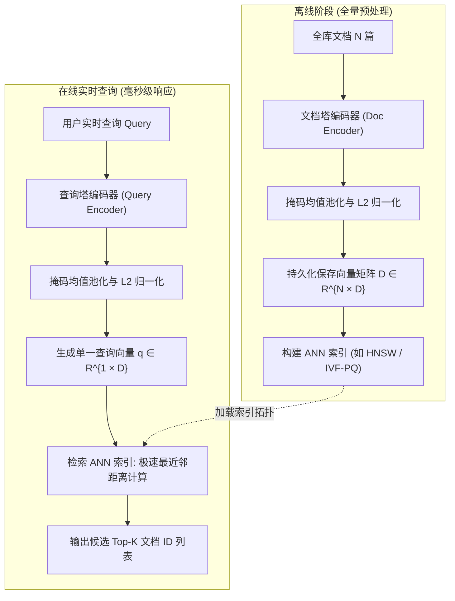

# 稠密向量表示与最近邻检索

> 阅读导航：[检索与排序](../README.md) · [Embedding 体系导览](README.md) · [对比学习与表征几何](对比学习与表征几何.md) · [长文切分与迟分](长文切分与迟分.md) · [Embedding 监督微调](Embedding监督微调.md) · 代码实践：[`embedding-finetuning`](../../../../experiments/embedding-finetuning/README.md)

在现代语义搜索与检索增强生成（RAG）系统中，基于关键词字面匹配的倒排索引（如 BM25）受限于离散词袋假设，无法捕捉同义词与多义词的语境差异。稠密向量检索（Dense Embedding Retrieval）通过双塔神经网络将自然语言文本映射至连续高维流形空间，利用高维超球面上的向量夹角或内积度量语义相似度。本文系统推导双塔编码器的张量前向流转、掩码加权均值池化代数过程、InfoNCE 对比损失与温度系数调节机制，并剖析近似最近邻（ANN）检索在工程落地中的计算与存储边界。

---

## 一、概念与问题概述

### 1. 离散符号匹配与词袋困境

传统的倒排索引检索（如 TF-IDF、BM25）建立在词袋模型（Bag of Words）的离散符号假设之上。设词表大小为 $V$（通常在 30,000 到 100,000 之间）。在离散空间中，每一个词都是相互正交的 One-Hot 向量：

$$\mathbf{w}_{\text{Python}} = [1, 0, 0, \dots, 0]^T, \quad \mathbf{w}_{\text{编程}} = [0, 1, 0, \dots, 0]^T$$

由于任意两个不同词项的 One-Hot 向量内积严格为零（$\mathbf{w}_i^T \mathbf{w}_j = 0, \forall i \neq j$），离散词袋模型无法感知字面不同但语义相近的概念，在实际场景中面临两个固有问题：
- **同义词遗漏（Synonym Miss）**：查询词与文档词表述不同时（如“番茄”与“西红柿”、“买房贷款”与“按揭流程”），召回直接失效；
- **多义词干扰（Polysemy Confusion）**：“苹果新手机”与“红富士苹果采摘”因共享关键词“苹果”而被误判为强相关。

### 2. 连续语义流形与双塔架构

稠密向量模型假设：自然语言文本的全部语义，可以被嵌入到一个相对低维的连续流形 $\mathbb{R}^D$ 中（典型维度 $D \in \{384, 768, 1024\}$）。在这个高维向量空间内：
- 语义相近的句子被映射到空间中邻近的坐标位置；
- 语义正交或相悖的句子在空间中几何距离遥远；
- 词汇之间的语义关系能够通过向量加减运算在几何上得到近似反映。

现代向量检索普遍采用双编码器（Bi-Encoder，俗称双塔）结构。其核心特征是：**查询（Query）与文档（Document）各自独立编码，在计算最终向量之前两者互不发生注意力交互**。文本从自然语言符号到可检索向量的流转，严格经过四个张量变换阶段：
1. **Token 序列离散输入**：分词器将文本映射为形状为 $[B, T]$ 的整型 Token ID 矩阵与注意力掩码；
2. **Transformer 特征提取**：多层自注意力将离散词项编码为包含全句上下文的连续隐藏状态矩阵 $\mathbf{H} \in \mathbb{R}^{B \times T \times D}$；
3. **掩码加权均值池化**：通过 Attention Mask 过滤掉 Padding 填充符，将变长序列维度聚合成单个向量 $\mathbf{u} \in \mathbb{R}^{B \times D}$；
4. **L2 范数超球面投影**：除以欧氏模长 $\|\mathbf{u}\|_2$，将向量投射至单位超球面 $\mathcal{S}^{D-1}$ 上，使每个向量严格满足 $\|\mathbf{e}\|_2 = 1$。

---

## 二、核心原理

### 1. 双塔网络计算图与张量流转

输入一段包含 $T$ 个词元（Token）的文本序列，通过分词器映射为 Token ID 向量 $\mathbf{x} = [x_1, x_2, \dots, x_T]$ 以及对应的注意力掩码向量 $\mathbf{m} = [m_1, m_2, \dots, m_T] \in \{0, 1\}^T$（其中 1 表示真实文字，0 表示填充 Padding）。

数据在模型中的流转过程如下：
1. **嵌入与骨干网络前向传播**：
   输入张量经过词嵌入矩阵与多层 Transformer 编码器计算，输出最后一层隐藏状态张量 $\mathbf{H} \in \mathbb{R}^{B \times T \times D}$：
   $$\mathbf{H} = \operatorname{Transformer}(\mathbf{x}) = [\mathbf{h}_1, \mathbf{h}_2, \dots, \mathbf{h}_T], \quad \mathbf{h}_t \in \mathbb{R}^D$$
   其中 $B$ 为批次大小（Batch Size），$T$ 为填充后的最大序列长度，$D$ 为隐藏层维度。
2. **隐藏状态池化（Pooling）**：
   将长度为 $T$ 的变长向量序列压缩为唯一代表整段语义的固定维度向量 $\mathbf{u} \in \mathbb{R}^D$。
3. **L2 范数归一化（L2 Normalization）**：
   将向量缩放至单位超球面上：
   $$\mathbf{e} = \frac{\mathbf{u}}{\|\mathbf{u}\|_2} = \frac{\mathbf{u}}{\sqrt{\sum_{k=1}^D u_k^2}}$$

### 2. 序列池化机制与代数实现

如何将序列矩阵 $\mathbf{H}$ 压缩为向量 $\mathbf{u}$，决定了最终语义表示的质量。工程上有两种主流方案：

#### 方案 A：CLS 标记池化（First Token / CLS Pooling）
直接取序列首位特殊标记 `[CLS]` 对应的隐藏状态向量：
$$\mathbf{u}_{\text{cls}} = \mathbf{h}_1$$
在未经针对性对比学习专门微调的预训练模型上，`[CLS]` 向量容易受到预训练掩码语言模型（MLM）目标的各向异性塌缩影响，在未微调时效果较弱。

#### 方案 B：掩码加权均值池化（Masked Mean Pooling）
计算所有有效非填充 Token 向量的算术平均值：
$$\mathbf{u}_{\text{mean}} = \frac{\sum_{t=1}^T m_t \mathbf{h}_t}{\sum_{t=1}^T m_t}$$

在 PyTorch 实际张量运算中，必须通过广播逐元素乘以 Attention Mask 消除填充 Token 的干扰，避免分母为零：
```python
# token_embeddings: [B, T, D]
# attention_mask:   [B, T]
input_mask_expanded = attention_mask.unsqueeze(-1).expand(token_embeddings.size()).float()
sum_embeddings = torch.sum(token_embeddings * input_mask_expanded, dim=1)  # [B, D]
sum_mask = torch.clamp(input_mask_expanded.sum(dim=1), min=1e-9)           # [B, D]
mean_pooled = sum_embeddings / sum_mask                                     # [B, D]
```
均值池化平滑整合了整句所有词汇的全局表征，在多数开源 Embedding 基准（如 BGE、E5、Sentence-Transformers）中，均值池化的召回表现显著优于 CLS 池化。

### 3. L2 超球面归一化与内积等价性

两个非零向量 $\mathbf{q}, \mathbf{d} \in \mathbb{R}^D$ 之间的余弦相似度定义为：

$$\operatorname{sim}_{\cos}(\mathbf{q}, \mathbf{d}) = \frac{\mathbf{q} \cdot \mathbf{d}}{\|\mathbf{q}\|_2 \|\mathbf{d}\|_2} = \frac{\sum_{k=1}^D q_k d_k}{\sqrt{\sum_{k=1}^D q_k^2} \sqrt{\sum_{k=1}^D d_k^2}}$$

当我们在模型前向推理的最后一步对输出向量施加 L2 范数归一化，即满足 $\|\mathbf{q}\|_2 = 1$ 且 $\|\mathbf{d}\|_2 = 1$ 时：

$$\operatorname{sim}_{\cos}(\mathbf{q}, \mathbf{d}) = \frac{\mathbf{q} \cdot \mathbf{d}}{1 \times 1} = \mathbf{q} \cdot \mathbf{d} = \mathbf{q}^T \mathbf{d}$$

这一步代数化简在系统实现上消除了除法与开方运算，并将查询向量 $\mathbf{q}$ 与成千上万个文档向量矩阵 $\mathbf{D} \in \mathbb{R}^{N \times D}$ 的批量相似度计算简化为底层硬件优化的通用矩阵乘法（GEMM）：
$$\mathbf{s} = \mathbf{q} \mathbf{D}^T \in \mathbb{R}^{1 \times N}$$

### 4. InfoNCE 对比损失与温度系数调节

在单向量检索微调中，一个标准的训练样本通常是一个三元组或多元组 $(\mathbf{q}, \mathbf{d}^+, \mathbf{d}_1^-, \dots, \mathbf{d}_K^-)$。
对于一个批次中包含 $B$ 对样本 $\{(\mathbf{q}_i, \mathbf{d}_i^+)\}_{i=1}^B$，将批次内所有其他文档作为相互的负例。查询 $\mathbf{q}_i$ 对正例 $\mathbf{d}_i^+$ 的对比交叉熵损失（InfoNCE）定义为：

$$\mathcal{L}_i = -\log \frac{\exp(\mathbf{q}_i^T \mathbf{d}_i^+ / \tau)}{\sum_{j=1}^B \exp(\mathbf{q}_i^T \mathbf{d}_j^+ / \tau)}$$

超参数 $\tau > 0$（Temperature，通常设置为 0.01 到 0.05 之间）调节概率分布的平滑度：
- **当 $\tau$ 较大时**：Softmax 概率分布趋于平缓，所有负例受到的惩罚相对均匀，梯度更新较为保守；
- **当 $\tau$ 较小时**：Softmax 分布尖锐，模型会将大部分梯度集中在得分最高、最容易混淆的难负例上，把相似但错误的候选用力推开；若 $\tau$ 过小，训练容易发生数值下溢，或对噪声标注过度敏感而导致梯度不稳定。

---

## 三、工程代价与加速方案

### 1. 离线建库开销与向量存储膨胀

单向量模型将每个文本块映射为 $D$ 维浮点数向量。以单精度浮点数（FP32，每个浮点数 4 字节）与常见维度 $D = 1024$ 为例：
- 单篇文档向量存储体积：$1024 \times 4 \text{ bytes} = 4 \text{ KB}$；
- 1000 万篇文档的纯向量体积：$10^7 \times 4 \text{ KB} \approx 40 \text{ GB}$。
若考虑构建近邻图索引（如 HNSW 的节点邻居指针开销通常为原始向量的 1.2~1.5 倍），常驻内存需求可达 80~100 GB。在海量数据场景下，通常采用标量量化（SQ8）或乘积量化（PQ）将内存压缩至 1/4 到 1/16。

### 2. 全量暴力内积开销与瓶颈

在线查询时，若对全库 $N$ 个向量进行无索引的暴力穷举内积计算（Flat Search），计算复杂度为 $\mathcal{O}(N \cdot D)$。
当 $N = 1,000,000$ 且 $D = 1024$ 时，单次查询需要进行约 $10^9$ 次浮点乘加运算（1 GFLOPs）。即使现代 GPU 具备极高的 GEMM 吞吐，高并发场景下纯暴力扫描仍会带来巨大的显存带宽压力与端到端延迟瓶颈。

### 3. 近似最近邻（ANN）索引加速路径

为将检索延迟从线性复杂度降低至对数复杂度，业界普遍采用近似最近邻（Approximate Nearest Neighbor, ANN）索引：
- **图索引（HNSW）**：通过构建分层可导航小世界图，在多层稀疏图上快速路由至近邻区域，单次查询时间复杂度降至 $\mathcal{O}(\log N)$，召回率通常在 95%~99% 之间；
- **倒排聚类量化（IVF-PQ）**：利用 K-Means 将向量空间划分为若干 Voronoi 单元（簇），查询时仅探测最近的几个簇，配合子空间乘积量化（PQ）实现极小内存常驻与高速查表计算。



---

## 四、选型指南与协同架构

### 1. 向量相似度的能力边界与语义混淆

在构建基于 Embedding 的检索系统时，需明确其内在能力边界：
1. **语义亲近不代表事实真实**：Embedding 模型度量的是上下文共现与语法语义特征的亲疏，无法判断事实真伪。例如“适量摄入阿司匹林有利于预防血栓”与“过量摄入阿司匹林会导致胃出血中毒”，在向量空间中的余弦相似度极高（通常超过 0.85），因为它们共享核心医学实体与语法骨架；
2. **长文本信息瓶颈（Semantic Dilution）**：单向量模型的信息承载容量有限（有效信息窗口通常在 256 到 512 token 之间）。若将数千字的长文档强行压缩为一个固定向量，局部细节会被大量非相关文字稀释，导致多约束查询漏召回。针对此场景应结合 [长文切分与迟分](长文切分与迟分.md) 或采用 [晚期交互多向量检索](../colbert/晚期交互与多向量检索.md)。

### 2. 双塔单向量 vs 交叉编码器复杂度对比

| 架构特性 | 双塔单向量检索（Bi-Encoder） | 交叉编码器重排序（Cross-Encoder） |
|---|---|---|
| **文档表征计算** | **离线单次计算**：$N$ 次前向传播后持久化至向量库 | **无法离线预计算**：每次搜索必须将 Query 与 Document 拼接输入 |
| **单次在线查询计算量** | **低**：仅对 Query 进行 1 次前向传播生成向量 $\mathbf{q}$ | **高**：必须对候选集合逐对进行联合 Transformer 前向计算 |
| **在线匹配算子** | 纯向量内积 $\mathbf{q} \mathbf{D}^T$，结合 ANN 索引在 $\mathcal{O}(\log N)$ 完成 | 复杂度为 $\mathcal{O}(K \times (L_q + L_d)^2)$，无法用于全库直接检索 |
| **系统职责定位** | 承担全库数百万至数亿候选的第一道低延迟粗筛 | 承担粗筛后前 50~100 个高价值候选的高精度精排 |

### 3. 双阶段级联与混合检索落地范式

在工业生产实践中，通常不单靠单向量检索独立支撑全部查询：
1. **密集检索与稀疏检索混合（Hybrid Search）**：采用**稠密向量检索（捕捉同义泛化语义） + BM25 稀疏检索（捕捉专有名词、流水号、精确错误码）**双路召回，再通过互惠排名融合（RRF，Reciprocal Rank Fusion）合并结果，能显著降低极端 Case 的漏检；
2. **粗排与精排级联**：通过单向量快速从全库筛选出 Top-100 候选，随后送入 Cross-Encoder 进行全自注意力精细重排序，在响应延迟与排序准确率之间取得良好平衡。

---

## 五、参考资料

1. **Sentence-BERT (EMNLP 2019)**: Reimers, N., & Gurevych, I. *Sentence-BERT: Sentence Embeddings using Siamese BERT-Networks*. In Proceedings of the 2019 Conference on Empirical Methods in Natural Language Processing (EMNLP 2019). [ACL:D19-1410](https://aclanthology.org/D19-1410/).
2. **DPR (EMNLP 2020)**: Karpukhin, V., Oğuz, B., Min, S., Lewis, P., Wu, L., Edunov, S., Chen, D., & Yih, W. *Dense Passage Retrieval for Open-Domain Question Answering*. EMNLP 2020. [arXiv:2004.04906](https://arxiv.org/abs/2004.04906).
3. **HNSW (IEEE TPAMI 2020)**: Malkov, Y. A., & Yashunin, D. A. *Efficient and Robust Approximate Nearest Neighbor Search Using Hierarchical Navigable Small World Graphs*. IEEE Transactions on Pattern Analysis and Machine Intelligence, 42(4), 824-836 (2020).
4. **BM25 (TREC-3 1994)**: Robertson, S. E., Walker, S., Jones, S., Hancock-Beaulieu, M. M., & Gatford, M. *Okapi at TREC-3*. In Overview of the Third Text REtrieval Conference (TREC-3), pp. 109-126 (1994).
