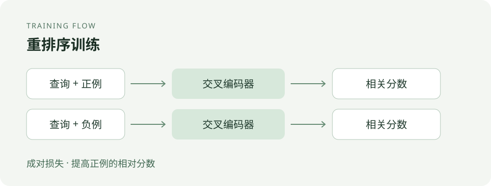
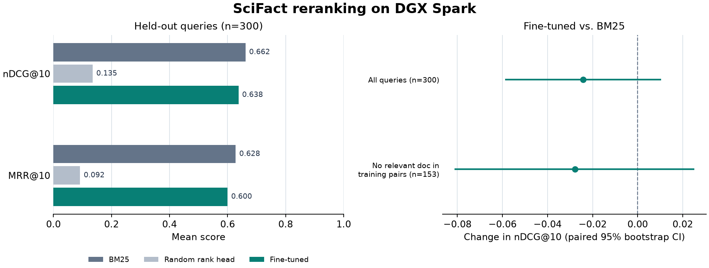

# 文本重排序模型微调

> 阅读导航：[检索与排序](../README.md) · [重排序体系导览](README.md) · [知识蒸馏与软标签监督](../知识蒸馏与软标签监督.md) · [稠密向量表示与最近邻检索](../embedding/稠密向量表示与最近邻检索.md) · 代码实践：[`reranker-finetuning`](../../../../experiments/reranker-finetuning/README.md)

在两阶段检索架构中，第一阶段双塔向量或 BM25 粗筛能够快速从全库海量候选（百万至亿级）中召回 Top-K 候选，但由于查询与文档缺乏深度交互，局部细微逻辑矛盾容易被忽视。交叉编码器（Cross-Encoder / Reranker）将查询与候选文档拼接后送入 Transformer 各层进行全自注意力交互，输出高精度的相关性标量。关于两阶段检索架构与匹配范式对比，参见 [检索系统全景与评估](../检索系统全景与评估.md)。本实验采用 390 条带有句级证据的英文科学论断训练 RoBERTa-base 交叉编码器，检验其改善 BM25 粗筛候选排序的能力，并结合 10,000 次配对 Bootstrap 采样分析指标分布。

---

## 一、核心原理

### 1. 全自注意力交互与排序打分头

交叉编码器不把查询和文档分别编码为独立向量，而是将文本序列拼接输入：
$$\mathbf{x} = [\text{[CLS]}, q_1, \dots, q_m, \text{[SEP]}, d_1, \dots, d_n, \text{[SEP]}]$$
在 Transformer 的每一层，查询中的每个 Token 与文档中的每个 Token 均进行双向注意力计算，直接捕捉跨词匹配。模型在最终隐藏状态的 `[CLS]` 向量上挂载单神经元线性层，输出实数相关性分数 $s(q, d) \in \mathbb{R}$。



### 2. 成对逻辑斯蒂损失（Pairwise Softplus Loss）推导

设查询为 $q$，正例文档为 $d^+$，负例文档代理为 $d^-$。交叉编码器分别输出打分 $s(q, d^+)$ 与 $s(q, d^-)$。
成对逻辑斯蒂损失函数定义为：

$$\mathcal{L}_{\text{pair}} = \log\left(1 + \exp\left[s(q, d^-) - s(q, d^+)\right]\right) = \operatorname{softplus}\left(s(q, d^-) - s(q, d^+)\right)$$

当正例得分远高于负例时，差值 $s(q, d^-) - s(q, d^+) \ll 0$，损失指数衰减趋于 0；当负例得分反超正例时，损失线性上升，促使模型调整权重拉大正负例分差。该目标学习的是同一查询下候选的相对排序偏好，输出值不代表绝对相关概率。

---

## 二、实验设计

### 1. 骨干模型与任务拓扑

- **骨干网络**：RoBERTa-base（12 层，768 维），在输出端随机初始化单输出打分头；
- **优化配置**：AdamW 优化器，学习率 $2 \times 10^{-5}$，最大输入序列长度 192 Token，BF16 自动混合精度；
- **输入截断策略**：当拼接总长度超过 192 时，保留完整查询，仅截断候选文档尾部。

### 2. SciFact 科学论断数据集与 Jaccard 近重复过滤

数据集基于科学事实核查基准 SciFact：
- **近重复过滤**：计算词集合 Jaccard 相似度，过滤掉与 300 条留出测试查询相似度 $\ge 0.80$ 的训练样本；
- **正负例构建**：正例取 BEIR 标注与 SciFact 原始句级证据文档的交集（共 390 条合格训练查询，对应 430 个正例对）；负例从 BM25 前 30 候选中抽取未标注的候选作为负例代理。

### 3. 三组排序条件与评估指标

所有方法在完全相同的 300 条留出测试查询（每条固定 30 个 BM25 候选）上评估：
1. **BM25 原始排序**；
2. **RoBERTa-base（随机初始化排序头，未微调）**；
3. **RoBERTa-base（微调 180 步）**。
评估指标采用 nDCG@10 与 MRR@10。其中 39 条测试查询因 BM25 候选内未包含真实正例而统一记为 0 分（无法通过重排修复）。

---

## 三、过程与开销

### 1. 批量前向与显存峰值开销

在单台计算设备（DGX Spark GB10）上运行记录：
- **训练开销**：180 步全参数微调耗时 15.22 秒，处理 1,434 个三元组；
- **推理打分开销**：为测试集 9,000 个 `(查询, 候选摘要)` 文本对完成联合前向打分耗时 13.91 秒；
- **显存占用**：全流程 PyTorch 峰值已分配显存为 **2.85 GiB**。

### 2. 训练收敛动态与梯度裁剪

训练曲线显示损失在 60~80 步内快速从初始的 0.69 降至 0.25 附近，随后进入平缓收敛阶段，梯度裁剪（`max_norm=1.0`）确保了训练未发生数值震荡。

---

## 四、实验结果与观察

### 1. 固定候选集排序指标（nDCG@10 与 MRR@10）



| 固定候选排序方式 | nDCG@10 | MRR@10 | 相对 BM25 变化 |
|---|---:|---:|---:|
| **BM25 原始排序** | **0.6617** | **0.6276** | 基线 (0.0000) |
| **RoBERTa-base，随机排序头** | 0.1351 | 0.0919 | -0.5266 |
| **RoBERTa-base，微调 180 步** | **0.6375** | **0.5998** | **-0.0242** |

### 2. 配对 Bootstrap 检验与查询升降级分布

- **查询得分升降分布**：相比 BM25 原序，微调后模型在 **51** 条查询上 nDCG@10 上升，在 **77** 条查询上下降，在 **172** 条查询上持平；
- **Bootstrap 置信区间**：按查询配对重采样 10,000 次，微调模型相对 BM25 的 nDCG@10 差值为 **−0.0241**，95% 置信区间为 **[−0.0589, 0.0105]**（跨越零点）；
- **纯未见标注子集**：在全部标注正例均未进入训练对的 153 条严格泛化查询上，nDCG@10 为 0.6069（BM25 为 0.6348），区间为 [−0.0813, 0.0251]。

### 3. 未微调排序头 vs 成熟 BM25 的工程启示

1. **从随机头到具备排序能力**：模型从随机头的 0.1351 提升至 0.6375，表明模型在 180 步内迅速掌握了论断与证据的配对逻辑；
2. **小样本微调难以直接击败成熟检索基线**：在仅有 390 条训练样本且从头训练打分头的前提下，模型的泛化排序表现略低于高度鲁棒的 BM25 词频统计基准。在生产场景中，直接采用大规模弱监督预训练的现成 Reranker（如 bge-reranker-large）微调，通常优于从通用语言模型加随机头冷启动。

---

## 五、代码与复现

### 1. 数据结构与逐查询证据明细

训练与评测数据记录保存于 `experiments/reranker-finetuning/evidence/`：
- **汇总报告**：[`evidence/summary.json`](../../../../experiments/reranker-finetuning/evidence/summary.json)
- **逐查询打分明细**：[`evidence/per-query.jsonl`](../../../../experiments/reranker-finetuning/evidence/per-query.jsonl)
- **训练损失轨迹**：[`evidence/training-curve.jsonl`](../../../../experiments/reranker-finetuning/evidence/training-curve.jsonl)

### 2. 脚本命令与验证入口

- **实验代码入口**：[`experiments/reranker-finetuning`](../../../../experiments/reranker-finetuning/README.md)
- **训练执行命令**：
  ```bash
  python experiments/reranker-finetuning/scripts/train.py \
      --model_name_or_path roberta-base \
      --num_steps 180 \
      --learning_rate 2e-5 \
      --batch_size 8
  ```

---

## 六、参考资料

1. **Sentence-BERT / Cross-Encoder (EMNLP 2019)**: Reimers, N., & Gurevych, I. *Sentence-BERT: Sentence Embeddings using Siamese BERT-Networks*. In Proceedings of EMNLP 2019. [ACL:D19-1410](https://aclanthology.org/D19-1410/).
2. **SciFact (EMNLP 2020)**: Wadden, D., Lin, S., Lo, K., Wang, L. L., van Zuylen, M., Cohan, A., & Hajishirzi, H. *Fact or Fiction: Verifying Scientific Claims with Evidence*. In Proceedings of EMNLP 2020. [arXiv:2004.14974](https://arxiv.org/abs/2004.14974).
3. **BEIR Benchmark (NeurIPS 2021 Datasets & Benchmarks)**: Thakur, N., Reimers, N., Rücklé, A., Srivastava, A., & Gurevych, I. *BEIR: A Heterogeneous Benchmark for Zero-shot Evaluation of Information Retrieval Models*. [arXiv:2104.08663](https://arxiv.org/abs/2104.08663).
